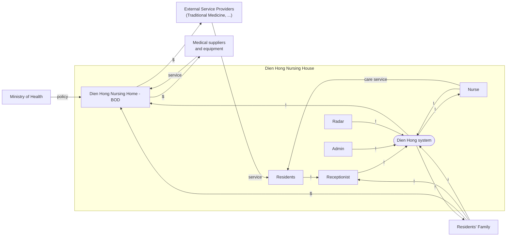

# CVCA: Dien Hong

The Customer Value Chain Analysis lists every stakeholder of the Dien Hong Nursing House and
what flows between them: money (`$`), information (`!`) and goods or services. It is drawn before
the system is designed, to find the problems and opportunities.

| Field | Value |
|---|---|
| Version | v1.1 |
| Next | [Context Diagram](context-diagram.md) |

## 1. Value chain (with the new system)

The dashed box is the Dien Hong Nursing Home. Everything outside it is an outside stakeholder.

## Legend

| Symbol | Meaning |
|---|---|
| `!` | Resident information, condition updates, alerts, messages, reports, accounts |
| `$` | Money |
| Service | Care service, policy |

## 2. Problems and opportunities

| #   | Stakeholder        | Problem or opportunity                                                                                                          |
| --- | ------------------ | ------------------------------------------------------------------------------------------------------------------------------- |
| P-1 | Nurse              | A resident's condition is spread over paper notes, so the nurse has no quick overview and may learn of a problem late.          |
| P-2 | Nurse              | Care given and condition changes are written down inconsistently, so the next shift lacks reliable information.                 |
| P-3 | Residents' Family  | The family only hears about their relative's condition when they call or visit, and alerts reach them late.                     |
| P-4 | Residents' Family  | There is no simple way to send a question or message to the staff and get an answer.                                            |
| P-5 | Receptionist       | Resident and family information is recorded by hand and is hard to keep up to date.                                             |
| P-6 | BOD                | No summary of residents' condition and care activity, so management decisions rely on verbal reports.                           |
## 3. Stakeholder requirements

| ID     | Stakeholder requirement                                                                              | From     | CVCA flow            |
| ------ | ---------------------------------------------------------------------------------------------------- | -------- | -------------------- |
| StR-01 | Nurses shall be able to see a resident's current condition and care information in one place.        | P-1      | DH -> NUR            |
| StR-02 | Nurses shall be able to receive an alert when a resident's condition needs attention.                | P-1      | RAD -> DH -> NUR     |
| StR-03 | Nurses shall be able to record the care they gave and any change in a resident's condition.          | P-2      | NUR -> DH            |
| StR-04 | Nurses shall be able to see what was recorded in earlier shifts when they take over.                 | P-2      | DH -> NUR            |
| StR-05 | Residents' Family shall be able to see their relative's condition updates.                           | P-3      | DH -> FAM            |
| StR-06 | Residents' Family shall be able to be told promptly when their relative has an alert.                | P-3      | DH -> FAM            |
| StR-07 | Residents' Family shall be able to send a message to the staff and read the answer.                  | P-4      | FAM -> DH            |
| StR-08 | Receptionists shall be able to record and update resident and family information.                    | P-5      | REC -> DH            |
| StR-09 | The BOD shall be able to view reports on residents' condition and care activity.                     | P-6      | DH -> BOD            |

## Change log

| Version | Change | Why |
|---|---|---|
| v1.0 | First version | |
| v1.1 | Added the flows between the system and the Residents' Family (alerts and condition to the family, messages from the family); added Admin; renamed the Receptionist label; changed the legend | The family is the main receiver of the new system's information, and the Context Diagram needs the Admin |
