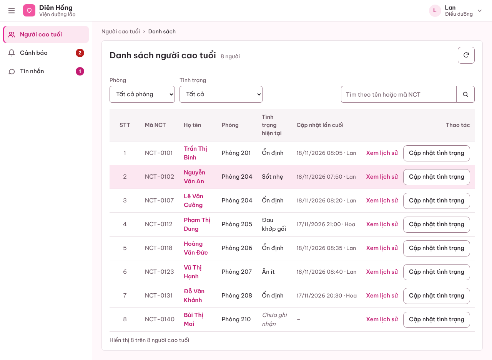
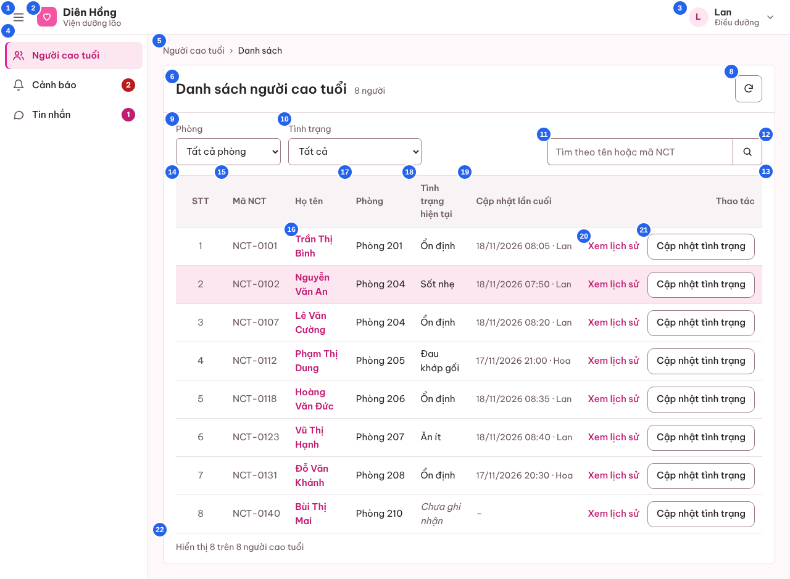
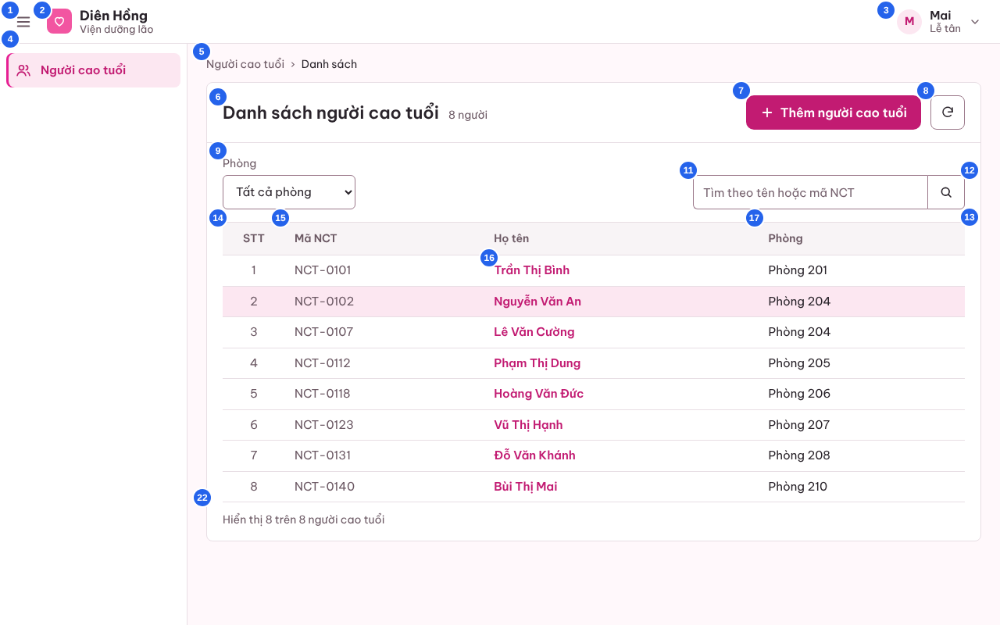
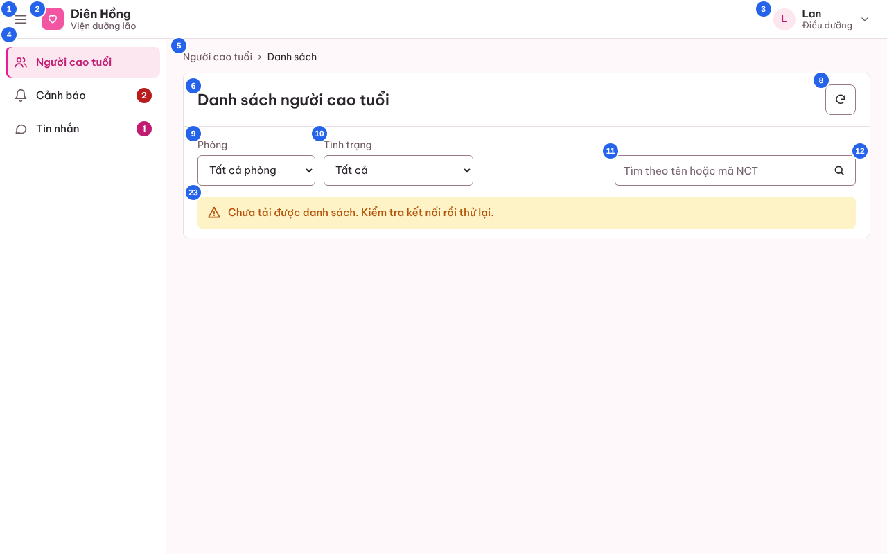

# Screen Spec: S-F01-01 Resident list (web)

| Field | Value |
|---|---|
| Screen ID | S-F01-01 |
| Screen name | Resident list |
| Layout | Web and tablet, 768px and wider ([ui-conventions](../ui-conventions.md) 3.1, 3.2). Below 768px: [screen-spec-S-F01-01-mobile.md](screen-spec-S-F01-01-mobile.md) |
| Actor | Receptionist, Nurse |
| Priority | Must |
| Feature | F-01 Resident Profile Management (the nurse's actions lead into F-02 Condition Tracking) |
| Activity diagrams | AD-UC-02 (action `a1` "Select the resident"), AD-UC-05 (action `a1` "Select resident"); AD-UC-01 starts from here with "New resident"; UC-03 and UC-04 have no activity diagram (usage flow: "not needed") |
| Mockup images | `img/S-F01-01-web.png` (default, Nurse), `img/S-F01-01-web-receptionist.png`, three numbered images, four state images (section 2) |
| Frame width | 1280px (exported at 1x) |
| Figma frame | not used (drawn on the Design canvas "Diên Hồng – UI preview", artboard "Web · S-F01-01 Danh sách người cao tuổi") |
| Status | Draft |

## 1. Purpose

**Shown when:** a Receptionist or a Nurse has signed in (this is their home screen, FR-00-01), comes
back from a resident's screen, taps "Người cao tuổi" in the menu, or a refused request has sent
them home (FR-06-03). The user picks the resident to work on; the receptionist can also start a
new resident.

**The user leaves this screen when:** they open a resident's profile (S-F01-02), and for the
Nurse the resident's condition history (S-F02-01) or the update of their condition (S-F02-02); the
Receptionist starts a new resident (S-F01-03); the Nurse opens Alerts (S-F03-01) or Chat
(S-F04-01); or the user signs out.

## 2. Mockup

**Numbered:** each number is the # of the element inventory in section 3. Element 7 (New resident)
appears only for the Receptionist, so it is numbered on the receptionist image. Element 23 (Message
area) appears only in the empty and error states, so it is numbered on the error image.

| Default (Nurse), numbered | Receptionist, numbered | Error, numbered |
|---|---|---|
|  |  |  |

| State | Image |
|---|---|
| Default | `img/S-F01-01-web.png` (Nurse), `img/S-F01-01-web-receptionist.png` (Receptionist) |
| Empty | `img/S-F01-01-web-empty.png` (no resident matches the search) |
| Loading | `img/S-F01-01-web-loading.png` |
| Error | `img/S-F01-01-web-error.png` (the list cannot be loaded; the access-denied message is described in section 4 only) |
| Success | none: this screen saves nothing (section 4) |

All colours, fonts and corners come from the design tokens in
[ui-conventions.md](../ui-conventions.md#7-design-tokens), whose values live in
[design-tokens.css](../design-tokens.css).

**Mockup status:** drawn on the canvas as the artboard "Web · S-F01-01 Danh sách người cao tuổi".
Its Tweaks switch the role (Điều dưỡng, Lễ tân) and the state (Mặc định, Trống, Đang tải, Lỗi, Bị
từ chối quyền), one image per row of the state table; filters, search and Reload work in Play. The
numbered images still have to be annotated.

## 3. Element inventory

Labels are shown as they appear in the interface (Vietnamese), with the repository label in
brackets. "Nurse only" and "Receptionist only" elements are not rendered for the other role.

| # | Element | Type | Content / data source | Required | Validation |
|---|---|---|---|---|---|
| 1 | Menu button | Icon button | static: accessible name "Thu gọn menu" (Collapse menu) | Yes | none |
| 2 | Brand | Image + text | static: logo mark on colour/brand-pink, "Diên Hồng", "Viện dưỡng lão" | Yes | |
| 3 | Account menu | Menu button | `user.name`, role name (`user.role`); item "Đăng xuất" (Sign out) | Yes | none |
| 4 | Sidebar menu | Navigation | the role's items (ui-conventions 3.4): Nurse "Người cao tuổi" (current), "Cảnh báo" with the number of `alert` whose `alert.status` is New or Escalated (Alert Log), "Tin nhắn" with the number of unread `chat_message` for this user (Chat Message); Receptionist "Người cao tuổi" only. The top bar shows no counters (ui-conventions 3.2) | Yes | counters hidden at 0; "99+" above 99 |
| 5 | Breadcrumb | Text | static: "Người cao tuổi › Danh sách" | Yes | |
| 6 | Title and count | Header | "Danh sách người cao tuổi" (Resident list) + number of rows after filters and search, "n người" | Yes | |
| 7 | New resident | Primary button | label "Thêm người cao tuổi" (New resident), in the title row | Receptionist only | none |
| 8 | Reload | Icon button | static: accessible name "Tải lại danh sách" (Reload the list) | Yes | none |
| 9 | Room filter | Select | label "Phòng" (Room): "Tất cả phòng" (All rooms) + each `resident.room` in use | Yes | one value |
| 10 | Condition filter | Select | label "Tình trạng" (Condition): "Tất cả" (All), "Chưa ghi nhận hôm nay" (No record today: no `condition_record.saved_at` on today's date) | Nurse only | one value |
| 11 | Quick search | Search field | placeholder "Tìm theo tên hoặc mã NCT" (Search by name or resident ID); matches `resident.full_name` and `resident.resident_id` | No | none (SR-004) |
| 12 | Search | Secondary button, joined to field 11 | static: magnifier icon, accessible name "Tìm" (Search) | Yes | none |
| 13 | Resident table | Data table | one row per resident in the Resident Profile data group that matches the filters and the search | Yes | |
| 14 | No. | Column "STT" | row number, 1, 2, 3 in the order shown | Yes | |
| 15 | Resident ID | Column "Mã NCT" | `resident.resident_id` (BR-01) | Yes | |
| 16 | Full name | Link, column "Họ tên" | `resident.full_name` | Yes | |
| 17 | Room | Column "Phòng" | "Phòng " + `resident.room` | Yes | |
| 18 | Current condition | Column "Tình trạng hiện tại" | `condition_record.condition` of the resident's most recent record; "Chưa ghi nhận" (No record yet) in colour/text-tertiary italics when there is none | Nurse only | |
| 19 | Last update | Column "Cập nhật lần cuối" | `condition_record.saved_at` (dd/MM/yyyy HH:mm) · `condition_record.nurse_name` of the same record (FR-02-02); "–" when there is none | Nurse only | |
| 20 | View history | Link, column "Thao tác" | label "Xem lịch sử" (View history) | Nurse only | none |
| 21 | Update condition | Secondary button, column "Thao tác" | label "Cập nhật tình trạng" (Update condition) | Nurse only | none |
| 22 | Footer count | Text | "Hiển thị n trên N người cao tuổi" (Showing n of N residents) | Yes | |
| 23 | Message area | Banner | empty, error and access-denied messages of section 4 (FR-06-03) | No | |

## 4. States

| State | What the user sees | Trigger |
|---|---|---|
| Default | Table of residents ordered by room, then name (SR-003). The row of the resident last opened from this screen is on colour/pink-light (SR-006). The mockup shows this state for the Nurse, with the row of Nguyễn Văn An selected. | Screen opened, residents loaded |
| Empty (no data) | No table. Information banner (23) on colour/info-bg. No resident at all: Receptionist "Chưa có người cao tuổi nào. Hãy thêm người đầu tiên." (No resident yet. Add the first resident.) (new), with element 7 still in the title row; Nurse "Chưa có người cao tuổi nào." (No resident yet.) (new). No match: "Không có người cao tuổi nào khớp với “Hùng”. Kiểm tra lại tên hoặc mã NCT." (No resident matches “Hùng”. Check the name or the resident ID.); when only the filters leave no row: "Không có người cao tuổi nào khớp với bộ lọc đã chọn." (No resident matches the chosen filters.) (new); filters and search stay as typed | The Resident Profile data group is empty, or no resident matches the filters and the search |
| Loading | 8 placeholder rows on colour/surface-secondary in place of the table; elements 8–12 disabled; count in element 6 hidden | List being fetched (screen opened, Reload, filter or search changed) |
| Error | Warning banner (23) on colour/warning-bg: "Chưa tải được danh sách. Kiểm tra kết nối rồi thử lại." (The list cannot be loaded. Check your connection and try again.) (new), no table; element 8 stays enabled. Second case: after a refused request (FR-06-03), the list loads normally with the warning banner "Bạn không có quyền dùng chức năng đó. Bạn đã được đưa về màn hình chính." (You do not have access to that function. You are back on your home screen.) above the table until the user leaves the screen | The request failed, or the user was sent home by an access-denied refusal |
| Success / confirmation | None on this screen: no action here saves data. S-F01-03 and S-F02-02 show their own confirmation | – |

For a Nurse, the real-time alert pop-up of S-F03-01 can open over this screen in any state
(FR-03-02, Screen List "Modals and overlays"); it is specified with the alert screens.

Messages marked (new) follow the patterns of [ui-conventions](../ui-conventions.md) section 5 but
are not listed there yet (open question 5).

## 5. Interactions and navigation

| # | Element | User action | System response | Goes to screen |
|---|---|---|---|---|
| 1 | Full name (16) | click | Opens the resident's profile ("taps a resident", "selects a resident to view the profile") | S-F01-02 |
| 2 | View history (20) | click | Opens the resident's condition records in time order (FR-02-04) | S-F02-01 |
| 3 | Update condition (21) | click | Opens the record dialog over this list (ui-conventions 3.3) | S-F02-02 |
| 4 | New resident (7) | click | Opens the record dialog, form only | S-F01-03 |
| 5 | Room filter (9), Condition filter (10) | choose a value | List filtered at once; elements 6 and 22 update; the filter stays visible | stays |
| 6 | Search (12), or Enter in field 11 | click or key | List filtered by name or resident ID (SR-004); no match gives the Empty state | stays |
| 7 | Reload (8) | click | Fetches the list again (Loading, then Default or Error) | stays |
| 8 | "Cảnh báo" in the menu (4) | click | Opens the open alerts ("taps Alerts in the menu") | S-F03-01 |
| 9 | "Tin nhắn" in the menu (4) | click | Opens the conversations ("taps Chat in the menu") | S-F04-01 |
| 10 | Menu button (1) | click | Collapses the sidebar to icons (64px), or opens it again | stays |
| 11 | "Đăng xuất" in the account menu (3) | click | Ends the session | S-F00-01 |
| 12 | Real-time alert pop-up (system) | a new or repeated alert arrives (Nurse) | Pop-up with sound over this screen (FR-03-02, FR-03-04); "Acknowledge" records the acknowledgement (FR-03-03) and opens the alert list ("taps the notice") | S-F03-01 |

## 6. Screen-level rules

| Rule ID | Rule | Source |
|---|---|---|
| SR-001 | The "Cảnh báo" and "Tin nhắn" items of element 4, element 10 and elements 18–21 are rendered for the Nurse only, element 7 for the Receptionist only. The API Server checks the role on every request; hiding an element is never the only check. | FR-02-02, FR-01-01, ADR-003 |
| SR-002 | Elements 18 and 19 always show the resident's most recent saved condition record; earlier records are listed only on S-F02-01. | FR-02-02, FR-02-03, BR-04 (same rule as for families) |
| SR-003 | Rows are ordered by room, then by given name (the last word of the full name, as Vietnamese lists are ordered), then by the rest of the name; element 14 numbers the rows shown, in that order. | ui-conventions §2 (Row number in a table) |
| SR-004 | The search trims spaces, ignores capitals and Vietnamese diacritics ("hung" finds "Hùng"), and matches any part of the full name or the resident ID. | ui-conventions §5 (No search match) |
| SR-005 | The applied filters and search text stay visible above the table and are kept when the user comes back from S-F01-02, S-F02-01 or S-F02-02. | ui-conventions §4 (Filter bar) |
| SR-006 | The row of the resident last opened from this screen is selected (colour/pink-light) when the user comes back, so the user finds their place. | ui-conventions §7.3 |
| SR-007 | "Chưa ghi nhận" is written in words; no state on this screen is shown by colour alone. | ui-conventions §6, WCAG 2.2 1.4.1 |
| SR-008 | Each counter appears once, on its menu item (4), never also in the top bar. The "Cảnh báo" counter counts alerts that are New or Escalated and disappears at 0; red (colour/error) on this screen is used only for that counter. | ui-conventions 3.2, §4, §7.2 |

## 7. Linked requirements

| FR ID | What this screen does for it |
|---|---|
| FR-00-01 | Home screen of the Receptionist and the Nurse after sign-in |
| FR-01-01 | "New resident" starts the creation of a resident profile (S-F01-03) |
| FR-01-02 | The Receptionist selects here the resident whose information will be updated (through S-F01-02) |
| FR-01-03 | Opens the profile of the selected resident |
| FR-02-02 | The Nurse selects here the resident whose condition will be updated; the list shows the time and the nurse's name of the latest record |
| FR-02-04 | "View history" opens the condition history of the resident |
| FR-03-02 | Shows the alert counter on the menu, and the real-time alert pop-up can open over this screen |
| FR-06-03 | Shows the access-denied message when a refused request sends the user home |

## 8. Responsive and accessibility notes

- 1024px and wider: sidebar 240px with labels; content padding 24px; table text 15px
  (ui-conventions 3.1, 7.5).
- 768–1023px: sidebar with icons only (64px); the toolbar wraps; the table keeps its columns
  (at least 880px) and scrolls sideways inside its card. Below 768px the phone layout applies.
- Table headers are `<th scope="col">`; every row is at least 48px tall; the full name, View history
  and Update condition are reachable with Tab, and their accessible names include the resident
  ("Cập nhật tình trạng, Nguyễn Văn An").
- Counters have text names for screen readers ("2 cảnh báo chưa tiếp nhận").
- Focus shows the 2px colour/primary ring; hover on a row uses colour/pink-soft; text contrast is
  at least 4.5:1 on every background used here (ui-conventions 7.6).

## 9. Open questions

| # | Question | Blocking? | Status |
|---|---|---|---|
| 1 | [NEEDS CLARIFICATION: how many residents will the list hold, and does it need pages?] | No | Open. Default: all residents on one page; the header row stays visible while scrolling. |
| 2 | [NEEDS CLARIFICATION: should the list refresh by itself when another nurse saves a condition?] | No | Open. Default: refresh when the screen opens and on Reload; alerts already arrive in real time. |
| 3 | [NEEDS CLARIFICATION: does the Receptionist need any condition information on this list?] | No | Open. Default: no; recording conditions belongs to the Nurse (F-02). |
| 4 | The format of the resident ID is not defined (BR-02); "NCT-0101" in the mockup is an example. | No | Open. |
| 5 | The messages marked (new) in section 4 are not in ui-conventions section 5. | No | Open. Add them at the next revision of the conventions. |

---

## Completion checklist

- [ ] The mockup is a separate cropped image file, named with the Screen ID, at the frame width.
- [ ] The numbered image exists, and its numbers match the # column of the element inventory.
- [x] Every visible element in the mockup appears in the element inventory.
- [x] Every colour in the mockup is a design token from ui-conventions.md.
- [x] Every input element has a validation rule or an explicit "none".
- [x] All five states are filled in.
- [x] Every navigation target is a Screen ID that exists in the Screen List.
- [x] Every element that displays data names the field it displays.
- [x] Every linked FR exists in the Function List, and every action of this screen in AD-UC-02 and
      AD-UC-05 is covered by an interaction row.
