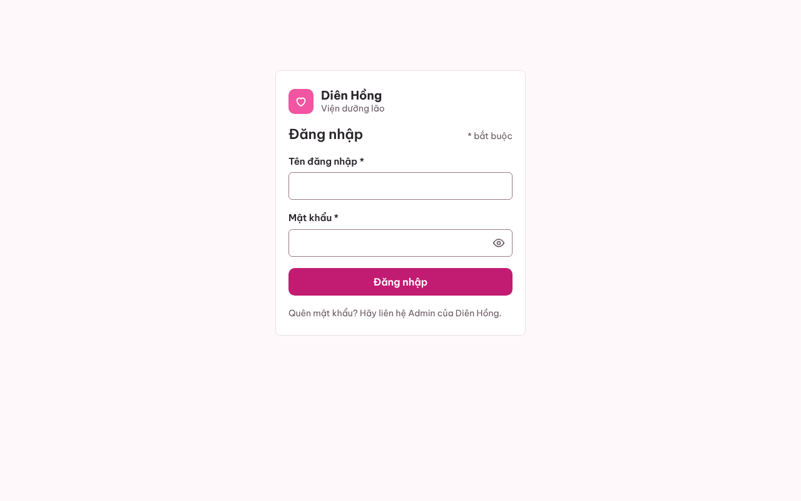
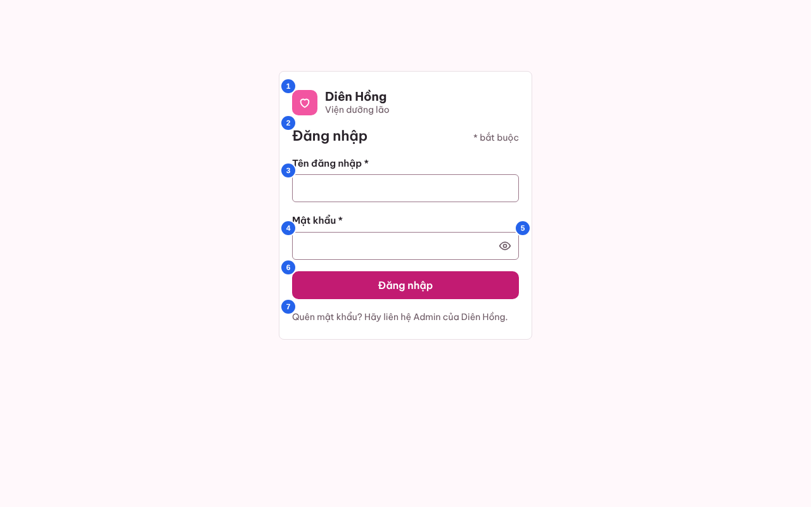
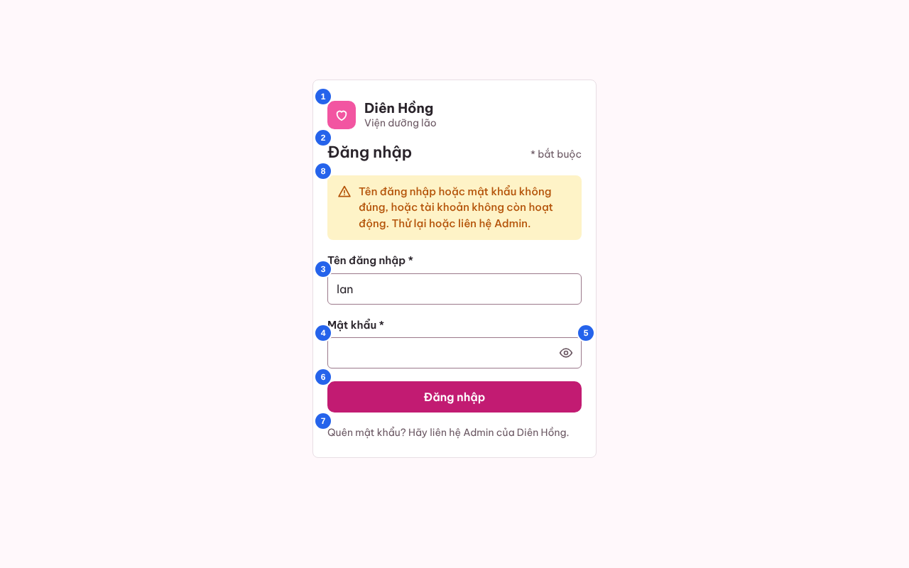

# Screen Spec: S-F00-01 Sign in (desktop)

| Field | Value |
|---|---|
| Screen ID | S-F00-01 |
| Screen name | Sign in |
| Layout | Web and tablet, 768px and wider ([ui-conventions](../ui-conventions.md) 3.1). Below 768px: [screen-spec-S-F00-01-mobile.md](screen-spec-S-F00-01-mobile.md) |
| Actor | Receptionist, Nurse, Residents' Family, BOD, Admin |
| Priority | Must |
| Feature | F-00 Platform and Access |
| Activity diagrams | none: Sign in has no use case; it is the precondition "signed in" of every activity diagram (AD-UC-01, open question 4) |
| Mockup images | `img/S-F00-01-web.png` (default), `img/S-F00-01-web-numbered.png`, four state images (section 2) |
| Frame width | 1280px (exported at 1x); the sign-in card is 400px wide |
| Figma frame | not used (drawn on the Design canvas "Diên Hồng – UI preview") |
| Status | Draft |

## 1. Purpose

**Shown when:** a user opens the Dien Hong System for the first time, opens any link while signed
out, or their session has ended (Sign out, or the account was deactivated, FR-06-07).

**The user leaves this screen when:** the sign-in succeeds and the home screen of their role opens
(FR-00-01). There is no other way out: every other screen needs a session (ADR-003).

## 2. Mockup

**Numbered:** each number is the # of the element inventory in section 3. Element 8 (Message
area) appears only in the error and session-ended states, so it is numbered on the error image.

| Default, numbered | Error, numbered |
|---|---|
|  |  |

| State | Image |
|---|---|
| Default | `img/S-F00-01-web.png` |
| Empty | `img/S-F00-01-web-empty.png` (field errors after Sign in with empty fields) |
| Loading | `img/S-F00-01-web-loading.png` |
| Error | `img/S-F00-01-web-error.png` (sign-in refused, FR-00-01; the network error is described in section 4 only) |
| Success | none: the home screen of the role opens at once (section 4) |

All colours, fonts and corners come from the design tokens in
[ui-conventions.md](../ui-conventions.md#7-design-tokens), whose values live in
[design-tokens.css](../design-tokens.css).

**Mockup status:** drawn on the canvas as the artboard "Web · S-F00-01 Đăng nhập". Its Tweaks
switch the state (Mặc định, Phiên đã kết thúc, Ô trống, Đang đăng nhập, Từ chối đăng nhập, Lỗi kết
nối), one image per row of the state table. Every image named in this section is
exported from it into `img/`.

## 3. Element inventory

Labels are shown as they appear in the interface (Vietnamese), with the repository label in
brackets.

| # | Element | Type | Content / data source | Required | Validation |
|---|---|---|---|---|---|
| 1 | Brand | Image + text | static: logo mark on colour/brand-pink, "Diên Hồng", "Viện dưỡng lão" | Yes | |
| 2 | Title | Header | static: "Đăng nhập" (Sign in), and the line "* bắt buộc" (* required) | Yes | |
| 3 | Identifier | Text field | label "Tên đăng nhập *" (Identifier); typed by the user, sent as `account.identifier` | Yes | not empty after trimming spaces; no format rule (identifiers are set by the Admin, FR-06-04) |
| 4 | Password | Password field | label "Mật khẩu *" (Password); typed by the user, sent with the identifier, never shown or stored on the device | Yes | not empty; spaces kept |
| 5 | Show password | Toggle button, inside field 4 | static: eye icon; accessible name "Hiện mật khẩu" / "Ẩn mật khẩu" | Yes | none |
| 6 | Sign in | Primary button | label "Đăng nhập" (Sign in); full card width | Yes | always enabled; checks fields 3 and 4 when tapped |
| 7 | Help line | Text | static: "Quên mật khẩu? Hãy liên hệ Admin của Diên Hồng." (Forgot your password? Contact the Admin of Diên Hồng.) | Yes | |
| 8 | Message area | Banner | error and information messages of section 4 (FR-00-01, FR-06-07) | No | |

## 4. States

| State | What the user sees | Trigger |
|---|---|---|
| Default | Card with fields 3 and 4 empty and focus in field 3; Sign in enabled. The mockup shows this state. | Screen opened while signed out |
| Default, session ended | As Default, with an information banner (8) on colour/info-bg: "Phiên đăng nhập đã kết thúc. Hãy đăng nhập lại." (Your session has ended. Sign in again.) (new) | Opened after Sign out, or after the account's session was ended (FR-06-07) |
| Empty (no data) | No stored data is shown on this screen. When Sign in is tapped with an empty field, that field gets a 2px colour/warning edge and an inline error under it on colour/warning-bg: "Nhập tên đăng nhập." (Enter the identifier.) (new) or "Nhập mật khẩu." (Enter the password.) (new); focus moves to the first field with an error | Sign in tapped with field 3 or 4 empty |
| Loading | Sign in shows a spinner and "Đang đăng nhập…" (Signing in…) and is disabled; fields 3 and 4 are read-only | Sign-in request sent, no answer yet |
| Error | Warning banner (8) on colour/warning-bg: "Tên đăng nhập hoặc mật khẩu không đúng, hoặc tài khoản không còn hoạt động. Thử lại hoặc liên hệ Admin." (The account or password is not correct, or the account is no longer active. Try again or contact the Admin.) Identifier kept, password cleared, focus on the banner (FR-00-01). Second error: "Chưa đăng nhập được. Kiểm tra kết nối rồi thử lại." (Cannot sign in right now. Check your connection and try again.) (new), both fields kept | Sign-in refused (wrong identifier, wrong password or Inactive account), or the request failed |
| Success / confirmation | No confirmation screen: the session starts and the home screen of the role opens at once (SR-003) | Identifier and password of an Active account (FR-00-01) |

Messages marked (new) follow the patterns of [ui-conventions](../ui-conventions.md) section 5 but
are not listed there yet (open question 4).

## 5. Interactions and navigation

| # | Element | User action | System response | Goes to screen |
|---|---|---|---|---|
| 1 | Identifier | Enter key | Moves focus to the password field | stays |
| 2 | Password | Enter key | Same as tapping Sign in | as row 4 |
| 3 | Show password | click | Shows or hides the password; the icon and accessible name switch | stays |
| 4 | Sign in | click [fields valid, account Active] | Starts the session and records the sign-in (FR-00-01, FR-06-13) | S-F01-01 (Receptionist, Nurse), S-F04-02 (Residents' Family), S-F05-01 (BOD), S-F06-01 (Admin) |
| 5 | Sign in | click [a field empty] | Shows the field errors of the Empty state; nothing is sent | stays |
| 6 | Sign in | click [refused or no connection] | Shows the matching Error state | stays |

## 6. Screen-level rules

| Rule ID | Rule | Source |
|---|---|---|
| SR-001 | A wrong identifier, a wrong password and an Inactive account get the same message; the screen never says which one it was. | FR-00-01, FR-06-07 |
| SR-002 | After a refusal the identifier is kept and the password is cleared. | FR-00-01 |
| SR-003 | A successful sign-in always opens the home screen of the user's role, as in the menu table of ui-conventions 3.4. | FR-00-01 |
| SR-004 | Paste and password managers work in both fields (`autocomplete="username"` and `autocomplete="current-password"`); no puzzle or memory test is asked. | WCAG 2.2, 3.3.8 |
| SR-005 | A signed-in user who opens this screen's address goes straight to their home screen. | FR-00-01 |
| SR-006 | The screen is served over HTTPS only. | ui-conventions 3.6, ADR-005 |
| SR-007 | Every later request carries the session token, and the API Server checks it; this screen is never the only check. | ADR-003, BR-13 |

## 7. Linked requirements

| FR ID | What this screen does for it |
|---|---|
| FR-00-01 | Takes the identifier and password, starts the session and opens the home screen of the role, or refuses with a message |
| FR-06-07 | Refuses an Inactive account with the same message; shows the session-ended banner after a deactivation |
| FR-06-13 | Each successful sign-in is recorded with the user and the time |

## 8. Responsive and accessibility notes

- From 768px: card 400px wide, centred on colour/background, card padding 20px, radius 8px
  (ui-conventions 3.5, 7.5). Below 768px the phone layout applies.
- Fields and Sign in are 44px tall; labels sit above the fields; "*" and the line "* bắt buộc" in
  colour/text-primary, never red (red is kept for resident alerts).
- Field edges colour/border-strong (3.9:1); focus shows a 2px colour/primary edge; every control
  shows the 2px colour/primary focus ring when reached with the keyboard.
- Errors are linked to their fields (`aria-describedby`, `aria-invalid="true"`); the banner is
  announced (`role="alert"`).
- The page language is Vietnamese (`lang="vi"`) and zoom stays allowed.

## 9. Open questions

| # | Question | Blocking? | Status |
|---|---|---|---|
| 1 | [NEEDS CLARIFICATION: should an account be locked for a while after several refused sign-ins?] | No | Open. Default: no lock in Release 1; W1 has no such function. |
| 2 | [NEEDS CLARIFICATION: when a link was opened while signed out (for example a push notice to S-F03-01), should the user land on that screen after signing in?] | No | Open. Default: the home screen of the role, as FR-00-01 says. |
| 3 | [NEEDS CLARIFICATION: how long does a session last, on the phone and on a computer?] A nurse whose session ends can no longer see the in-app alert pop-up (FR-03-02). | No | Open. Default: the session lasts until Sign out or deactivation (FR-06-07). |
| 4 | The messages marked (new) in section 4 are not in ui-conventions section 5. | No | Open. Add them at the next revision of the conventions. |

---

## Completion checklist

- [x] The mockup is a separate cropped image file, named with the Screen ID, at the frame width.
- [x] The numbered image exists, and its numbers match the # column of the element inventory.
- [x] Every visible element in the mockup appears in the element inventory.
- [x] Every colour in the mockup is a design token from ui-conventions.md.
- [x] Every input element has a validation rule or an explicit "none".
- [x] All five states are filled in.
- [x] Every navigation target is a Screen ID that exists in the Screen List.
- [x] Every element that displays data names the field it displays.
- [x] Every linked FR exists in the Function List, and every action of this screen is covered by an
      interaction row (no activity diagram covers Sign in).
