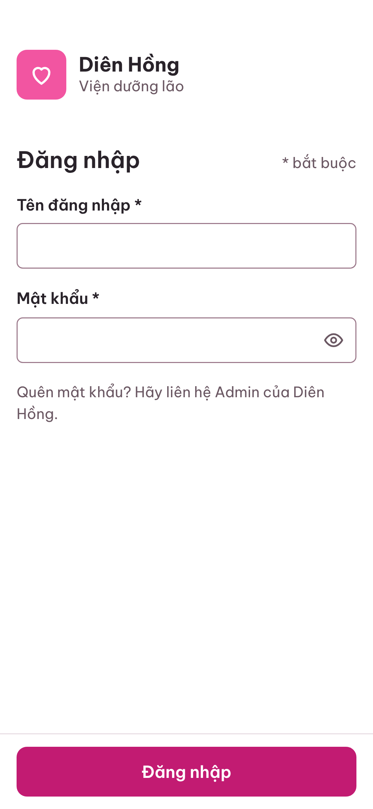
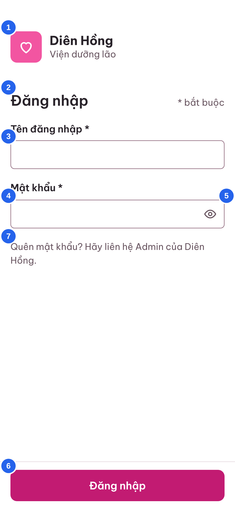
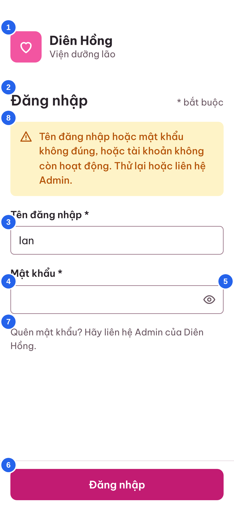
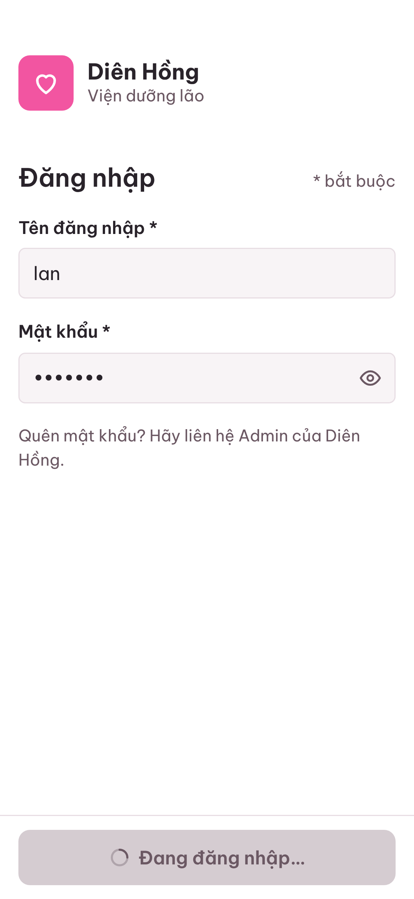
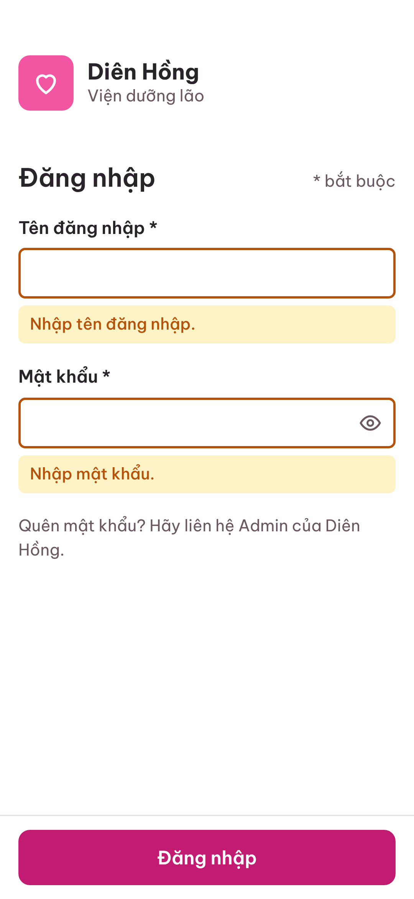

# Screen Spec: S-F00-01 Sign in (mobile)

| Field | Value |
|---|---|
| Screen ID | S-F00-01 |
| Screen name | Sign in (interface label: "Đăng nhập") |
| Actor | Receptionist, Nurse, Residents' Family, BOD, Admin (on the phone mostly Nurse and Residents' Family, ADR-001) |
| Priority | Must |
| Feature | F-00 Platform and Access |
| Activity diagrams | none: Sign in has no use case; it is the precondition "signed in" of every activity diagram (AD-UC-01, open question 4) |
| Mockup images | `img/S-F00-01-mobile.png` (default), two numbered images, three state images (section 2) |
| Frame width | 360px (exported at 3x, 1080 pixels) |
| Figma frame | not used (drawn as an HTML wireframe) |
| Status | Done |

## 1. Purpose

**Shown when:** a user opens the app for the first time, opens any link or push notice while signed
out, or their session has ended (Sign out, or the account was deactivated, FR-06-07).

**The user leaves this screen when:** the sign-in succeeds and the home screen of their role opens
(FR-00-01). There is no other way out: every other screen needs a session (ADR-003).

## 2. Mockup

**Numbered:** each number is the # of the element inventory in section 3. Element 8 (Message area) appears only in the error state and in the situations of section 4, so it is numbered on the error image.

| Default, numbered | Error, numbered |
|---|---|
|  |  |

| Loading | Empty |
|---|---|
|  |  |

| State | Image |
|---|---|
| Default | img/S-F00-01-mobile.png |
| Empty | img/S-F00-01-mobile-empty.png (field errors after Sign in with empty fields) |
| Loading | img/S-F00-01-mobile-loading.png |
| Error | img/S-F00-01-mobile-error.png (sign-in refused, FR-00-01) |
| Success | Not drawn: the session starts and the home screen of the role opens at once, with no confirmation screen (section 4) |

All colours, fonts and corners come from the design tokens in [ui-conventions.md](../ui-conventions.md#7-design-tokens), whose values live in [design-tokens.css](../design-tokens.css).

## 3. Element inventory

Labels are shown as they appear in the interface (Vietnamese), with the repository label in
brackets. The numbers are the same as in the desktop spec.

| # | Element | Type | Content / data source | Required | Validation |
|---|---|---|---|---|---|
| 1 | Brand | Image + text | static: logo mark on colour/brand-pink, "Diên Hồng", "Viện dưỡng lão"; top of the screen | Yes | |
| 2 | Title | Header | static: "Đăng nhập" (Sign in), and the line "* bắt buộc" (* required) | Yes | |
| 3 | Username | Text field | label "Tên đăng nhập *" (Username); typed by the user, sent as `account.identifier` | Yes | not empty after trimming spaces; no format rule (usernames are set by the Admin, FR-06-04) |
| 4 | Password | Password field | label "Mật khẩu *" (Password); typed by the user, sent with the username, never shown or stored on the phone | Yes | not empty; spaces kept |
| 5 | Show password | Toggle button, inside field 4 | static: eye icon, 44 × 44px target; accessible name "Hiện mật khẩu" / "Ẩn mật khẩu" | Yes | none |
| 6 | Sign in | Primary button | label "Đăng nhập" (Sign in); full width, fixed at the bottom | Yes | always enabled; checks fields 3 and 4 when tapped |
| 7 | Help line | Text | static: "Quên mật khẩu? Hãy liên hệ Admin của Diên Hồng." (Forgot your password? Contact the Admin of Diên Hồng.); under field 4 | Yes | |
| 8 | Message area | Banner | error and information messages of section 4 (FR-00-01, FR-06-07); above field 3 | No | Shown only in the Error state and the situations below section 4 |

## 4. States

| State | What the user sees | Trigger |
|---|---|---|
| Default | Fields 3 and 4 empty; Sign in fixed at the bottom and enabled. The keyboard does not open by itself, so the whole screen is visible first. The mockup shows this state. | Screen opened while signed out |
| Empty (no data) | No stored data is shown on this screen. When Sign in is tapped with an empty field, that field gets a 2px colour/warning edge and an inline error under it on colour/warning-bg: "Nhập tên đăng nhập." (Enter the username.) or "Nhập mật khẩu." (Enter the password.) (ui-conventions §5); the screen scrolls to the first field with an error and focuses it | Sign in tapped with field 3 or 4 empty |
| Loading | Sign in shows a spinner and "Đang đăng nhập…" (Signing in…) and is disabled; fields 3 and 4 are read-only; the keyboard closes | Sign-in request sent, no answer yet |
| Error | Warning banner (8) on colour/warning-bg: "Tên đăng nhập hoặc mật khẩu không đúng, hoặc tài khoản không còn hoạt động. Thử lại hoặc liên hệ Admin." (The account or password is not correct, or the account is no longer active. Try again or contact the Admin.) Username kept, password cleared, the screen scrolls to the banner (FR-00-01). | Sign-in refused: wrong username, wrong password or Inactive account (FR-00-01, FR-06-07) |
| Success / confirmation | No confirmation screen: the session starts and the home screen of the role opens at once (SR-003) | Username and password of an Active account (FR-00-01) |

**Situations described in words, not drawn:**

- Session ended: when the screen opens after Sign out, or after the account's session was ended (FR-06-07), it shows the Default state with an information banner (8) on colour/info-bg: "Phiên đăng nhập đã kết thúc. Hãy đăng nhập lại." (Your session has ended. Sign in again.) (new).
- No connection: when the sign-in request fails, the warning banner (8) says "Chưa đăng nhập được. Kiểm tra kết nối rồi thử lại." (Cannot sign in right now. Check your connection and try again.) (new), and both fields keep what was typed.

Messages marked (new) follow the patterns of [ui-conventions](../ui-conventions.md) section 5 but
are not listed there yet (open question 4).

## 5. Interactions and navigation

| # | Element | User action | System response | Goes to screen |
|---|---|---|---|---|
| 1 | Username | "Tiếp" (Next) key on the phone keyboard | Moves focus to the password field | stays |
| 2 | Password | "Đi" (Go) key on the phone keyboard | Same as tapping Sign in | as row 4 |
| 3 | Show password | tap | Shows or hides the password; the icon and accessible name switch | stays |
| 4 | Sign in | tap [fields valid, account Active] | Starts the session and records the sign-in (FR-00-01, FR-06-13) | S-F01-01 (Receptionist, Nurse), S-F04-02 (Residents' Family), S-F05-01 (BOD), S-F06-01 (Admin) |
| 5 | Sign in | tap [a field empty] | Shows the field errors of the Empty state; nothing is sent | stays |
| 6 | Sign in | tap [refused or no connection] | Shows the matching Error state | stays |

## 6. Screen-level rules

| Rule ID | Rule | Source |
|---|---|---|
| SR-001 | A wrong username, a wrong password and an Inactive account get the same message; the screen never says which one it was. | FR-00-01, FR-06-07 |
| SR-002 | After a refusal the username is kept and the password is cleared. | FR-00-01 |
| SR-003 | A successful sign-in always opens the home screen of the user's role, as in the menu table of ui-conventions 3.4. | FR-00-01 |
| SR-004 | Paste and password managers work in both fields (`autocomplete="username"` and `autocomplete="current-password"`); no puzzle or memory test is asked. | WCAG 2.2, 3.3.8 |
| SR-005 | A signed-in user who opens this screen's address goes straight to their home screen. | FR-00-01 |
| SR-006 | The screen is served over HTTPS only; the phone can install the app and receive push notices only from an HTTPS address. | ui-conventions 3.6, ADR-005 |
| SR-007 | Every later request carries the session token, and the API Server checks it; this screen is never the only check. | ADR-003, BR-13 |

## 7. Linked requirements

| FR ID | What this screen does for it |
|---|---|
| FR-00-01 | Takes the username and password, starts the session and opens the home screen of the role, or refuses with a message |
| FR-06-07 | Refuses an Inactive account with the same message; shows the session-ended banner after a deactivation |
| FR-06-13 | Each successful sign-in is recorded with the user and the time |

## 8. Responsive and accessibility notes

- 360–767px: full screen on colour/surface, so the field edges (colour/border-strong) reach 3.9:1
  (ui-conventions 7.6); screen padding 16px. From 768px the desktop layout applies
  ([screen-spec-S-F00-01-desktop.md](screen-spec-S-F00-01-desktop.md)).
- The desktop card becomes the whole screen: the brand moves to the top, the fields fill the
  width, and Sign in is fixed at the bottom.
- Sign in is fixed at the bottom (ui-conventions 3.1) and stays just above the phone keyboard when
  it is open; the screen has bottom padding equal to the button area, so it never covers field 4
  or the help line.
- Field 3 turns off automatic capitals and spelling correction (`autocapitalize="none"`,
  `autocorrect="off"`, `spellcheck="false"`), because usernames are typed exactly.
- Fields 44px tall, Sign in 48px tall; every target at least 44 × 44px.
- Errors are linked to their fields (`aria-describedby`, `aria-invalid="true"`); the banner is
  announced (`role="alert"`).
- The page language is Vietnamese (`lang="vi"`) and zoom stays allowed: never `user-scalable=no`
  or `maximum-scale=1`.

## 9. Open questions

| # | Question | Blocking? | Status |
|---|---|---|---|
| 1 | Is an account locked for a while after several refused sign-ins? | No. | No. W1 has no such function, so Release 1 has no lock. |
| 2 | When a link was opened while signed out (for example a push notice to S-F03-01), does the user land on that screen after signing in? | No. | No. The home screen of the role opens, as FR-00-01 says. |
| 3 | How long does a session last, on the phone and on a computer? | No. | Until Sign out or deactivation (FR-06-07), so a nurse's phone keeps receiving the in-app alert pop-up (FR-03-02). |
| 4 | Are the messages marked (new) in section 4 in ui-conventions section 5? | No. | Not yet. Add them at the next revision of the conventions. |

## Completion checklist

- [x] The mockup is a separate cropped image file, named with the Screen ID, at the frame width.
- [x] The numbered images exist for default and error, and their numbers match the # column of the element inventory.
- [x] Every visible element in the mockup appears in the element inventory.
- [x] Every colour in the mockup is a design token from ui-conventions.md.
- [x] Every input element has a validation rule or an explicit "none".
- [x] All five states are filled in (Success is a direct move to the home screen, with the reason in section 4); every drawn state links its image.
- [x] Every navigation target is a Screen ID that exists in the Screen List.
- [x] Every element that displays data names the field it displays.
- [x] Every linked FR exists in the Function List, and every action of this screen is covered by an interaction row (no activity diagram covers Sign in).
