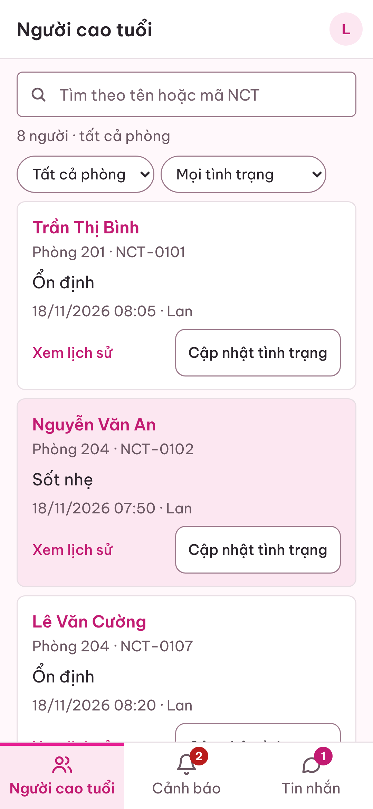
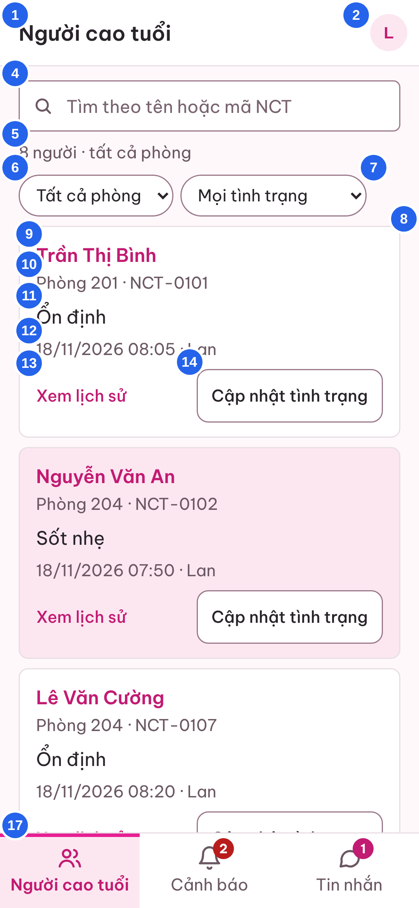
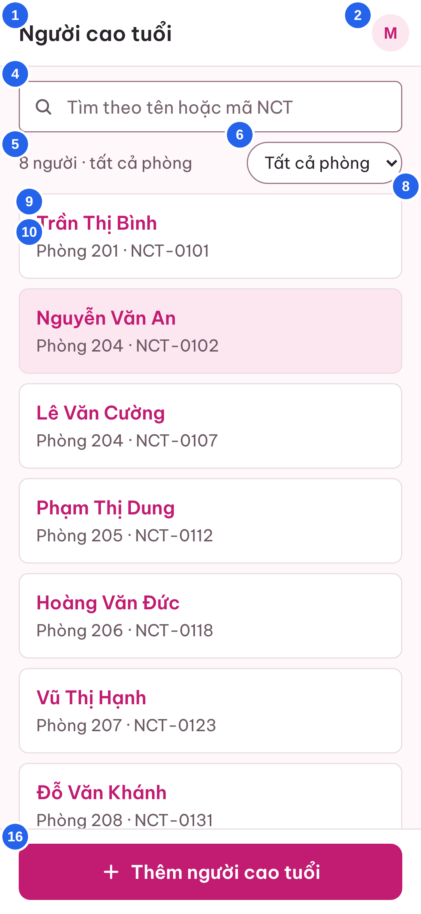
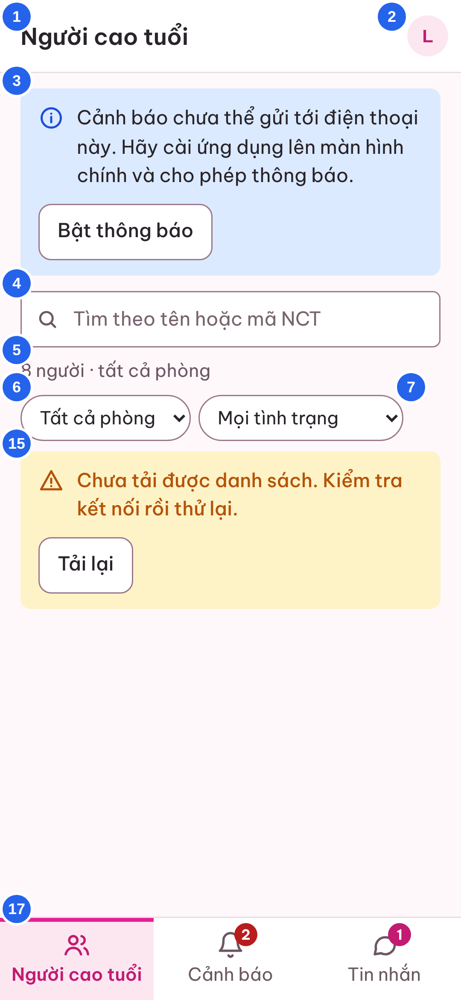
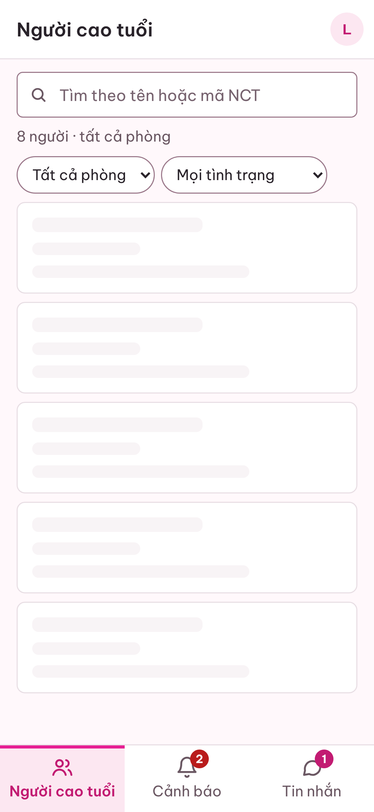
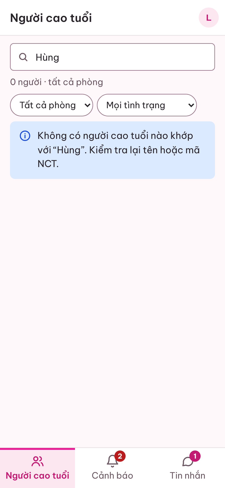

# Screen Spec: S-F01-01 Resident list (mobile)

| Field | Value |
|---|---|
| Screen ID | S-F01-01 |
| Screen name | Resident list (interface label: "Danh sách người cao tuổi") |
| Actor | Receptionist, Nurse (on the phone mostly the Nurse, ADR-001) |
| Priority | Must |
| Feature | F-01 Resident Profile Management (the nurse's actions lead into F-02 Condition Tracking) |
| Activity diagrams | AD-UC-02 (action `a1` "Select the resident"), AD-UC-05 (action `a1` "Select resident"); AD-UC-01 starts from here with "New resident"; UC-03 and UC-04 have no activity diagram (usage flow: "not needed") |
| Mockup images | `img/S-F01-01-mobile.png` (default, Nurse), `img/S-F01-01-mobile-receptionist.png`, three numbered images, three state images (section 2) |
| Frame width | 360px (exported at 3x, 1080 pixels) |
| Figma frame | not used (drawn as an HTML wireframe) |
| Status | Done |

## 1. Purpose

**Shown when:** a Receptionist or a Nurse has signed in on the phone (this is their home screen,
FR-00-01), comes back from a resident's screen, taps the "Người cao tuổi" tab, or a refused request
has sent them home (FR-06-03). The user picks the resident to work on; the receptionist can also
start a new resident.

**The user leaves this screen when:** they open a resident's profile (S-F01-02), and for the
Nurse the resident's condition history (S-F02-01) or the update of their condition (S-F02-02); the
Receptionist starts a new resident (S-F01-03); the Nurse opens the Alerts tab (S-F03-01) or the
Chat tab (S-F04-01); or the user signs out.

## 2. Mockup

**Numbered:** each number is the # of the element inventory in section 3. Element 16 (New resident) appears only for the Receptionist, so it is numbered on the receptionist image. Elements 3 (Notice banner) and 15 (Message area) appear only in some states, so they are numbered on the error image, which shows both.

| Default (Nurse), numbered | Receptionist, numbered | Error, numbered |
|---|---|---|
|  |  |  |

| Loading | Empty |
|---|---|
|  |  |

| State | Image |
|---|---|
| Default | img/S-F01-01-mobile.png (Nurse), img/S-F01-01-mobile-receptionist.png (Receptionist) |
| Empty | img/S-F01-01-mobile-empty.png (no resident matches the search) |
| Loading | img/S-F01-01-mobile-loading.png |
| Error | img/S-F01-01-mobile-error.png (the list cannot be loaded) |
| Success | Not applicable: this screen saves nothing (section 4) |

All colours, fonts and corners come from the design tokens in [ui-conventions.md](../ui-conventions.md#7-design-tokens), whose values live in [design-tokens.css](../design-tokens.css).

## 3. Element inventory

Labels are shown as they appear in the interface (Vietnamese), with the repository label in
brackets. "Nurse only" and "Receptionist only" elements are not rendered for the other role.

| # | Element | Type | Content / data source | Required | Validation |
|---|---|---|---|---|---|
| 1 | Title | Header, app bar | static: "Người cao tuổi" (Residents) | Yes | |
| 2 | Account button | Icon button, app bar | initial of the given name (the last word of `user.name`, "L" for "Lan") on colour/pink-light; opens a menu with `user.name`, role name (`user.role`) and "Đăng xuất" (Sign out) | Yes | none |
| 3 | Notice banner | Banner with button | "Cảnh báo chưa thể gửi tới điện thoại này. Hãy cài ứng dụng lên màn hình chính và cho phép thông báo." (Alerts cannot reach this phone yet. Install the app on the home screen and allow notices.); button "Bật thông báo" (Allow notices) | Nurse only, while push notices are not allowed on this phone (ADR-005) | none |
| 4 | Quick search | Search field | placeholder "Tìm theo tên hoặc mã NCT" (Search by name or resident ID); matches `resident.full_name` and `resident.resident_id` | No | none (SR-004) |
| 5 | Count line | Text | number of cards shown + the room filter value: "n người · tất cả phòng" (n residents · all rooms) | Yes | |
| 6 | Room filter | Select shown as a chip | shows the chosen value, "Tất cả phòng" (All rooms) by default; accessible name "Lọc theo phòng" (Filter by room); opens the phone's own picker with "Tất cả phòng" + each `resident.room` in use | Yes | one value |
| 7 | Condition filter | Select shown as a chip | shows the chosen value, "Mọi tình trạng" (Any condition) by default; accessible name "Lọc theo tình trạng" (Filter by condition); options "Mọi tình trạng", "Chưa ghi nhận hôm nay" (No record today: no `condition_record.saved_at` on today's date) | Nurse only | one value |
| 8 | Resident cards | Card list | one card per resident in the Resident Profile data group that matches the filters and the search | Yes | |
| 9 | Full name | Link, first line of the card | `resident.full_name` | Yes | |
| 10 | Room and resident ID | Text, first line of the card | "Phòng " + `resident.room` + " · " + `resident.resident_id` (BR-01) | Yes | |
| 11 | Current condition | Text, second line | `condition_record.condition` of the resident's most recent record; "Chưa ghi nhận tình trạng" (No record yet) in colour/text-tertiary italics when there is none | Nurse only | |
| 12 | Last update | Text, third line | `condition_record.saved_at` (dd/MM/yyyy HH:mm) · `condition_record.nurse_name` of the same record (FR-02-02); not shown when there is none | Nurse only | |
| 13 | View history | Link, third line | label "Xem lịch sử" (View history) | Nurse only | none |
| 14 | Update condition | Secondary button, third line | label "Cập nhật tình trạng" (Update condition) | Nurse only | none |
| 15 | Message area | Banner, above the cards | empty, error and access-denied messages of section 4 (FR-06-03) | No | Shown only in the Empty and Error states and the situations below section 4 |
| 16 | New resident | Primary button, fixed at the bottom | label "Thêm người cao tuổi" (New resident), full width | Receptionist only | none |
| 17 | Tab bar | Navigation | "Người cao tuổi" (current), "Cảnh báo" with the number of `alert` whose `alert.status` is New or Escalated (Alert Log), "Tin nhắn" with the number of unread `chat_message` for this user; the app bar shows no counters (ui-conventions §4) | Nurse only (the Receptionist has one destination, ui-conventions 3.4) | counters hidden at 0; "99+" above 99 |

## 4. States

| State | What the user sees | Trigger |
|---|---|---|
| Default | Cards ordered by room, then name (SR-003). The card of the resident last opened from this screen is on colour/pink-light (SR-006). The mockup shows this state for the Nurse. | Screen opened, residents loaded |
| Empty (no data) | No cards. Information banner (15) on colour/info-bg: "Không có người cao tuổi nào khớp với “Hùng”. Kiểm tra lại tên hoặc mã NCT." (No resident matches “Hùng”. Check the name or the resident ID.); filters and search stay as typed | No resident matches the search |
| Loading | 5 placeholder cards on colour/surface-secondary; elements 4, 6 and 7 disabled; count line (5) hidden | List being fetched (screen opened, filter or search changed, Reload in the error banner) |
| Error | Warning banner (15) on colour/warning-bg: "Chưa tải được danh sách. Kiểm tra kết nối rồi thử lại." (The list cannot be loaded. Check your connection and try again.) (new) with the button "Tải lại" (Reload); no cards. | The request for the list failed |
| Success / confirmation | Not applicable: this screen saves nothing; S-F01-03 and S-F02-02 show their own confirmation | – |

**Situations described in words, not drawn:**

- Notices off: for a Nurse whose phone cannot receive push notices yet (the app is not installed, or notices are not allowed, ADR-005), the notice banner (3) on colour/info-bg sits above the search field; "Bật thông báo" asks the phone's permission and the banner disappears once notices are allowed. The error image shows it too.
- No resident at all: the banner (15) says, for the Receptionist, "Chưa có người cao tuổi nào. Hãy thêm người đầu tiên." (No resident yet. Add the first resident.) (new), with element 16 still at the bottom; for the Nurse, "Chưa có người cao tuổi nào." (No resident yet.) (new).
- Only the filters leave no card: the banner says "Không có người cao tuổi nào khớp với bộ lọc đã chọn." (No resident matches the chosen filters.) (new).
- Access denied: after a refused request (FR-06-03) the user is sent here, the list loads normally and the warning banner (15) says "Bạn không có quyền dùng chức năng đó. Bạn đã được đưa về màn hình chính." (You do not have access to that function. You are back on your home screen.) until the user leaves the screen.
- Real-time alert pop-up: for a Nurse, the pop-up of S-F03-01 can open over this screen in any state, full width on the phone (FR-03-02, Screen List "Modals and overlays"); it is specified with the alert screens.

Messages marked (new) follow the patterns of [ui-conventions](../ui-conventions.md) section 5 but
are not listed there yet (open question 5).

## 5. Interactions and navigation

| # | Element | User action | System response | Goes to screen |
|---|---|---|---|---|
| 1 | Full name (9) | tap | Opens the resident's profile ("taps a resident", "selects a resident to view the profile") | S-F01-02 |
| 2 | View history (13) | tap | Opens the resident's condition records in time order (FR-02-04) | S-F02-01 |
| 3 | Update condition (14) | tap | Opens the update screen, full screen on the phone (ui-conventions 3.3) | S-F02-02 |
| 4 | New resident (16) | tap | Opens the form, full screen | S-F01-03 |
| 5 | Room filter (6), Condition filter (7) | choose a value in the picker | Cards filtered at once; count line (5) updates; the chosen value shows on the chip | stays |
| 6 | Quick search (4) | "Tìm" (Search) key on the phone keyboard | Cards filtered by name or resident ID (SR-004); no match gives the Empty state | stays |
| 7 | "Tải lại" in the error banner (15) | tap | Fetches the list again (Loading, then Default or Error) | stays |
| 8 | "Bật thông báo" in the notice banner (3) | tap | Asks the phone's permission for notices; banner disappears when allowed | stays |
| 9 | "Cảnh báo" tab (17) | tap | Opens the open alerts ("taps Alerts in the menu") | S-F03-01 |
| 10 | "Tin nhắn" tab (17) | tap | Opens the conversations ("taps Chat in the menu") | S-F04-01 |
| 11 | "Đăng xuất" in the account menu (2) | tap | Ends the session | S-F00-01 |
| 12 | Real-time alert pop-up (system) | a new or repeated alert arrives (Nurse) | Pop-up with sound over this screen (FR-03-02, FR-03-04); "Acknowledge" records the acknowledgement (FR-03-03) and opens the alert list ("taps the notice") | S-F03-01 |
| 13 | Push notice on the phone (system) | the Nurse taps a push notice while the app is closed | Opens the alert list ("[nurses notified] taps the notice") | S-F03-01 |

## 6. Screen-level rules

| Rule ID | Rule | Source |
|---|---|---|
| SR-001 | Elements 3, 7, 11–14 and 17 are rendered for the Nurse only, element 16 for the Receptionist only. The API Server checks the role on every request; hiding an element is never the only check. | FR-02-02, FR-01-01, ADR-003 |
| SR-002 | Elements 11 and 12 always show the resident's most recent saved condition record; earlier records are listed only on S-F02-01. | FR-02-02, FR-02-03, BR-04 (same rule as for families) |
| SR-003 | Cards are ordered by room, then by given name (the last word of the full name), then by the rest of the name, as on desktop. | desktop spec SR-003 |
| SR-004 | The search trims spaces, ignores capitals and Vietnamese diacritics ("hung" finds "Hùng"), and matches any part of the full name or the resident ID. | ui-conventions §5 (No search match) |
| SR-005 | The applied filters and search text stay visible and are kept when the user comes back from S-F01-02, S-F02-01 or S-F02-02. | ui-conventions §4 (Filter bar) |
| SR-006 | The card of the resident last opened from this screen is selected (colour/pink-light) when the user comes back. | ui-conventions §7.3 |
| SR-007 | "Chưa ghi nhận tình trạng" is written in words; no state on this screen is shown by colour alone. | ui-conventions §6, WCAG 2.2 1.4.1 |
| SR-008 | The notice banner (3) is shown while this phone cannot receive push notices: on iPhone that means the app is not installed on the home screen, on every phone that notices are not allowed. "Bật thông báo" is shown only when the phone can ask for the permission. | ADR-005, FR-03-02 |
| SR-009 | Each counter appears once, on its tab (17), never also in the app bar. The "Cảnh báo" counter counts alerts that are New or Escalated and disappears at 0; red (colour/error) on this screen is used only for that count. | ui-conventions §4, §7.2 |

## 7. Linked requirements

| FR ID | What this screen does for it |
|---|---|
| FR-00-01 | Home screen of the Receptionist and the Nurse after sign-in on the phone |
| FR-01-01 | "New resident" starts the creation of a resident profile (S-F01-03) |
| FR-01-02 | The Receptionist selects here the resident whose information will be updated (through S-F01-02) |
| FR-01-03 | Opens the profile of the selected resident |
| FR-02-02 | The Nurse selects here the resident whose condition will be updated; each card shows the time and the nurse's name of the latest record |
| FR-02-04 | "View history" opens the condition history of the resident |
| FR-03-02 | Shows the alert count; the notice banner gets push notices working on the nurse's phone; the real-time alert pop-up can open over this screen |
| FR-06-03 | Shows the access-denied message when a refused request sends the user home |

## 8. Responsive and accessibility notes

- 360–767px: app bar 56px, screen padding 16px, card gap 8px, card padding 16px, tab bar 64px
  (ui-conventions 3.1, 7.5). From 768px the desktop layout applies
  ([screen-spec-S-F01-01-desktop.md](screen-spec-S-F01-01-desktop.md)).
- The desktop table becomes one card per resident: the full name, then the room and the resident
  ID; the current condition and the last update below; View history and Update condition under
  them. The filters become chips and the sidebar becomes the tab bar.
- At 360px nothing scrolls sideways: a long name wraps to a second line, and when View history and
  Update condition do not fit beside the last update they move to their own line.
- Element 16 is fixed at the bottom; the list has bottom padding equal to the button area so the
  last card is never covered.
- Every target is at least 44 × 44px; the tab bar shows an icon and a label on every tab.
- The full name, View history and Update condition have accessible names that include the resident
  ("Cập nhật tình trạng, Nguyễn Văn An"); the counters have text names ("2 cảnh báo chưa tiếp
  nhận").
- Text contrast is at least 4.5:1 on every background used here (ui-conventions 7.6); zoom stays
  allowed.

## 9. Open questions

| # | Question | Blocking? | Status |
|---|---|---|---|
| 1 | How many residents will the list hold, and does it need pages? | No. | No pages: all residents in one scrolling list. |
| 2 | Does the list refresh by itself when another nurse saves a condition? | No. | No. It is read when the screen opens and on Reload; alerts already arrive in real time. |
| 3 | Does the Receptionist see condition information on this list? | No. | No. Recording conditions belongs to the Nurse (F-02). |
| 4 | Is the format of the resident ID defined? | No. | Not yet (BR-02). "NCT-0101" in the mockup is an example. |
| 5 | Are the messages marked (new) in section 4 in ui-conventions section 5? | No. | Not yet. Add them at the next revision of the conventions. |

## Completion checklist

- [x] The mockup is a separate cropped image file, named with the Screen ID, at the frame width.
- [x] The numbered images exist for the Nurse default, the Receptionist and error, and their numbers match the # column of the element inventory.
- [x] Every visible element in the mockup appears in the element inventory.
- [x] Every colour in the mockup is a design token from ui-conventions.md.
- [x] Every input element has a validation rule or an explicit "none".
- [x] All five states are filled in (Success is "Not applicable", with the reason in section 4); every drawn state links its image.
- [x] Every navigation target is a Screen ID that exists in the Screen List.
- [x] Every element that displays data names the field it displays.
- [x] Every linked FR exists in the Function List, and every action of this screen in AD-UC-02 and AD-UC-05 is covered by an interaction row.
