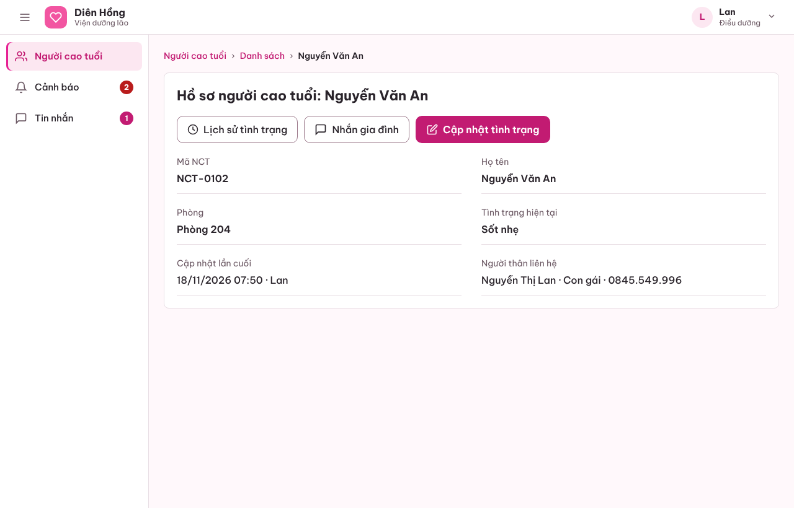
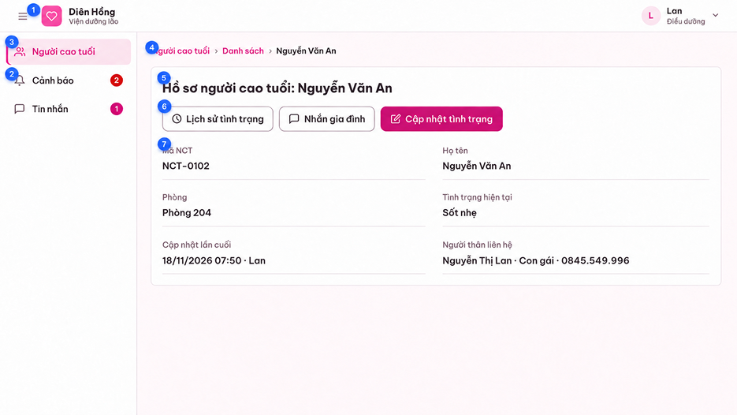

# Screen Spec: S-F01-02 — Resident profile detail

| Field | Value |
|---|---|
| Screen ID | S-F01-02 |
| Screen name | Resident profile detail |
| Actor | Receptionist, Nurse |
| Priority | Must |
| Feature | F-01 Resident Profile Management |
| Activity diagrams | AD-UC-01 (profile creation and success); AD-UC-02 (profile update and success) |
| Mockup images | `img/S-F01-02-desktop.png` (default), `img/S-F01-02-desktop-numbered.png`, six state/numbered images (section 2) |
| Frame width | Desktop mockup; exported image size 935 × 526 pixels |
| Figma frame | Desktop |
| Status | Draft — desktop mockups reviewed; Receptionist-specific action and data-field mapping need confirmation |

## 1. Purpose

**Shown when:** the Receptionist or Nurse selects a resident from the Resident list (S-F01-01), or when a newly created or updated profile is shown after the success state of the create/edit screen (S-F01-03).

**The user leaves this screen when:** they return to the Resident list, open the condition history, open the nurse-family conversation, open the condition-update screen, or (for Receptionist) open the edit-profile screen.

## 2. Mockup

**Numbered:** each blue number is the # of the element inventory in section 3. Element 8 (Profile-load error banner and Retry) appears only in the error state, so it is numbered on the error image.

| Default, numbered | Error, numbered |
|---|---|
|  |  |

| State | Image |
|---|---|
| Empty | `img/S-F01-02-desktop-empty.png` |
| Loading | `img/S-F01-02-desktop-loading.png` |
| Error | `img/S-F01-02-desktop-error.png` |
| Success | `img/S-F01-02-desktop-success.png` |

All colours, fonts, spacing and corners come from the design tokens and layout rules in [ui-conventions.md](../ui-conventions.md).

## 3. Element inventory

| # | Element | Type | Content / data source | Required | Validation |
|---|---|---|---|---|---|
| 1 | Sidebar toggle | Icon button | Static menu icon | Yes | Toggles the desktop sidebar between expanded and collapsed states, following UI Convention §3. |
| 2 | Alerts navigation item | Sidebar navigation item with counter | Nurse's unacknowledged alert count (New and Escalated) | Nurse only | Opens S-F03-01. Counter is hidden when 0; above 99 show `99+`. |
| 3 | Residents navigation item | Active sidebar navigation item | Static label `Người cao tuổi` | Yes | Opens the Resident area; current item is highlighted. |
| 4 | Breadcrumb | Breadcrumb links | `Người cao tuổi > Danh sách > {resident.full_name}` | Yes | `Người cao tuổi` and `Danh sách` return to S-F01-01; resident name is the current location, not a link. |
| 5 | Page title | Header | `Hồ sơ người cao tuổi: {resident.full_name}` | Yes | Displays the selected resident's full name. |
| 6 | Action group | Buttons | Nurse: `Lịch sử tình trạng`, `Nhắn gia đình`, `Cập nhật tình trạng`. Receptionist: edit-profile action as defined by the Screen List and FR-01-02. | Role-dependent | Nurse actions open S-F02-01, S-F04-01 and S-F02-02 respectively. Receptionist opens S-F01-03 to edit the profile. The supplied mockups show the Nurse action group only. |
| 7 | Resident profile detail | Read-only information fields | Resident ID, full name, room, current condition, last condition update, family contact | Yes | Displays the selected resident's current profile information. Missing condition information is shown as `Chưa ghi nhận`; missing last-update value is shown as `—`. The Function List does not define the complete resident-profile field schema. |
| 8 | Profile-load error banner and Retry | Warning banner + secondary button | Error message: `Không thể tải đầy đủ thông tin hồ sơ người cao tuổi. Kiểm tra kết nối và thử lại.`; button `Thử lại` | No | Appears when the profile cannot be fully loaded. Retry requests the profile again; the banner disappears on success and remains on failure. |

The following shell elements are visible but are not numbered in the mockup:

| Element | Type | Content / data source | Required | Validation |
|---|---|---|---|---|
| Brand mark and app name | Logo / text | `Diên Hồng`; `Viện dưỡng lão` | Yes | Static brand identity. |
| Account menu | Avatar, account name, role and dropdown | Signed-in user's name and role | Yes | Opens the account menu. |
| Chat navigation item | Sidebar navigation item with counter | `Tin nhắn`; unread-message count | Nurse only | Opens the chat area; counter is hidden at 0. |

## 4. States

| State | What the user sees | Trigger |
|---|---|---|
| Default | Resident profile detail with the resident ID, full name, room, current condition, last update and family contact. The Nurse action group is visible in the supplied Nurse mockup. | Screen opened and profile data loaded successfully. |
| Empty (no condition recorded) | Resident profile remains visible. An information banner says that no condition has been recorded for the resident; `Tình trạng hiện tại` shows `Chưa ghi nhận` and `Cập nhật lần cuối` shows `—`. | The resident profile exists but no condition record has been recorded. |
| Loading | Page title and action group remain visible; skeleton placeholders replace the profile values while the system retrieves the resident profile. | Initial profile request is in progress or the user retries after a load error. |
| Error | Warning banner says `Không thể tải đầy đủ thông tin hồ sơ người cao tuổi. Kiểm tra kết nối và thử lại.` and shows `Thử lại`. The supplied error mockup also displays profile values underneath; whether these are cached values is not specified. | The profile request fails or returns incomplete data. |
| Success / confirmation | The newly created or updated resident profile is displayed. The supplied success mockup shows a confirmation toast: `Đã lưu hồ sơ người cao tuổi Nguyễn Văn An · Phòng 204.` | A profile has been successfully created or updated on S-F01-03 (FR-01-01 or FR-01-02), and the user returns to this screen. |

## 5. Interactions and navigation

| # | Element | User action | System response | Goes to screen |
|---|---|---|---|---|
| 1 | Sidebar toggle | Click | Collapses or expands the desktop sidebar. | stays |
| 2 | Alerts navigation item | Click | Opens the Nurse's alert list. | S-F03-01 |
| 3 | Residents navigation item | Click | Opens the resident list. | S-F01-01 |
| 4 | Breadcrumb `Người cao tuổi` / `Danh sách` | Click | Returns to the resident list. | S-F01-01 |
| 5 | Page title | No action | Displays the selected resident's name. | stays |
| 6a | `Lịch sử tình trạng` | Nurse clicks | Opens the selected resident's condition history. | S-F02-01 |
| 6b | `Nhắn gia đình` | Nurse clicks | Opens the conversation with the resident's family. | S-F04-01 |
| 6c | `Cập nhật tình trạng` | Nurse clicks | Opens the condition-update screen for this resident. | S-F02-02 |
| 6d | Edit profile action | Receptionist clicks | Opens the create/edit resident profile screen. | S-F01-03 |
| 7 | Resident profile detail | Read | Displays the selected resident's current profile information; no inline editing is performed here. | stays |
| 8 | `Thử lại` | Click | Requests the profile again. On success, displays the loaded profile and removes the error banner; on failure, keeps the error state. | stays |

## 6. Screen-level rules

| Rule ID | Rule | Source |
|---|---|---|
| SR-001 | This screen is available to Receptionist and Nurse. The visible menu and actions depend on the signed-in role. | Screen List |
| SR-002 | The Nurse can view the resident profile and navigate to condition history, family chat and condition update. | Screen List; FR-01-03; FR-02-04; FR-04-04; FR-02-02 |
| SR-003 | The Receptionist edits resident information through S-F01-03; editing is not performed inline on S-F01-02. | Screen List; FR-01-02 |
| SR-004 | After valid profile changes are saved, the system shows the updated information. | FR-01-02 |
| SR-005 | The last condition update is displayed as date and time followed by the nurse's name. | UI Convention §2; FR-02-02 |
| SR-006 | Phone numbers use 10 digits in groups 4.3.3 with dots and no country code. | UI Convention §2 |
| SR-007 | Menu counters are shown on their menu items, use `99+` above 99 and are hidden at 0. | UI Convention §2 |
| SR-008 | The error state must not present cached or stale profile values as current. The exact behaviour for retaining previously loaded values needs confirmation. | Error mockup; clarification required |
| SR-009 | Colours, fonts, spacing, borders and component styling follow the shared UI Convention and design tokens. | UI Convention |

## 7. Linked requirements

| FR ID | What this screen does for it |
|---|---|
| FR-01-01 | Displays the created resident profile and unique resident ID after successful profile creation. |
| FR-01-02 | Displays the updated resident information after valid changes are saved; provides the Receptionist's route to S-F01-03. |
| FR-01-03 | Displays the selected resident's current profile information to the Nurse. |
| FR-02-02 | Displays the latest condition update time and nurse name where this information is included in the profile summary. |
| FR-02-04 | Provides navigation to the condition history screen, where the Nurse reads all condition records in time order. |
| FR-04-04 | Provides navigation to the Nurse's conversation with the resident's family. |

## 8. Responsive and accessibility notes

- The supplied mockups cover **desktop only**. The mobile layout is not shown in the supplied images.
- Desktop uses the shared top bar and sidebar dimensions defined in UI Convention §3.
- The sidebar toggle must remain keyboard-operable and expose an accessible name.
- Buttons, breadcrumb links and navigation items must be keyboard-operable and have visible focus states.
- Text and status messages must follow the contrast requirements in the UI Convention.
- The latest condition update uses the date/time format `dd/MM/yyyy HH:mm` and the nurse's name, as defined in UI Convention §2.

## 9. Open questions

| # | Question | Blocking? | Status |
|---|---|---|---|
| 1 | [NEEDS CLARIFICATION: which exact resident-profile fields are included in the approved data model, beyond the fields visible in the mockup?] | Yes, for final field-to-data mapping | Open. The Function List says to display the current profile but does not enumerate the complete profile schema. |
| 2 | [NEEDS CLARIFICATION: in the error state, are the profile values underneath the banner cached values from a previous successful request, or values returned with an incomplete response?] | Yes, for final error-state behaviour | Open. Do not imply that stale values are current. |
| 3 | [NEEDS CLARIFICATION: what exact action label should the Receptionist see on S-F01-02 to open S-F01-03?] | No | Open. The Screen List and FR-01-02 establish the edit route, but the supplied mockups show only the Nurse variant. |
| 4 | [NEEDS CLARIFICATION: is the family-contact information part of the approved resident-profile data returned by FR-01-03?] | No | Open. The field appears in the mockup, but its data mapping is not specified in the Function List. |

---

## Completion checklist

- [x] The mockup is a separate cropped image file, named with the Screen ID and platform.
- [x] The numbered image exists, and its numbers match the # column of the element inventory.
- [x] Every numbered visible element in the mockup appears in the element inventory.
- [x] The default, empty, loading, error and success state images are listed.
- [ ] Every visible colour, font, spacing and corner has been checked against the current UI Convention design tokens.
- [x] Every input element has a validation rule or an explicit statement that it is not an input.
- [x] All five states are filled in.
- [x] Every navigation target is a Screen ID that exists in the Screen List.
- [ ] Every data-displaying element is mapped to an approved field in the data model.
- [x] Every linked FR exists in the Function List, and the screen actions evidenced by the Screen List and Function List are covered by an interaction row.
