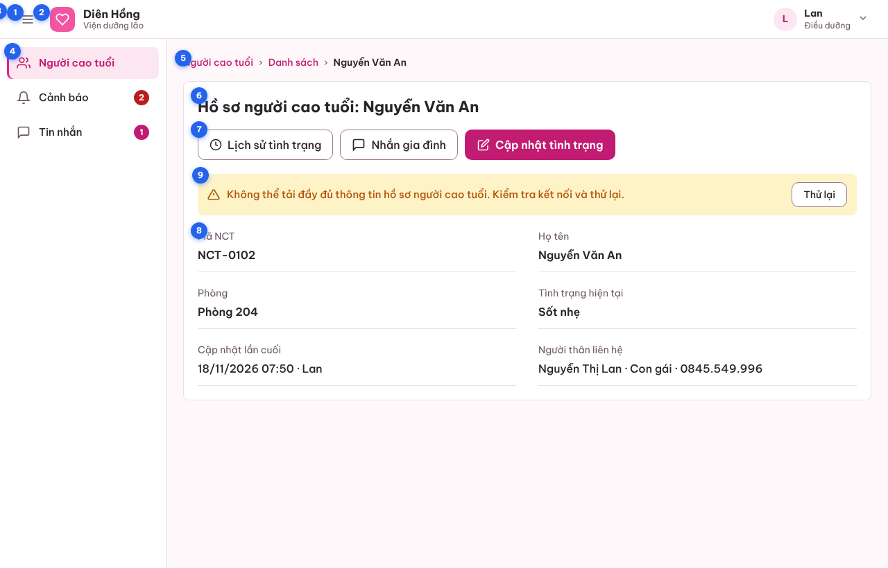
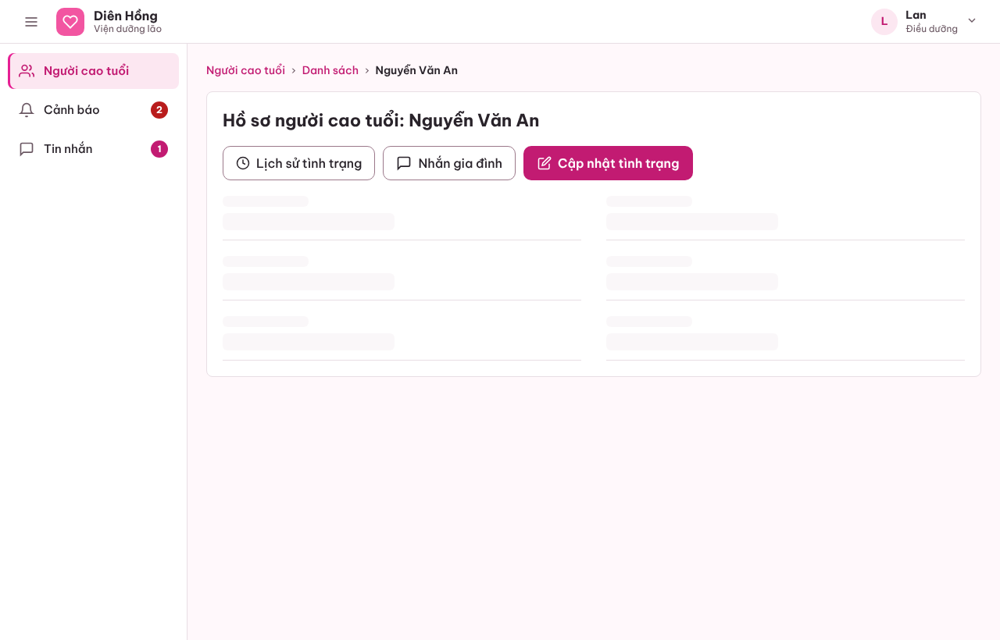
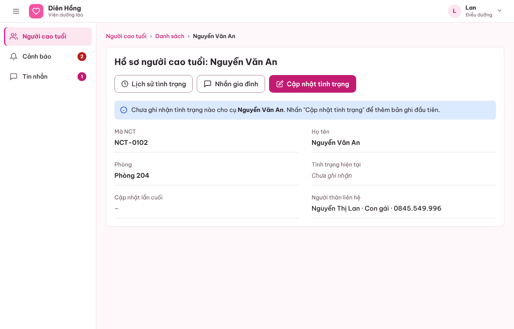
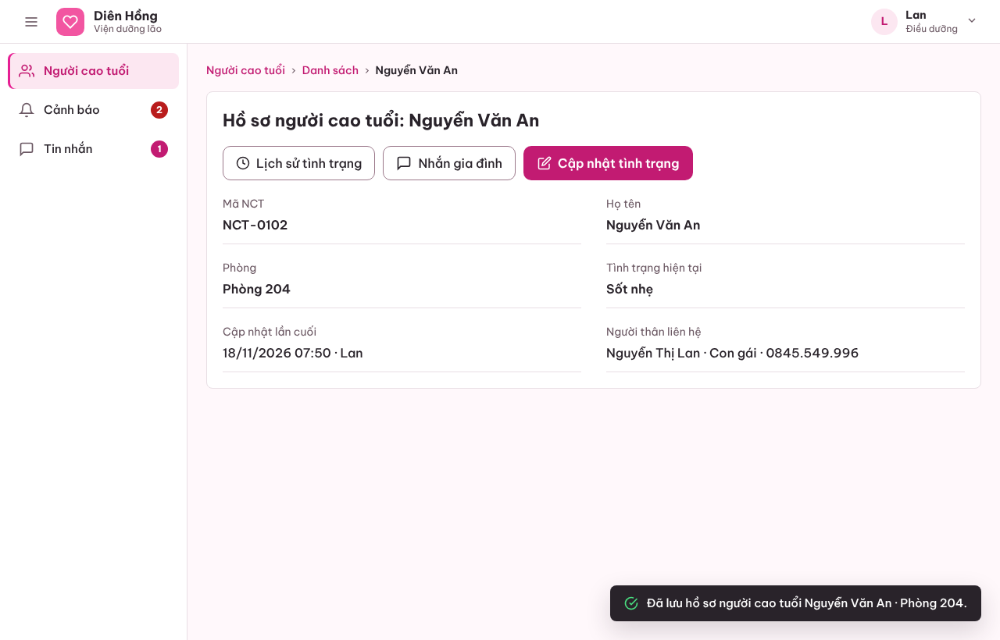

# Screen Spec: S-F01-02 Resident profile detail (Desktop)

| Field | Value |
|---|---|
| Screen ID | S-F01-02 |
| Screen name | Resident profile detail |
| Actor | Receptionist, Nurse |
| Priority | Must |
| Feature | F-01 Resident Profile Management |
| Activity diagrams | AD-UC-01 (action "See the profile created with its resident ID"), AD-UC-02 (actions "Show the resident's current information", "See the updated information"); UC-03 has no AD (`not needed`) |
| Mockup images | `img/S-F01-02-desktop.png` (default), `img/S-F01-02-desktop-numbered.png`, five state images (section 2) |
| Frame width | 1280px (exported at 1x) |
| Figma frame | not used (drawn as an HTML wireframe) |
| Status | Draft |

## 1. Purpose

**Shown when:** a Receptionist or Nurse selects a resident from S-F01-01 (Resident list) to view their profile, or when a Receptionist has just created or updated a resident profile on S-F01-03 (Create or edit resident profile).

**The user leaves this screen when:** they navigate back to S-F01-01 via the breadcrumb or sidebar, or proceed to edit the profile (S-F01-03 for Receptionist), view condition history (S-F02-01 for Nurse), update condition (S-F02-02 for Nurse), or chat with the family (S-F04-01 for Nurse).

## 2. Mockup

**Numbered:** each number is the # of the element inventory in section 3. Element 8 (Message area) appears only in the error and empty states, so it is numbered on the error image. *(Note: The mockup shows the Nurse view; for the Receptionist view, sidebar items Alerts/Chat and condition/chat action buttons are replaced by the "Edit profile" button).*

| Default, numbered | Error, numbered |
|---|---|
|  |  |
| Loading                                                       | Empty                                                     |
| ------------------------------------------------------------- | --------------------------------------------------------- |
|  |  |
| Success                                                     |
| ------------------------------------------------------------- |
|  |

| State | Image |
|---|---|
| Default | `img/S-F01-02-desktop.png` |
| Empty | `img/S-F01-02-desktop-empty.png` |
| Loading | `img/S-F01-02-desktop-loading.png` |
| Error | `img/S-F01-02-desktop-error.png` (network/load failure; access-denied refusal redirects to S-F01-01 per FR-06-03) |
| Success | `img/S-F01-02-desktop-success.png` |

All colours, fonts and corners come from the design tokens in
[ui-conventions.md](../ui-conventions.md#7-design-tokens).

## 3. Element inventory

| # | Element | Type | Content / data source | Required | Validation |
|---|---|---|---|---|---|
| 1 | Top bar | Shell header | Static brand ("Diên Hồng · Viện dưỡng lão"), sidebar toggle button, and signed-in user menu (`User Account & Role`: full name + role, e.g., "Lan · Điều dưỡng") | Yes | none |
| 2 | Sidebar navigation | Navigation menu | Role-based destinations (`ui-conventions.md` §3.4): for Nurse: "Người cao tuổi", "Cảnh báo" (with unacknowledged count badge), "Tin nhắn" (with unread count badge); for Receptionist: "Người cao tuổi" only | Yes | none |
| 3 | Active menu item | Navigation item | Highlights current section ("Người cao tuổi") with `colour/pink-light` fill, `colour/primary` text/icon, and 3px `colour/accent` left bar | Yes | none |
| 4 | Breadcrumb | Navigation trail | Path: "Người cao tuổi > Danh sách > " + `Resident Profile.full_name` (e.g., "Nguyễn Văn An") | Yes | none |
| 5 | Page title | Header | Static prefix "Hồ sơ người cao tuổi: " + `Resident Profile.full_name` | Yes | none |
| 6 | Action buttons | Button group | Role-dependent actions (`ui-conventions.md` §3.5): for Nurse: "Lịch sử tình trạng" (secondary), "Nhắn gia đình" (secondary), "Cập nhật tình trạng" (primary); for Receptionist: "Sửa hồ sơ" (primary) | Yes | none |
| 7 | Profile details grid | Read-only fields (2 columns) | Displays `Resident Profile` & latest `Resident Condition`: Mã NCT (`resident.id`), Họ tên (`resident.full_name`), Phòng (`resident.room`, formatted "Phòng" + number), Tình trạng hiện tại (`condition.value`, or *"Chưa ghi nhận"* when empty), Cập nhật lần cuối (`condition.updated_at` · `condition.nurse_name`, or "–" when empty), Người thân liên hệ (linked `User Account & Role`: full name · relationship · phone in `4.3.3` dot format) | Yes | formats from `ui-conventions.md` §2 |
| 8 | Message area | Banner / Toast | Info banner in Empty state ("Chưa ghi nhận tình trạng nào cho cụ [Full Name]. Nhấn "Cập nhật tình trạng" để thêm bản ghi đầu tiên."); Warning banner with "Thử lại" button in Error state ("Không thể tải đầy đủ thông tin hồ sơ người cao tuổi. Kiểm tra kết nối và thử lại."); Toast in Success state ("Đã lưu hồ sơ người cao tuổi [Full Name] · [Room].") | No | none |

## 4. States

| State | What the user sees | Trigger |
|---|---|---|
| Default | Two-column read-only profile card showing resident ID, full name, room, latest condition, last update timestamp & nurse name, and linked family contact; role-specific action buttons enabled. | Screen opened and resident profile data loaded (FR-01-03) |
| Empty (no data) | Profile fields are shown, "Tình trạng hiện tại" shows *"Chưa ghi nhận"*, "Cập nhật lần cuối" shows "–", and an info banner (`colour/info-bg`) prompts the nurse to record the first condition. | Resident profile exists, but no `Resident Condition` record has been created yet |
| Loading | Header and action buttons remain visible; the 6 profile detail fields are replaced by grey skeleton placeholders (`colour/surface-secondary`). | Resident profile and condition data are being fetched from API Server |
| Error | Warning banner (`colour/warning-bg`) displays "Không thể tải đầy đủ thông tin hồ sơ người cao tuổi. Kiểm tra kết nối và thử lại." with a "Thử lại" secondary button; cached or partial fields remain visible below. | API request to fetch full resident details fails or times out |
| Success / confirmation | Default profile view with updated values plus a dark bottom-right toast (`colour/toast`, auto-dismisses after 4s) confirming "Đã lưu hồ sơ người cao tuổi [Full Name] · [Room]." | Redirected from S-F01-03 after creating (FR-01-01) or updating (FR-01-02) a resident profile, or after saving a condition on S-F02-02 |

## 5. Interactions and navigation

| # | Element | User action | System response | Goes to screen |
|---|---|---|---|---|
| 1 | Sidebar toggle (`[=]`) | click | Collapses sidebar from 240px (icons + labels) to 64px (icons only) or expands it back | stays |
| 2 | Sidebar menu items | click | Opens the selected role destination ("Người cao tuổi", "Cảnh báo", or "Tin nhắn") | S-F01-01 / S-F03-01 / S-F04-01 |
| 3 | Account menu (top right) | click | Opens dropdown with Sign out option | S-F00-01 (on Sign out) |
| 4 | Breadcrumb ("Người cao tuổi" / "Danh sách") | click | Returns to the resident list | S-F01-01 |
| 5 | "Lịch sử tình trạng" button | click (Nurse) | Opens the resident's chronological condition history timeline | S-F02-01 |
| 6 | "Nhắn gia đình" button | click (Nurse) | Opens the conversation thread with the resident's linked family | S-F04-01 |
| 7 | "Cập nhật tình trạng" button | click (Nurse) | Opens the Update resident condition record dialog (with history) | S-F02-02 |
| 8 | "Sửa hồ sơ" button | click (Receptionist) | Opens the Create or edit resident profile record dialog (form only) | S-F01-03 |
| 9 | "Thử lại" button (Error banner) | click (Error state) | Re-fetches the resident profile and latest condition data | stays (Loading → Default/Error) |

## 6. Screen-level rules

| Rule ID | Rule | Source |
|---|---|---|
| SR-001 | The API Server verifies the user's session token and role permissions before returning resident profile data; unauthorized requests return to the role's home screen with an access-denied message. | BR-06-01, FR-06-03 |
| SR-002 | Each saved resident profile displays its unique system-generated Resident ID (`Mã NCT`). | BR-01-01, FR-01-01 |
| SR-003 | The current condition and last update timestamp/nurse name always reflect the resident's most recently saved condition record, without overwriting history. | BR-02-01, BR-02-02, FR-02-02 |
| SR-004 | Action buttons adapt strictly to the signed-in actor's role: Receptionists see profile editing actions ("Sửa hồ sơ"), while Nurses see care and communication actions ("Lịch sử tình trạng", "Nhắn gia đình", "Cập nhật tình trạng"). | `screen-list.md`, `ui-conventions.md` §3.4 |
| SR-005 | All dates follow `dd/MM/yyyy HH:mm` (24-hour) and Vietnamese phone numbers follow `4.3.3` dot-separated formatting (`0845.549.996`). | `ui-conventions.md` §2 |

## 7. Linked requirements

| FR ID | What this screen does for it |
|---|---|
| FR-01-01 | Displays the newly created resident profile with its generated unique Resident ID and confirmation toast upon saving from S-F01-03 |
| FR-01-02 | Displays the updated resident profile information and confirmation toast upon saving changes from S-F01-03 |
| FR-01-03 | Displays the resident's current profile details (ID, full name, room, condition, last update, family contact) when opened by a Nurse or Receptionist |
| FR-06-03 | Enforces role-based visibility of actions and restricts access to authorized staff roles only |

## 8. Responsive and accessibility notes

- Desktop layout applies at viewport widths `768px` and wider (drawn at `1280px`); below `768px` (down to `360px`), the screen switches to the mobile layout (`S-F01-02-mobile`) with a single-column field stack and a fixed bottom primary button (`ui-conventions.md` §3.1, §3.5).
- Body text contrast is at least `4.5:1` (e.g., `colour/text-primary` `#29232A` on `colour/surface` `#FFFFFF` is `15.4:1`), and interactive focus rings use a `2px` `colour/primary` outline offset by `2px` (`ui-conventions.md` §6, §7.6).
- Banners and toasts never rely on colour alone: each includes a semantic icon (info icon, warning triangle, or check mark) alongside descriptive Vietnamese text (`lang="vi"`).

## 9. Open questions

| # | Question | Blocking? | Status |
|---|---|---|---|
| 1 | [NEEDS CLARIFICATION: Are additional demographic fields (such as date of birth, sex, or medical notes) required on the resident profile detail screen once confirmed by the client?] | No | Open. Default: display the 6 core fields shown in the wireframe (`Mã NCT`, `Họ tên`, `Phòng`, `Tình trạng hiện tại`, `Cập nhật lần cuối`, `Người thân liên hệ`) per `ui-conventions.md` §3.6. |
| 2 | [NEEDS CLARIFICATION: How should multiple linked family contacts be displayed if a resident has more than one linked family account?] | No | Open. Default: display the primary linked family member's full name, relationship, and phone number, or list additional contacts vertically in the same cell. |

---

## Completion checklist

- [x] The mockup is a separate cropped image file, named with the Screen ID, at the frame width.
- [x] The numbered image exists, and its numbers match the # column of the element inventory.
- [x] Every visible element in the mockup appears in the element inventory.
- [x] Every colour in the mockup is a design token from ui-conventions.md.
- [x] Every input element has a validation rule or an explicit "none".
- [x] All five states are filled in.
- [x] Every navigation target is a Screen ID that exists in the Screen List.
- [x] Every element that displays data names the field it displays.
- [x] Every linked FR exists in the Function List, and every action of this screen in AD-UC-01 and AD-UC-02 is covered by an interaction row.
