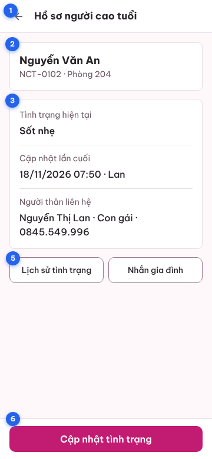

# Screen Spec: S-F01-02 — Resident profile detail

| Field | Value |
|---|---|
| Screen ID | S-F01-02 |
| Screen name | Resident profile |
| Actor | Receptionist, Nurse |
| Priority | Must |
| Feature | F-01 Resident Profile Management |
| Activity diagrams | AD-UC-01 (profile creation and success); AD-UC-02 (profile update and success) |
| Mockup images | `img/S-F01-02-mobile.png` (default), `img/S-F01-02-mobile-numbered.png`, state images (section 2) |
| Frame width | 360px (mobile mockup) |
| Figma frame | Mobile |
| Status | Draft — based on supplied mobile mockups; role and requirement mapping need confirmation |

## 1. Purpose

**Shown when:** the user opens a selected resident's profile to view the resident's identity, room assignment, current condition, last condition update and family-contact information.

**The user leaves this screen when:** they return to the previous screen, open condition history, open the family-contact messaging flow, or select **“Cập nhật tình trạng”** to start updating the resident's condition.

## 2. Mockup

**Numbered:** each blue number corresponds to the # in the element inventory in section 3. Element 4 (profile-load warning and Retry) is only visible in the error state and is numbered on the error mockup.

| Default, numbered | Error, numbered |
|---|---|
|  |  |

| State | Image |
|---|---|
| Default | `img/S-F01-02-mobile.png` |
| Empty | `img/S-F01-02-mobile-empty.png` |
| Loading | `img/S-F01-02-mobile-loading.png` |
| Error | `img/S-F01-02-mobile-error.png` (profile information cannot be fully loaded) |
| Success | `img/S-F01-02-mobile-success.png` (save-success toast) |

All colours, fonts, spacing, borders and corners come from the design tokens and layout rules in [ui-conventions.md](../ui-conventions.md).

## 3. Element inventory

| # | Element | Type | Content / data source | Required | Validation |
|---|---|---|---|---|
| 1 | Back | Icon button | Back arrow | Yes | Returns to previous screen; no data change. |
| 2 | Resident identity card | Card | Resident full name, resident ID, room number | Yes | Read-only display of selected resident. |
| 3 | Resident condition details | Information card | Current condition; last updated date/time and staff name; family-contact name, relationship and phone number | Yes | Read-only. If no condition record exists, show the empty-condition guidance and `Chưa ghi nhận`; missing last-update value displays `—`. |
| 4 | Profile-load warning and Retry | Warning banner + button | Warning text: `Không thể tải đầy đủ thông tin hồ sơ người cao tuổi. Kiểm tra kết nối và thử lại.`; button `Thử lại` | No | Appears only when profile information cannot be fully loaded. Retry requests profile data again. Do not present stale data as current. |
| 5 | History and Family actions | Secondary buttons | `Lịch sử tình trạng`; `Nhắn gia đình` | Yes | Opens condition history or family messaging for the selected resident. |
| 6 | Update condition | Primary button, bottom action area | `Cập nhật tình trạng` | Yes | Opens the condition-update workflow for the selected resident. |

## 4. States

| State | What the user sees | Trigger |
|---|---|---|
| Default | Resident identity card; condition details card showing current condition, last update and family contact; `Lịch sử tình trạng` and `Nhắn gia đình` buttons; bottom `Cập nhật tình trạng` action. | Profile data loads successfully and a condition record exists. |
| Empty (no data) | Resident identity card; information notice stating no condition has been recorded for the resident and prompting staff to use `Cập nhật tình trạng` to add the first record; condition card shows `Chưa ghi nhận`; last-update field shows `—`; bottom update action remains available. | Resident profile loads but no condition record exists. |
| Loading | Skeleton placeholders for resident identity and profile details; bottom `Cập nhật tình trạng` action remains visible. | Profile data is being fetched. |
| Error | Resident identity card; warning banner with `Thử lại`; available profile details may remain visible underneath as depicted; condition details and action buttons remain; bottom update action remains visible. Whether the visible values are cached or returned with a partial response is not specified. | Profile information cannot be fully loaded. |
| Success / confirmation | Resident profile details remain displayed and a toast confirms the profile was saved, e.g. `Đã lưu hồ sơ người cao tuổi Nguyễn Văn An · Phòng 204.` | Profile save succeeds and confirmation feedback is shown. |

## 5. Interactions and navigation

| # | Element | User action | System response | Goes to screen |
|---|---|---|---|
| 1 | Back | Tap | Returns to the previous screen without changing the profile. | Previous screen (not specified) |
| 2 | Resident identity card | View | Displays resident name, resident ID and room number. | stays |
| 3 | Resident condition details | View | Displays condition, last update and family-contact details; empty condition is handled as described in section 4. | stays |
| 4 | `Thử lại` | Tap (Error state) | Requests profile information again; removes the warning on successful load, otherwise keeps the error state. | stays |
| 5a | `Lịch sử tình trạng` | Tap | Opens condition history for the selected resident. | Screen ID not supplied |
| 5b | `Nhắn gia đình` | Tap | Opens messaging with the resident's family contact. | Screen ID not supplied |
| 6 | `Cập nhật tình trạng` | Tap | Opens the condition-update workflow for the selected resident. | Screen ID not supplied |

## 6. Screen-level rules

| Rule ID | Rule | Source |
|---|---|---|
| SR-001 | Display the resident's full name, resident ID and room number in the identity card. | Mobile mockup |
| SR-002 | Display current condition, last update time/staff name and family-contact details when available. | Mobile mockup |
| SR-003 | If no condition record exists, show the empty-state guidance, display `Chưa ghi nhận` and allow staff to start an update using `Cập nhật tình trạng`. | Mobile empty mockup |
| SR-004 | If profile information cannot be fully loaded, show the warning banner and `Thử lại` action. | Mobile error mockup |
| SR-005 | Keep `Cập nhật tình trạng` anchored in the bottom action area; content may scroll without the action obscuring it. | Mobile mockup |
| SR-006 | Keep the History and Family actions side by side as shown when the mobile width allows. | Mobile mockup |
| SR-007 | Profile and condition details are read-only on this screen; changes are initiated through the condition-update workflow. | Mockup / screen flow; confirmation required against requirements |

## 7. Linked requirements

| FR ID | What this screen does for it |
|---|---|
| F-01 / F01-02 | Displays the selected resident's profile information and condition context as represented in the supplied mockups. Exact FR mapping requires confirmation against the Function List. |
| TBD | Provides entry points to condition history, family messaging and condition update; destination screen IDs are not shown in the supplied mobile mockups. |

## 8. Responsive and accessibility notes

- Mobile layout uses a single vertical column.
- The top bar remains at the top with back navigation and the screen title.
- Resident identity and condition details are shown in stacked cards.
- `Lịch sử tình trạng` and `Nhắn gia đình` are side-by-side buttons as shown.
- The primary `Cập nhật tình trạng` button stays anchored in the bottom action area.
- Profile content can scroll vertically; the bottom action area remains available and must not cover content.
- Empty, loading, error and success states must be distinguishable without relying only on colour.
- Buttons and back navigation must have adequate touch targets; resident and contact details should remain legible and not be truncated.

## 9. Open questions

| # | Question | Blocking? | Status |
|---|---|---|---|
| 1 | [NEEDS CLARIFICATION: what are the exact Screen IDs for condition history, family messaging and condition update?] | No | Open; destination IDs are not present in the supplied mobile mockups. |
| 2 | [NEEDS CLARIFICATION: confirm the exact linked FR ID(s) and Activity Diagram mapping for this screen.] | No | Open; mappings should be verified against the Function List and Activity Diagrams. |
| 3 | [NEEDS CLARIFICATION: in the Error state, are the profile values shown beneath the banner cached values or data returned with a partial response?] | Yes, for final error-state behaviour | Open; avoid presenting stale data as current. |
| 4 | [NEEDS CLARIFICATION: confirm whether the family-contact fields shown in the mockup are part of the approved resident-profile data model.] | No | Open; field mapping is not specified in the Function List. |

## Completion checklist

- [x] The mockup is a separate cropped image file, named with the Screen ID, at the mobile frame width.
- [x] The numbered image exists, and its numbers match the # column of the element inventory.
- [x] Every numbered visible element in the mockup appears in the element inventory.
- [x] The default, empty, loading, error and success state images are listed.
- [ ] Every visible colour, font, spacing, border and corner has been checked against the current UI Convention design tokens.
- [x] Every input element has a validation rule or an explicit statement that it is not an input.
- [x] All five states are filled in.
- [ ] Every navigation target is a Screen ID that exists in the Screen List.
- [ ] Every data-displaying element is mapped to an approved field in the data model.
- [ ] Every linked FR exists in the Function List, and every action of this screen in the Activity Diagram is covered by an interaction row.
