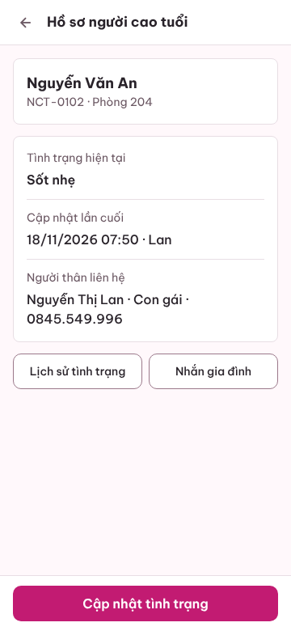
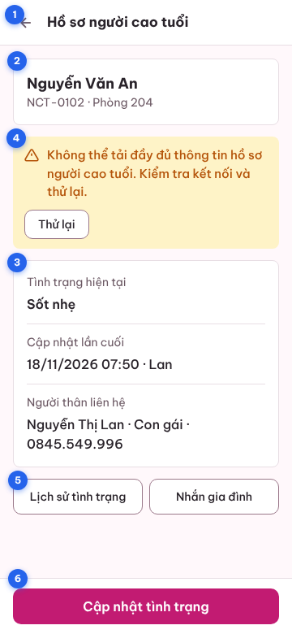
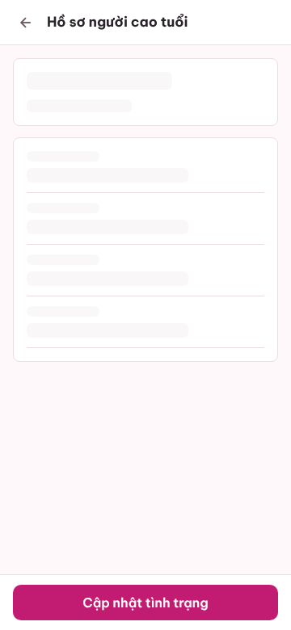
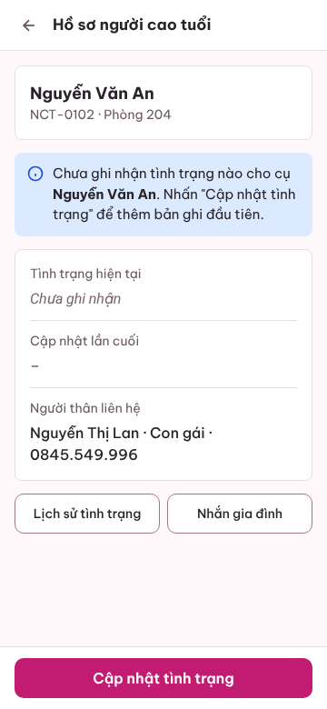
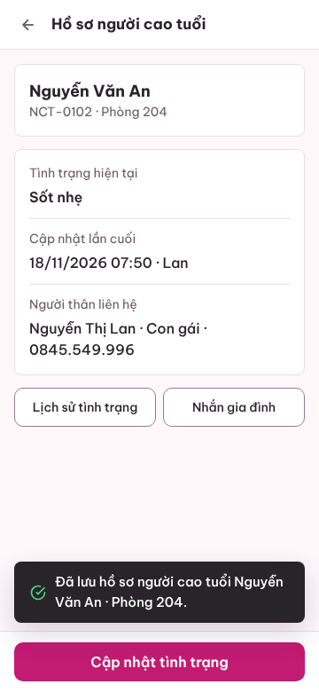

# Screen Spec: S-F01-02 Resident profile detail (Mobile)

| Field | Value |
|---|---|
| Screen ID | S-F01-02 |
| Screen name | Resident profile detail |
| Actor | Receptionist, Nurse |
| Priority | Must |
| Feature | F-01 Resident Profile Management |
| Activity diagrams | AD-UC-01 (action "See the profile created with its resident ID"), AD-UC-02 (actions "Show the resident's current information", "See the updated information"); UC-03 has no AD (`not needed`) |
| Mockup images | `img/S-F01-02-mobile.png` (default), `img/S-F01-02-mobile-numbered.png`, five state images (section 2) |
| Frame width | 360px (exported at 3x, 1080 pixels) |
| Figma frame | not used (drawn as an HTML wireframe) |
| Status | Done |

## 1. Purpose

**Shown when:** a Receptionist or Nurse taps a resident on S-F01-01 (Resident list) on a mobile viewport (`360–767px`) to view their profile, or when a Receptionist has just created or updated a resident profile on S-F01-03.

**The user leaves this screen when:** they tap the Back button in the app bar to return to S-F01-01, or proceed to edit the profile (S-F01-03 for Receptionist), view condition history (S-F02-01 for Nurse), update condition (S-F02-02 for Nurse), or chat with the family (S-F04-01 for Nurse).

## 2. Mockup

**Numbered:** each number is the # of the element inventory in section 3. Element 4 (Message area) appears only in the error, empty, and success states, so it is numbered on the error image. *(Note: The mockup shows the Nurse view; for the Receptionist view, secondary action buttons #5 are omitted and the fixed bottom primary button #6 becomes "Sửa hồ sơ").*

| Default, numbered | Error, numbered |
|---|---|
|  |  |

| Loading | Empty |
|---|---|
|  |  |

| Success |
|---|
|  |

| State | Image |
|---|---|
| Default | `img/S-F01-02-mobile.png` |
| Empty | `img/S-F01-02-mobile-empty.png` |
| Loading | `img/S-F01-02-mobile-loading.png` |
| Error | `img/S-F01-02-mobile-error.png` (network/load failure; access-denied refusal redirects to S-F01-01 per FR-06-03) |
| Success | `img/S-F01-02-mobile-success.png` |

All colours, fonts and corners come from the design tokens in
[ui-conventions.md](../ui-conventions.md#7-design-tokens).

## 3. Element inventory

| # | Element | Type | Content / data source | Required | Validation |
|---|---|---|---|---|---|
| 1 | App bar | Mobile top bar | Back arrow button (`←`) on the left + static title "Hồ sơ người cao tuổi" (`56px` height, `colour/surface`, no counters per `ui-conventions.md` §4) | Yes | none |
| 2 | Resident header card | Summary card | `Resident Profile.full_name` (bold title, e.g., "Nguyễn Văn An") and subtitle `resident.id` + " · " + `resident.room` (e.g., "NCT-0102 · Phòng 204") | Yes | formats from `ui-conventions.md` §2 |
| 3 | Profile details card | Single-column field stack | Displays `Resident Profile` & latest `Resident Condition`: Tình trạng hiện tại (`condition.value`, or *"Chưa ghi nhận"* when empty), Cập nhật lần cuối (`condition.updated_at` · `condition.nurse_name`, or "–" when empty), Người thân liên hệ (linked `User Account & Role`: full name · relationship · phone in `4.3.3` dot format) | Yes | formats from `ui-conventions.md` §2 |
| 4 | Message area | Banner / Toast | Info banner in Empty state ("Chưa ghi nhận tình trạng nào cho cụ [Full Name]. Nhấn "Cập nhật tình trạng" để thêm bản ghi đầu tiên."); Warning banner with "Thử lại" button in Error state ("Không thể tải đầy đủ thông tin hồ sơ người cao tuổi. Kiểm tra kết nối và thử lại."); Dark toast above bottom bar in Success state ("Đã lưu hồ sơ người cao tuổi [Full Name] · [Room].") | No | none |
| 5 | Secondary actions | Two-column button row | Role-dependent secondary buttons (`ui-conventions.md` §3.5): for Nurse: "Lịch sử tình trạng" and "Nhắn gia đình" (`colour/surface` with `1px colour/border-strong`); hidden for Receptionist | No | none |
| 6 | Primary action | Fixed bottom button | Full-width button fixed at the bottom (`44px+` height, `colour/primary`): "Cập nhật tình trạng" for Nurse; "Sửa hồ sơ" for Receptionist | Yes | none |

## 4. States

| State | What the user sees | Trigger |
|---|---|---|
| Default | App bar with Back button, resident header card (name, ID, room), single-column details card (current condition, last update, family contact), two side-by-side secondary buttons ("Lịch sử tình trạng", "Nhắn gia đình"), and fixed bottom primary button ("Cập nhật tình trạng"). | Screen opened and resident profile data loaded (FR-01-03) |
| Empty (no data) | Resident header card is shown, an info banner (`colour/info-bg`) appears between the header card and details card prompting the nurse to record the first condition, "Tình trạng hiện tại" shows *"Chưa ghi nhận"*, and "Cập nhật lần cuối" shows "–". | Resident profile exists, but no `Resident Condition` record has been created yet |
| Loading | App bar and fixed bottom primary button remain visible; both cards are replaced by grey skeleton placeholders (`colour/surface-secondary`), and secondary buttons are hidden while loading. | Resident profile and condition data are being fetched from API Server |
| Error | Warning banner (`colour/warning-bg`) appears below the header card with "Không thể tải đầy đủ thông tin hồ sơ người cao tuổi. Kiểm tra kết nối và thử lại." and a "Thử lại" button; cached or partial profile details remain visible below. | API request to fetch full resident details fails or times out |
| Success / confirmation | Default mobile profile view with updated values plus a dark toast (`colour/toast`, auto-dismisses after 4s) positioned above the fixed bottom button confirming "Đã lưu hồ sơ người cao tuổi [Full Name] · [Room]." | Returned from S-F01-03 after creating (FR-01-01) or updating (FR-01-02) a resident profile, or after saving a condition on S-F02-02 |

## 5. Interactions and navigation

| # | Element | User action | System response | Goes to screen |
|---|---|---|---|---|
| 1 | Back button (`←` in app bar) | tap | Returns to the resident list without changes | S-F01-01 |
| 2 | "Lịch sử tình trạng" button | tap (Nurse) | Opens the resident's chronological condition history timeline | S-F02-01 |
| 3 | "Nhắn gia đình" button | tap (Nurse) | Opens the mobile chat thread with the resident's linked family | S-F04-01 |
| 4 | "Cập nhật tình trạng" button | tap (Nurse) | Opens the full-screen Update resident condition form | S-F02-02 |
| 5 | "Sửa hồ sơ" button | tap (Receptionist) | Opens the full-screen Create or edit resident profile form | S-F01-03 |
| 6 | "Thử lại" button (Error banner) | tap (Error state) | Re-fetches the resident profile and latest condition data | stays (Loading → Default/Error) |

## 6. Screen-level rules

| Rule ID | Rule | Source |
|---|---|---|
| SR-001 | The API Server verifies the user's session token and role permissions before returning resident profile data; unauthorized requests redirect to the role's home screen with an access-denied message. | BR-06-01, FR-06-03 |
| SR-002 | Each saved resident profile displays its unique system-generated Resident ID (`Mã NCT`) in the header card. | BR-01-01, FR-01-01 |
| SR-003 | The current condition and last update timestamp/nurse name always reflect the resident's most recently saved condition record, without overwriting history. | BR-02-01, BR-02-02, FR-02-02 |
| SR-004 | Action buttons adapt strictly to the signed-in actor's role: Receptionists see the fixed bottom primary button "Sửa hồ sơ" (with no secondary care/chat buttons), while Nurses see "Lịch sử tình trạng", "Nhắn gia đình", and the fixed bottom primary button "Cập nhật tình trạng". | `screen-list.md`, `ui-conventions.md` §3.4, §3.5 |
| SR-005 | All dates follow `dd/MM/yyyy HH:mm` (24-hour) and Vietnamese phone numbers follow `4.3.3` dot-separated formatting (`0845.549.996`). | `ui-conventions.md` §2 |

## 7. Linked requirements

| FR ID | What this screen does for it |
|---|---|
| FR-01-01 | Displays the newly created resident profile with its generated unique Resident ID and confirmation toast upon saving from S-F01-03 |
| FR-01-02 | Displays the updated resident profile information and confirmation toast upon saving changes from S-F01-03 |
| FR-01-03 | Displays the resident's current profile details (ID, full name, room, condition, last update, family contact) when opened by a Nurse or Receptionist |
| FR-06-03 | Enforces role-based visibility of actions and restricts access to authorized staff roles only |

## 8. Responsive and accessibility notes

- Smallest supported width: `360px` (exported at 3x = `1080px`); at `768px` and wider, the screen switches to the desktop layout (`S-F01-02-desktop`) with sidebar navigation and a two-column detail card (`ui-conventions.md` §3.1, §3.5).
- The fixed primary button at the bottom is at least `44px` tall (`48px` touch target) and the scrollable content area includes bottom padding equal to the button bar height so no fields or secondary buttons are ever covered (`ui-conventions.md` §6).
- Touch targets (including the Back icon button in the app bar and "Thử lại" button) meet the `24x24px` minimum (`44x44px` standard), and zoom remains enabled (`ui-conventions.md` §6).
- Body text contrast is at least `4.5:1` (`colour/text-primary` on `colour/surface` is `15.4:1`), and status banners/toasts combine semantic icons with Vietnamese text (`lang="vi"`).

## 9. Open questions

| # | Question | Blocking? | Status |
|---|---|---|---|
| 1 | [NEEDS CLARIFICATION: Are additional demographic fields (such as date of birth, sex, or medical notes) required on the resident profile detail screen once confirmed by the client?] | No | Open. Default: display the 6 core fields shown in the wireframe (`Mã NCT`, `Họ tên`, `Phòng`, `Tình trạng hiện tại`, `Cập nhật lần cuối`, `Người thân liên hệ`) per `ui-conventions.md` §3.6. |
| 2 | [NEEDS CLARIFICATION: How should multiple linked family contacts be displayed if a resident has more than one linked family account?] | No | Open. Default: display the primary linked family member's full name, relationship, and phone number, or stack additional contacts vertically in the same field block. |

---

## Completion checklist

- [x] The mockup is a separate cropped image file, named with the Screen ID, at the frame width.
- [x] The numbered image exists, and its numbers match the # column of the element inventory.
- [x] Every visible element in the mockup appears in the element inventory.
- [x] Every colour in the mockup is a design token from ui-conventions.md.
- [x] Every input element has a validation rule or an explicit "none".
- [x] All five states are filled in.
- [x] Every navigation target is a Screen ID that exists in the Screen List.
- [x] Every element that displays data names the field it displays.
- [x] Every linked FR exists in the Function List, and every action of this screen in AD-UC-01 and AD-UC-02 is covered by an interaction row.
