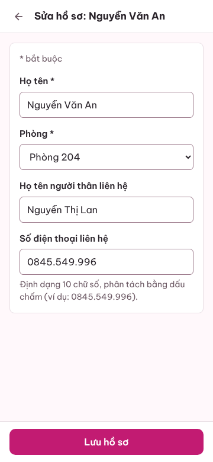
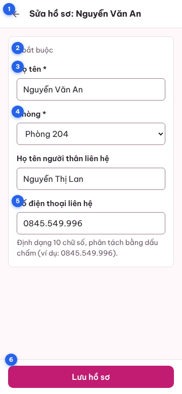
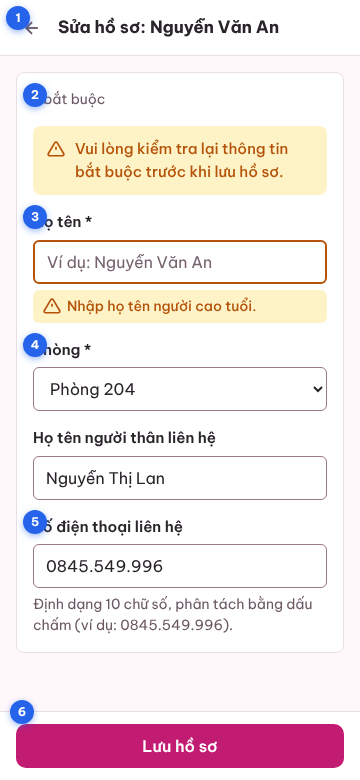

# Screen Spec: S-F01-03 Create or edit resident profile (Mobile)

| Field | Value |
|---|---|
| Screen ID | S-F01-03 |
| Screen name | Create or edit resident profile |
| Actor | Receptionist |
| Priority | Must |
| Feature | F-01 Resident Profile Management |
| Activity diagrams | AD-UC-01 (actions "Enter or correct the resident's details", "Submit the details"), AD-UC-02 (actions "Edit or correct the resident's information", "Save the changes") |
| Mockup images | `img/S-F01-03-mobile.png` (default), `img/S-F01-03-mobile-numbered.png`, five state images (section 2) |
| Frame width | 360px (exported at 3x, 1080 pixels) |
| Figma frame | not used (drawn as an HTML wireframe) |
| Status | Draft |

## 1. Purpose

**Shown when:** a Receptionist taps "Thêm người cao tuổi" (New resident) from S-F01-01 (Resident list) on a mobile viewport (`360–767px`) to create a new resident profile (UC-01), or taps "Sửa hồ sơ" (Edit profile) from S-F01-02 (Resident profile detail) to update an existing resident's information (UC-02).

**The user leaves this screen when:** the profile is saved with valid details (navigating to S-F01-02 to show the newly created or updated profile), or when the Receptionist taps the Back arrow button in the app bar without saving (returning to S-F01-01 or S-F01-02).

## 2. Mockup

**Numbered:** each number is the # of the element inventory in section 3. The top warning banner and inline field error appear in the error state (shown on `S-F01-03-mobile-error-numbered.png`). *(Note: The default mockup shows Edit mode "Sửa hồ sơ: Nguyễn Văn An"; Create mode "Thêm người cao tuổi" is shown in `S-F01-03-mobile-empty.png`).*

| Default, numbered | Error, numbered |
|---|---|
|  |  |

| State | Image |
|---|---|
| Default | `img/S-F01-03-mobile.png` |
| Empty | `img/S-F01-03-mobile-empty.png` (Create mode with blank form fields) |
| Loading | `img/S-F01-03-mobile-loading.png` |
| Error | `img/S-F01-03-mobile-error.png` (validation error state, FR-01-01 / FR-01-02) |
| Success | `img/S-F01-03-mobile-success.png` |

All colours, fonts and corners come from the design tokens in
[ui-conventions.md](../ui-conventions.md#7-design-tokens).

## 3. Element inventory

| # | Element | Type | Content / data source | Required | Validation |
|---|---|---|---|---|---|
| 1 | App bar | Mobile top bar | Back arrow button (`←`) on the left + dynamic title ("Thêm người cao tuổi" in Create mode; "Sửa hồ sơ: " + `Resident Profile.full_name` in Edit mode; `56px` height, `colour/surface`, tab bar hidden on full-screen forms per `ui-conventions.md` §4) | Yes | none |
| 2 | Required legend & form error banner | Helper text / Warning banner | Static legend `* bắt buộc` in `colour/text-secondary`; in Error state, top warning banner (`colour/warning-bg`) displays "Vui lòng kiểm tra lại thông tin bắt buộc trước khi lưu hồ sơ." | Yes (legend) / No (banner) | none |
| 3 | Full name (`Họ tên *`) | Text input | `Resident Profile.full_name`; placeholder "Ví dụ: Nguyễn Văn An"; displays inline warning banner ("Nhập họ tên người cao tuổi.") and `2px colour/warning` border when invalid | Yes | Non-empty string required (FR-01-01, FR-01-02, BR-01-02) |
| 4 | Room (`Phòng *`) | Select dropdown | `Resident Profile.room`; placeholder "Chọn phòng" in Create mode, current room (e.g., "Phòng 204") in Edit mode | Yes | Must select a valid room (BR-01-02) |
| 5 | Linked family contact (`Họ tên người thân liên hệ` & `Số điện thoại liên hệ`) | Text inputs + hint text | Optional contact fields (`family_contact.full_name`, placeholder "Ví dụ: Nguyễn Thị Lan"; `family_contact.phone`, placeholder "0845.549.996") with format hint "Định dạng 10 chữ số, phân tách bằng dấu chấm (ví dụ: 0845.549.996)." | No | When provided, phone must be 10 digits formatted `4.3.3` with dots (`ui-conventions.md` §2) |
| 6 | Save profile (`Lưu hồ sơ`) | Fixed bottom primary button | Full-width button fixed at the bottom (`44px+` height, `colour/primary`) | Yes | none |

## 4. States

| State | What the user sees | Trigger |
|---|---|---|
| Default | Full-screen mobile form (`360px` width) with app bar ("Sửa hồ sơ: Nguyễn Văn An"), single form card pre-filled with existing resident's full name, room, and optional family contact details (Edit mode), and fixed bottom primary button "Lưu hồ sơ". | Receptionist taps "Sửa hồ sơ" on S-F01-02 (UC-02) |
| Empty (no data) | Full-screen mobile form titled "Thêm người cao tuổi" with empty text fields showing placeholders ("Ví dụ: Nguyễn Văn An", "Ví dụ: Nguyễn Thị Lan", "0845.549.996") and "Chọn phòng" unselected in the Room dropdown (Create mode). | Receptionist taps "Thêm người cao tuổi" on S-F01-01 (UC-01) |
| Loading | App bar and fixed bottom primary button ("Lưu hồ sơ") remain visible; the 4 form input groups inside the card are replaced by grey skeleton placeholders (`colour/surface-secondary`). | Existing resident profile data is being fetched in Edit mode, or profile save request is in flight |
| Error | Top warning banner (`colour/warning-bg`) displays "Vui lòng kiểm tra lại thông tin bắt buộc trước khi lưu hồ sơ."; invalid fields (e.g., empty `Họ tên *`) are highlighted with a `2px colour/warning` border and an inline warning banner ("Nhập họ tên người cao tuổi.") directly underneath; entered valid data in other fields is preserved. | Receptionist taps "Lưu hồ sơ" with missing required fields or invalid input format (FR-01-01, FR-01-02) |
| Success / confirmation | Profile is saved with a generated unique Resident ID (Create) or updated timestamp & staff name (Edit), a dark toast (`colour/toast`) above the bottom button confirms "Đã lưu hồ sơ người cao tuổi \[Full Name\] · \[Room\].", and the app navigates to S-F01-02. | Server validates and saves the `Resident Profile` record (FR-01-01, FR-01-02) |

## 5. Interactions and navigation

| # | Element | User action | System response | Goes to screen |
|---|---|---|---|---|
| 1 | `Họ tên *` text input | type | Updates full name value; clears inline error highlight if corrected | stays |
| 2 | `Phòng *` dropdown | tap / select | Opens room picker and selects a room | stays |
| 3 | `Họ tên người thân liên hệ` / `Số điện thoại liên hệ` inputs | type | Updates optional family contact name and phone number | stays |
| 4 | "Lưu hồ sơ" button | tap | Validates fields (FR-01-01 / FR-01-02); if invalid, displays top and inline validation errors; if valid, generates Resident ID (Create) or records timestamp & staff name (Edit), saves profile, and opens profile detail with success toast | stays (Error state) or S-F01-02 (Success) |
| 5 | Back button (`←` in app bar) | tap | If unsaved changes exist, opens confirm modal ("Close without saving?"); otherwise closes form without saving and returns to previous screen | S-F01-01 (from Create) or S-F01-02 (from Edit) |

## 6. Screen-level rules

| Rule ID | Rule | Source |
|---|---|---|
| SR-001 | Only users with the Receptionist role and a valid session token may create or update resident profiles; unauthorized requests redirect to the user's home screen with an access-denied message. | BR-06-01, FR-06-03 |
| SR-002 | A resident profile is saved or updated only when all required fields (`Họ tên *`, `Phòng *`) pass validation; if invalid, no data is persisted and validation errors are shown so the Receptionist can correct them. | BR-01-02, FR-01-01, FR-01-02 |
| SR-003 | On creating a new resident profile, the system generates a unique Resident ID (`Mã NCT`) upon valid submission. | BR-01-01, FR-01-01 |
| SR-004 | On updating an existing resident profile, the system records the modification timestamp and the signed-in Receptionist's name. | FR-01-02 |
| SR-005 | Tapping the Back arrow button (`←`) when form fields have been modified prompts the Receptionist to confirm discarding unsaved changes (`ui-conventions.md` §3.3, §5). | `ui-conventions.md` §3.3 |

## 7. Linked requirements

| FR ID | What this screen does for it |
|---|---|
| FR-01-01 | Provides the mobile creation form, validates submitted resident details, displays validation errors when invalid, or triggers unique Resident ID generation and saves the new profile |
| FR-01-02 | Provides the mobile edit form pre-filled with current details, validates changes, displays validation errors when invalid, or saves updates with timestamp and staff name |
| FR-06-03 | Restricts access to the Receptionist role and verifies session permissions on submission |

## 8. Responsive and accessibility notes

* Smallest supported width: `360px` (exported at 3x = `1080px`); at `768px` and wider, the screen renders as a centred form-only record dialog (`S-F01-03-desktop`, max width `640px`) (`ui-conventions.md` §3.1, §3.3, §3.5).
* The mobile tab bar is hidden on full-screen forms, and the fixed bottom primary button ("Lưu hồ sơ") is at least `44px` tall with matching bottom padding on the scrollable form container so no inputs or hints are covered (`ui-conventions.md` §4, §6).
* Required fields are marked with `*` in `colour/text-primary` (explained by `* bắt buộc` at the top) rather than red, reserving `colour/error` exclusively for resident medical alerts; validation errors use `colour/warning` (`#B45309` on `#FEF3C7`, `4.5:1` contrast) paired with a warning icon (`ui-conventions.md` §3.6, §4, §7.6).
* Every control displays a `2px` `colour/primary` focus ring (`2px` offset), touch targets meet `24x24px` minimums (`44x44px` standard), and zoom remains enabled (`lang="vi"`, `ui-conventions.md` §6).

## 9. Open questions

| # | Question | Blocking? | Status |
|---|---|---|---|
| 1 | [NEEDS CLARIFICATION: Are additional demographic fields (such as date of birth, sex, or medical history) required in Release 1, and what exact validation rules apply to them?] | Yes | Open (`AD-UC-01` Q1, `AD-UC-02` Q1). Default: validate non-empty `Họ tên *`, selected `Phòng *`, and 10-digit `4.3.3` dot format for optional `Số điện thoại liên hệ`. |
| 2 | [NEEDS CLARIFICATION: Should entering family contact details here automatically link/create a family user account, or is family account linking handled exclusively by Admin in UC-11 (S-F06-02)?] | No | Open (`AD-UC-01` Q3). Default: store contact reference info here; system account linking remains in S-F06-02 per FR-06-05. |

---

## Completion checklist

- [x] The mockup is a separate cropped image file, named with the Screen ID, at the frame width.
- [x] The numbered image exists, and its numbers match the # column of the element inventory.
- [x] Every visible element in the mockup appears in the element inventory.
- [x] Every colour in the mockup is a design token from ui-conventions.md.
- [x] Every input element has a validation rule or an explicit "none".
- [x] All five states are filled in.
- [x] Every navigation target is a Screen ID that exists in the Screen List.
- [x] Every element that displays data names the field it displays.
- [x] Every linked FR exists in the Function List, and every action of this screen in AD-UC-01 and AD-UC-02 is covered by an interaction row.