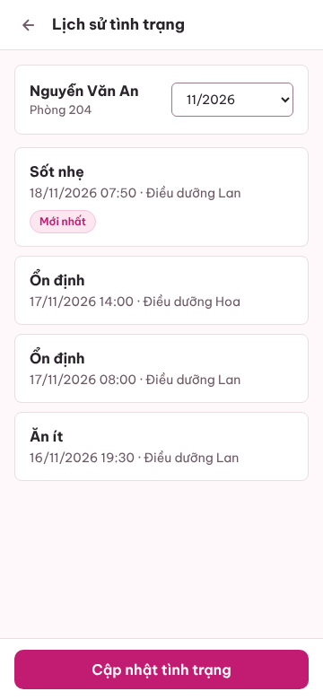
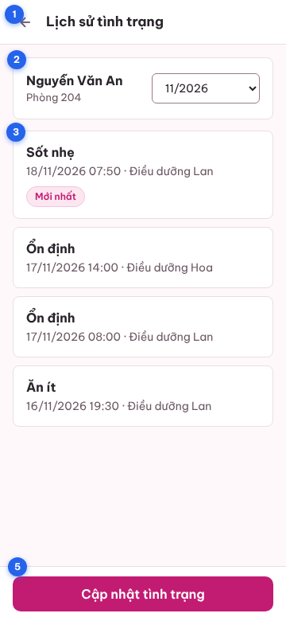
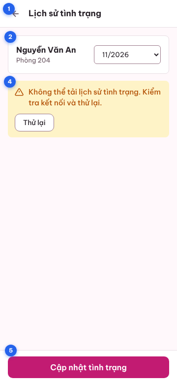
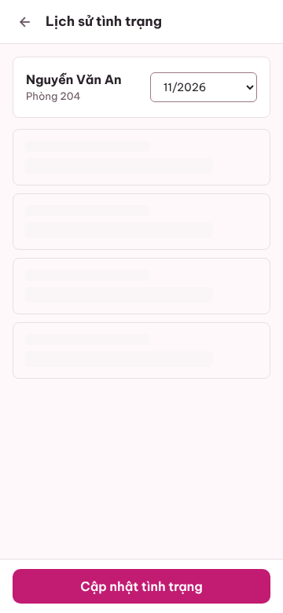
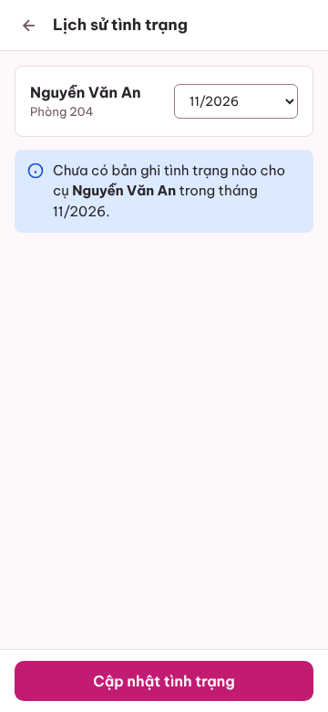
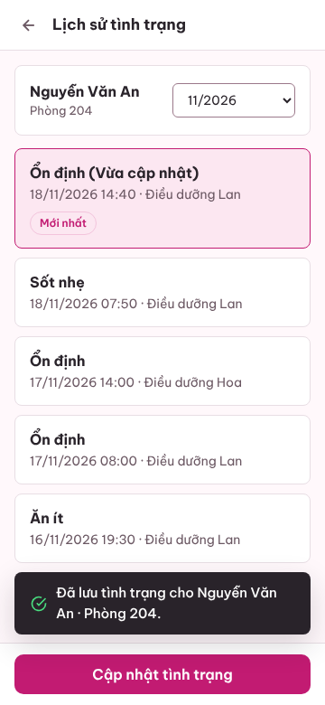

# Screen Spec: S-F02-01 Condition history (Mobile)

| Field | Value |
|---|---|
| Screen ID | S-F02-01 |
| Screen name | Condition history |
| Actor | Nurse |
| Priority | Should |
| Feature | F-02 Condition Tracking |
| Activity diagrams | None (`UC-04 View condition history` is marked `not needed` in `usage-flow.md`; related to `AD-UC-05` append-only history rule) |
| Mockup images | `img/S-F02-01-mobile.png` (default), `img/S-F02-01-mobile-numbered.png`, five state images (section 2) |
| Frame width | 360px (exported at 3x, 1080 pixels) |
| Figma frame | not used (drawn as an HTML wireframe) |
| Status | Draft |

## 1. Purpose

**Shown when:** a Nurse taps a resident's condition history from S-F01-01 (Resident list) or taps "Lịch sử tình trạng" on S-F01-02 (Resident profile detail) on a mobile viewport (`360–767px`), or returns here after saving a new condition on S-F02-02 (Update resident condition).

**The user leaves this screen when:** they tap the Back arrow button (`←`) in the app bar to return to S-F01-02 (if opened from profile) or S-F01-01 (if opened from the resident list), or tap the fixed bottom primary button "Cập nhật tình trạng" to open S-F02-02.

## 2. Mockup

**Numbered:** each number is the # of the element inventory in section 3. Element 3 (Condition history timeline) appears in the default and success states, while element 4 (Message area) replaces the timeline in the error and empty states (shown on `S-F02-01-mobile-error-numbered.png`).

| Default, numbered | Error, numbered |
|---|---|
|  |  |

| Loading | Empty |
|---|---|
|  |  |

| Success |
|---|
|  |

| State | Image |
|---|---|
| Default | `img/S-F02-01-mobile.png` |
| Empty | `img/S-F02-01-mobile-empty.png` |
| Loading | `img/S-F02-01-mobile-loading.png` |
| Error | `img/S-F02-01-mobile-error.png` (network/load failure; access-denied refusal redirects to S-F01-01 per FR-06-03) |
| Success | `img/S-F02-01-mobile-success.png` |

All colours, fonts and corners come from the design tokens in
[ui-conventions.md](../ui-conventions.md#7-design-tokens).

## 3. Element inventory

| # | Element | Type | Content / data source | Required | Validation |
|---|---|---|---|---|---|
| 1 | App bar | Mobile top bar | Back arrow button (`←`) on the left + static title "Lịch sử tình trạng" (`56px` height, `colour/surface`, no counters per `ui-conventions.md` §4) | Yes | none |
| 2 | Resident & period header card | Summary + filter card | `Resident Profile.full_name` (bold, e.g., "Nguyễn Văn An") and `resident.room` ("Phòng 204") on the left; month selector dropdown (`MM/yyyy`, e.g., "11/2026") on the right | Yes | Valid month selection |
| 3 | Condition history timeline | Chronological card list | List of `Resident Condition` records sorted newest first: condition value (`condition.value`), timestamp & nurse (`condition.updated_at` · "Điều dưỡng " + `condition.nurse_name`), and "Mới nhất" pill badge (`colour/pink-light`, `colour/primary`) on the top record; no Edit or Delete actions | Yes | formats from `ui-conventions.md` §2 |
| 4 | Message area | Banner / Toast | Info banner in Empty state ("Chưa có bản ghi tình trạng nào cho cụ [Full Name] trong tháng [MM/yyyy]."); Warning banner with "Thử lại" button in Error state ("Không thể tải lịch sử tình trạng. Kiểm tra kết nối và thử lại."); Dark toast above bottom bar in Success state ("Đã lưu tình trạng cho [Full Name] · [Room].") | No | none |
| 5 | Update condition (`Cập nhật tình trạng`) | Fixed bottom primary button | Full-width button fixed at the bottom (`44px+` height, `colour/primary`) | Yes | none |

## 4. States

| State | What the user sees | Trigger |
|---|---|---|
| Default | Mobile app bar ("Lịch sử tình trạng"), resident & month filter card ("Nguyễn Văn An · Phòng 204", "11/2026"), stacked chronological cards of saved condition records (newest on top with "Mới nhất" pill badge), and fixed bottom primary button "Cập nhật tình trạng". | Nurse opens condition history for a resident and records load (FR-02-04) |
| Empty (no data) | App bar, resident & month filter card, and fixed bottom button remain visible; the record cards are replaced by an info banner (`colour/info-bg`) stating "Chưa có bản ghi tình trạng nào cho cụ [Full Name] trong tháng [MM/yyyy]." | No `Resident Condition` records exist for the resident in the selected month |
| Loading | App bar, resident & month filter card, and fixed bottom button remain visible; the timeline area displays 4 grey skeleton card placeholders (`colour/surface-secondary`). | Condition history records are being fetched from API Server |
| Error | Warning banner (`colour/warning-bg`) displays "Không thể tải lịch sử tình trạng. Kiểm tra kết nối và thử lại." with a "Thử lại" secondary button below the filter card; record list is hidden. | API request to fetch condition history fails or times out |
| Success / confirmation | Newly saved condition record appears at the top of the card list highlighted with `colour/pink-light` background, `1px colour/primary` border, and "(Vừa cập nhật)" / "Mới nhất" badge; a dark toast (`colour/toast`, auto-dismisses after 4s) above the fixed bottom button confirms "Đã lưu tình trạng cho [Full Name] · [Room]." | Returned from S-F02-02 after saving a new condition record (FR-02-02, FR-02-03) |

## 5. Interactions and navigation

| # | Element | User action | System response | Goes to screen |
|---|---|---|---|---|
| 1 | Back button (`←` in app bar) | tap | Returns to the previous screen without changes | S-F01-02 (if opened from profile) or S-F01-01 (if opened from list) |
| 2 | Month dropdown (`11/2026`) | tap / select | Filters and reloads condition records for the chosen month | stays (Loading → Default/Empty/Error) |
| 3 | "Cập nhật tình trạng" button | tap | Opens the full-screen Update resident condition form | S-F02-02 |
| 4 | "Thử lại" button (Error banner) | tap (Error state) | Re-fetches the resident's condition history for the selected month | stays (Loading → Default/Empty/Error) |

## 6. Screen-level rules

| Rule ID | Rule | Source |
|---|---|---|
| SR-001 | Only authenticated users with the Nurse role may view condition history; unauthorized requests redirect to the user's home screen with an access-denied message. | BR-06-01, FR-06-03 |
| SR-002 | Condition records are displayed in reverse chronological order (newest first) showing the condition value, timestamp (`dd/MM/yyyy HH:mm`), and recording nurse's name. | FR-02-02, FR-02-04 |
| SR-003 | Saved condition records are strictly immutable (append-only): no Edit, Copy, or Delete controls are provided on any record card in the timeline. | BR-02-01, FR-02-03 |
| SR-004 | Status badges ("Mới nhất") and banners never rely on colour alone; banners pair semantic icons with clear Vietnamese text (`lang="vi"`). | `ui-conventions.md` §4, §6 |

## 7. Linked requirements

| FR ID | What this screen does for it |
|---|---|
| FR-02-02 | Displays the saved timestamp and nurse's name alongside each condition record |
| FR-02-03 | Enforces read-only presentation of historical condition records without overwrite or delete actions |
| FR-02-04 | Lists all condition records of the selected resident in chronological order filtered by month on mobile |
| FR-06-03 | Restricts access to the Nurse role and verifies session permissions on every request |

## 8. Responsive and accessibility notes

* Smallest supported width: `360px` (exported at 3x = `1080px`); at `768px` and wider, the screen switches to the desktop layout (`S-F02-01-desktop`) with sidebar navigation, breadcrumbs, and additional secondary action buttons (`ui-conventions.md` §3.1, §3.5).
* The fixed primary button ("Cập nhật tình trạng") at the bottom is at least `44px` tall, and the scrollable timeline container includes bottom padding equal to the button area so the last record card is never covered (`ui-conventions.md` §6).
* Touch targets (including the Back icon button in the app bar, month dropdown, and "Thử lại" button) meet the `24x24px` minimum (`44x44px` standard), and zoom remains enabled (`lang="vi"`, `ui-conventions.md` §6).
* Body text contrast is at least `4.5:1` (`colour/text-primary` on `colour/surface` is `15.4:1`; `colour/primary` on `colour/pink-light` is `4.8:1`), and banners/toasts pair semantic icons with descriptive Vietnamese text.

## 9. Open questions

| # | Question | Blocking? | Status |
|---|---|---|---|
| 1 | [NEEDS CLARIFICATION: Should the period filter also include an "All time" (Tất cả) option in addition to individual months (`MM/yyyy`), or only monthly buckets?] | No | Open. Default: monthly buckets (`MM/yyyy`) defaulting to the current month per `ui-conventions.md` §3.3. |
| 2 | [NEEDS CLARIFICATION: Should condition records display structured vital-sign fields if added in a future release, or remain a single condition text entry?] | No | Open (`ui-conventions.md` §3.6). Default: single condition value per record in Release 1 per FR-02-02. |

---

## Completion checklist

- [x] The mockup is a separate cropped image file, named with the Screen ID, at the frame width.
- [x] The numbered image exists, and its numbers match the # column of the element inventory.
- [x] Every visible element in the mockup appears in the element inventory.
- [x] Every colour in the mockup is a design token from ui-conventions.md.
- [x] Every input element has a validation rule or an explicit "none".
- [x] All five states are filled in.
- [x] Every navigation target is a Screen ID that exists in the Screen List.
- [x] Every element that displays data names the field it displays.
- [x] Every linked FR exists in the Function List, and every action of this screen is covered by an interaction row.
