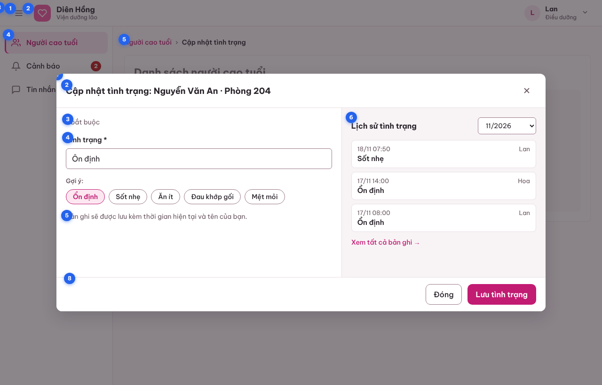
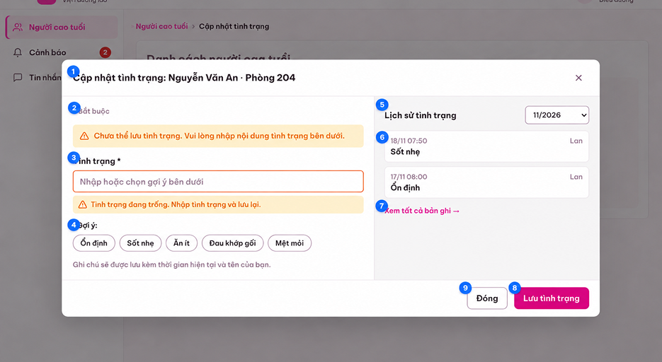
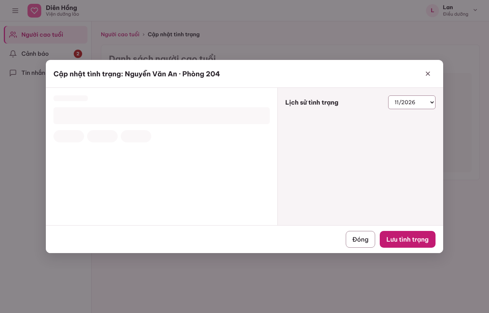
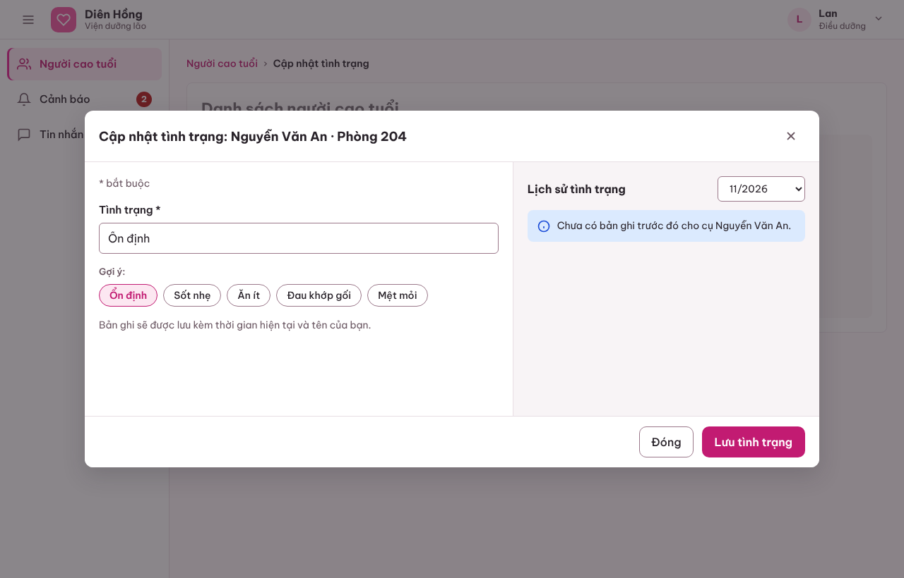
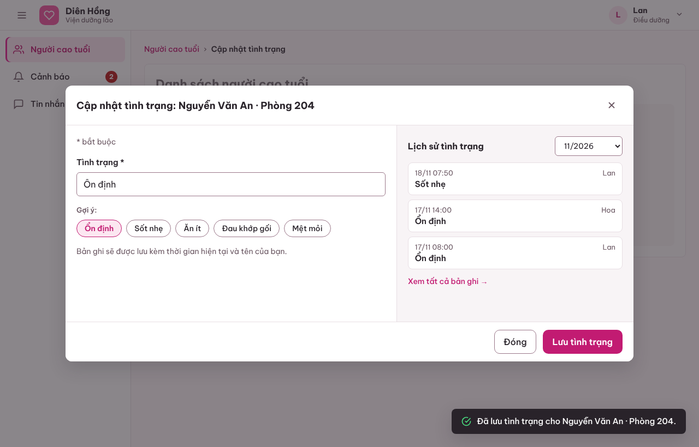

# Screen Spec: S-F02-02 Update resident condition (Desktop)

| Field | Value | 
| ----- | ----- | 
| Screen ID | S-F02-02 | 
| Screen name | Update resident condition | 
| Actor | Nurse | 
| Priority | Must | 
| Feature | F-02 Condition Tracking | 
| Activity diagrams | AD-UC-05 (actions "Show the resident's current condition and quick-condition options", "Enter a custom condition or pick a quick-condition option", "Save the condition") | 
| Mockup images | `img/S-F02-02-desktop.png` (default), `img/S-F02-02-desktop-numbered.jpg`, five state images (section 2) | 
| Frame width | 1280px (exported at 1x; record dialog with history up to 1040px) | 
| Figma frame | not used (drawn as an HTML wireframe) | 
| Status | Draft | 

## 1. Purpose

**Shown when:** a Nurse clicks "Cập nhật tình trạng" (Update condition) from S-F01-01 (Resident list), S-F01-02 (Resident profile detail), or S-F02-01 (Condition history) to record a new condition update for a resident (UC-05).

**The user leaves this screen when:** the condition record is saved with valid text (navigating to S-F02-01 or back to the triggering screen with a success toast), when they click "Xem tất cả bản ghi →" to view the full timeline on S-F02-01, or when they close/cancel the dialog via `[x]`, "Đóng", or `Esc` without saving.

## 2. Mockup

**Numbered:** each number is the # of the element inventory in section 3. The top warning banner and inline field error appear in the error state (shown on `S-F02-02-desktop-error-numbered.jpg`).

| Default, numbered | Error, numbered |
|---|---|
|  |  |

| Loading | Empty |
|---|---|
|  |  |

| Success |
|---|
|  |

| State | Image | 
| ----- | ----- | 
| Default | `img/S-F02-02-desktop.png` | 
| Empty | `img/S-F02-02-desktop-empty.png` (Resident has no prior condition records in the history pane) | 
| Loading | `img/S-F02-02-desktop-loading.png` | 
| Error | `img/S-F02-02-desktop-error.png` (validation error when condition input is empty, FR-02-01) | 
| Success | `img/S-F02-02-desktop-success.png` | 

All colours, fonts and corners come from the design tokens in
[ui-conventions.md](../ui-conventions.md#7-design-tokens).

## 3. Element inventory

| \# | Element | Type | Content / data source | Required | Validation | 
| ----- | ----- | ----- | ----- | ----- | ----- | 
| 1 | Dialog header & close button | Record dialog header | Title "Cập nhật tình trạng: " + `Resident Profile.full_name` + " · " + `Resident Profile.room` (e.g., "Cập nhật tình trạng: Nguyễn Văn An · Phòng 204") and `[x]` icon button on the right | Yes | none | 
| 2 | Required legend & form error banner | Helper text / Warning banner | Static legend `* bắt buộc` in `colour/text-secondary`; in Error state, top warning banner (`colour/warning-bg`) displays "Chưa thể lưu tình trạng. Vui lòng nhập nội dung tình trạng bên dưới." | Yes (legend) / No (banner) | none | 
| 3 | Condition input (`Tình trạng *`) | Text input | `Resident Condition.value`; pre-filled with the active quick-condition or current value ("Ổn định"), placeholder "Nhập hoặc chọn gợi ý bên dưới" when cleared; displays inline warning banner ("Tình trạng đang trống. Nhập tình trạng và lưu lại.") and `2px colour/warning` border when invalid | Yes | Non-empty string required (FR-02-01, BR-02-02) | 
| 4 | Quick-condition chips & audit note | Chip group + helper text | Label "Gợi ý:" with selectable pill chips ("Ổn định", "Sốt nhẹ", "Ăn ít", "Đau khớp gối", "Mệt mỏi"; selected chip uses `colour/pink-light` fill and `colour/primary` border/text), plus static note "Bản ghi sẽ được lưu kèm thời gian hiện tại và tên của bạn." | Yes | none | 
| 5 | History pane header & period filter | Section heading + dropdown | Heading "Lịch sử tình trạng" and month selector dropdown (`MM/yyyy`, e.g., "11/2026") on the right of the side pane | Yes | Valid month selection | 
| 6 | Recent condition history list | Read-only record cards | Chronological list (newest first) of prior `Resident Condition` records in the side pane showing `condition.updated_at` (`dd/MM HH:mm`), `condition.nurse_name`, and `condition.value`; replaced by an info banner ("Chưa có bản ghi trước đó cho cụ \[Full Name\].") when no prior records exist | No | formats from `ui-conventions.md` §2 | 
| 7 | View all records link (`Xem tất cả bản ghi →`) | Text link | Static link (`colour/primary`) at the bottom of the history side pane | No | none | 
| 8 | Save condition (`Lưu tình trạng`) | Primary button | Right footer action button (`colour/primary`) | Yes | none | 
| 9 | Close (`Đóng`) | Secondary button | Left footer action button (`1px colour/border-strong`) | Yes | none | 

## 4. States

| State | What the user sees | Trigger | 
| ----- | ----- | ----- | 
| Default | Two-column record dialog with history (`1040px` max width) over a dimmed backdrop (`colour/scrim`). Left column (`60%`) shows the condition input ("Ổn định"), quick-condition chips, and audit note; right column (`40%`) shows the month filter ("11/2026"), recent read-only condition records, and "Xem tất cả bản ghi →" link; footer shows "Đóng" and "Lưu tình trạng". | Nurse clicks "Cập nhật tình trạng" on S-F01-01, S-F01-02, or S-F02-01 (UC-05) | 
| Empty (no data) | Left column shows the condition input and quick-condition chips as normal; right history pane shows an info banner (`colour/info-bg`) stating "Chưa có bản ghi trước đó cho cụ \[Full Name\]." instead of prior record cards. | Resident has no previously saved `Resident Condition` records in the selected month | 
| Loading | Dialog title, history pane header, and footer buttons ("Đóng", "Lưu tình trạng") remain visible; left form controls and right history list are replaced by grey skeleton placeholders (`colour/surface-secondary`). | Resident condition data and recent history are being fetched from API Server | 
| Error | Top warning banner (`colour/warning-bg`) displays "Chưa thể lưu tình trạng. Vui lòng nhập nội dung tình trạng bên dưới."; `Tình trạng *` input shows placeholder "Nhập hoặc chọn gợi ý bên dưới" with a `2px colour/warning` border and an inline warning banner ("Tình trạng đang trống. Nhập tình trạng và lưu lại.") underneath. | Nurse clears the condition input and clicks "Lưu tình trạng" with an empty value (FR-02-01) | 
| Success / confirmation | New `Resident Condition` record is appended (without overwriting prior records), a dark bottom-right toast (`colour/toast`, auto-dismisses after 4s) confirms "Đã lưu tình trạng cho \[Full Name\] · \[Room\].", and the dialog closes to show S-F02-01 (or the originating screen). | Server validates and appends the new condition record with current timestamp and nurse name (FR-02-02, FR-02-03) | 

## 5. Interactions and navigation

| \# | Element | User action | System response | Goes to screen | 
| ----- | ----- | ----- | ----- | ----- | 
| 1 | `Tình trạng *` text input | type | Updates condition text; clears inline validation error highlight if corrected | stays | 
| 2 | Quick-condition chips ("Ổn định", "Sốt nhẹ", "Ăn ít", "Đau khớp gối", "Mệt mỏi") | click | Selects the chip and populates `Tình trạng *` with the chosen condition text | stays | 
| 3 | Month dropdown (`11/2026` in history pane) | select | Reloads the read-only history cards in the right pane for the selected month | stays | 
| 4 | "Xem tất cả bản ghi →" link | click | Closes dialog and opens the full condition history screen for the resident | S-F02-01 | 
| 5 | "Lưu tình trạng" button | click | Validates non-empty condition (FR-02-01); if empty, displays top and inline warning banners; if valid, appends a new `Resident Condition` record with current timestamp and nurse name (FR-02-02, FR-02-03), updates resident's current status, and shows success toast | stays (Error state) or S-F02-01 (Success) | 
| 6 | "Đóng" button / `[x]` icon / `Esc` key | click / press | If unsaved changes exist, opens confirm modal ("Close without saving?"); otherwise closes dialog without saving and returns to previous screen | S-F01-01 / S-F01-02 / S-F02-01 | 

## 6. Screen-level rules

| Rule ID | Rule | Source | 
| ----- | ----- | ----- | 
| SR-001 | Only authenticated users with the Nurse role may record condition updates; unauthorized requests redirect to the user's home screen with an access-denied message. | BR-06-01, FR-06-03 | 
| SR-002 | A condition update is saved only when `Tình trạng *` is non-empty (entered manually or selected from a quick-condition chip); empty submissions are rejected with inline validation warnings and no data is persisted. | FR-02-01 | 
| SR-003 | Every saved condition update automatically records the current system timestamp (`dd/MM/yyyy HH:mm`) and the signed-in Nurse's name alongside the condition value. | FR-02-02 | 
| SR-004 | Saving a new condition update appends a new record to the resident's history and updates the resident's current condition summary; historical records are never overwritten or deleted. | BR-02-01, BR-02-02, FR-02-03 | 
| SR-005 | Closing the dialog via `[x]`, "Đóng", or `Esc` after modifying the condition input prompts the Nurse to confirm discarding unsaved changes (`ui-conventions.md` §3.3, §5). | `ui-conventions.md` §3.3 | 

## 7. Linked requirements

| FR ID | What this screen does for it | 
| ----- | ----- | 
| FR-02-01 | Provides the condition input field and quick-condition chips, and validates that a non-empty condition is entered before saving | 
| FR-02-02 | Automatically attaches the current timestamp and signed-in Nurse's name when saving a condition record | 
| FR-02-03 | Appends each new condition update as a separate immutable record while displaying read-only prior records in the side pane | 
| FR-06-03 | Restricts condition updates to the Nurse role and verifies session permissions on submission | 

## 8. Responsive and accessibility notes

* Desktop layout (`768px` and wider, drawn at `1280px`) renders S-F02-02 as a centred two-column record dialog with history (`max-width: 1040px`, `size/dialog-with-history`, 60% form / 40% history) over a `55%` scrim (`colour/scrim`); below `768px` (down to `360px`), it switches to a single-column full-screen mobile form (`S-F02-02-mobile`) with a fixed bottom primary button (`ui-conventions.md` §3.1, §3.3, §3.5).

* Keyboard focus is trapped inside the open record dialog, every input, chip, and button displays a `2px` `colour/primary` focus ring (`2px` offset), and pressing `Esc` triggers the close/unsaved-changes flow (`ui-conventions.md` §6).

* Required fields are marked with `*` in `colour/text-primary` (explained by `* bắt buộc` at the top) rather than red, reserving `colour/error` exclusively for resident medical alerts; validation warnings use `colour/warning` (`#B45309` on `#FEF3C7`, `4.5:1` contrast) paired with a warning icon (`ui-conventions.md` §3.6, §4, §7.6).

## 9. Open questions

| \# | Question | Blocking? | Status | 
| ----- | ----- | ----- | ----- | 
| 1 | \[NEEDS CLARIFICATION: Should the quick-condition chip list ("Ổn định", "Sốt nhẹ", "Ăn ít", "Đau khớp gối", "Mệt mỏi") be configurable by Admin in a future release, or remain fixed in Release 1?\] | No | Open (`AD-UC-05` Q1). Default: fixed set of 5 Vietnamese quick-condition chips in Release 1 per FR-02-01. | 
| 2 | \[NEEDS CLARIFICATION: After saving a condition update, should the Nurse always be navigated to S-F02-01 (Condition history), or returned to whichever screen opened the dialog (S-F01-01, S-F01-02, or S-F02-01)?\] | No | Open. Default: return to S-F02-01 (or the originating screen) with the confirmation toast "Đã lưu tình trạng cho \[Full Name\] · \[Room\]." | 

## Completion checklist

* \[x\] The mockup is a separate cropped image file, named with the Screen ID, at the frame width.

* \[x\] The numbered image exists, and its numbers match the # column of the element inventory.

* \[x\] Every visible element in the mockup appears in the element inventory.

* \[x\] Every colour in the mockup is a design token from ui-conventions.md.

* \[x\] Every input element has a validation rule or an explicit "none".

* \[x\] All five states are filled in.

* \[x\] Every navigation target is a Screen ID that exists in the Screen List.

* \[x\] Every element that displays data names the field it displays.

* \[x\] Every linked FR exists in the Function List, and every action of this screen in AD-UC-05 is covered by an interaction row.
