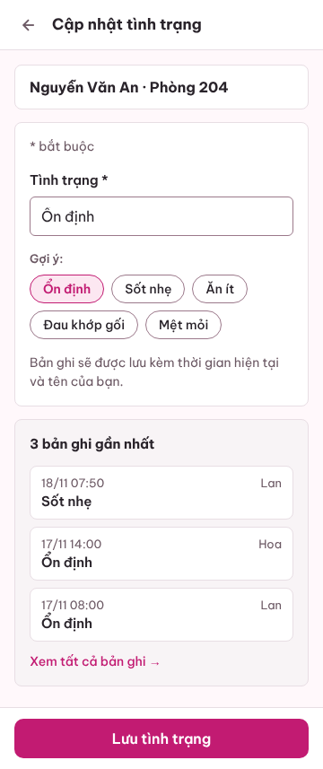
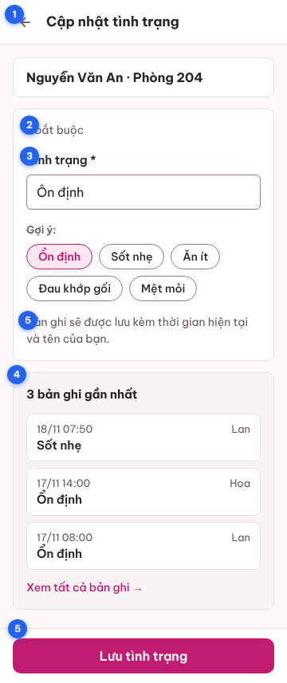
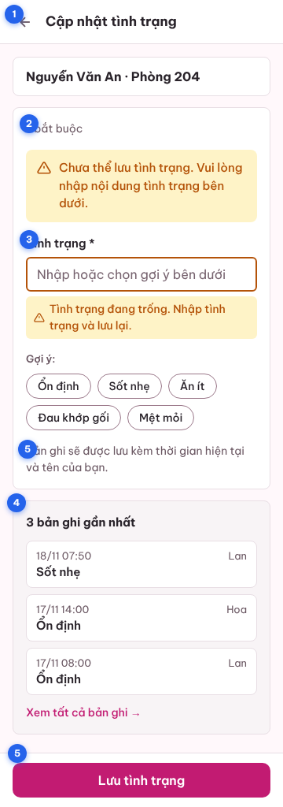
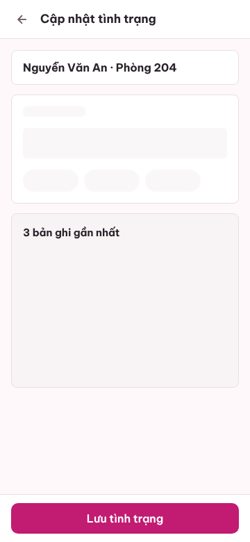
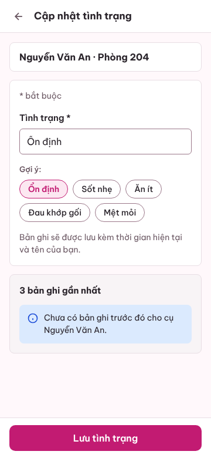
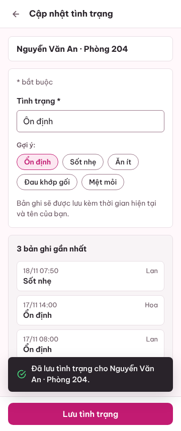

# Screen Spec: S-F02-02 Update resident condition (Mobile)

| Field | Value | 
| ----- | ----- | 
| Screen ID | S-F02-02 | 
| Screen name | Update resident condition | 
| Actor | Nurse | 
| Priority | Must | 
| Feature | F-02 Condition Tracking | 
| Activity diagrams | AD-UC-05 (actions "Show the resident's current condition and quick-condition options", "Enter a custom condition or pick a quick-condition option", "Save the condition") | 
| Mockup images | `img/S-F02-02-mobile.png` (default), `img/S-F02-02-mobile-numbered.png`, five state images (section 2) | 
| Frame width | 360px (exported at 3x, 1080 pixels) | 
| Figma frame | not used (drawn as an HTML wireframe) | 
| Status | Done | 

## 1. Purpose

**Shown when:** a Nurse taps "Cập nhật tình trạng" (Update condition) from S-F01-01 (Resident list), S-F01-02 (Resident profile detail), or S-F02-01 (Condition history) on a mobile viewport (`360–767px`) to record a new condition update for a resident (UC-05).

**The user leaves this screen when:** the condition record is saved with valid text (navigating to S-F02-01 or back to the triggering screen with a success toast), when they tap "Xem tất cả bản ghi →" to view the full timeline on S-F02-01, or when they tap the Back arrow button (`←`) in the app bar without saving.

## 2. Mockup

**Numbered:** each number is the # of the element inventory in section 3. The top warning banner and inline field error appear in the error state (shown on `S-F02-02-mobile-error-numbered.png`). *(Note: On `S-F02-02-mobile-numbered.png`, badge `5` marks both the audit note and the fixed bottom primary button `Lưu tình trạng`).*

| Default, numbered | Error, numbered |
|---|---|
|  |  |

| Loading | Empty |
|---|---|
|  |  |

| Success |
|---|
|  | 

| State | Image | 
| ----- | ----- | 
| Default | `img/S-F02-02-mobile.png` | 
| Empty | `img/S-F02-02-mobile-empty.png` (Resident has no prior condition records in the recent records card) | 
| Loading | `img/S-F02-02-mobile-loading.png` | 
| Error | `img/S-F02-02-mobile-error.png` (validation error when condition input is empty, FR-02-01) | 
| Success | `img/S-F02-02-mobile-success.png` | 

All colours, fonts and corners come from the design tokens in
[ui-conventions.md](../ui-conventions.md#7-design-tokens).

## 3. Element inventory

| \# | Element | Type | Content / data source | Required | Validation | 
| ----- | ----- | ----- | ----- | ----- | ----- | 
| 1 | App bar & resident header card | Mobile top bar + summary card | Back arrow button (`←`) on the left + static title "Cập nhật tình trạng" (`56px` height, `colour/surface`, tab bar hidden on full-screen forms per `ui-conventions.md` §4), followed by summary card showing `Resident Profile.full_name` + " · " + `Resident Profile.room` (e.g., "Nguyễn Văn An · Phòng 204") | Yes | none | 
| 2 | Required legend & form error banner | Helper text / Warning banner | Static legend `* bắt buộc` in `colour/text-secondary`; in Error state, top warning banner (`colour/warning-bg`) displays "Chưa thể lưu tình trạng. Vui lòng nhập nội dung tình trạng bên dưới." | Yes (legend) / No (banner) | none | 
| 3 | Condition input & quick-condition chips (`Tình trạng *` & `Gợi ý:`) | Text input + chip group | `Resident Condition.value`; pre-filled with the active quick-condition or current value ("Ổn định"), placeholder "Nhập hoặc chọn gợi ý bên dưới" when cleared; displays inline warning banner ("Tình trạng đang trống. Nhập tình trạng và lưu lại.") and `2px colour/warning` border when invalid; selectable pill chips ("Ổn định", "Sốt nhẹ", "Ăn ít", "Đau khớp gối", "Mệt mỏi") | Yes | Non-empty string required (FR-02-01, BR-02-02) | 
| 4 | Recent records card (`3 bản ghi gần nhất`) | Read-only summary card | Heading "3 bản ghi gần nhất" with up to 3 most recent `Resident Condition` records (`condition.updated_at` in `dd/MM HH:mm`, `condition.nurse_name`, `condition.value`) and "Xem tất cả bản ghi →" link (`colour/primary`); replaced by an info banner ("Chưa có bản ghi trước đó cho cụ \[Full Name\].") when no prior records exist | No | formats from `ui-conventions.md` §2 | 
| 5 | Audit note & save action (`Lưu tình trạng`) | Helper text + fixed bottom button | Static note "Bản ghi sẽ được lưu kèm thời gian hiện tại và tên của bạn." inside the form card, plus full-width primary button fixed at the bottom (`44px+` height, `colour/primary`) | Yes | none | 

## 4. States

| State | What the user sees | Trigger | 
| ----- | ----- | ----- | 
| Default | Full-screen mobile form (`360px` width) with app bar ("Cập nhật tình trạng"), resident card ("Nguyễn Văn An · Phòng 204"), condition form card (input pre-filled with "Ổn định", 5 quick-condition chips, audit note), "3 bản ghi gần nhất" card with "Xem tất cả bản ghi →" link, and fixed bottom primary button "Lưu tình trạng". | Nurse taps "Cập nhật tình trạng" on S-F01-01, S-F01-02, or S-F02-01 (UC-05) | 
| Empty (no data) | Resident header card and condition form card appear as normal; inside the "3 bản ghi gần nhất" card, an info banner (`colour/info-bg`) displays "Chưa có bản ghi trước đó cho cụ \[Full Name\]." instead of prior record cards. | Resident has no previously saved `Resident Condition` records | 
| Loading | App bar, resident header card, "3 bản ghi gần nhất" heading, and fixed bottom primary button remain visible; the form controls and recent records area are replaced by grey skeleton placeholders (`colour/surface-secondary`). | Resident condition data and recent records are being fetched from API Server | 
| Error | Top warning banner (`colour/warning-bg`) displays "Chưa thể lưu tình trạng. Vui lòng nhập nội dung tình trạng bên dưới."; `Tình trạng *` input shows placeholder "Nhập hoặc chọn gợi ý bên dưới" with a `2px colour/warning` border and an inline warning banner ("Tình trạng đang trống. Nhập tình trạng và lưu lại.") underneath. | Nurse clears the condition input and taps "Lưu tình trạng" with an empty value (FR-02-01) | 
| Success / confirmation | New `Resident Condition` record is appended (without overwriting prior records), a dark toast (`colour/toast`, auto-dismisses after 4s) above the bottom button confirms "Đã lưu tình trạng cho \[Full Name\] · \[Room\].", and the app navigates to S-F02-01 (or back to the originating screen). | Server validates and appends the new condition record with current timestamp and nurse name (FR-02-02, FR-02-03) | 

## 5. Interactions and navigation

| \# | Element | User action | System response | Goes to screen | 
| ----- | ----- | ----- | ----- | ----- | 
| 1 | `Tình trạng *` text input | type | Updates condition text; clears inline validation error highlight if corrected | stays | 
| 2 | Quick-condition chips ("Ổn định", "Sốt nhẹ", "Ăn ít", "Đau khớp gối", "Mệt mỏi") | tap | Selects the chip and populates `Tình trạng *` with the chosen condition text | stays | 
| 3 | "Xem tất cả bản ghi →" link | tap | Opens the full condition history timeline for the resident | S-F02-01 | 
| 4 | "Lưu tình trạng" button | tap | Validates non-empty condition (FR-02-01); if empty, displays top and inline warning banners; if valid, appends a new `Resident Condition` record with current timestamp and nurse name (FR-02-02, FR-02-03), updates resident's current status, and navigates with success toast | stays (Error state) or S-F02-01 (Success) | 
| 5 | Back button (`←` in app bar) | tap | If unsaved changes exist, opens confirm modal ("Close without saving?"); otherwise closes form without saving and returns to previous screen | S-F01-01 / S-F01-02 / S-F02-01 | 

## 6. Screen-level rules

| Rule ID | Rule | Source | 
| ----- | ----- | ----- | 
| SR-001 | Only authenticated users with the Nurse role may record condition updates; unauthorized requests redirect to the user's home screen with an access-denied message. | BR-06-01, FR-06-03 | 
| SR-002 | A condition update is saved only when `Tình trạng *` is non-empty (entered manually or selected from a quick-condition chip); empty submissions are rejected with inline validation warnings and no data is persisted. | FR-02-01 | 
| SR-003 | Every saved condition update automatically records the current system timestamp (`dd/MM/yyyy HH:mm`) and the signed-in Nurse's name alongside the condition value. | FR-02-02 | 
| SR-004 | Saving a new condition update appends a new record to the resident's history and updates the resident's current condition summary; historical records are never overwritten or deleted. | BR-02-01, BR-02-02, FR-02-03 | 
| SR-005 | Tapping the Back arrow button (`←`) after modifying the condition input prompts the Nurse to confirm discarding unsaved changes (`ui-conventions.md` §3.3, §5). | `ui-conventions.md` §3.3 | 

## 7. Linked requirements

| FR ID | What this screen does for it | 
| ----- | ----- | 
| FR-02-01 | Provides the mobile condition input field and quick-condition chips, and validates that a non-empty condition is entered before saving | 
| FR-02-02 | Automatically attaches the current timestamp and signed-in Nurse's name when saving a condition record | 
| FR-02-03 | Appends each new condition update as a separate immutable record while displaying read-only recent records underneath | 
| FR-06-03 | Restricts condition updates to the Nurse role and verifies session permissions on submission | 

## 8. Responsive and accessibility notes

* Smallest supported width: `360px` (exported at 3x = `1080px`); at `768px` and wider, the screen renders as a centred two-column record dialog with history (`S-F02-02-desktop`, max width `1040px`) (`ui-conventions.md` §3.1, §3.3, §3.5).

* The mobile tab bar is hidden on full-screen forms, and the fixed bottom primary button ("Lưu tình trạng") is at least `44px` tall with matching bottom padding on the scrollable form container so the "Xem tất cả bản ghi →" link and recent cards are never covered (`ui-conventions.md` §4, §6).

* Required fields are marked with `*` in `colour/text-primary` (explained by `* bắt buộc` at the top) rather than red, reserving `colour/error` exclusively for resident medical alerts; validation warnings use `colour/warning` (`#B45309` on `#FEF3C7`, `4.5:1` contrast) paired with a warning icon (`ui-conventions.md` §3.6, §4, §7.6).

* Every input, chip, and button displays a `2px` `colour/primary` focus ring (`2px` offset), touch targets meet `24x24px` minimums (`44x44px` standard), and zoom remains enabled (`lang="vi"`, `ui-conventions.md` §6).

## 9. Open questions

| \# | Question | Blocking? | Status | 
| ----- | ----- | ----- | ----- | 
| 1 | \[NEEDS CLARIFICATION: Should the quick-condition chip list ("Ổn định", "Sốt nhẹ", "Ăn ít", "Đau khớp gối", "Mệt mỏi") be configurable by Admin in a future release, or remain fixed in Release 1?\] | No | Open (`AD-UC-05` Q1). Default: fixed set of 5 Vietnamese quick-condition chips in Release 1 per FR-02-01. | 
| 2 | \[NEEDS CLARIFICATION: After saving a condition update, should the Nurse always be navigated to S-F02-01 (Condition history), or returned to whichever screen opened the form (S-F01-01, S-F01-02, or S-F02-01)?\] | No | Open. Default: return to S-F02-01 (or the originating screen) with the confirmation toast "Đã lưu tình trạng cho \[Full Name\] · \[Room\]." | 

## Completion checklist

* \[x\] The mockup is a separate cropped image file, named with the Screen ID, at the frame width.

* \[x\] The numbered image exists, and its numbers match the # column of the element inventory.

* \[x\] Every visible element in the mockup appears in the element inventory.

* \[x\] Every colour in the mockup is a design token from ui-conventions.md.

* \[x\] Every input element has a validation rule or an explicit "none".

* \[x\] All five states are filled in.

* \[x\] Every navigation target is a Screen ID that exists in the Screen List.

* \[x\] Every element that displays data names the field it displays.

* \[x\] Every linked FR exists in the Function List, and every action of this screen in AD-UC-05 is covered by an interaction row.
