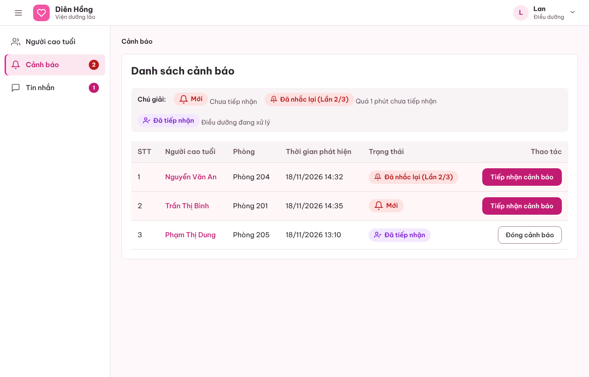
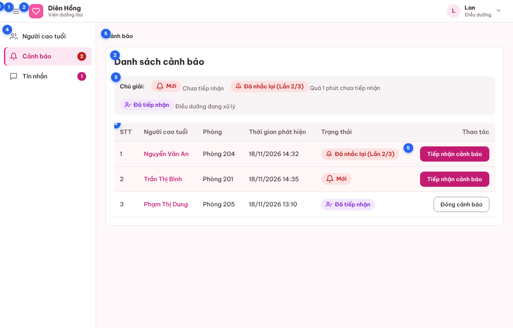
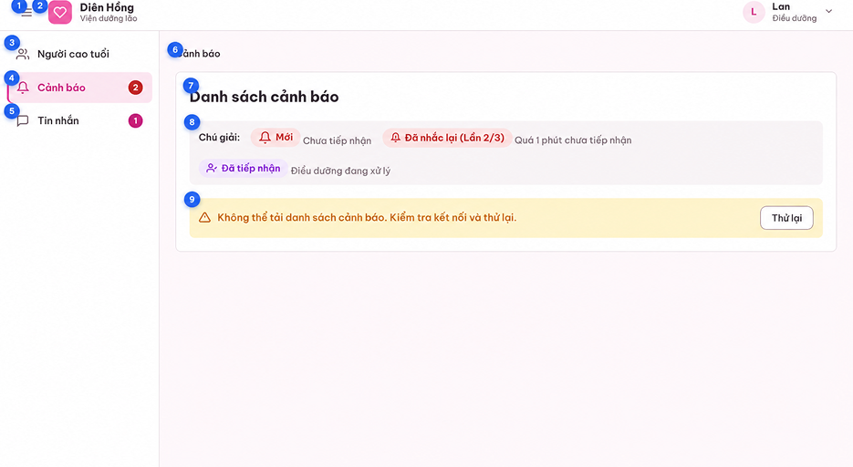
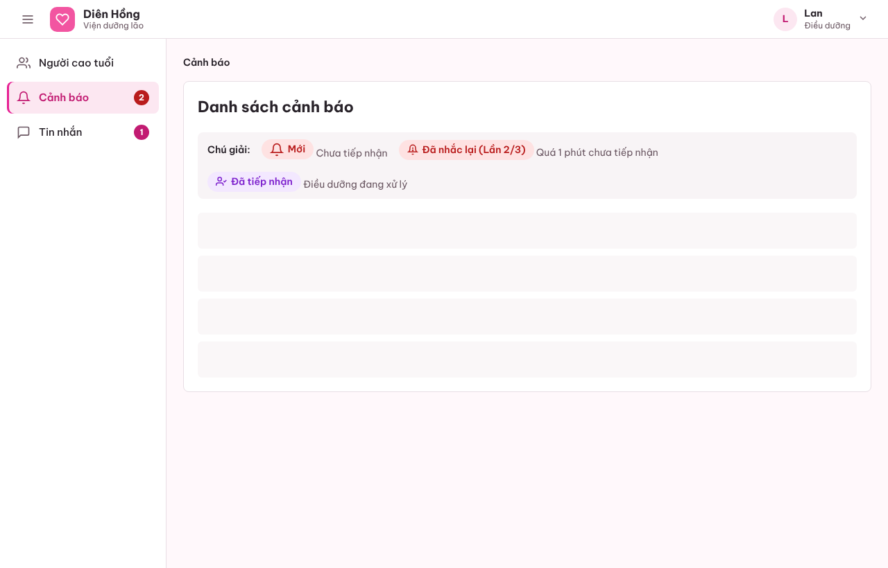
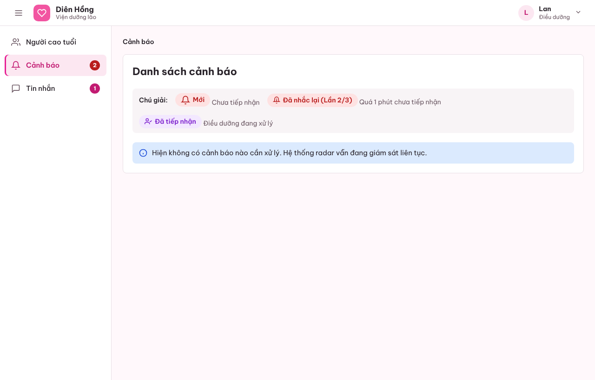
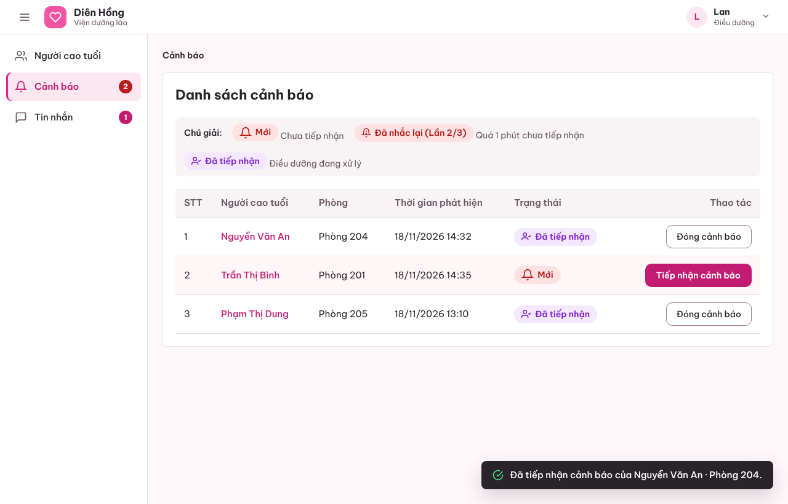

# Screen Spec: S-F03-01 Fall alert list (Desktop)

| Field | Value | 
| ----- | ----- | 
| Screen ID | S-F03-01 | 
| Screen name | Fall alert list | 
| Actor | Nurse | 
| Priority | Must | 
| Feature | F-03 Fall Alert Management | 
| Activity diagrams | AD-UC-06 (actions "Receive and display real-time fall alert", "Show repeat reminders until acknowledged"), AD-UC-07 (actions "Review active fall alerts", "Acknowledge alert", "Close alert after intervention") | 
| Mockup images | `img/S-F03-01-desktop.png` (default), `img/S-F03-01-desktop-numbered.jpg`, five state images (section 2) | 
| Frame width | 1280px (exported at 1x) | 
| Figma frame | not used (drawn as an HTML wireframe) | 
| Status | Done | 

## 1. Purpose

**Shown when:** a Nurse clicks "Cảnh báo" in the left sidebar navigation (or clicks an incoming real-time fall alert notification) on a desktop viewport (`768px` and wider) to monitor, acknowledge, or close active fall alerts (UC-06, UC-07).

**The user leaves this screen when:** they click a resident's name in the alert table to inspect their profile (S-F01-02), click "Đóng cảnh báo" to open the Close alert modal (S-F03-02), or switch to another destination in the left sidebar ("Người cao tuổi" or "Tin nhắn").

## 2. Mockup

**Numbered:** each number is the # of the element inventory in section 3. Elements 10 and 11 (Alert table and row actions) appear in the default and success states, while element 9 (Message area) replaces the table in the error and empty states (shown on `S-F03-01-desktop-error-numbered.jpg`).

| Default, numbered | Error, numbered |
|---|---|
|  |  |

| Loading | Empty |
|---|---|
|  |  |

| Success |
|---|
|  |

| State | Image | 
| ----- | ----- | 
| Default | `img/S-F03-01-desktop.png` | 
| Empty | `img/S-F03-01-desktop-empty.png` | 
| Loading | `img/S-F03-01-desktop-loading.png` | 
| Error | `img/S-F03-01-desktop-error.png` (network/load failure; access-denied refusal redirects to S-F01-01 per FR-06-03) | 
| Success | `img/S-F03-01-desktop-success.png` | 

All colours, fonts and corners come from the design tokens in
[ui-conventions.md](../ui-conventions.md#7-design-tokens).

## 3. Element inventory

| \# | Element | Type | Content / data source | Required | Validation | 
| ----- | ----- | ----- | ----- | ----- | ----- | 
| 1 | Sidebar toggle (`[=]`) | Icon button | Static icon (`colour/text-secondary`) in top bar (`56px` height) | Yes | none | 
| 2 | Top bar brand & account | Shell header | Brand ("Diên Hồng · Viện dưỡng lão") on the left and signed-in Nurse account menu ("Lan · Điều dưỡng") on the right | Yes | none | 
| 3 | Sidebar item: Residents (`Người cao tuổi`) | Navigation link | Static icon + label (`colour/text-secondary`) | Yes | none | 
| 4 | Sidebar item: Alerts (`Cảnh báo`) | Active navigation link + badge | Bell icon + label "Cảnh báo" (`colour/pink-light` active pill) + live unacknowledged alert counter badge (`colour/error`, e.g., `2`) | Yes | none | 
| 5 | Sidebar item: Messages (`Tin nhắn`) | Navigation link + badge | Chat icon + label "Tin nhắn" + unread message counter badge (`colour/primary`, e.g., `1`) | Yes | none | 
| 6 | Breadcrumb | Page header trail | Current top-level section label "Cảnh báo" | Yes | none | 
| 7 | Card heading (`Danh sách cảnh báo`) | Section title | Static title "Danh sách cảnh báo" (`24px` bold) | Yes | none | 
| 8 | Status legend (`Chú giải:`) | Legend panel | Explains the 3 alert status pills with icons: `Mới` ("Chưa tiếp nhận"), `Đã nhắc lại (Lần 2/3)` ("Quá 1 phút chưa tiếp nhận"), and `Đã tiếp nhận` ("Điều dưỡng đang xử lý") | Yes | none | 
| 9 | Message area (Error / Empty / Toast) | Banner / Toast | Info banner in Empty state ("Hiện không có cảnh báo nào cần xử lý. Hệ thống radar vẫn đang giám sát liên tục."); Warning banner with "Thử lại" button in Error state ("Không thể tải danh sách cảnh báo. Kiểm tra kết nối và thử lại."); Dark bottom-right toast in Success state ("Đã tiếp nhận cảnh báo của \[Full Name\] · \[Room\].") | No | none | 
| 10 | Fall alert table | Data table | Lists active `Fall Alert` records sorted by priority (unacknowledged first): `STT` (1-based row index), `Người cao tuổi` (`Resident Profile.full_name` link in `colour/primary`), `Phòng` (`Resident Profile.room`), `Thời gian phát hiện` (`alert.detected_at` in `dd/MM/yyyy HH:mm`), `Trạng thái` (status pill with icon), and `Thao tác` | Yes | formats from `ui-conventions.md` §2 | 
| 11 | Row action button (`Tiếp nhận cảnh báo` / `Đóng cảnh báo`) | Action button | Primary button "Tiếp nhận cảnh báo" (`colour/primary`) for `Mới` / `Đã nhắc lại` rows; Secondary button "Đóng cảnh báo" (`1px colour/border-strong`) for `Đã tiếp nhận` rows | Yes | none | 

## 4. States

| State | What the user sees | Trigger | 
| ----- | ----- | ----- | 
| Default | Left sidebar with "Cảnh báo" active and unacknowledged count badge (`2`), page card titled "Danh sách cảnh báo", status legend (`Chú giải:`), and the active fall alert table showing unacknowledged rows highlighted in `colour/error-bg` (`Mới`, `Đã nhắc lại (Lần 2/3)`) with "Tiếp nhận cảnh báo" buttons, and acknowledged rows (`Đã tiếp nhận`) with "Đóng cảnh báo" buttons. | Nurse opens S-F03-01 and active fall alerts load from API Server (FR-03-01, FR-03-02) | 
| Empty (no data) | Sidebar badge shows `0` (or hidden), card header and status legend remain visible, and the alert table is replaced by an info banner (`colour/info-bg`) stating "Hiện không có cảnh báo nào cần xử lý. Hệ thống radar vẫn đang giám sát liên tục." | No active (`Mới`, `Đã nhắc lại`, or `Đã tiếp nhận`) `Fall Alert` records exist | 
| Loading | Card header and status legend remain visible; the table area displays 4 grey skeleton row placeholders (`colour/surface-secondary`). | Active fall alert list is being fetched from API Server | 
| Error | Warning banner (`colour/warning-bg`) displays "Không thể tải danh sách cảnh báo. Kiểm tra kết nối và thử lại." with a "Thử lại" secondary button; alert table is hidden. | API request to fetch active fall alerts fails or times out | 
| Success / confirmation | When a Nurse clicks "Tiếp nhận cảnh báo", the row status pill changes from `Mới` / `Đã nhắc lại` to `Đã tiếp nhận` (`colour/purple-light`), its button changes to "Đóng cảnh báo", the row's red tint clears, the sidebar unacknowledged badge decrements (e.g., `2` → `1`), and a dark bottom-right toast (`colour/toast`, auto-dismisses after 4s) confirms "Đã tiếp nhận cảnh báo của \[Full Name\] · \[Room\]." | Nurse acknowledges an active fall alert (FR-03-03) or closes an alert via S-F03-02 (FR-03-04) | 

## 5. Interactions and navigation

| \# | Element | User action | System response | Goes to screen | 
| ----- | ----- | ----- | ----- | ----- | 
| 1 | Sidebar toggle (`[=]`) | click | Collapses sidebar from 240px to 64px (icons only) or expands it back | stays | 
| 2 | Sidebar menu items ("Người cao tuổi", "Tin nhắn") | click | Opens the selected Nurse destination | S-F01-01 / S-F04-01 | 
| 3 | Resident name link (`Người cao tuổi` column) | click | Opens the resident's profile detail screen | S-F01-02 | 
| 4 | "Tiếp nhận cảnh báo" button | click | Records alert acknowledgement with current timestamp and signed-in Nurse's name (FR-03-03), stops repeat reminders (BR-03-02), updates row status to `Đã tiếp nhận`, switches button to "Đóng cảnh báo", and shows confirmation toast | stays (Success state) | 
| 5 | "Đóng cảnh báo" button | click | Opens the Close alert confirmation modal with optional resolution note input | S-F03-02 | 
| 6 | "Thử lại" button (Error banner) | click (Error state) | Re-fetches the active fall alert list from API Server | stays (Loading → Default/Empty/Error) | 

## 6. Screen-level rules

| Rule ID | Rule | Source | 
| ----- | ----- | ----- | 
| SR-001 | Only authenticated users with the Nurse role may view and manage fall alerts; unauthorized requests return to the user's home screen with an access-denied message. | BR-06-01, FR-06-03 | 
| SR-002 | Incoming fall alerts from the Radar Gateway are displayed in real time with the resident's full name, room number, detection timestamp (`dd/MM/yyyy HH:mm`), and current status (`Mới`, `Đã nhắc lại`, or `Đã tiếp nhận`). | BR-03-01, FR-03-01 | 
| SR-003 | Unacknowledged fall alerts (`Mới`) repeat reminder notifications every 1 minute up to 3 times (`Đã nhắc lại (Lần 1/3)` to `(Lần 3/3)`) until acknowledged by a Nurse. | BR-03-02, FR-03-02 | 
| SR-004 | Acknowledging an alert records the acknowledgement timestamp and the signed-in Nurse's name, halts repeat reminders, and enables the "Đóng cảnh báo" action so the alert can only be closed after acknowledgement (BR-03-03). | BR-03-02, BR-03-03, FR-03-03 | 
| SR-005 | Alert status pills never rely on colour alone: `Mới` and `Đã nhắc lại` pair an alert bell icon with `colour/error` text on `colour/error-bg`, while `Đã tiếp nhận` pairs a user-check icon with `colour/purple` text on `colour/purple-light` (`ui-conventions.md` §4, §7.6). | `ui-conventions.md` §4 | 

## 7. Linked requirements

| FR ID | What this screen does for it | 
| ----- | ----- | 
| FR-03-01 | Receives and displays active fall alerts in real time with resident name, room, detection timestamp, and status | 
| FR-03-02 | Displays repeat reminder status (`Đã nhắc lại (Lần X/3)`) every 1 minute up to 3 times while unacknowledged | 
| FR-03-03 | Allows a Nurse to acknowledge an active alert via "Tiếp nhận cảnh báo", recording timestamp and nurse name and stopping repeat reminders | 
| FR-03-04 | Provides the "Đóng cảnh báo" action on acknowledged alerts to launch S-F03-02 for closing the alert | 
| FR-06-03 | Restricts fall alert access and actions to the Nurse role and verifies session permissions | 

## 8. Responsive and accessibility notes

* Desktop layout (`768px` and wider, drawn at `1280px`) renders S-F03-01 inside the desktop shell with sidebar navigation, status legend (`Chú giải:`), and a 6-column table; below `768px` (down to `360px`), it switches to stacked mobile alert cards (`S-F03-01-mobile`) with bottom tab navigation (`ui-conventions.md` §3.1, §3.5).

* Real-time alert updates and toast confirmations use ARIA live regions (`role="status"` / `aria-live="assertive"` for incoming fall alerts) so screen readers announce urgent alerts without stealing keyboard focus (`ui-conventions.md` §6).

* All text and status pills meet at least `4.5:1` contrast (`colour/error` `#B91C1C` on `#FEE2E2` is `5.3:1`; `colour/purple` `#6D28D9` on `#EDE9FE` is `6.2:1`), and every button and link displays a `2px` `colour/primary` focus ring (`2px` offset) (`lang="vi"`, `ui-conventions.md` §6, §7.6).

## 9. Open questions

| \# | Question | Blocking? | Status | 
| ----- | ----- | ----- | ----- | 
| 1 | \[NEEDS CLARIFICATION: Should closed fall alerts remain viewable in a separate historical tab/filter on S-F03-01, or are only active (`Mới`, `Đã nhắc lại`, `Đã tiếp nhận`) alerts shown here in Release 1?\] | No | Open (`AD-UC-07` Q1). Default: show active alerts (`Mới`, `Đã nhắc lại`, `Đã tiếp nhận`) in S-F03-01; closed alerts are removed from the active queue once closed in S-F03-02. | 
| 2 | \[NEEDS CLARIFICATION: When an unacknowledged alert reaches `Đã nhắc lại (Lần 3/3)` without acknowledgement, does the system escalate to a supervisor or remain in `Lần 3/3` state until a Nurse acknowledges it?\] | No | Open (`AD-UC-06` Q1). Default: remain in `Đã nhắc lại (Lần 3/3)` state in the active alert list until a Nurse clicks "Tiếp nhận cảnh báo" per BR-03-02. | 

## Completion checklist

* \[x\] The mockup is a separate cropped image file, named with the Screen ID, at the frame width.

* \[x\] The numbered image exists, and its numbers match the # column of the element inventory.

* \[x\] Every visible element in the mockup appears in the element inventory.

* \[x\] Every colour in the mockup is a design token from ui-conventions.md.

* \[x\] Every input element has a validation rule or an explicit "none".

* \[x\] All five states are filled in.

* \[x\] Every navigation target is a Screen ID that exists in the Screen List.

* \[x\] Every element that displays data names the field it displays.

* \[x\] Every linked FR exists in the Function List, and every action of this screen in AD-UC-06 and AD-UC-07 is covered by an interaction row.
