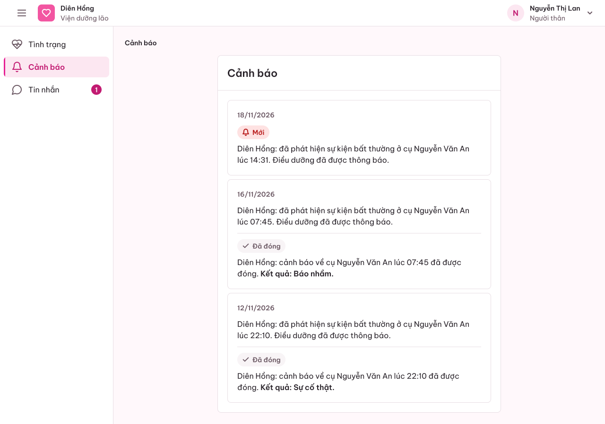
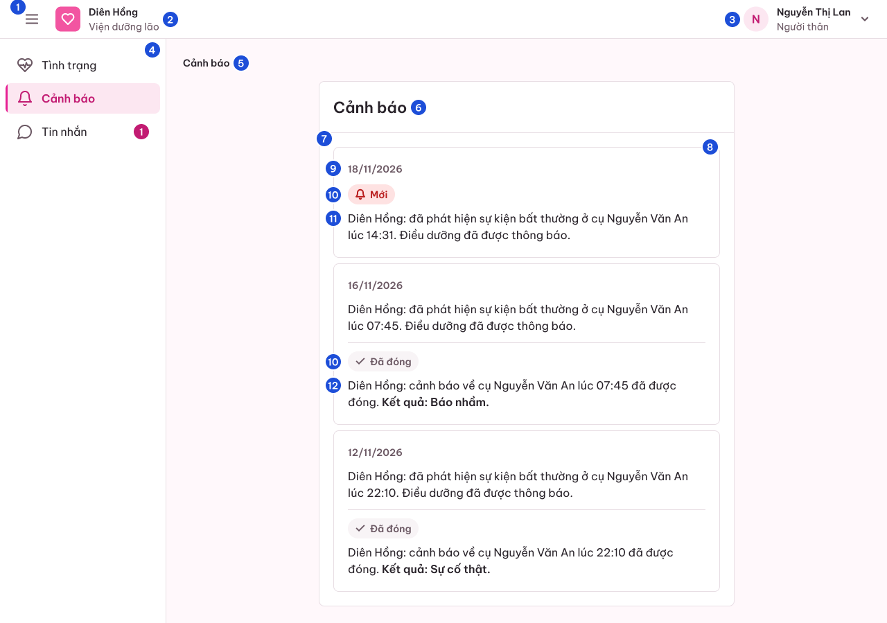
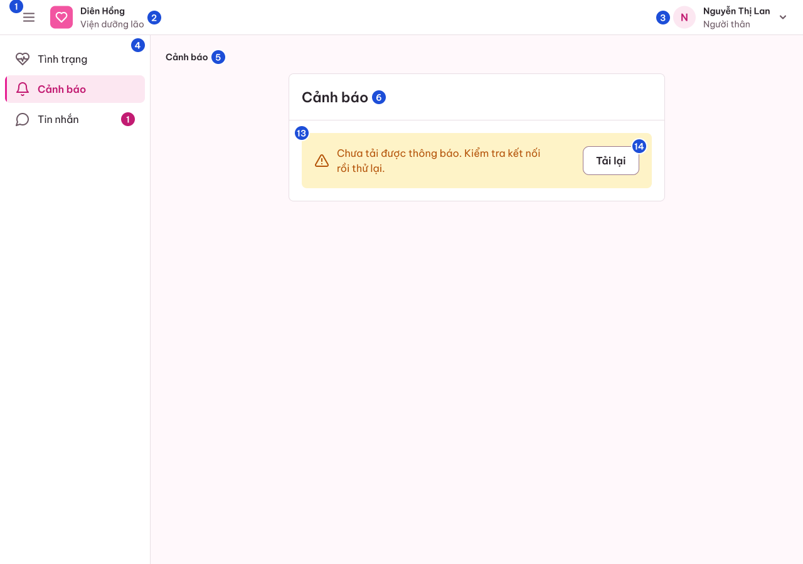

# Screen Spec: S-F03-02 Alert notice and closed notice with outcome (Desktop)

| Field | Value |
| ----- | ----- |
| Screen ID | S-F03-02 |
| Screen name | Alert notice and closed notice with outcome |
| Actor | Residents' Family |
| Priority | Must |
| Feature | F-03 Abnormal Alert Handling |
| Activity diagrams | AD-UC-07 (actions **Receive first notice**, **Receive closed notice**) |
| Mockup images | `img/S-F03-02-desktop.png` (default), `img/S-F03-02-desktop-numbered.png`, four state images (section 2), `img/S-F03-02-desktop-error-numbered.png` |
| Frame width | `1280px` (Figma frame; exported at 1x) |
| Figma frame | not used (drawn as an HTML wireframe) |
| Status | Done |

## 1. Purpose

**Shown when:** a Residents' Family member opens a push notification about a dangerous alert or selects **Cảnh báo** from the sidebar navigation on a desktop viewport (`768px` and wider) to read the first alert notice and, when available, the closed notice with the outcome (UC-07).

**The user leaves this screen when:** they click **Tình trạng** to view the resident's current condition (`S-F04-02`), click **Tin nhắn** to open the conversation with a nurse (`S-F04-03`), or select another destination from the sidebar.

## 2. Mockup

**Numbered:** EEach number corresponds to the element inventory in section 3. Elements 1–12 appear in the default state; elements 13–14 identify the Error banner and its retry button.

| Default, numbered | Error, numbered |
| ----- | ----- |
|  |  |

| State | Image |
| ----- | ----- |
| Default | `img/S-F03-02-desktop.png` |
| Empty | `img/S-F03-02-desktop-empty.png` |
| Loading | `img/S-F03-02-desktop-loading.png` |
| Error | `img/S-F03-02-desktop-error.png` (failure to retrieve alert notices) |

All colours, fonts and corners come from the design tokens in [ui-conventions.md](../ui-conventions.md#7-design-tokens).

## 3. Element inventory

| # | Element | Type | Content / data source | Required | Validation |
| - | ------- | ---- | --------------------- | -------- | ---------- |
| 1 | Menu button (Sidebar toggle) | Icon button | Static menu icon in the top bar; toggles the sidebar between expanded and collapsed states. | Yes | none |
| 2 | Brand | Brand area | Diên Hồng logo mark and brand text **Diên Hồng · Viện dưỡng lão**. | Yes | none |
| 3 | Account menu | Account menu | Signed-in family member's avatar, name (e.g., **Nguyễn Thị Lan**), role (**Người thân**) and dropdown icon. | Yes | none |
| 4 | Sidebar navigation | Navigation links | **Tình trạng**, **Cảnh báo** (active item), and **Tin nhắn** with unread message counter (e.g., `1`). | Yes | none |
| 5 | Breadcrumb | Page header trail | Current section label **Cảnh báo**. | Yes | none |
| 6 | Page title | Section heading | Static page title **Cảnh báo**. | Yes | none |
| 7 | Alert list | List container | Container for the family's alert notice cards. The marker is positioned at the upper-left corner of the list area. | Yes, when notices are available | One list contains multiple alert cards; replaced by an empty-state or error message when applicable. |
| 8 | Alert card | Card | Represents one alert and contains its associated date, status and notice content. The marker is positioned at the upper-right corner of the first card. | Yes, when an alert notice exists | Each card represents one alert. |
| 9 | Alert date | Date label | Date associated with the alert notice, formatted as `dd/MM/yyyy` (e.g., `18/11/2026`). | Yes | Format: `dd/MM/yyyy` |
| 10 | Status badge | Status badge | Displays **Mới** for an alert with a first notice, or **Đã đóng** when a closed notice is available. Each variant uses its corresponding icon, label and visual style. | Conditional | Must include both an icon and text; status must not rely on colour alone. |
| 11 | First notice text | Notice content | Initial alert notice identifying the resident and detection time, and confirming that nurses have been notified (e.g., **Diên Hồng: đã phát hiện sự kiện bất thường ở cụ Nguyễn Văn An lúc 14:31. Điều dưỡng đã được thông báo.**) (FR-03-09) | Yes, when a first notice exists | none |
| 12 | Closed notice text | Notice content | Closure notice identifying the resident, original detection time and outcome (e.g., **Diên Hồng: cảnh báo về cụ Nguyễn Văn An lúc 07:45 đã được đóng. Kết quả: Báo nhầm.**) (FR-03-10) | Conditional | Displayed only when the corresponding closed notice is available. |
| 13 | Error banner | Warning banner | Displays **Không thể tải thông báo cảnh báo. Kiểm tra kết nối và thử lại.** Only visible in the Error state. | Conditional | none |
| 14 | Retry button (**Tải lại**) | Secondary button | Re-fetches the family's alert notices. Only visible in the Error state. | Conditional | none |

## 4. States

| State | What the user sees | Trigger |
| ----- | ------------------ | ------- |
| Default | Desktop shell with the **Cảnh báo** sidebar item active, breadcrumb and page card titled **Cảnh báo**. The centred card displays alert notice cards in reverse chronological order. Each card shows its date and first notice. If the alert has been closed and a closed notice has been sent, the card also displays a divider, the **Đã đóng** badge and the outcome text. The newest example has only the first notice with status **Mới**; older examples show both the first and closed notices. | Family member opens `S-F03-02` and the alert notices are retrieved successfully (FR-03-09, FR-03-10) |
| Empty (no data) | Desktop shell, breadcrumb and page card remain visible. The alert list is replaced by an information banner indicating that there are no alert notices to display. | No first or closed alert notices are available for the signed-in family member |
| Loading | Desktop shell, breadcrumb and page card remain visible. The alert list area displays skeleton placeholders while the system retrieves alert notices. | Alert notices are being fetched from the system |
| Error | Desktop shell, breadcrumb and page card remain visible. The alert list is replaced by a warning banner and a **Tải lại** secondary button. | The request to retrieve alert notices fails or times out |

**Successful outcome:** There is no separate Success state because this screen only retrieves and displays alert notices; it does not save or modify data. A successful response is displayed as Default or Empty, depending on whether alert notices are available.

## 5. Interactions and navigation

| # | Element | User action | System response | Goes to screen |
| - | ------- | ----------- | --------------- | -------------- |
| 1 | Sidebar toggle (`[=]`) | click | Collapses the sidebar from `240px` to `64px` (icons only), or expands it back to `240px`. | stays |
| 2 | Account menu | click | Opens the signed-in family member's account menu. The menu contents and destination are not specified in this screen's Figma frames. | stays / menu (not specified) |
| 3 | **Tình trạng** sidebar item | click | Opens the family member's resident condition screen. | `S-F04-02` |
| 4 | **Cảnh báo** sidebar item | click | Keeps the family member on the current screen and marks this item active. | `S-F03-02` |
| 5 | **Tin nhắn** sidebar item | click | Opens the family member's conversation with a nurse. | `S-F04-03` |
| 6 | **Tải lại** button (Error state) | click | Repeats the request to retrieve alert notices. Shows Loading while the request is in progress, then displays Default or Empty if successful; remains in Error if the request fails again. | stays (Loading → Default/Empty/Error) |

## 6. Screen-level rules

| Rule ID | Rule | Source |
| ------- | ---- | ------ |
| SR-001 | Only authenticated family members may access their alert notices. The system retrieves notices for the linked family accounts; it must not expose another family's notices. | FR-03-09, FR-03-10; access-control policy |
| SR-002 | A first notice is displayed only for a dangerous alert (severity High) and is sent once per alert to every linked family account. | FR-03-09, BR-05, BR-06, BR-11 |
| SR-003 | A first notice informs the family that an abnormal event was detected, identifies the resident and detection time, and states that nurses have been notified. | FR-03-09 |
| SR-004 | A closed notice is displayed only when the alert's first notice was delivered and the alert is subsequently closed. It includes the outcome of the alert. | FR-03-10, BR-07 |
| SR-005 | The first notice and its corresponding closed notice are displayed together in the same alert card, separated by a divider. A closed notice must not replace the original first notice. | Figma frame; FR-03-09, FR-03-10 |
| SR-006 | Alert notice cards are displayed in reverse chronological order by their associated alert date. | Figma frame |
| SR-007 | The **Mới** and **Đã đóng** status labels must include an icon and text; status must not rely on colour alone. | Figma frame; `ui-conventions.md` §4, §7 |
| SR-008 | A failed push does not create a notice that the family can read as successfully delivered. Failed push retry and logging are handled by the system, not by an action on this screen. | FR-03-11, AD-UC-07 |

## 7. Linked requirements

| FR ID | What this screen does for it |
| ----- | ---------------------------- |
| FR-03-09 | Displays the first notice sent to the family when a dangerous alert is detected, including the resident, detection time and notification to nurses. |
| FR-03-10 | Displays the closed notice with the outcome after an alert whose first notice was delivered is closed. |
| FR-03-11 | Displays only successfully delivered notices; push retry and failure logging are system-side behaviours and have no direct user interaction on this screen. |

## 8. Responsive and accessibility notes

- Desktop layout (`768px` and wider, drawn at `1280px`) uses the desktop shell with a `240px` sidebar and a `600px` page card centred in the remaining content area. Below `768px` (down to `360px`), the layout switches to the full-screen mobile alert notice list (`S-F03-02-mobile`) (`ui-conventions.md` §3).
- Alert notice cards remain readable when the notice text wraps onto multiple lines. The card height grows with its content; the page list scrolls vertically when notices exceed the available viewport height.
- Status labels use both text and icons so that **Mới** and **Đã đóng** are not distinguished by colour alone (`ui-conventions.md` §4, §6).
- Body text and status labels meet at least `4.5:1` contrast. Interactive controls have a visible `2px` `colour/primary` focus ring with a `2px` offset (`ui-conventions.md` §6, §7).
- Page language is Vietnamese (`lang="vi"`). Zoom remains enabled, and all interactive targets meet the minimum target size (`ui-conventions.md` §6).

## 9. Open questions

| # | Question | Blocking? | Status |
| - | -------- | --------- | ------ |
| 3 | [NEEDS CLARIFICATION: Should the alert notice list display all historical notices or only notices within a defined time period?] | No | **Proposed default:** Display all historical alert notices in reverse chronological order. |

## Completion checklist

- [x] The mockup is exported as a separate cropped image file, named with the Screen ID, at the frame width.
- [x] The numbered image exists, and its numbers match the # column of the element inventory.
- [x] Every visible element in the mockup appears in the element inventory.
- [x] Every colour in the mockup is a design token from `ui-conventions.md`.
- [x] Every input element has a validation rule or an explicit **none**.
- [x] All four states are filled in.
- [x] Every navigation target is a Screen ID that exists in the Screen List.
- [x] Every element that displays data names the field it displays.
- [x] Every linked FR exists in the Function List, and every family-facing action in AD-UC-07 is covered by the screen spec.
