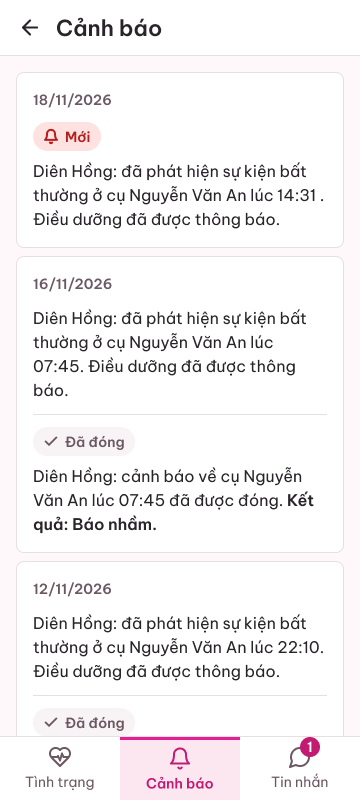

# Screen Spec: S-F03-02 Alert notice and closed notice with outcome (Mobile)

| Field | Value |
| ----- | ----- |
| Screen ID | S-F03-02 |
| Screen name | Alert notice and closed notice with outcome |
| Actor | Residents' Family |
| Priority | Must |
| Feature | F-03 Abnormal Alert Handling |
| Activity diagrams | AD-UC-07 (actions **Receive first notice**, **Receive closed notice**) |
| Mockup images | `img/S-F03-02-mobile.png` (default), `img/S-F03-02-mobile-numbered.png`, four state images (section 2), `img/S-F03-02-mobile-error-numbered.png` |
| Frame width | `360px` (Figma frame; exported at 3x = 1080 pixels) |
| Figma frame | `S-F03-02-mobile` (Figma frame) |
| Status | Draft |

## 1. Purpose

**Shown when:** a Residents' Family member taps a push notification about a dangerous alert on their phone, or taps **Cảnh báo** from the resident condition screen (`S-F04-02`) on a mobile viewport (`360–767px`) to read the first alert notice and, when available, the closed notice with the outcome (UC-07).

**The user leaves this screen when:** they tap the Back button in the app bar to return to the resident condition screen (`S-F04-02`).

## 2. Mockup

**Numbered:** Each number corresponds to the element inventory in section 3. Elements 1–8 appear in the Default state. Elements 9–10 identify the Error banner and its retry button.

| Default, numbered | Error, numbered |
| ----- | ----- |
|  |  |

| State | Image |
| ----- | ----- |
| Default | `img/S-F03-02-mobile.png` |
| Empty | `img/S-F03-02-mobile-empty.png` |
| Loading | `img/S-F03-02-mobile-loading.png` |
| Error | `img/S-F03-02-mobile-error.png` (failure to retrieve alert notices) |

All colours, fonts and corners come from the design tokens in [ui-conventions.md](../ui-conventions.md#7-design-tokens).

## 3. Element inventory

| # | Element | Type | Content / data source | Required | Validation |
| - | ------- | ---- | --------------------- | -------- | ---------- |
| 1 | Back button | Icon button | Left arrow icon in the app bar (`44 × 44px` touch target). Returns to the resident condition screen. | Yes | none |
| 2 | App bar title | Screen title | Static title **Cảnh báo** (`56px` app bar height). | Yes | none |
| 3 | Alert notice list | Scrollable list container | Vertically scrollable area containing alert notice cards. Cards are ordered by the associated alert date, newest first (Figma frame). | Yes | none |
| 4 | Alert notice card | Card | One card per alert. Displays the alert date and first notice; when a closed notice is available, the same card also displays the closed notice below a divider. | Conditional | none |
| 5 | Alert date | Date label | Date associated with the alert, formatted as `dd/MM/yyyy` (e.g., `18/11/2026`) (`ui-conventions.md` §2). | Yes, when an alert card exists | Format: `dd/MM/yyyy` |
| 6 | Notice status badge | Status badge | Bell icon + **Mới** for a first notice without a closed notice; check icon + **Đã đóng** when the closed notice is displayed. Uses the corresponding alert status tokens (`ui-conventions.md` §4, §7.1). | Conditional | none |
| 7 | First notice text | Notice content | First alert notice with the organisation name, resident's full name, detection time and confirmation that nurses have been notified. e.g., **Diên Hồng: đã phát hiện sự kiện bất thường ở cụ Nguyễn Văn An lúc 14:31. Điều dưỡng đã được thông báo.** (FR-03-09) | Yes, when the first notice exists | none |
| 8 | Closed notice section | Notice content | Divider followed by the closed notice text, including the resident's full name, original detection time and outcome. e.g., **Diên Hồng: cảnh báo về cụ Nguyễn Văn An lúc 07:45 đã được đóng. Kết quả: Báo nhầm.** (FR-03-10, BR-07) | Conditional | none |
| 9 | Error message banner | Warning banner | Warning icon and message **Chưa tải được thông báo. Kiểm tra kết nối rồi thử lại.** (`colour/warning-bg`). | Conditional | none |
| 10 | Retry button (**Tải lại**) | Secondary button | Repeats the request to retrieve the family's alert notices. | Conditional | none |

## 4. States

| State | What the user sees | Trigger |
| ----- | ------------------ | ------- |
| Default | App bar with Back button and title **Cảnh báo**. The scrollable list displays alert notice cards in reverse chronological order. Each card shows its date and first notice. If the alert has been closed and a closed notice has been sent, the card also displays a divider, the **Đã đóng** badge and the outcome text. The newest example has only the first notice with status **Mới**; older examples show both the first and closed notices. | Family member opens `S-F03-02` and the alert notices are retrieved successfully (FR-03-09, FR-03-10). |
| Empty (no data) | App bar remains visible. The alert list is replaced by an information banner (`colour/info-bg`) with the message **Hiện chưa có thông báo cảnh báo nào về cụ Nguyễn Văn An.** | No first or closed alert notices are available for the signed-in family account. |
| Loading | App bar remains visible. The alert list area displays three skeleton card placeholders (`colour/surface-secondary`) while the system retrieves alert notices. | Alert notices are being fetched from the system. |
| Error | App bar remains visible. The alert list is replaced by a warning banner (`colour/warning-bg`) displaying **Chưa tải được thông báo. Kiểm tra kết nối rồi thử lại.** and a secondary **Tải lại** button. | The request to retrieve alert notices fails or times out. |

## 5. Interactions and navigation

| # | Element | User action | System response | Goes to screen |
| - | ------- | ----------- | --------------- | -------------- |
| 1 | Back button | tap | Returns the family member to the resident condition screen. | `S-F04-02` |
| 2 | **Tải lại** button (Error state) | tap | Repeats the request to retrieve alert notices. Shows Loading while the request is in progress, then displays Default or Empty if successful; remains in Error if the request fails again. | stays (Loading → Default/Empty/Error) |

Alert notice cards are read-only. Tapping a card or its notice content does not trigger another screen or action.

## 6. Screen-level rules

| Rule ID | Rule | Source |
| ------- | ---- | ------ |
| SR-001 | Only alert notices delivered to the signed-in family account are displayed. The screen must not expose notices delivered to another family account. | FR-03-09, FR-03-10 |
| SR-002 | A first notice is sent only for a dangerous alert (severity High), once per alert, to every linked family account. | FR-03-09, BR-05, BR-06, BR-11 |
| SR-003 | A first notice informs the family that an abnormal event was detected, identifies the resident and detection time, and states that nurses have been notified. | FR-03-09 |
| SR-004 | A closed notice is displayed only when the alert's first notice was delivered and the alert is subsequently closed. It includes the outcome of the alert. | FR-03-10, BR-07 |
| SR-005 | The first notice and its corresponding closed notice are displayed together in the same alert card, separated by a divider. A closed notice must not replace the original first notice. | Figma frame, FR-03-09, FR-03-10 |
| SR-006 | Alert notice cards are displayed in reverse chronological order by their associated alert date. | Figma frame |
| SR-007 | The **Mới** and **Đã đóng** status labels must include both an icon and text; status must not rely on colour alone. | Figma frame, `ui-conventions.md` §4, §7.1 |
| SR-008 | A failed push does not create a notice that the family can read as successfully delivered. Push retry and failure logging are system-side behaviours, not actions on this screen. | FR-03-11, AD-UC-07 |

## 7. Linked requirements

| FR ID | What this screen does for it |
| ----- | ---------------------------- |
| FR-03-09 | Displays the first notice sent to the family when a dangerous alert is detected, including the resident's name, detection time and notification to nurses. |
| FR-03-10 | Displays the closed notice with the outcome after an alert whose first notice was delivered is closed. |
| FR-03-11 | Displays only successfully delivered notices; push retry and failure logging are system-side behaviours and have no direct user interaction on this screen. |

## 8. Responsive and accessibility notes

- Smallest supported width: `360px`. The screen uses the full-screen mobile layout (`360–767px`); at `768px` and wider, it switches to the desktop layout (`S-F03-02-desktop`) with the desktop shell and sidebar navigation (`ui-conventions.md` §3.1).
- The app bar remains at the top while the alert notice list scrolls vertically. The screen does not display a bottom tab bar because it is opened as a full-screen notice view with a Back action.
- Alert notice cards grow vertically when the first notice or closed notice wraps onto multiple lines. The list must remain scrollable without clipping any notice text.
- The Back button and **Tải lại** button meet the `44px` minimum touch target height. Browser zoom remains enabled, and the page language is Vietnamese (`lang="vi"`) (`ui-conventions.md` §6).
- Status badges use both text and icons so that **Mới** and **Đã đóng** are not distinguished by colour alone (`ui-conventions.md` §4, §6).
- Body text and status labels meet at least `4.5:1` contrast. Interactive controls have a visible `2px` `colour/primary` focus ring with a `2px` offset (`ui-conventions.md` §6, §7).

## 9. Open questions

| # | Question | Blocking? | Status |
| - | -------- | --------- | ------ |
| 3 | [NEEDS CLARIFICATION: Should the alert notice list display all historical notices or only notices within a defined time period?] | No | **Proposed default:** Display all historical alert notices in reverse chronological order. |

## Completion checklist

- [x] The mockup is a separate cropped image file, named with the Screen ID, at the frame width.
- [x] The numbered image exists, and its numbers match the # column of the element inventory.
- [x] Every visible element in the mockup appears in the element inventory.
- [x] Every colour in the mockup is a design token from `ui-conventions.md`.
- [x] Every input element has a validation rule or an explicit **none**.
- [x] All four states are filled in.
- [x] Every navigation target is a Screen ID that exists in the Screen Transition Diagram.
- [x] Every element that displays data names the field it displays.
- [x] Every linked FR exists in the Function List, and every family-facing action in AD-UC-07 is covered by an interaction row.