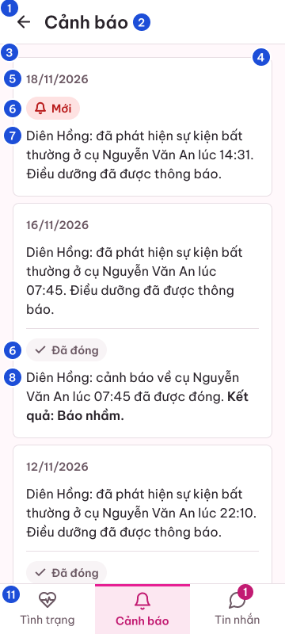
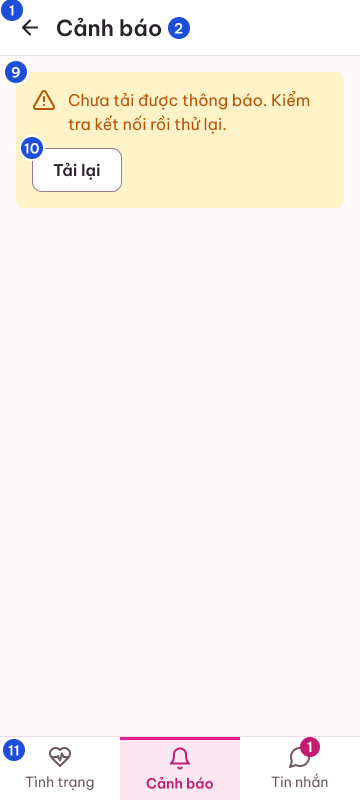

# Screen Spec: S-F03-02 Alert notice and closed notice with outcome (mobile)

| Field | Value |
|---|---|
| Screen ID | S-F03-02 |
| Screen name | Alert notice and closed notice with outcome |
| Layout | Mobile, 360–767px, the web app installed on the phone home screen (ADR-001; [ui-conventions](../ui-conventions.md) 3.1). From 768px: [screen-spec-S-F03-02-desktop.md](screen-spec-S-F03-02-desktop.md) |
| Actor | Residents' Family (on the phone, ADR-001) |
| Priority | Must |
| Feature | F-03 Abnormal Alert Handling |
| Activity diagrams | AD-UC-07 (actions `fam1` "Receive first notice" and `fam2` "Receive closed notice") |
| Mockup images | `img/S-F03-02-mobile.png` (default), two numbered images, three state images (section 2) |
| Frame width | 360px (exported at 3x, 1080 pixels) |
| Figma frame | [Dien Hong System](https://www.figma.com/design/aHkwiQYgPGceB6W3tMHXOE/Dien-Hong-System?node-id=0-1), frames "Mobile · S-F03-02 Cảnh báo · Default", "· Empty", "· Loading", "· Error", "· Default · Numbered", "· Error · Numbered" |
| Status | Draft |

## 1. Purpose

**Shown when:** a family member taps the "Cảnh báo" tab (Alerts) from S-F04-02, or taps a push notice on the phone (FR-03-09, FR-03-10). From the tab, the screen lists the alert notices of the resident the family member has selected on S-F04-02. From a push notice, it shows the alert that the notice belongs to (section 5, row 6). The family member only reads: the first notice of each alert and, once an alert is closed, the closed notice with the outcome.

**The user leaves this screen when:** they tap Back and return to S-F04-02 (Screen Transition Diagram), tap the "Tình trạng" tab (S-F04-02) or the "Tin nhắn" tab (S-F04-03), or sign out from S-F04-02 (the account button is not on this screen).

## 2. Mockup

**Numbered:** each number is the # of the element inventory in section 3. The inventory is one list for the whole screen, so a number means the same element in every state. Elements 4 to 8 appear only when the list holds alerts, so they are numbered on the default image (element 6, the status badge, appears twice: "Mới" and "Đã đóng"). Elements 9 and 10 appear only in some states, so they are numbered on the error image, which shows both. Element 3 in the loading state is the same list drawn with placeholder cards.

| Default, numbered | Error, numbered |
|---|---|
|  |  |

| State | Image |
|---|---|
| Default | `img/S-F03-02-mobile.png` (an open alert, then two closed alerts, newest first) |
| Empty | `img/S-F03-02-mobile-empty.png` (the selected resident has no alert notices) |
| Loading | `img/S-F03-02-mobile-loading.png` |
| Error | `img/S-F03-02-mobile-error.png` (the notices cannot be loaded, with the warning banner and "Tải lại") |
| Success | none: this screen saves nothing (section 4) |

All colours, fonts and corners come from the design tokens in
[ui-conventions.md](../ui-conventions.md#7-design-tokens), whose values live in
[design-tokens.css](../design-tokens.css).

**Mockup status:** drawn in Figma as the frames listed in the header; the Default frame was designed and reviewed first, and the other states were cloned from it so the app bar, tab bar, spacing and card style are identical. Colours, spacing and radii are bound to the Figma variables of "Dien Hong tokens" and the text uses the file's text styles. Every image named in this section is exported from those frames into `img/`; the numbered images add only the number markers (a separate "Number markers" layer).

## 3. Element inventory

Labels are shown as they appear in the interface (Vietnamese), with the repository label in brackets. The divider line between the first notice and the closed notice inside a card is decoration and is not numbered.

| # | Element | Type | Content / data source | Required | Validation |
|---|---|---|---|---|---|
| 1 | Back | Icon button, app bar | static; accessible name "Quay lại" (Back); 44 × 44px | Yes | none |
| 2 | Title | Header, app bar | static: "Cảnh báo" (Alerts) | Yes | |
| 3 | Alert list | Card list, scrolls on its own | one card per alert of the selected resident that has a family notice (Alert Log data group), newest first (SR-002); the app bar and tab bar stay fixed; bottom padding equals the tab bar height | Yes | |
| 4 | Alert card | Card | one alert: its alert date (5), first notice (7) and, when the alert is closed, the closed notice (8) | Yes | one card per alert |
| 5 | Alert date | Text, first line of the card | date of the alert, dd/MM/yyyy ([ui-conventions](../ui-conventions.md) section 2), in colour/text-secondary | Yes | |
| 6 | Status badge | Badge (text, icon and colour) | "Mới" (New) on colour/error-bg with a bell icon, shown under the date while `alert.status` is New (SR-005); "Đã đóng" (Closed) on colour/surface-secondary with a check mark, shown above the closed notice | Yes | |
| 7 | First notice | Text | "Diên Hồng: đã phát hiện sự kiện bất thường ở cụ " + `resident.full_name` + " lúc " + time of the abnormal event (HH:mm) + ". Điều dưỡng đã được thông báo." (Diên Hồng: an abnormal event was detected for cụ … at …. The nurses have been notified.) (FR-03-09; [ui-conventions](../ui-conventions.md) section 5) | Yes | |
| 8 | Closed notice with outcome | Text, with the "Đã đóng" badge and a divider above | "Diên Hồng: cảnh báo về cụ " + `resident.full_name` + " lúc " + time of the abnormal event (HH:mm) + " đã được đóng. Kết quả: " + outcome + "." (Diên Hồng: the alert for cụ … at … is closed. Outcome: ….) The outcome is "Sự cố thật" (Real event) or "Báo nhầm" (False alarm), written in semi-bold (FR-03-10, FR-03-06) | Only for a closed alert whose first notice was sent (BR-07) | |
| 9 | Message area | Banner, at the top of the list area | empty and error messages of section 4: information banner on colour/info-bg (empty), warning banner on colour/warning-bg (error) | No | |
| 10 | Reload | Secondary button, inside the error banner | label "Tải lại" (Reload); 44px tall | Only in the error state | none |
| 11 | Tab bar | Navigation | "Tình trạng" (Condition), "Cảnh báo" (Alerts, current: colour/pink-light, colour/primary label, 3px colour/accent bar), "Tin nhắn" (Chat) with the number of unread `chat_message` for this user; the app bar shows no counters ([ui-conventions](../ui-conventions.md) section 4) | Yes | counter hidden at 0; "99+" above 99 |

## 4. States

| State | What the user sees | Trigger |
|---|---|---|
| Default | Alert cards (3) ordered newest first, for the selected resident only. An open alert shows its first notice (7) with the "Mới" badge (6). A closed alert shows its first notice without the "Mới" badge, then a divider, the "Đã đóng" badge and the closed notice with the outcome (8). The mockup shows an open alert, an alert closed as "Báo nhầm" and an alert closed as "Sự cố thật". | Screen opened from S-F04-02, notices loaded |
| Default, from a push notice | Same layout and elements; the screen shows the alert that the push notice belongs to (first notice or closed notice). It has no mockup of its own: the entry path is described in section 5, row 6. | Family member taps a push notice on the phone |
| Empty (no data) | No cards. Information banner (9) on colour/info-bg with an info icon: "Hiện chưa có thông báo cảnh báo nào về cụ Nguyễn Văn An." (There are no alert notices for cụ Nguyễn Văn An at the moment.) (new). A normal empty state, not an error. | The selected resident has no alert notice |
| Loading | 3 placeholder cards on colour/surface-secondary (date bar, badge shape, 3 text lines), no text and no real alert content; app bar and tab bar unchanged | Notices being fetched (screen opened, Reload in the error banner) |
| Error | Warning banner (9) on colour/warning-bg with a warning icon: "Chưa tải được thông báo. Kiểm tra kết nối rồi thử lại." (The notices cannot be loaded. Check your connection and try again.) (new) with the button "Tải lại" (Reload) (10); no cards. Not shown as an empty state and not in red (colour/error is for resident alerts only). | The request failed |
| Success / confirmation | None on this screen: the family member only reads, no action here saves data (section 5) | – |

Messages marked (new) follow the patterns of [ui-conventions](../ui-conventions.md) section 5 but are not listed there yet (open question 6).

## 5. Interactions and navigation

| # | Element | User action | System response | Goes to screen |
|---|---|---|---|---|
| 1 | Back (1) | tap | Returns to the resident condition ("taps Back") | S-F04-02 |
| 2 | "Tình trạng" tab (11) | tap | Opens the resident's current condition (home screen of the family, menu) | S-F04-02 |
| 3 | "Tin nhắn" tab (11) | tap | Opens the conversation with the nurses (menu) | S-F04-03 |
| 4 | "Cảnh báo" tab (11) | tap | Nothing: this is the current screen | stays |
| 5 | "Tải lại" in the error banner (9, 10) | tap | Fetches the notices again (Loading, then Default, Empty or Error) | stays |
| 6 | Push notice on the phone (system) | the family member taps a push notice (first notice FR-03-09 or closed notice FR-03-10) | Opens this screen showing the alert that the notice belongs to ("taps the push notice") | S-F03-02 |
| 7 | Alert list (3) | scroll | The list scrolls on its own; the app bar and the tab bar stay in place | stays |

Alert cards (4) and the notices in them have no action: the family only receives the notices and chooses nothing in UC-07 ([SD-UC-07](../../use-case/SD-UC-07.md)).

## 6. Screen-level rules

| Rule ID | Rule | Source |
|---|---|---|
| SR-001 | The list shows only the alerts of the resident selected on S-F04-02, a resident linked to the signed-in account; alerts of several residents are never mixed in one list. | BR-11, BR-12, BR-13 (team decision on the Default state) |
| SR-002 | Cards are ordered newest first by the time of the alert. | team decision on the Default state, same order as S-F03-01 |
| SR-003 | A card shows only the notices that were sent to the family: the first notice of every alert in the list, and the closed notice only when the alert is closed and its first notice was sent. A closed alert with a closed notice shows the outcome. | BR-06, BR-07, FR-03-09, FR-03-10 |
| SR-004 | A non-dangerous alert (severity not High) gets no notice and does not appear in this list. | BR-05, BR-06 |
| SR-005 | The badge shows the actual status of the alert, not the stage of the notice: "Mới" (red) only while the alert is open and New, no "Mới" on the first notice of a closed alert, and "Đã đóng" (grey) on the closed notice. No other badge is drawn on this screen. | [ui-conventions](../ui-conventions.md) section 4 (Status badge), open question 1 |
| SR-006 | The date on the first line of each card is written dd/MM/yyyy; the time appears only inside the notice text, as HH:mm. | [ui-conventions](../ui-conventions.md) section 2 |
| SR-007 | The notice texts follow the first and closed notice messages of ui-conventions section 5; the resident is "cụ" + full name and the outcome is "Sự cố thật" or "Báo nhầm", in semi-bold. | [ui-conventions](../ui-conventions.md) sections 1 and 5, FR-03-09, FR-03-10 |
| SR-008 | Red (colour/error) is used only for the "Mới" badge on this screen; the error and empty messages use colour/warning and colour/info, so a network error never looks like an emergency. | [ui-conventions](../ui-conventions.md) section 4, 7.1 |
| SR-009 | The status badge is written in words, with an icon and a colour; no state on this screen is shown by colour alone. | [ui-conventions](../ui-conventions.md) section 6, WCAG 2.2 1.4.1 |
| SR-010 | The tab bar counter appears only on "Tin nhắn" (unread messages) and is hidden at 0; the "Cảnh báo" tab has no counter for the family. The app bar shows no counters. | [ui-conventions](../ui-conventions.md) sections 2, 3.4 and 4 |
| SR-011 | The screen is read only: the family member cannot acknowledge, close or reply to an alert here. | [SD-UC-07](../../use-case/SD-UC-07.md) |

## 7. Linked requirements

| FR ID | What this screen does for it |
|---|---|
| FR-03-09 | Shows the first notice of a dangerous alert (element 7), which the system sent to the linked family accounts as a push notice; opening the push notice leads here (section 5, row 6) |
| FR-03-10 | Shows the closed notice with the outcome (element 8) once the alert is closed; Could priority, so without it the list shows first notices only |
| FR-03-11 | Defines when a notice exists: no linked family member means the push is skipped, and a failed first push means no closed notice (AD-UC-07 `o1`); this screen shows only notices that exist (SR-003) |

Business rules applied: BR-05, BR-06, BR-07, BR-11 ([W0](../../function-list/w0-scope.md#business-rules)). FR-03-09 is Must in the Screen List, Should in W1 and Must in the priorities of [W4](../../function-list/w4-priorities.md).

## 8. Responsive and accessibility notes

- 360–767px: app bar 56px, screen padding 16px, card gap 8px, card padding 16px, tab bar 64px ([ui-conventions](../ui-conventions.md) 3.1, 7.5). From 768px the desktop layout applies.
- At 360px nothing scrolls sideways: the notice texts wrap to several lines and the cards grow in height.
- The alert list (3) has bottom padding equal to the tab bar height (64px), so the last card is never covered by the tab bar.
- Every target is at least 44 × 44px (Back, "Tải lại", tab bar items); the tab bar shows an icon and a label on every tab.
- The status badge carries text, an icon and a colour; "Mới" is red on red-tinted background, "Đã đóng" grey with a check mark.
- The tab bar counter has a text name (for example "1 tin nhắn chưa đọc").
- Text contrast is at least 4.5:1 on every background used here, the warning banner included (colour/warning on colour/warning-bg, 4.5:1, so the text stays at least 14px; [ui-conventions](../ui-conventions.md) 7.6); zoom stays allowed.

## 9. Open questions

| # | Question | Blocking? | Status |
|---|---|---|---|
| 1 | [NEEDS CLARIFICATION: which badge does the family see for an alert that is Acknowledged or Escalated? The conventions list badges for these states, but the design shows only "Mới" (open) and "Đã đóng" (closed).] | No | Open. Default: an open alert shows "Mới"; no other badge is drawn. |
| 2 | [NEEDS CLARIFICATION: when the family member opens a push notice, which resident is selected on S-F04-02 afterwards, if the notice belongs to another linked resident?] | No | Open. Default: the screen shows the alert of the notice; the selection on S-F04-02 is not changed. |
| 3 | [NEEDS CLARIFICATION: does the list show only alerts whose first notice was delivered (AD-UC-07 `o1`), or every dangerous alert of the resident?] | No | Open. Default: only alerts that have a family notice. |
| 4 | [NEEDS CLARIFICATION: does the "lúc HH:mm" in the closed notice show the time of the abnormal event or the time the alert was closed?] | No | Open. Default: the time of the abnormal event, as in the closed notice message of ui-conventions section 5. |
| 5 | [NEEDS CLARIFICATION: does the access-denied message of FR-04-01 / BR-12 also apply to this screen, if the link between the family account and the resident cannot be verified?] | No | Open. Default: not drawn; to be decided with S-F04-02. |
| 6 | The messages marked (new) in section 4 (empty and error) are not in ui-conventions section 5, and the reload button reads "Tải lại" here and in S-F01-01, but "Thử lại" in the S-F03-01 mockup. | No | Open. Add the messages at the next revision of the conventions and use one label. |
| 7 | [NEEDS CLARIFICATION: how many alerts can the list hold, does it need pages, and should it refresh by itself while open?] | No | Open. Default: all notices of the resident in one scrolling list, loaded when the screen opens and on "Tải lại". |
| 8 | The data model has no field names for the alert date, time and outcome yet; section 3 names the data group (Alert Log) and describes the data instead. | No | Open. |
| 9 | [NEEDS CLARIFICATION: should the family see a notice like "Alerts cannot reach this phone yet" when push notices are not allowed on their phone (ADR-005)? The nurse screens have it; no family design does.] | No | Open. Default: not drawn on this screen. |

---

## Completion checklist

- [x] The mockup is a separate cropped image file, named with the Screen ID, at the frame width.
- [x] The numbered image exists, and its numbers match the # column of the element inventory.
- [x] Every visible element in the mockup appears in the element inventory.
- [x] Every colour in the mockup is a design token from ui-conventions.md.
- [x] Every input element has a validation rule or an explicit "none".
- [x] All five states are filled in.
- [x] Every navigation target is a Screen ID that exists in the Screen List.
- [x] Every element that displays data names the field it displays.
- [x] Every linked FR exists in the Function List, and every action of this screen in AD-UC-07 is covered by an interaction row.
