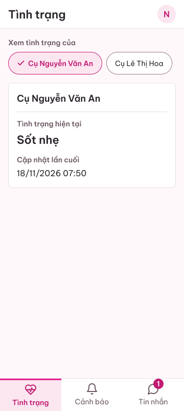
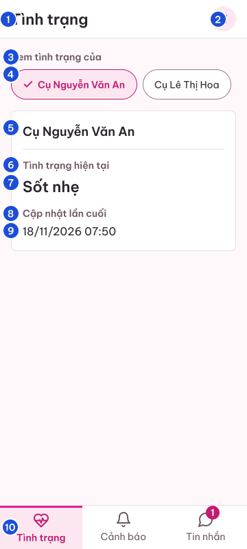
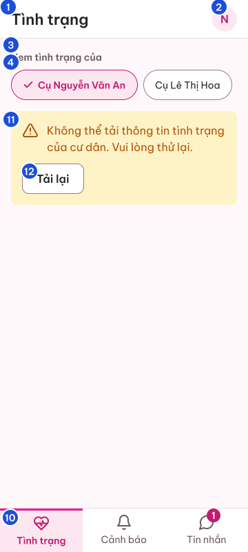

# Screen Spec: S-F04-02 Resident condition (Mobile)

| Field             | Value                                                                                                                                                                   |
| ----------------- | ----------------------------------------------------------------------------------------------------------------------------------------------------------------------- |
| Screen ID         | S-F04-02                                                                                                                                                                |
| Screen name       | Resident condition                                                                                                                                                      |
| Actor             | Residents' Family                                                                                                                                                       |
| Priority          | Must                                                                                                                                                                    |
| Feature           | F-04 Family Communication                                                                                                                                               |
| Activity diagrams | AD-UC-08 (actions "Select one of own linked residents", "Read the current condition", "Read the access-denied message", "Read that no condition has been recorded yet") |
| Mockup images     | `img/S-F04-02-mobile.png` (default), `img/S-F04-02-mobile-numbered.png`, four state images (section 2), `img/S-F04-02-mobile-error-numbered.png`                        |
| Frame width       | 360px (Figma frame; mobile layout supports 360–767px)                                                                                                                   |
| Figma frame       | not used (drawn as an HTML wireframe)                                                    |
| Status            | Done                                                                                                                                                                   |

## 1. Purpose

**Shown when:** a signed-in Residents' Family member opens the app. S-F04-02 is the family member's home screen after sign-in. It lets the family member select one of the residents linked to their account and read that resident's current condition (UC-08, FR-04-02).

**The user leaves this screen when:** they tap **Cảnh báo** to open the family's alert notices (S-F03-02), or **Tin nhắn** to open the conversation with a nurse (S-F04-03). The family member can also select another linked resident without leaving this screen.

## 2. Mockup

**Numbered:** each number corresponds to the # of the element inventory in section 3. Elements 1–10 are visible in the default state. Elements 11–12 appear only in the Error state and are numbered in the error-numbered image.

| Default, numbered                                                     | Error, numbered                                                           |
| --------------------------------------------------------------------- | ------------------------------------------------------------------------- |
|  |  |

| State   | Image                                                                                                                                                                     |
| ------- | ------------------------------------------------------------------------------------------------------------------------------------------------------------------------- |
| Default | `img/S-F04-02-mobile.png`                                                                                                           |
| Empty   | `img/S-F04-02-mobile-empty.png`                                                                                                 |
| Loading | `img/S-F04-02-mobile-loading.png`                                                                                           |
| Error   | `img/S-F04-02-mobile-error.png` — condition fetch failure; access-denied outcome is a separate case under FR-04-01              |

All colours, fonts and corners come from the design tokens in [ui-conventions.md](../ui-conventions.md#7-design-tokens).

## 3. Element inventory

| #  | Element                      | Type              | Content / data source                                                                                                                                                                                                                                                                                                                                            | Required                    | Validation                                                                     |
| -- | ---------------------------- | ----------------- | ---------------------------------------------------------------------------------------------------------------------------------------------------------------------------------------------------------------------------------------------------------------------------------------------------------------------------------------------------------------- | --------------------------- | ------------------------------------------------------------------------------ |
| 1  | App bar title                | Mobile app bar    | Static title **Tình trạng** (`56px` height, `colour/surface`, bottom border)                                                                                                                                                                                                                                                                                     | Yes                         | none                                                                           |
| 2  | Account button / avatar      | Icon button       | Avatar showing the signed-in family member's initial (shown as `N` in the mockup), inside a `44px` touch target                                                                                                                                                                                                                                                  | Yes                         | none                                                                           |
| 3  | Resident switcher label      | Section label     | Static text **Xem tình trạng của**                                                                                                                                                                                                                                                                                                                               | Yes                         | none                                                                           |
| 4  | Resident selector chips      | Selectable chips  | Displays the full name of each resident linked to the signed-in family account. The selected chip has a check icon, `colour/pink-light` background and `colour/primary` border/text; unselected chips use `colour/surface` background and `colour/text-primary` text. Example names: **Cụ Nguyễn Văn An**, **Cụ Lê Thị Hoa**. Source: FR-04-01, FR-04-02, BR-12. | Yes                         | Only residents linked to the current family account may be listed or selected. |
| 5  | Condition card heading       | Card heading      | Displays the selected resident's name (e.g. **Cụ Nguyễn Văn An**) to identify whose condition is being shown                                                                                                                                                                                                                                                     | Yes when a condition exists | none                                                                           |
| 6  | Current condition label      | Data label        | Static, muted label **Tình trạng hiện tại**                                                                                                                                                                                                                                                                                                                      | Yes when a condition exists | none                                                                           |
| 7  | Current condition value      | Data value        | Displays the latest saved condition value for the selected resident (example: **Sốt nhẹ**). Source: the most recent Resident Condition Record (FR-04-02, BR-04).                                                                                                                                                                                                 | Yes when a condition exists | Read-only. The family member cannot edit the condition here.                   |
| 8  | Last update label            | Data label        | Static label **Cập nhật lần cuối**                                                                                                                                                                                                                                                                                                                               | Yes when a condition exists | none                                                                           |
| 9  | Last update date and time    | Data value        | Displays the date and time of the latest condition record, formatted `dd/MM/yyyy HH:mm` (ui-conventions.md §2).                                                                                                                                                                                                                                                  | Yes when a condition exists | Must belong to the same latest record displayed in element 7.                  |
| 10 | Bottom tab bar               | Mobile navigation | Three destinations: **Tình trạng** (active), **Cảnh báo**, **Tin nhắn**. The Tin nhắn tab displays the unread-message counter when applicable; hide it at 0 and show `99+` above 99 (ui-conventions.md §2, §3.4). Fixed at the bottom, `64px` high.                                                                                                              | Yes                         | Only show destinations permitted for Residents' Family.                        |
| 11 | Condition fetch error banner | Warning banner    | In Error state, displays a warning icon and the message **“Không thể tải thông tin tình trạng của cụ Nguyễn Văn An. Vui lòng thử lại.”** (`colour/warning-bg`).                                                                                                                                                                                                  | No                          | Shown when the request to retrieve the selected resident's condition fails.    |
| 12 | Retry button                 | Secondary button  | Button labelled **Tải lại**, displayed below the Error banner.                                                                                                                                                                                                                                                                                                   | No                          | Tapping retries the request for the currently selected resident.               |

Elements 11–12 appear only in the Error state. In the Empty state, an information banner replaces the condition card content. In the Loading state, skeleton placeholders replace the condition details. The app bar, resident selector and bottom tab bar remain visible across these states.

## 4. States

| State                         | What the user sees                                                                                                                                                                                                                                                                                                                                                                                                                    | Trigger                                                                                                                                                                                        |
| ----------------------------- | ------------------------------------------------------------------------------------------------------------------------------------------------------------------------------------------------------------------------------------------------------------------------------------------------------------------------------------------------------------------------------------------------------------------------------------- | ---------------------------------------------------------------------------------------------------------------------------------------------------------------------------------------------- |
| Default                       | The **Tình trạng** app bar and account avatar; the **Xem tình trạng của** label and resident selector chips; a condition card showing the selected resident's name, the muted label **Tình trạng hiện tại**, the current condition value (e.g. **Sốt nhẹ**), and **Cập nhật lần cuối** with the corresponding date and time. The bottom tab bar shows **Tình trạng** as active and an unread counter on **Tin nhắn** when applicable. | The system verifies the family-to-resident link and successfully retrieves the latest saved condition for the selected resident (FR-04-01, FR-04-02).                                          |
| Empty (no condition recorded) | The app bar, resident selector and bottom tab bar remain visible. In place of the condition card, an information banner (`colour/info-bg`) with an info icon says: **“Hiện chưa có thông tin cập nhật về tình trạng sức khỏe của cụ Nguyễn Văn An.”** The selected resident remains visible in the chip selector.                                                                                                                     | Access is verified, but no condition has been recorded for the selected resident (FR-04-02).                                                                                                   |
| Loading                       | The app bar, resident selector and bottom tab bar remain visible. A condition-card-shaped placeholder appears in place of the condition details, with grey skeleton bars (`colour/surface-secondary`).                                                                                                                                                                                                                                | The app is retrieving the selected resident's current condition, including after the family member selects another resident.                                                                   |
| Error                         | The app bar, resident selector and bottom tab bar remain visible. A warning banner (`colour/warning-bg`) with a warning icon says **“Không thể tải thông tin tình trạng của cụ Nguyễn Văn An. Vui lòng thử lại.”** A secondary **Tải lại** button appears below the message. No condition value is displayed as current while the request has failed.                                                                                 | The request to retrieve the selected resident's condition fails. The Figma design shows this technical fetch-error state; it is not the same as the access-denied outcome defined in FR-04-01. |

**Successful outcome:** there is no separate Success state because this screen only reads data and does not save or change anything. A successful response is displayed as Default or Empty, depending on whether a condition record exists.

## 5. Interactions and navigation

| # | Element                          | User action | System response                                                                                                                                                                                                                                         | Goes to screen               |
| - | -------------------------------- | ----------- | ------------------------------------------------------------------------------------------------------------------------------------------------------------------------------------------------------------------------------------------------------- | ---------------------------- |
| 1 | Resident chip (unselected)       | tap         | Marks the tapped resident as selected, updates the selected-chip styling and check icon, and requests that resident's current condition. Shows Loading until the request completes, then displays Default or Empty. If retrieval fails, displays Error. | stays                        |
| 2 | Account button / avatar          | tap         | Opens the signed-in family member's account menu. The menu contents and destination are not specified in this screen's Figma frames.                                                                                                                    | stays / menu (not specified) |
| 3 | **Tình trạng** tab               | tap         | Keeps the family member on the current screen and marks this tab active.                                                                                                                                                                                | S-F04-02                     |
| 4 | **Cảnh báo** tab                 | tap         | Opens the family's alert notice and closed-notice list.                                                                                                                                                                                                 | S-F03-02                     |
| 5 | **Tin nhắn** tab                 | tap         | Opens the family member's conversation with a nurse.                                                                                                                                                                                                    | S-F04-03                     |
| 6 | **Tải lại** button (Error state) | tap         | Repeats the request for the currently selected resident's condition. Shows Loading while the request is in progress, then Default or Empty if successful; remains in Error if the request fails again.                                                  | stays                        |

## 6. Screen-level rules

| Rule ID | Rule                                                                                                                                                                                                                                | Source                                                |
| ------- | ----------------------------------------------------------------------------------------------------------------------------------------------------------------------------------------------------------------------------------- | ----------------------------------------------------- |
| SR-001  | The system must verify on every request that the selected resident is linked to the signed-in family account. A family member must not see a condition belonging to an unlinked resident.                                           | FR-04-01, BR-12, SD-UC-08                             |
| SR-002  | The resident selector lists only residents linked to the current family account. Selecting a chip changes which resident's condition is requested and displayed. Data belonging to different residents must not be mixed.           | FR-04-02, BR-12, AD-UC-08                             |
| SR-003  | The screen displays the current condition from the selected resident's most recent saved Resident Condition Record, together with that record's date and time. Earlier records remain unchanged; this screen only reads the record. | FR-04-02, BR-04, FR-02-03, SD-UC-08                   |
| SR-004  | If no condition has been recorded for the selected resident, the screen displays the information message instead of an empty or misleading condition value.                                                                         | FR-04-02, AD-UC-08                                    |
| SR-005  | The family member cannot create, edit or delete a condition record from this screen.                                                                                                                                                | UC-08, AD-UC-08                                       |
| SR-006  | A failed condition-fetch request must not be presented as a current condition. The **Tải lại** action retries the read request for the currently selected resident.                                                                 | Figma Error state; clarification required (section 9) |

## 7. Linked requirements

| FR ID    | What this screen does for it                                                                                                                                                                        |
| -------- | --------------------------------------------------------------------------------------------------------------------------------------------------------------------------------------------------- |
| FR-04-01 | Ensures that access to a selected resident's information is verified against the link between the family account and that resident. If access cannot be verified, the system must deny the request. |
| FR-04-02 | Lets the family member select one of their linked residents and read that resident's current condition. If no condition has been recorded, the screen tells the family member so.                   |

## 8. Responsive and accessibility notes

- The Figma mobile frame is `360px` wide. Per ui-conventions.md §3.1, the mobile layout applies from `360px` to `767px`; at `768px` and wider, the screen switches to the desktop layout, `S-F04-02-desktop`.
- The mobile layout uses a `56px` app bar, `16px` screen padding, a scrollable condition-content area and a fixed `64px` bottom tab bar. The tab bar must not cover the condition content; the scroll area must allow the user to reach the end of the content.
- Resident chips have a `44px` height, meeting the touch-target convention. The account button also has a `44px` touch target. The **Tải lại** button is `44px` high.
- Use Be Vietnam Pro and the semantic/brand tokens defined in design-tokens.css; do not hard-code replacement colours. The information banner uses `colour/info-bg`; the technical error banner uses `colour/warning-bg`; skeletons use `colour/surface-secondary`.
- Keep the selected resident visually distinguishable by more than colour alone: the selected chip also has a check icon and a border. Preserve readable text contrast and visible keyboard focus for interactive chips, tabs, the account button and **Tải lại**.
- Announce loading completion and error feedback to assistive technology without unexpectedly moving focus. Give each resident chip an accessible name containing the resident's full name and selected state; expose the unread count on **Tin nhắn** in its accessible label.

## 9. Open questions

| # | Question                                                                                                                                                                                                                                                    | Blocking? | Status                                                                                                                                                       |
| - | ----------------------------------------------------------------------------------------------------------------------------------------------------------------------------------------------------------------------------------------------------------- | --------- | ------------------------------------------------------------------------------------------------------------------------------------------------------------ |
| 1 | [NEEDS CLARIFICATION: What technical failures should trigger the Figma fetch-error state, and should tapping **Tải lại** simply repeat the same read request? No FR in the current UC-08 scope defines network/server failure handling or retry behaviour.] | No        | Open. Provisional UI assumption: a failed read request shows the warning banner; **Tải lại** retries the read for the selected resident. No data is changed. |

## Completion checklist

- [x] The target mobile Figma frame and its default, empty, loading and error variants have been identified.
- [x] The mockup is referenced using the exported image files in `img/`.
- [x] The numbered image exists, and its numbers match the # column of the element inventory.
- [x] All 10 default-state elements and the 2 additional Error-state elements appear in the inventory.
- [x] Every visible element in the default and error states appears in the element inventory.
- [x] Every input or interactive element has a validation rule or an explicit "none".
- [x] Default, Empty, Loading and Error states are documented.
- [x] A separate Success state is not invented for this read-only screen; successful retrieval is represented by Default or Empty.
- [x] Every navigation target is a Screen ID that exists in the Screen List.
- [x] Every element that displays data names the field it displays.
- [x] Every linked FR exists in the Function List, and every action of this screen in AD-UC-08 is covered by an interaction row.
