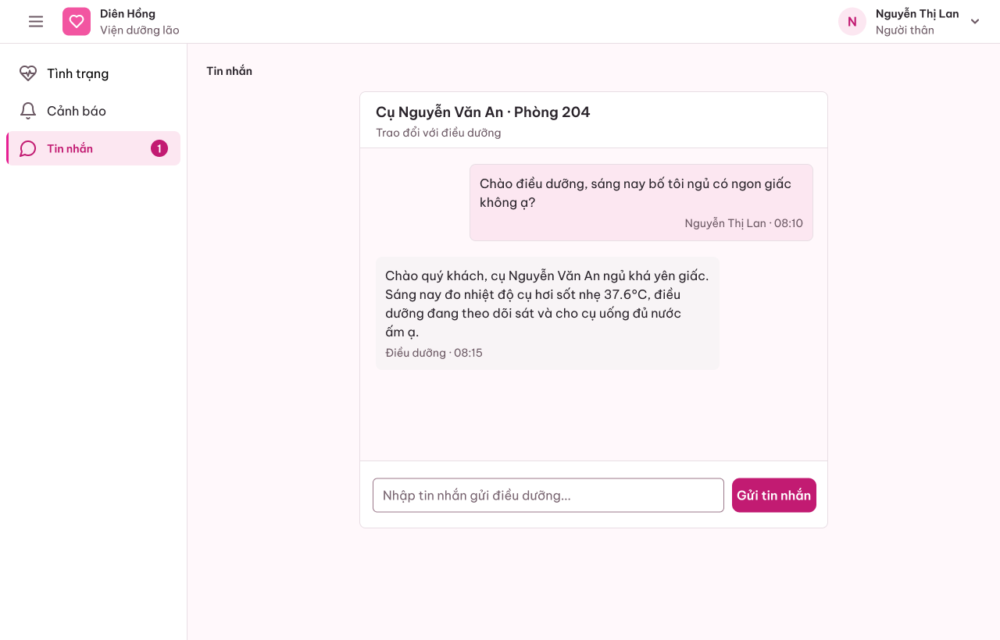
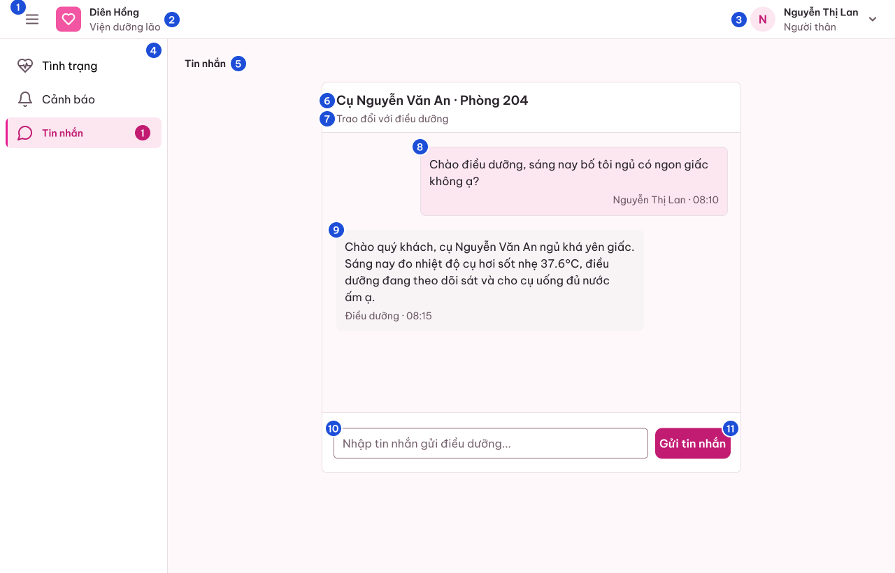
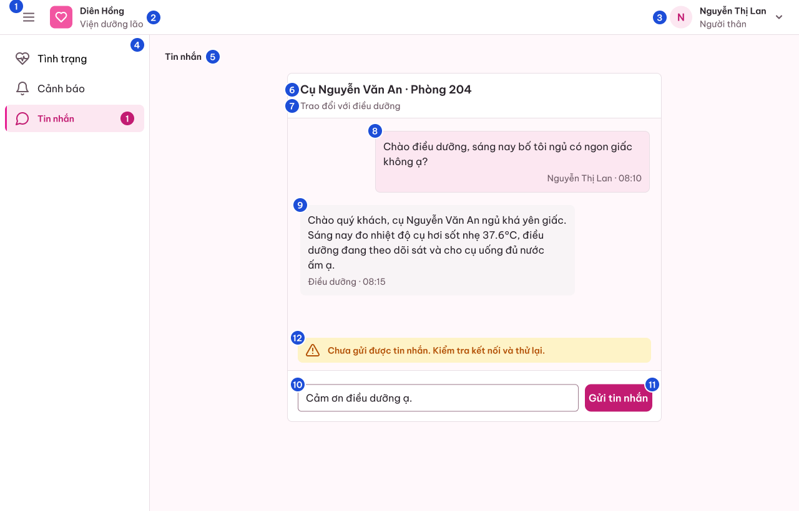
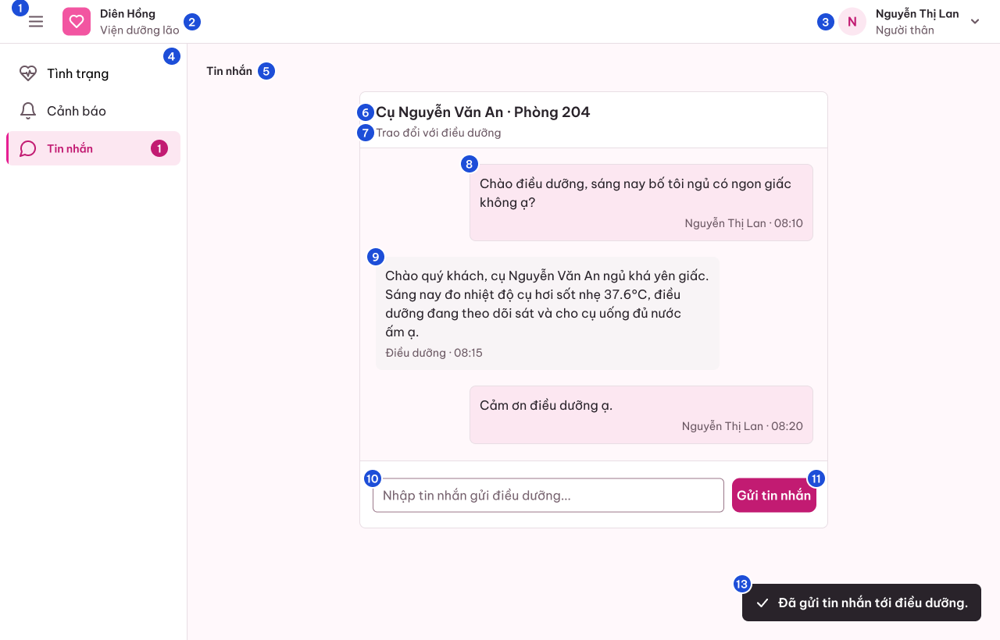

# Screen Spec: S-F04-03 Chat with nurse (Desktop)

| Field | Value |
| ----- | ----- |
| Screen ID | S-F04-03 |
| Screen name | Chat with nurse |
| Actor | Residents' Family |
| Priority | Should |
| Feature | F-04 Family Communication |
| Activity diagrams | AD-UC-09 (family action "Send message to nurses"; the thread also displays messages sent by nurses) |
| Mockup images | `img/S-F04-03-desktop.png` (default), `img/S-F04-03-desktop-numbered.png`, four state images (section 2), `img/S-F04-03-desktop-error-numbered.png`, `img/S-F04-03-desktop-success-numbered.png` |
| Frame width | `1280px` (Figma frame; exported at 1x) |
| Figma frame | `S-F04-03-desktop` ([Figma frame](https://www.figma.com/design/aHkwiQYgPGceB6W3tMHXOE/Dien-Hong-System?node-id=0-1&p=f&m=draw)) |
| Status | Draft |

## 1. Purpose

**Shown when:** a signed-in Residents' Family member clicks **Tin nhắn** in the sidebar. `S-F04-03` displays the conversation associated with the selected resident and allows the family member to exchange messages with the nursing team (UC-09, FR-04-03, FR-04-04).

The conversation displays messages sent by both the family member and the nursing team. Family messages are aligned to the right; messages from the nursing team are aligned to the left.

**The user leaves this screen when:** they click **Tình trạng** to return to the resident condition screen (`S-F04-02`), or **Cảnh báo** to open the family's alert notices (`S-F03-02`). The family member can also use the sidebar toggle or account menu without leaving the current screen.

## 2. Mockup

**Numbered:** Elements 1–9 are visible in the default state. Elements 10–13 appear only in the Error or Success state and are numbered in the corresponding state-numbered images.

| Default, numbered | Error, numbered | Success, numbered |
| ----- | ----- | ----- |
|  |  |  |

| State | Image |
| ----- | ----- |
| Default | `img/S-F04-03-desktop.png` |
| Empty | `img/S-F04-03-desktop-empty.png` |
| Loading | `img/S-F04-03-desktop-loading.png` |
| Error | `img/S-F04-03-desktop-error.png` |
| Success | `img/S-F04-03-desktop-success.png` |

All colours, fonts and corners come from the design tokens in [ui-conventions.md](../ui-conventions.md#7-design-tokens).

## 3. Element inventory

| # | Element | Type | Content / data source | Required | Validation |
| - | ------- | ---- | --------------------- | -------- | ---------- |
| 1 | Sidebar toggle (`[=]`) | Icon button | Static menu icon in the top bar; collapses or expands the sidebar. | Yes | none |
| 2 | Top bar brand | Shell brand mark | Heart icon + **Diên Hồng · Viện dưỡng lão**. | Yes | none |
| 3 | Top bar account menu | User menu | Signed-in family member's avatar/initial, name and role. Example: **Nguyễn Thị Lan · Người thân**. | Yes | none |
| 4 | Sidebar navigation | Left navigation rail | Family destinations: **Tình trạng**, **Cảnh báo**, and **Tin nhắn**. The **Tin nhắn** item is active and displays the unread-message counter when applicable (`ui-conventions.md` §2, §3.4). | Yes | Only show destinations permitted for Residents' Family. |
| 5 | Breadcrumb | Page header trail | Current section label **Tin nhắn**. | Yes | none |
| 6 | Conversation header | Card header | Displays the resident's full name and room, e.g. **Cụ Nguyễn Văn An · Phòng 204**, with the subtitle **Trao đổi với điều dưỡng**. | Yes | Must identify the resident whose conversation is displayed. |
| 7 | Message history feed | Scrollable conversation area | Displays messages in chronological order. Family messages are aligned right with `colour/pink-light`; nursing-team messages are aligned left with `colour/surface-secondary`. Each message includes its content, sender label and timestamp. Example: **Nguyễn Thị Lan · 08:10**, **Điều dưỡng · 08:15** (FR-04-03, FR-04-04; `ui-conventions.md` §2, §4). | Yes | Preserve the sender and timestamp belonging to each message. Messages from different resident conversations must not be mixed. |
| 8 | Message composer input | Text input | A text field with placeholder **Nhập tin nhắn gửi điều dưỡng...**. The family member types a message here. | Yes | Do not submit an empty or whitespace-only message (provisional UI assumption; see section 9). |
| 9 | Send message button | Primary button | Button labelled **Gửi tin nhắn** (`108×44px`). Submits the text entered in element 8 (FR-04-03). | Yes | Enabled when the message contains non-whitespace text; disable or prevent repeated submission while a send request is in progress. |
| 10 | Send error banner | Warning banner | In Error state, displays a warning icon and the message **"Chưa gửi được tin nhắn. Kiểm tra kết nối và thử lại."** (`colour/warning-bg`). | No | Appears when the send operation fails. |
| 11 | Success toast | Confirmation toast | In Success state, displays a check icon and the message **"Đã gửi tin nhắn tới điều dưỡng."** (`colour/toast`). The toast auto-dismisses after 4 seconds. | No | Appears only after the message has been stored and accepted as sent. |
| 12 | Unsent message draft | Text input value | In Error state, the message content remains in the composer so the family member can retry without retyping. Example: **Cảm ơn điều dưỡng ạ.** | No | Preserve the draft when sending fails. |
| 13 | Newly sent message | Message bubble | In Success state, the newly sent family message appears at the bottom right of the conversation thread with its sender label and timestamp. | No | Display only after the message has been stored and accepted as sent (FR-04-03). |

Elements 10 and 12 appear in the Error state. Element 11 and the newly sent message in element 13 appear in the Success state. In the Empty state, an information banner replaces the message history. In the Loading state, skeleton bubbles replace the message history. The top bar, sidebar, breadcrumb, conversation header and composer remain visible across these states.

## 4. States

| State | What the user sees | Trigger |
| ----- | ------------------ | ------- |
| Default | The desktop shell with top bar, sidebar navigation and breadcrumb **Tin nhắn**. A centred conversation card (`600×560px`) displays the selected resident's name and room, the subtitle **Trao đổi với điều dưỡng**, a scrollable thread with family messages on the right and nursing-team messages on the left, and the bottom composer (**Nhập tin nhắn gửi điều dưỡng...** + **Gửi tin nhắn**). The **Tin nhắn** sidebar item is active and displays the unread counter when applicable. | The family member opens the conversation and the message history is retrieved successfully (FR-04-03, FR-04-04). |
| Empty (no messages) | The desktop shell, conversation header and composer remain visible. The thread displays an information banner (`colour/info-bg`) with an info icon and the message **"Chưa có tin nhắn nào với điều dưỡng. Nhập tin nhắn bên dưới để bắt đầu trao đổi."** | The selected resident's conversation contains no messages yet. |
| Loading | The desktop shell, conversation header and composer remain visible. The conversation thread displays three grey skeleton placeholders (`colour/surface-secondary`) in alternating left/right positions. | The conversation history is being retrieved. |
| Error (send failure) | The existing conversation remains visible. A warning banner (`colour/warning-bg`) appears above the composer with **"Chưa gửi được tin nhắn. Kiểm tra kết nối và thử lại."** The composer retains the unsent message draft so the family member can try again without retyping. | The family member sends a message but the send operation fails. The Figma design shows this feedback state; FR-04-03 does not define the exact failure point or recovery behaviour. |
| Success (message sent) | The new family message appears at the bottom right of the thread with its sender label and time. The composer is cleared, and a dark toast (`colour/toast`) appears at the bottom-right of the screen with **"Đã gửi tin nhắn tới điều dưỡng."** The toast auto-dismisses after 4 seconds. | The message is stored and accepted as sent; the conversation is updated (FR-04-03). |

## 5. Interactions and navigation

| # | Element | User action | System response | Goes to screen |
| - | ------- | ----------- | --------------- | -------------- |
| 1 | Sidebar toggle (`[=]`) | click | Collapses the sidebar from `240px` to `64px` (icons only), or expands it back. | stays |
| 2 | Account menu | click | Opens the signed-in family member's account menu. The menu contents and destination are not specified in this screen's Figma frames. | stays / menu (not specified) |
| 3 | **Tình trạng** sidebar item | click | Opens the resident condition screen. | `S-F04-02` |
| 4 | **Cảnh báo** sidebar item | click | Opens the family's alert notice and closed-notice list. | `S-F03-02` |
| 5 | **Tin nhắn** sidebar item | click | Keeps the family member on the current screen and marks this item active. | `S-F04-03` |
| 6 | Message history feed | scroll | Scrolls through the conversation; older messages remain available above and newer messages below. | stays |
| 7 | Message composer input (**Nhập tin nhắn gửi điều dưỡng...**) | type | Updates the unsent draft text. | stays |
| 8 | **Gửi tin nhắn** button | click | Submits the draft to the system. On success, the system stores the message, delivers it to the nurse on duty, appends the family message to the thread, clears the input and displays the confirmation toast. On failure, it displays the warning banner and retains the draft. | stays (Success or Error state) |

The conversation may continue with further messages from either party. A reply from the recipient is not required before another message can be sent (AD-UC-09, d2 `[yes]` loop).

## 6. Screen-level rules

| Rule ID | Rule |
| ------- | ---- |
| SR-001 | This screen displays the conversation associated with the resident identified in the conversation header. Messages from different resident conversations must not be mixed (SD-UC-09). |
| SR-002 | Family messages are displayed on the right and messages from the nursing team on the left; each message shows its sender label and time (Figma `S-F04-03-desktop`; `ui-conventions.md` §4). |
| SR-003 | When a family member sends a message, the system must store it and deliver it to the nurse on duty (FR-04-03). |
| SR-004 | When a nurse sends a message to the family, the system must store it and deliver it to that family account; the new message is shown in this conversation (FR-04-04). |
| SR-005 | Messages are displayed in chronological order, with the newest message at the bottom of the thread (`ui-conventions.md` §4; Figma `S-F04-03-desktop`). |
| SR-006 | A conversation can continue after a message has been added. Neither the family member nor the nurse is required to reply to every message (AD-UC-09, d2 `[yes]` loop and reading notes). |
| SR-007 | The desktop chat card is centred in the main content area and has a fixed width of `600px` in the `1280px` Figma frame. The desktop shell remains visible around it (Figma `S-F04-03-desktop`). |

## 7. Linked requirements

| FR ID | What this screen does for it |
| ----- | ---------------------------- |
| FR-04-03 | Allows a family member to send a message; the system stores it and delivers it to the nurse on duty. |
| FR-04-04 | Displays messages sent by a nurse to the family account in the same conversation; the system stores and delivers the nurse's message. |

## 8. Responsive and accessibility notes

- The Figma desktop frame is `1280px` wide. Per `ui-conventions.md` §3.1, the desktop layout applies from `768px` and wider; below `768px`, the screen switches to the mobile layout, `S-F04-03-mobile`.
- The desktop shell uses a `56px` top bar and a left sidebar that is `240px` wide when expanded and `64px` when collapsed. The main content area must remain usable when the sidebar is collapsed.
- The conversation card is `600px` wide and `560px` high in the Figma frame. It is centred horizontally in the content area. The card contains a `72px` conversation header, a `400px` message thread and an `88px` composer.
- The composer input is `450×44px`; the **Gửi tin nhắn** button is `108×44px`. Keep the composer controls aligned and visible at the bottom of the card.
- Use Be Vietnam Pro and the semantic/brand tokens defined in `design-tokens.css`; do not hard-code replacement colours. The family bubble uses `colour/pink-light`; nursing-team bubbles and loading skeletons use `colour/surface-secondary`; the Empty state uses `colour/info-bg`; send failure uses `colour/warning-bg`; the Success toast uses `colour/toast`.
- The message thread must remain scrollable without moving the conversation header or composer. Keep sufficient space so the newest message is not obscured by the composer.
- Keep message text and metadata readable. Ensure the sidebar toggle, sidebar items, account menu, composer input and **Gửi tin nhắn** button are keyboard accessible and have visible focus states.
- Expose each message's sender and timestamp to assistive technology. Announce newly received messages and send feedback through a polite live region without unexpectedly moving focus. Preserve visible keyboard focus and allow browser zoom.

## 9. Open questions

| # | Question | Blocking? | Status |
| - | -------- | --------- | ------ |
| 1 | [NEEDS CLARIFICATION: Can family members attach photos or documents to a message, or is messaging text-only in Release 1? The Figma composer contains only a text input and a send button.] | No | Open. Provisional default: text-only messaging in Release 1, matching the current Figma composer. |
| 2 | [NEEDS CLARIFICATION: Must a nurse be assigned to the resident, or linked to the resident's family, before they can exchange messages? FR-04-03 and FR-04-04 do not define this relationship.] | Yes | Proposed default from AD-UC-09 Q2 / W5 handover Q8: no specific nurse–resident assignment check is modelled; family messages are routed to the nurse on duty as stated in FR-04-03. This remains to be confirmed. |
| 3 | [NEEDS CLARIFICATION: If a message is stored successfully but real-time delivery to the nurse fails, should it still appear as sent to the family member, and how should the system retry or report the delivery failure? The sequence diagram stores the message before delivering it, while the Figma Error state shows a general send-failure banner.] | No | Open. Proposed default: • **If storage fails:** do not add the message to the conversation; display the warning banner and retain the unsent text in the message composer so the user can retry. • **If storage succeeds but delivery fails:** keep the message in the conversation with a pending/failed delivery status. The system should automatically retry delivery and allow the user to retry manually if automatic retries fail.  Both behaviours require team confirmation. |

## Completion checklist

- [x] The target desktop Figma frame and its Default, Empty, Loading, Error and Success variants have been identified.
- [x] The numbered Figma frames have been identified, and their markers correspond to the element inventory.
- [x] Every visible default, Empty, Error and Success element is covered by the element inventory.
- [x] Every interactive element has a documented action and response.
- [x] Default, Empty, Loading, Error and Success states are documented.
- [x] Every navigation target is a Screen ID or the current screen.
- [x] Every displayed data item names its source field or message-record value.
- [x] The linked FRs exist in the Function List, and the family-side send action is traced to AD-UC-09.