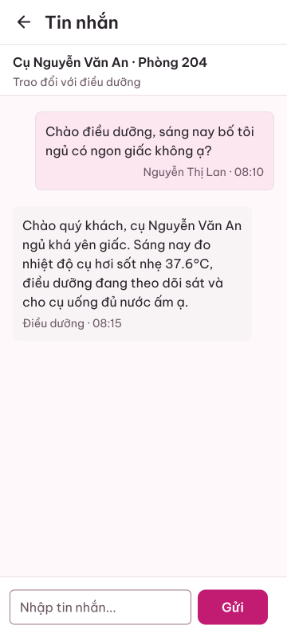
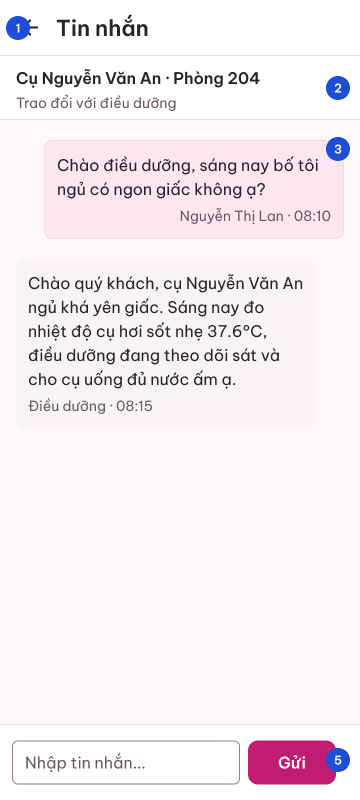
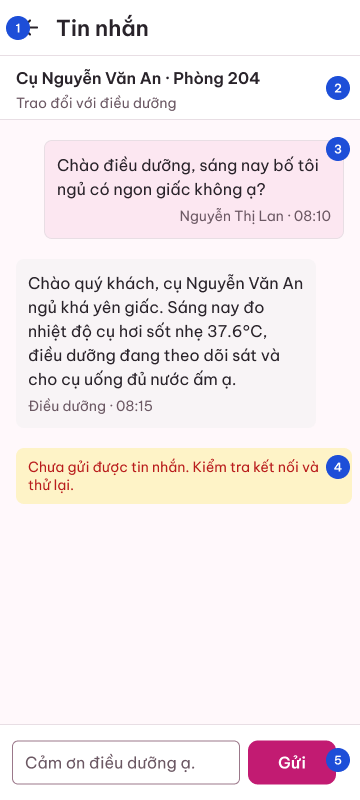
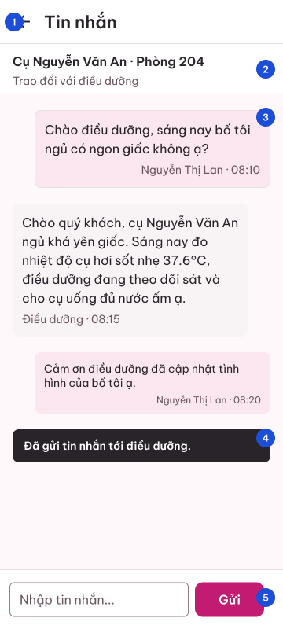

# Screen Spec: S-F04-03 Chat with nurse (Mobile)

| Field | Value |
| ----- | ----- |
| Screen ID | S-F04-03 |
| Screen name | Chat with nurse |
| Actor | Residents’ Family |
| Priority | Should |
| Feature | F-04 Family Communication |
| Activity diagrams | AD-UC-09 (family action “Send message to nurses”; the thread also displays messages sent by nurses) |
| Mockup images | `img/S-F04-03-mobile.png` (default), `img/S-F04-03-mobile-numbered.png`, four state images (section 2), `img/S-F04-03-mobile-error-numbered.png`, `img/S-F04-03-mobile-success-numbered.png` |
| Frame width | `360px` (Figma frame; exported at 1x) |
| Figma frame | not used (drawn as an HTML wireframe)) |
| Status | Donr |

## 1. Purpose

**Shown when:** a signed-in Residents’ Family member opens **Tin nhắn** from the family home screen (`S-F04-02`) or the family menu. The screen opens the conversation for the resident shown in the conversation header (e.g. **Cụ Nguyễn Văn An · Phòng 204**) so the family member can read messages from the nursing team and send a message to the nurse on duty (UC-09, FR-04-03, FR-04-04).

**The user leaves this screen when:** they tap the Back arrow (`←`) in the app bar to return to the previous screen, normally the family home screen (`S-F04-02`). The conversation thread itself has no bottom tab bar because it is a full-screen mobile chat view (`ui-conventions.md` §3.5, §4).

## 2. Mockup

**Numbered:** Elements 1–3 and 5 are visible in the Default state. Element 4 marks the send-error banner in the Error state or the confirmation toast in the Success state.

| Default, numbered | Error, numbered | Success, numbered |
| ----- | ----- | ----- |
|  |  |  |

| State | Image |
| ----- | ----- |
| Default | `img/S-F04-03-mobile.png` |
| Empty | `img/S-F04-03-mobile-empty.png` |
| Loading | `img/S-F04-03-mobile-loading.png` |
| Error | `img/S-F04-03-mobile-error.png` |
| Success | `img/S-F04-03-mobile-success.png` |

All colours, fonts and corners come from the design tokens in `ui-conventions.md`.

## 3. Element inventory

| # | Element | Type | Content / data source | Required | Validation |
| - | ------- | ---- | --------------------- | -------- | ---------- |
| 1 | App bar | Mobile app bar | Back arrow button (`←`) on the left + static title **Tin nhắn**; `56px` height, `colour/surface`, bottom border. The Back button has a `44×44px` touch target. | Yes | none |
| 2 | Conversation header | Context header | Resident’s full name and room on the first line (e.g. **Cụ Nguyễn Văn An · Phòng 204**); static subtitle **Trao đổi với điều dưỡng** below. Resident and room values come from the conversation’s resident context. | Yes | The header must identify the resident whose conversation is open; do not mix messages from different resident conversations. |
| 3 | Message history feed | Scrollable chronological chat feed | Messages appear oldest to newest. The family member’s own messages are right-aligned (`colour/pink-light`, `1px` `colour/border-strong`); messages from the nursing team are left-aligned (`colour/surface-secondary`). Each bubble displays message text, sender label and time (`HH:mm`). Figma examples: **Nguyễn Thị Lan (Con gái) · 08:10** for a family message and **Diên Hồng · 08:15** for a nurse-side message (FR-04-03, FR-04-04; time format from `ui-conventions.md` §2). | Yes | Preserve chronological order; display the sender and time belonging to each message. |
| 4 | Send feedback | Warning banner / confirmation toast | In Error state, show the warning message **"Chưa gửi được tin nhắn. Kiểm tra kết nối và thử lại."** in `colour/warning-bg` above the composer. In Success state, show the toast **"Đã gửi tin nhắn tới điều dưỡng."** in `colour/toast` above the composer; the toast auto-dismisses after 4 seconds. | No | Show Error feedback only when the send operation fails; show Success feedback only after the message has been stored and accepted as sent. Exact failure handling remains an open question (section 9). |
| 5 | Docked message composer | Text input + send button | Fixed bottom composer, `76px` high, with a text input placeholder **Nhập tin nhắn…** and a **Gửi** button (`88×44px`, primary action). The composer remains visible in Default, Empty, Loading and Error states. | Yes | FR-04-03 does not define a maximum length or empty-message rule. Provisional UI assumption: do not submit an empty or whitespace-only message; confirm this behaviour (section 9). |

Element 4 appears only in the Error or Success state. The Empty state banner and Loading skeletons appear inside the message history area (element 3); the app bar, conversation header and composer remain visible.

## 4. States

| State | What the user sees | Trigger |
| ----- | ------------------ | ------- |
| Default | The **Tin nhắn** app bar with Back arrow; conversation header showing **Cụ Nguyễn Văn An · Phòng 204** and **Trao đổi với điều dưỡng**; a scrollable thread with family messages on the right and nursing-team messages on the left; and the fixed bottom composer (**Nhập tin nhắn…** + **Gửi**). | The family member opens the conversation and the message history is retrieved successfully (FR-04-03, FR-04-04). |
| Empty (no messages) | The app bar, conversation header and composer remain visible. The thread displays an information banner (`colour/info-bg`) stating **"Chưa có tin nhắn nào với điều dưỡng. Nhập tin nhắn bên dưới để bắt đầu trao đổi."** | The selected resident’s conversation contains no messages yet. |
| Loading | The app bar, conversation header and composer remain visible. The thread displays three grey skeleton bubble placeholders (`colour/surface-secondary`) in alternating left/right positions. | The conversation history is being retrieved. |
| Error (send failure) | The existing message history remains visible. A warning banner (`colour/warning-bg`) appears in the thread above the composer with **"Chưa gửi được tin nhắn. Kiểm tra kết nối và thử lại."** The composer shows the unsent draft so the family member can try again without retyping. | The family member sends a message but the send operation fails. The Figma design shows this feedback state; FR-04-03 does not define the exact failure point or recovery behaviour. |
| Success (message sent) | The new family message appears at the bottom right of the thread with its sender label and time. The composer is cleared, and a dark toast (`colour/toast`) above it confirms **"Đã gửi tin nhắn tới điều dưỡng."** The toast auto-dismisses after 4 seconds. | The message is stored and accepted as sent; the conversation is updated (FR-04-03). |

## 5. Interactions and navigation

| # | Element | User action | System response | Goes to screen |
| - | ------- | ----------- | --------------- | -------------- |
| 1 | Back button (`←` in app bar) | tap | Closes the full-screen conversation and returns to the previous screen, normally the family home screen. | `S-F04-02` / previous screen |
| 2 | Message history feed | scroll | Scrolls through the conversation; older messages remain available above and newer messages below. | stays |
| 3 | Message composer input (**Nhập tin nhắn...**) | type | Updates the unsent draft text. | stays |
| 4 | **Gửi** button | tap | Submits the draft to the system. On success, the system stores the message, delivers it to the nurse on duty, appends the family message to the thread, clears the input and displays the confirmation toast. On failure, it displays the warning banner and retains the draft. | stays (Success or Error state) |

The conversation may continue with further messages from either party. A reply from the recipient is not required before another message can be sent (AD-UC-09, d2 `[yes]` loop).

## 6. Screen-level rules

| Rule ID | Rule | Source |
| ------- | ---- | ------ |
| SR-001 | This screen displays the conversation associated with the resident identified in the conversation header. Messages from different resident conversations must not be mixed. | SD-UC-09 |
| SR-002 | Family messages are displayed on the right and messages from the nursing team on the left; each message shows its sender label and time. | Figma `S-F04-03-mobile`; `ui-conventions.md` §4 |
| SR-003 | When a family member sends a message, the system must store it and deliver it to the nurse on duty. | FR-04-03 |
| SR-004 | When a nurse sends a message to the family, the system must store it and deliver it to that family account; the new message is shown in this conversation. | FR-04-04 |
| SR-005 | Messages are displayed in chronological order, with the newest message at the bottom of the thread. | `ui-conventions.md` §4; Figma `S-F04-03-mobile` |
| SR-006 | A conversation can continue after a message has been added. Neither the family member nor the nurse is required to reply to every message. | AD-UC-09, d2 `[yes]` loop and reading notes |
| SR-007 | The mobile chat thread is full-screen; the bottom tab bar is hidden and the composer stays docked at the bottom. | `ui-conventions.md` §3.5, §4 |

## 7. Linked requirements

| FR ID | What this screen does for it |
| ----- | ---------------------------- |
| FR-04-03 | Allows a family member to send a message; the system stores it and delivers it to the nurse on duty. |
| FR-04-04 | Displays messages sent by a nurse to the family account in the same conversation; the system stores and delivers the nurse’s message. |

## 8. Responsive and accessibility notes

- The Figma mobile frame is `360px` wide. Per `ui-conventions.md` §3.1, the mobile layout applies from `360px` to `767px`; at `768px` and wider, use the desktop layout defined for `S-F04-03` (a centred conversation column, not the nurse-side two-pane layout).
- The mobile conversation is full-screen: `56px` app bar, `64px` conversation header, scrollable message thread, and fixed `76px` composer at the bottom. The bottom tab bar is hidden while the conversation is open.
- Keep enough bottom padding in the message thread so the latest bubble and feedback banner are not obscured by the docked composer.
- Use Be Vietnam Pro and the semantic/brand tokens in `design-tokens.css`. Other people’s chat bubbles use `colour/surface-secondary`; the family’s own bubbles use `colour/pink-light`; send failure uses `colour/warning-bg`; the Empty state uses `colour/info-bg`.
- Keep message text and metadata readable at the supported mobile width. Ensure the Back button and **Gửi** button meet the minimum touch-target guidance; expose the message sender and timestamp to assistive technology.
- Announce newly received messages and send feedback through a polite live region without unexpectedly moving focus. Keep keyboard focus visible and allow browser zoom.

## 9. Open questions

| # | Question | Blocking? | Status |
| - | -------- | --------- | ------ |
| 1 | [NEEDS CLARIFICATION: Can family members attach photos or documents to a message, or is messaging text-only in Release 1? The Figma composer contains only a text input and a send button.] | No | Open. Provisional default: text-only messaging in Release 1, matching the current Figma composer. |
| 2 | [NEEDS CLARIFICATION: Must a nurse be assigned to the resident, or linked to the resident’s family, before they can exchange messages? FR-04-03 and FR-04-04 do not define this relationship.] | Yes | Proposed default from AD-UC-09 Q2 / W5 handover Q8: no specific nurse–resident assignment check is modelled; family messages are routed to the nurse on duty as stated in FR-04-03. This remains to be confirmed. |
| 3 | [NEEDS CLARIFICATION: If a message is stored successfully but real-time delivery to the nurse fails, should it still appear as sent to the family member, and how should the system retry or report the delivery failure? The sequence diagram stores the message before delivering it, while the Figma Error state shows a general send-failure banner.] | No | Open. Proposed default: • **If storage fails:** do not add the message to the conversation; display the warning banner and retain the unsent text in the message composer so the user can retry. • **If storage succeeds but delivery fails:** keep the message in the conversation with a pending/failed delivery status. The system should automatically retry delivery and allow the user to retry manually if automatic retries fail. |

## Completion checklist

- [x] The target mobile Figma frame and its Default, Empty, Loading, Error and Success variants have been identified.
- [x] The numbered Figma frames have been identified, and their markers correspond to the element inventory.
- [x] Every visible default, Empty, Error and Success element is covered by the element inventory.
- [x] Every interactive element has a documented action and response.
- [x] Default, Empty, Loading, Error and Success states are documented.
- [x] Every navigation target is a Screen ID or the previous screen.
- [x] Every displayed data item names its source field or message-record value.
- [x] The linked FRs exist in the Function List, and the family-side send action is traced to AD-UC-09.
