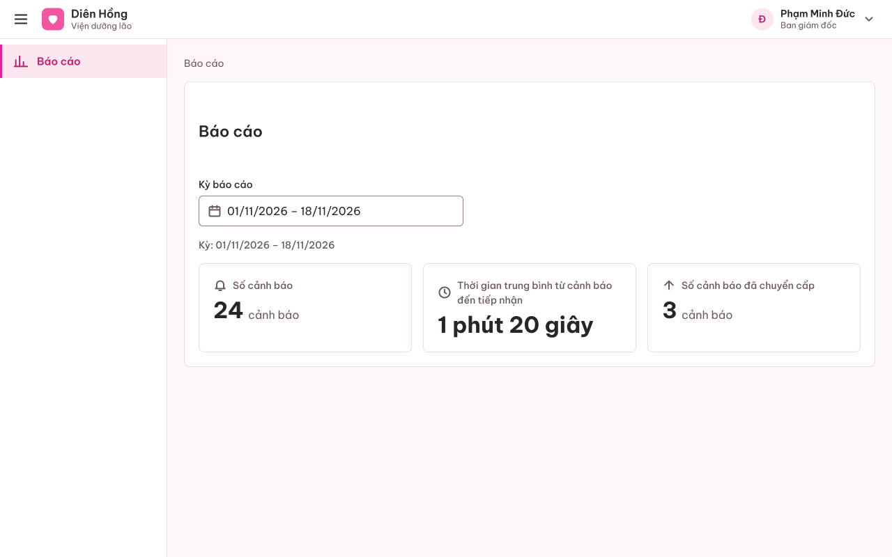
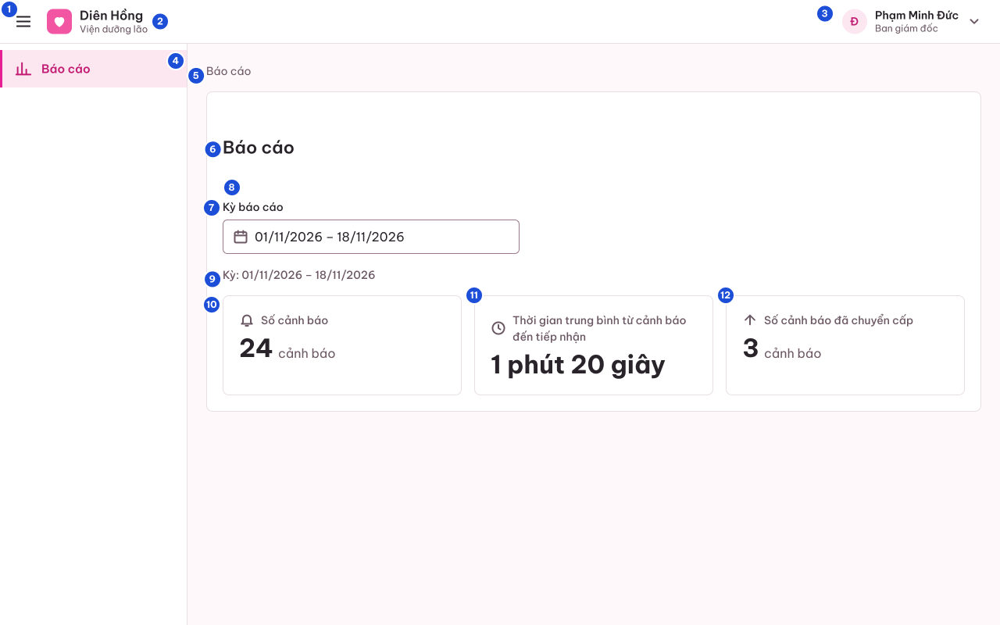
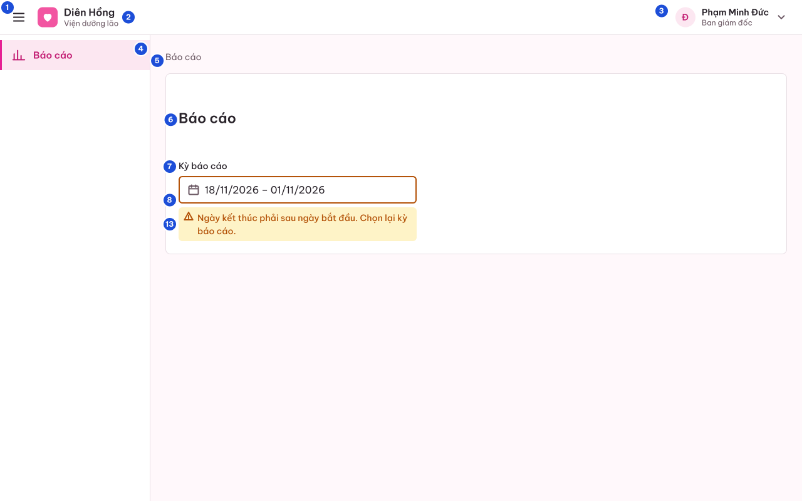
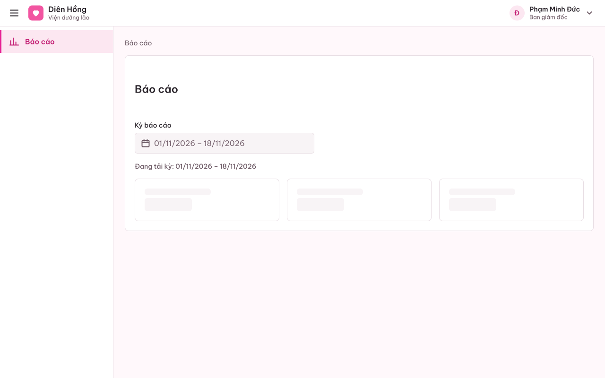
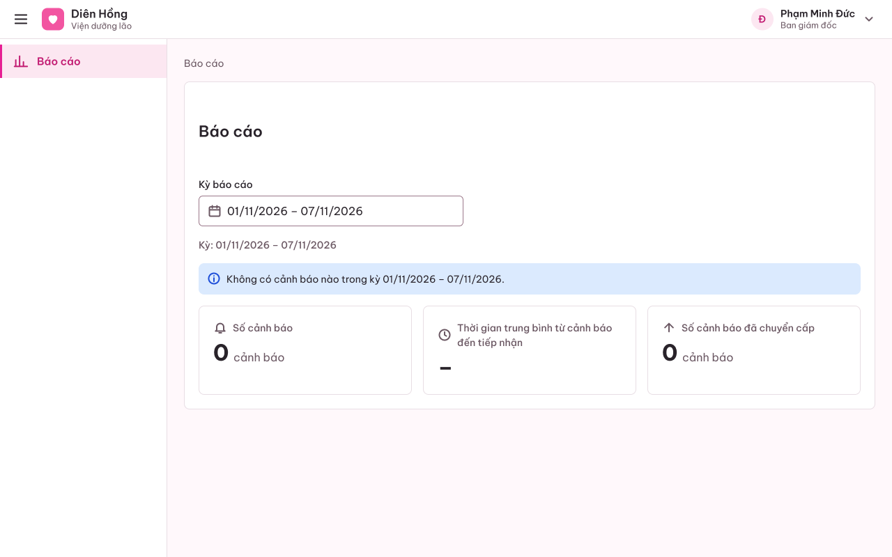

# Screen Spec: S-F05-01 Report with period filter (desktop)

| Field             | Value                                                                                     |
| ----------------- | ----------------------------------------------------------------------------------------- |
| Screen ID         | S-F05-01                                                                                  |
| Screen name       | Report with period filter (interface label: "Báo cáo")                                    |
| Actor             | BOD                                                                                       |
| Priority          | Could                                                                                     |
| Feature           | F-05 Reporting                                                                            |
| Activity diagrams | none: UC-10 has no activity diagram (usage flow: "not needed")                            |
| Mockup images     | `img/S-F05-01-desktop.png` (default), two numbered images, three state images (section 2) |
| Frame width       | 1280px                                                                                    |
| Figma frame       | page "BOD & Admin · Desktop 1280", frame `S-F05-01-desktop` ([Figma file]())              |
| Status            | Done                                                                                      |

## 1. Purpose

**Shown when:** a member of the Board of Directors has signed in (this is the BOD's home screen and only destination, FR-00-01; ui-conventions 3.4), clicks "Báo cáo" in the menu, or is sent home by a refused request (FR-06-03). The BOD chooses a period and reads three figures about the alerts of that period.

**The user leaves this screen when:** they sign out from the account menu. No other screen is opened from here.

## 2. Mockup

**Numbered:** each number is the # of the element inventory in section 3. Elements 1–6 are the desktop shell (menu button, brand, account menu, sidebar menu, breadcrumb, title). Element 13 (Inline field error) appears only in the error state, so it is numbered on the error image. The information banner of the empty state has no number. The "S-F05-01" tag beside the title in the mockup is a design annotation, not an element.

| Default, numbered | Error, numbered |
|---|---|
|  |  |

| Loading | Empty |
|---|---|
|  |  |

| State   | Image                              |
| ------- | ---------------------------------- |
| Default | `img/S-F05-01-desktop.png`         |
| Empty   | `img/S-F05-01-desktop-empty.png`   |
| Loading | `img/S-F05-01-desktop-loading.png` |
| Error   | `img/S-F05-01-desktop-error.png`   |
| Success | None: this screen saves nothing    |

All colours, fonts and corners come from the design tokens in [ui-conventions.md](../ui-conventions.md#7-design-tokens), whose values live in [design-tokens.css](../design-tokens.css).

## 3. Element inventory

Labels are shown as they appear in the interface (Vietnamese), with the repository label in brackets. Messages marked (new) are not in ui-conventions §5 yet (open question 5).

| # | Element | Type | Content / data source | Required | Validation |
|---|---|---|---|---|---|
| 1 | Menu button | Icon button | static: accessible name "Thu gọn menu" (Collapse menu) / "Mở rộng menu" (Expand menu) | Yes | none |
| 2 | Brand | Image + text | static: logo mark on colour/brand-pink, "Diên Hồng", "Viện dưỡng lão" | Yes | none |
| 3 | Account menu | Menu button | initial of the last word of `user.name` on colour/pink-light, `user.name`, role name (`user.role`, "Ban giám đốc"); item "Đăng xuất" (Sign out) | Yes | none |
| 4 | Sidebar menu | Navigation | the BOD's one item: "Báo cáo" (Report), current (ui-conventions 3.4) | Yes | none |
| 5 | Breadcrumb | Text | static: "Báo cáo" | Yes | none |
| 6 | Title | Header | static: "Báo cáo" (Report) | Yes | none |
| 7 | Filter bar | Container | holds field 8 (ui-conventions §4, Filter bar) | Yes | none |
| 8 | Report period | Date-range field | label "Kỳ báo cáo" (Report period); calendar icon that opens the date-range picker (popover); the dates can also be typed; value "dd/MM/yyyy – dd/MM/yyyy"; default: the first day of the current month to today | Yes | start and end dates both required and real dates: "Nhập kỳ báo cáo theo dạng dd/MM/yyyy – dd/MM/yyyy." (new); end date on or after the start date: "Ngày kết thúc không được trước ngày bắt đầu. Chọn lại kỳ báo cáo." (new, SR-002) |
| 9 | Applied period | Text | "Kỳ: " + the period of the figures shown | Yes | none |
| 10 | Number of alerts | Figure card | bell icon (decorative); label "Số cảnh báo" (Number of alerts); value = number of `alert` whose `alert.created_at` is in the period (Alert Log) + "cảnh báo" | Yes | none |
| 11 | Average time to acknowledgement | Figure card | clock icon (decorative); label "Thời gian trung bình từ cảnh báo đến tiếp nhận" (Average time from alert to acknowledgement); value = average of `alert.acknowledged_at` − `alert.created_at` for the acknowledged alerts of the period, as "m phút ss giây" (ui-conventions §2, Duration; for example "1 phút 05 giây"); "–" when no alert of the period was acknowledged | Yes | none |
| 12 | Number of escalated alerts | Figure card | arrow icon (decorative); label "Số cảnh báo đã chuyển cấp" (Number of escalated alerts); value = number of `alert` of the period that reached `alert.status` Escalated (Alert Log, open question 3) + "cảnh báo" | Yes | none |
| 13 | Inline field error | Inline error, under field 8 | message of section 4, text and icon on colour/warning-bg, field edge 2px colour/warning | No | shown only in the error state |

## 4. States

| State | What the user sees | Trigger |
|---|---|---|
| Default | The period field with the default period, the applied period (9) and the three figures (FR-05-01). The mockup shows 01/11/2026 – 18/11/2026: 24 cảnh báo, 1 phút 20 giây, 3 cảnh báo. | Screen opened, figures loaded |
| Empty (no data) | The applied period (9), then the information banner "Không có cảnh báo nào trong kỳ 01/11/2026 – 07/11/2026." (No alerts in the period …) (new) on colour/info-bg; the figures show "0 cảnh báo", "–" and "0 cảnh báo" | No alert was created in the chosen period |
| Loading | Field 8 disabled and greyed; element 9 reads "Đang tải kỳ: …" (Loading period …); the three figure cards show grey placeholders on colour/surface-secondary. | A valid period was applied (or the screen opened) and the figures are being computed |
| Error | Field 8 with a 2px colour/warning edge and the inline error (13) "Ngày kết thúc không được trước ngày bắt đầu. Chọn lại kỳ báo cáo." (The end date must not be before the start date. Choose the period again.) (new); no applied period and no figures are shown, and nothing is requested. | The chosen end date is before the start date, or a date is missing or not a real date (FR-05-01) |
| Success / confirmation | None: this screen saves nothing; choosing a period only reads data and there is nothing to confirm (SD-UC-10 has no confirmation step) | – |

**Situations described in words, not drawn:**

- Access denied: a user of another role who opens this screen is sent to their own home screen, which shows the message "Bạn không có quyền dùng chức năng đó. Bạn đã được đưa về màn hình chính." (You do not have access to that function. You are back on your home screen.) (FR-06-03, ui-conventions §5). A BOD who tries an Admin function is sent here: the screen opens in its Default state with this message in a banner on colour/warning-bg above the filter bar, until the period is changed.
- The report cannot be loaded because of the network: a banner on colour/warning-bg (not the information banner) under the filter bar, "Chưa tải được báo cáo. Kiểm tra kết nối và thử lại." (new; The report cannot be loaded. Check your connection and try again.); the period field keeps its value, no figures are shown, and the BOD tries again by applying the period again (open question 1).

## 5. Interactions and navigation

| # | Element | User action | System response | Goes to screen |
|---|---|---|---|---|
| 1 | Report period (8) | click the calendar icon and pick the dates, or type them | When both dates are complete (picker closed, or Enter), a valid period is applied at once: Loading, then Default or Empty (FR-05-01, SD-UC-10 "Select a period"); element 9 updates. An invalid period gives the Error state and nothing is requested | stays |
| 2 | "Báo cáo" in the menu (4) | click | Reloads this screen with the default period | stays |
| 3 | Menu button (1) | click | Collapses the sidebar to icons (64px), or opens it again | stays |
| 4 | "Đăng xuất" in the account menu (3) | click | Ends the session | S-F00-01 |

## 6. Screen-level rules

| Rule ID | Rule | Source |
|---|---|---|
| SR-001 | The report loads as soon as the period is complete and valid; there is no separate "view" button. | FR-05-01 ("WHEN a member of the Board of Directors selects a period"), SD-UC-10, open question 1 |
| SR-002 | Both dates are required; the end date must be on the same day as the start date or later, so a one-day period is valid (this also keeps the default period valid on the first day of a month). Figures are not requested until the period is valid. | FR-05-01 |
| SR-003 | The period covers whole days, from 00:00 on the start date to 23:59 on the end date, both included, in the local time of the nursing home. | FR-05-01 |
| SR-004 | The figures are computed by the API Server from the Alert Log at the time of the request; the screen shows figures, not charts, in Release 1. | SD-UC-10, ui-conventions 7.4 |
| SR-005 | An alert counts in the period by its creation time. The average time uses only the alerts of the period that were acknowledged and is "–" when there are none; the escalated figure counts the alerts of the period that reached the status Escalated. | FR-05-01, open question 3 |
| SR-006 | The applied period (9) always shows the period of the figures on screen; it is hidden together with the figures in the Error state. | ui-conventions §4 (Filter bar) |
| SR-007 | Only the BOD may use this screen; the API Server checks the role on every request, hiding an element is never the only check. | FR-06-03, BR-13, ADR-003 |
| SR-008 | Nothing is saved or changed on this screen, so no log entry is written. | SD-UC-10 |
| SR-009 | Errors are shown by text and icon as well as colour (colour/warning, never colour/error, which is for resident alerts). | ui-conventions §4, §6 (WCAG 2.2 1.4.1) |

## 7. Linked requirements

| FR ID | What this screen does for it |
|---|---|
| FR-00-01 | Home screen of the BOD after sign-in |
| FR-05-01 | Shows, for the chosen period, the number of alerts, the average time from alert to acknowledgement and the number of escalated alerts; rejects an invalid period; shows the empty state when the period has no alerts |
| FR-06-03 | Shows the access-denied message when a refused request sends the BOD home |

## 8. Responsive and accessibility notes

- 768px and wider: sidebar 240px with labels, which the menu button (1) collapses to icons (64px); content padding 24px (ui-conventions 3.1, 7.5).
- The three figure cards sit side by side and share the width of the page card; on a narrow window their labels wrap. Below 768px the mobile layout applies.
- Focus ring 2px colour/primary on every control; the date-range popover keeps the focus inside and returns it to field 8 when it closes (ui-conventions §6).
- No figure is shown by colour alone: each card has its icon, its label and its unit in words (SR-009).
- Text contrast at least 4.5:1 on every background used (ui-conventions 7.6); zoom stays allowed.

## 9. Open questions

| #   | Question                                                                                                                                                                                                 | Blocking?                                                            | Status                                                                                                                                                                    |
| --- | -------------------------------------------------------------------------------------------------------------------------------------------------------------------------------------------------------- | -------------------------------------------------------------------- | ------------------------------------------------------------------------------------------------------------------------------------------------------------------------- |
| 1   | Does the BOD need an explicit "Xem báo cáo" button? The mockups have one, but the Screen & Element List and FR-05-01 do not; without it, a failed load can be retried only by applying the period again. | No. The report works either way.                                     | Open. Default: no button, as in the Screen & Element List; the mockups must be redrawn without it. If the team keeps the button, update the List, FR-05-01 and this spec. |
| 2   | Should the period have preset choices (this month, last month, last 7 days)?                                                                                                                             | No.                                                                  | Open. Default: a free date range, starting with the current month.                                                                                                        |
| 3   | Does "escalated" mean every alert that received a repeated notice, or only those still Escalated at the end of the period?                                                                               | No. Only the meaning of one figure is affected.                      | Open. Default: every alert of the period that reached the status Escalated.                                                                                               |
| 4   | Are there limits on the period (end date in the future, longest range)?                                                                                                                                  | No. A long range is only slower; a future date simply has no alerts. | Open. Default: no limit; a period with no alerts shows the Empty state.                                                                                                   |

## Completion checklist

- [x] The mockup is a separate cropped image file, named with the Screen ID, at the frame width.
- [x] The numbered images exist, and their numbers match the # column of the element inventory. 
- [x] Every visible element in the mockup appears in the element inventory. 
- [x] Every colour in the mockup is a design token from ui-conventions.md.
- [x] Every input element has a validation rule or an explicit "none".
- [x] All five states are filled in, or marked "none" with a reason.
- [x] Every navigation target is a Screen ID that exists in the Screen List.
- [x] Every element that displays data names the field it displays.
- [x] Every linked FR exists in the Function List; UC-10 has no activity diagram, and the SD-UC-10 exchange is covered by interaction row 1.
