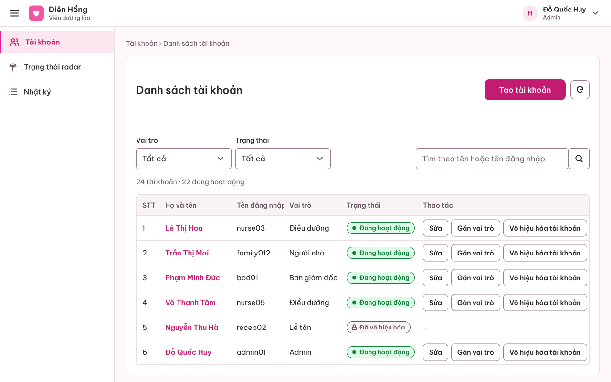
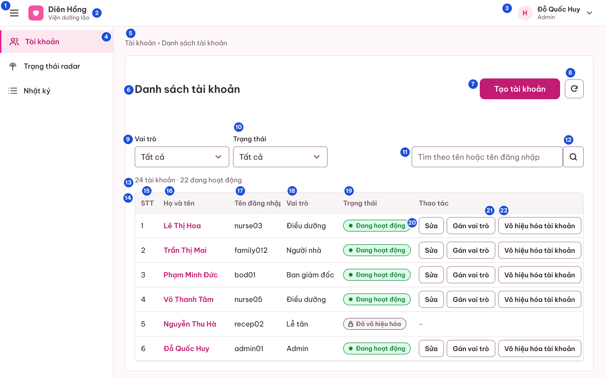
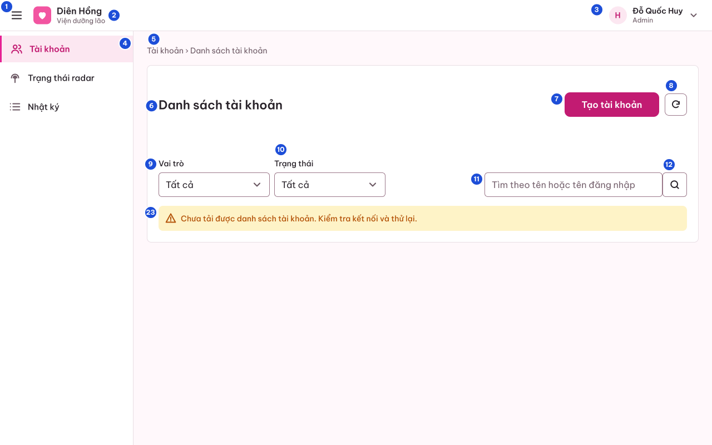
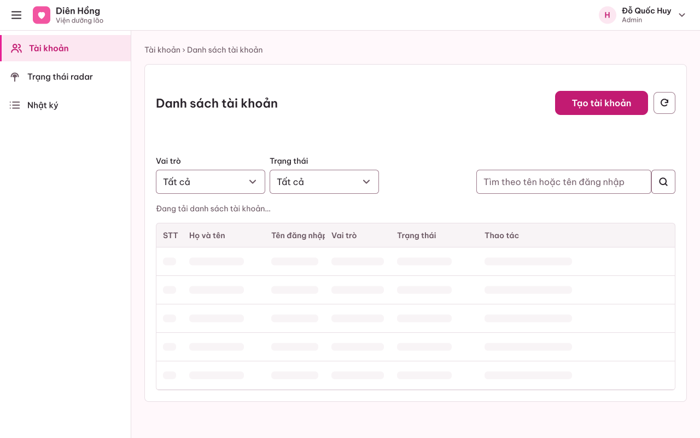
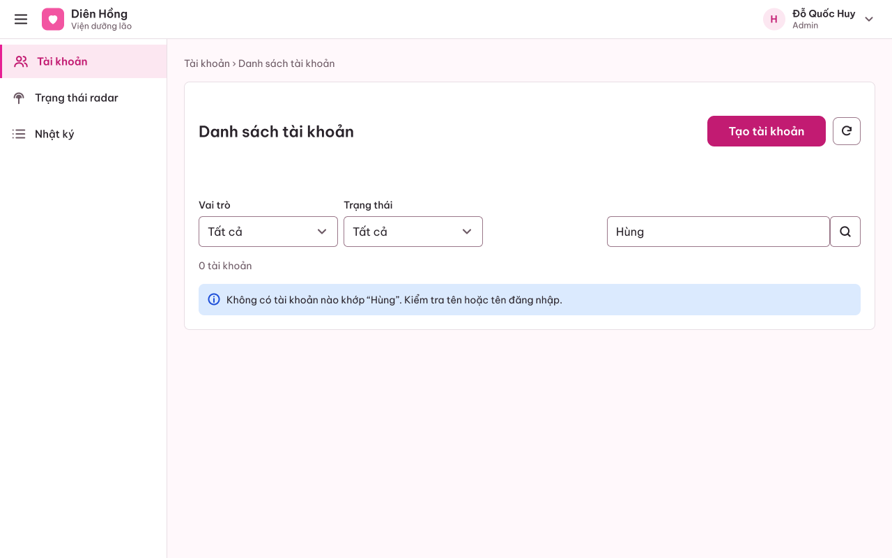
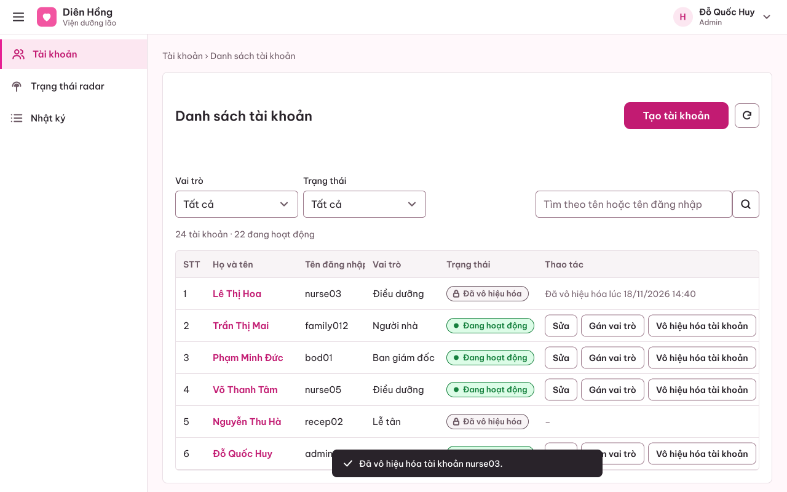

# Screen Spec: S-F06-01 Account management (desktop)

| Field             | Value                                                                                                                                                                                  |
| ----------------- | -------------------------------------------------------------------------------------------------------------------------------------------------------------------------------------- |
| Screen ID         | S-F06-01                                                                                                                                                                               |
| Screen name       | Account management (interface label: "Danh sách tài khoản" on desktop, "Tài khoản" on mobile)                                                                                          |
| Actor             | Admin                                                                                                                                                                                  |
| Priority          | Must                                                                                                                                                                                   |
| Feature           | F-06 Administration                                                                                                                                                                    |
| Activity diagrams | AD-UC-11 (set up account), AD-UC-12 (assign role-based permissions)                                                                                                                    |
| Mockup images     | `img/S-F06-01-desktop.png` (default), two numbered images, four state images and the confirm modal image (section 2)                                                                   |
| Frame width       | 1280px (exported at 1x)                                                                                                                                                                                |
| Figma frame       | page "BOD & Admin · Desktop 1280", frame `S-F06-01-desktop` ([Figma file]())                                                                                                           |
| Status            | Done                                                                                                                                                                                   |

## 1. Purpose

**Shown when:** the Admin has signed in (this is the Admin's home screen, FR-00-01; ui-conventions 3.4), clicks "Tài khoản" in the menu, or comes back from S-F06-02 or S-F06-03. The Admin finds an account and chooses an operation: create, edit, assign a role or deactivate. Only an Admin reaches this screen; any other user is refused (FR-06-03, section 4).

**The user leaves this screen when:** they start a new account or edit one (S-F06-02), assign a role (S-F06-03), open Radar status (S-F06-04) or Logs (S-F06-05), or sign out.

## 2. Mockup

**Numbered:** each number is the # of the element inventory in section 3. Element 23 (Message area) appears only in the empty and error states, so it is numbered on the error image. The "S-F06-01" tag beside the title in the mockup is a design annotation, not an element.

| Default, numbered | Error, numbered |
|---|---|
|  |  |

| Loading | Empty |
|---|---|
|  |  |

| Success |
|---|
|  | 

| State   | Image                              |
| ------- | ---------------------------------- |
| Default | `img/S-F06-01-desktop.png`         |
| Empty   | `img/S-F06-01-desktop-empty.png`   |
| Loading | `img/S-F06-01-desktop-loading.png` |
| Error   | `img/S-F06-01-desktop-error.png`    |
| Success | `img/S-F06-01-desktop-success.png` |

All colours, fonts and corners come from the design tokens in [ui-conventions.md](../ui-conventions.md#7-design-tokens), whose values live in [design-tokens.css](../design-tokens.css).

## 3. Element inventory

Labels are shown as they appear in the interface (Vietnamese), with the repository label in brackets.

| # | Element | Type | Content / data source | Required | Validation |
|---|---|---|---|---|---|
| 1 | Menu button | Icon button | static: accessible name "Thu gọn menu" (Collapse menu) / "Mở rộng menu" (Expand menu) | Yes | none |
| 2 | Brand | Image + text | static: logo mark on colour/brand-pink, "Diên Hồng", "Viện dưỡng lão" | Yes | none |
| 3 | Account menu | Menu button | initial of the last word of `user.name` (the given name) on colour/pink-light, `user.name`, role name (`user.role`, "Admin"); item "Đăng xuất" (Sign out) | Yes | none |
| 4 | Sidebar menu | Navigation | "Tài khoản" (current), "Trạng thái radar" (Radar status), "Nhật ký" (Logs) (ui-conventions 3.4) | Yes | none |
| 5 | Breadcrumb | Text | static: "Tài khoản › Danh sách tài khoản" | Yes | none |
| 6 | Title | Header | static: "Danh sách tài khoản" (Account list) | Yes | none |
| 7 | Create account | Primary button, title row | label "Tạo tài khoản" (Create account) | Yes | none |
| 8 | Reload | Icon button, title row | static: accessible name "Tải lại" (Reload) | Yes | none |
| 9 | Role filter | Dropdown | label "Vai trò" (Role): "Tất cả" (All), "Lễ tân", "Điều dưỡng", "Người nhà", "Ban giám đốc", "Admin" | Yes | one value |
| 10 | Status filter | Dropdown | label "Trạng thái" (Status): "Tất cả" (All), "Đang hoạt động" (Active), "Đã vô hiệu hóa" (Inactive) | Yes | one value |
| 11 | Quick search | Search field | placeholder "Tìm theo tên hoặc tên đăng nhập" (Search by name or username); matches `account.full_name` and `account.identifier` | No | none (SR-005) |
| 12 | Search | Secondary button, joined to field 11 | static: magnifier icon, accessible name "Tìm" (Search) | Yes | none |
| 13 | Count line | Text | "n tài khoản · m đang hoạt động": n = accounts matching the filters and the search, m = the Active ones among them (SR-009) | Yes | none |
| 14 | Account table | Data table | one row per account in the User Account & Role data group that matches the filters and the search | Yes | none |
| 15 | No. | Column "STT" | row number, 1, 2, 3 in the order shown (ui-conventions §2) | Yes | none |
| 16 | Full name | Column "Họ và tên" | `account.full_name`, plain text in colour/text-primary, not a link (SR-010) | Yes | none |
| 17 | Username | Column "Tên đăng nhập" | `account.identifier` | Yes | none |
| 18 | Role | Column "Vai trò" | role name of `account.role` | Yes | none |
| 19 | Status | Column "Trạng thái", status badge | `account.status`: "Đang hoạt động" (Active, dot icon, colour/success) or "Đã vô hiệu hóa" (Inactive, lock icon, colour/text-secondary) | Yes | none |
| 20 | Edit | Secondary button, column "Thao tác" | label "Sửa" (Edit); accessible name includes the username ("Sửa, nurse03") | Active only | none |
| 21 | Assign role | Secondary button, column "Thao tác" | label "Gán vai trò" (Assign role) (BR-15) | Active only | none |
| 22 | Deactivate account | Secondary button, column "Thao tác" | label "Vô hiệu hóa tài khoản" (Deactivate account); not offered on the signed-in Admin's own row (SR-007) | Active, not own | none |
| 23 | Message area | Banner, under the toolbar | the empty message (information banner) and the error message (warning banner) of section 4 | No | none |

An Inactive account row shows "–" in column "Thao tác" instead of elements 20–22; right after a deactivation the cell shows "Đã vô hiệu hóa lúc dd/MM/yyyy HH:mm" until the list is reloaded (SR-003).

## 4. States

| State | What the user sees | Trigger |
|---|---|---|
| Default | Toolbar with both filters on "Tất cả" and an empty search field, count line "24 tài khoản · 22 đang hoạt động" and the account table; the mockup shows the first six rows. Active rows show "Sửa", "Gán vai trò" and "Vô hiệu hóa tài khoản"; the signed-in Admin's own row (Đỗ Quốc Huy) shows no "Vô hiệu hóa tài khoản"; an Inactive row shows the badge and "–". | Screen opened, accounts loaded |
| Empty (no data) | Count line "0 tài khoản", no table, and the information banner (23): with a search text "Không có tài khoản nào khớp “Hùng”. Kiểm tra tên hoặc tên đăng nhập." (No account matches “Hùng”. Check the name or the username.); with filters only "Không có tài khoản nào khớp bộ lọc. Đổi vai trò hoặc trạng thái." (No account matches the filters. Change the role or the status.). Search and filters stay as typed. | No account matches the filters and the search |
| Loading | Toolbar kept, "Đang tải danh sách tài khoản…" (Loading the account list…) in the place of the count line, the table header kept and five placeholder rows on colour/surface-secondary. | List being fetched (screen opened, Reload, filter or search changed) |
| Error | Warning banner (23) "Chưa tải được danh sách tài khoản. Kiểm tra kết nối và thử lại." (The account list cannot be loaded. Check your connection and try again.); no count line, no table; Reload (8) stays enabled. | The request to fetch the list failed |
| Success / confirmation | The row of the deactivated account shows the badge "Đã vô hiệu hóa" and "Đã vô hiệu hóa lúc 18/11/2026 14:40" in column "Thao tác" instead of buttons 20–22; the count line drops by one active account (mockup: 24 tài khoản · 21 đang hoạt động); the row keeps its position; and the toast "Đã vô hiệu hóa tài khoản nurse03." (Account nurse03 deactivated.) appears at the bottom of the window for 4 seconds (AD-UC-11 `S4`, FR-06-07). | Deactivation confirmed in the confirm modal and saved |

**Confirm modal** (not drawn, described here only; it is a confirm modal, ui-conventions §4, and answers AD-UC-11 `D6`): title "Vô hiệu hóa tài khoản?" (Deactivate account?), text "Vô hiệu hóa nurse03? Người này bị đăng xuất ngay và không thể đăng nhập lại. Không thể hoàn tác." (ui-conventions §5, Confirm deactivation), buttons side by side: "Hủy" (Cancel, secondary) then "Vô hiệu hóa tài khoản" (primary). Esc is the same as "Hủy"; the modal keeps the keyboard focus inside and returns it to the button that opened it, or to the table when that button is gone after the deactivation (ui-conventions §6).

**Situations described in words, not drawn** (Screen & Element List):

- Access denied: a user who is not an Admin and opens this screen is sent back to their own home screen, which shows the message "Bạn không có quyền dùng chức năng đó. Bạn đã được đưa về màn hình chính." (You do not have access to that function. You are back on your home screen.) (FR-06-03, ui-conventions §5). This screen is not shown to that user and is never shown with this message.
- Deactivation fails because of the network: the modal closes, the account stays Active, and the message area (23 on desktop, 16 on mobile) shows, on colour/warning-bg, "Chưa lưu được. Kiểm tra kết nối và thử lại." (new; Not saved yet. Check your connection and try again.).

## 5. Interactions and navigation

| # | Element | User action | System response | Goes to screen |
|---|---|---|---|---|
| 1 | Create account (7) | click | Opens the account dialog for a new account over this list (AD-UC-11 `A1` [Create]) | S-F06-02 |
| 2 | Edit (20) | click | Opens the account dialog with this account (AD-UC-11 `A4`) | S-F06-02 |
| 3 | Assign role (21) | click | Opens the role dialog for this account (AD-UC-12 `A1`, "taps Assign role") | S-F06-03 |
| 4 | Deactivate account (22) | click | Opens the confirm modal for this account (AD-UC-11 `A5`) | stays (modal) |
| 5 | "Vô hiệu hóa tài khoản" in the confirm modal | click | Sets the account Inactive, ends its open sessions, records the action (FR-06-07, FR-06-08); Success state | stays |
| 6 | "Hủy" in the confirm modal, or Esc | click or key | Closes the modal; nothing is deactivated (AD-UC-11 `D6` [No]) | stays |
| 7 | Search (12), or Enter in field 11 | click or key | Filters the list by name or username (SR-005); Loading, then Default or Empty | stays |
| 8 | Role filter (9), Status filter (10) | choose a value | Filters the list at once; element 13 updates | stays |
| 9 | Reload (8) | click | Fetches the list again (Loading, then Default or Error) | stays |
| 10 | "Trạng thái radar" in the menu (4) | click | "taps Radar status in the menu" | S-F06-04 |
| 11 | "Nhật ký" in the menu (4) | click | "taps Logs in the menu" | S-F06-05 |
| 12 | Menu button (1) | click | Collapses the sidebar to icons (64px), or opens it again | stays |
| 13 | "Đăng xuất" in the account menu (3) | click | Ends the session | S-F00-01 |

## 6. Screen-level rules

| Rule ID | Rule                                                                                                                                                                                                                                                          | Source                                                |
| ------- | ------------------------------------------------------------------------------------------------------------------------------------------------------------------------------------------------------------------------------------------------------------- | ----------------------------------------------------- |
| SR-001  | Edit, Assign role and Deactivate account are offered for Active accounts only; an Inactive account cannot be selected for any operation.                                                                                                                      | AD-UC-11 (`A4`, `A5` "active account"), BR-15         |
| SR-002  | Deactivation always asks for confirmation first; it signs the person out at once and cannot be undone; the account data and history are kept.                                                                                                                 | FR-06-07, AD-UC-11 `D6`                               |
| SR-003  | The list keeps the order returned by the API Server; a row does not move when its account is deactivated. Just after a deactivation the row shows the time of the deactivation instead of "–" (or the "không thể đăng nhập" line) until the list is reloaded. | open question 3, FR-06-07                             |
| SR-004  | Account status is shown by text, icon and colour together, never by colour alone.                                                                                                                                                                             | ui-conventions §4 (Status badge), §6 (WCAG 2.2 1.4.1) |
| SR-005  | The filters and the search work together (all must match). The search trims spaces, ignores capitals and Vietnamese diacritics, and matches any part of the full name or the username.                                                                        | ui-conventions §5                                     |
| SR-006  | Only an Admin may use this screen; the API Server checks the role on every request, hiding an element is never the only check.                                                                                                                                | FR-06-03, BR-13, ADR-003                              |
| SR-007  | The signed-in Admin cannot deactivate their own account, and the API Server refuses to deactivate the last active Admin.                                                                                                                                      | open question 2, FR-06-07                             |
| SR-008  | The username of a deactivated account stays reserved and cannot be used for a new account; an Inactive account is not reactivated.                                                                                                                            | S-F06-02 SR-001, open question 1                      |
| SR-009  | The count line counts the accounts that match the filters and the search, and how many of them are Active; it is recomputed after every deactivation.                                                                                                         | FR-06-07                                              |
| SR-010  | The full name is plain text: this app has no account detail screen, and colour/primary is reserved for links and the current item (ui-conventions §7.1).                                                                                                      | Screen List, ui-conventions §4                        |

## 7. Linked requirements

| FR ID | What this screen does for it |
|---|---|
| FR-00-01 | Home screen of the Admin after sign-in |
| FR-06-01 | "Tạo tài khoản" starts the creation of an account (S-F06-02) |
| FR-06-02 | "Gán vai trò" selects the Active account whose role will change (S-F06-03) |
| FR-06-03 | Only the Admin reaches the screen; any other user is sent to their own home screen with the access-denied message |
| FR-06-06 | "Sửa" selects the Active account whose information will change (S-F06-02) |
| FR-06-07 | "Vô hiệu hóa tài khoản" deactivates an Active account after confirmation |
| FR-06-08 | The deactivation is recorded in the action log (no user interface here; listed on S-F06-05) |

## 8. Responsive and accessibility notes

- 768px and wider: sidebar 240px with labels, which the menu button (1) collapses to icons (64px); content padding 24px; table text 15px (ui-conventions 3.1, 7.5).
- When the window is narrower than the table, the toolbar wraps and the table keeps its columns and scrolls sideways inside its card. Below 768px the mobile layout applies.
- Table headers are `<th scope="col">`; rows are at least 48px tall; the row buttons are reachable with Tab and their accessible names include the account ("Gán vai trò, nurse03").
- The confirm modal keeps the keyboard focus inside while open (ui-conventions §6).
- Account status is never shown by colour alone (SR-004); text contrast at least 4.5:1 on every background used (ui-conventions 7.6).
- Row actions have accessible names that include the username ("Vô hiệu hóa tài khoản, nurse03").

## 9. Open questions

| #   | Question                                                                                                                                               | Blocking?                                   | Status                                                                                                                                                                              |
| --- | ------------------------------------------------------------------------------------------------------------------------------------------------------ | ------------------------------------------- | ----------------------------------------------------------------------------------------------------------------------------------------------------------------------------------- |
| 1   | Can the Admin reactivate an Inactive account?                                                                                                          | No.                                         | Open. Default (AD-UC-11 open question 5): no; the Admin creates a new account with a new username, and the old username stays reserved.                                             |
| 2   | May an Admin deactivate their own account or the last active Admin?                                                                                    | Yes.                                        | Open. Default, applied until the client answers: not their own account, and the API Server refuses to deactivate the last active Admin; another Admin's account may be deactivated. |
| 3   | In which order are accounts listed, and is the list paged? The mockup lists 6 of 24 accounts in an order that is neither by name nor by status.        | No.                                         | Open. Default: the order returned by the API Server, stable; all accounts in one scrollable list; no sorting control and no paging in Release 1.                                    |
| 4   | The messages marked (new) (empty list by filters, load error, toast, network error, loading text, "Không thể đăng nhập") are not in ui-conventions §5. | No.                                         | Closed. Added to ui-conventions v3.4.                                                         |

## Completion checklist

- [x] The mockup is a separate cropped image file, named with the Screen ID, at the frame width.
- [x] The numbered images exist, and their numbers match the # column of the element inventory.
- [x] Every visible element in the mockup appears in the element inventory. 
- [x] Every colour in the mockup is a design token from ui-conventions.md.
- [x] Every input element has a validation rule or an explicit "none".
- [x] All five states are filled in. 
- [x] Every navigation target is a Screen ID that exists in the Screen List.
- [x] Every element that displays data names the field it displays.
- [x] Every linked FR exists in the Function List, and every action of this screen in AD-UC-11 and AD-UC-12 is covered by an interaction row.
