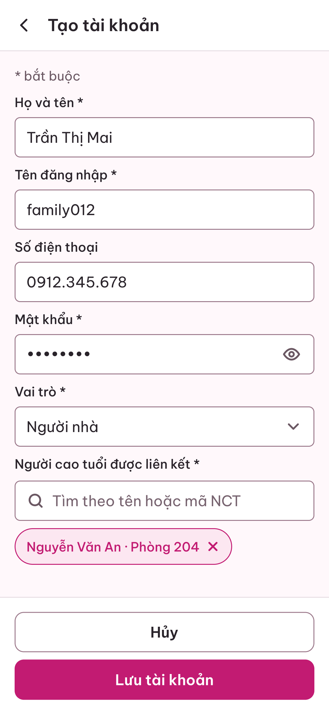
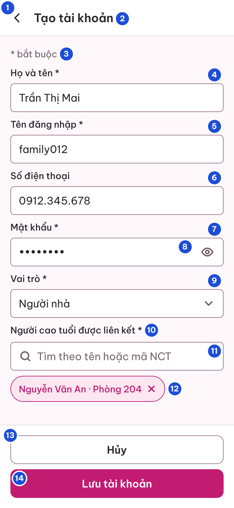
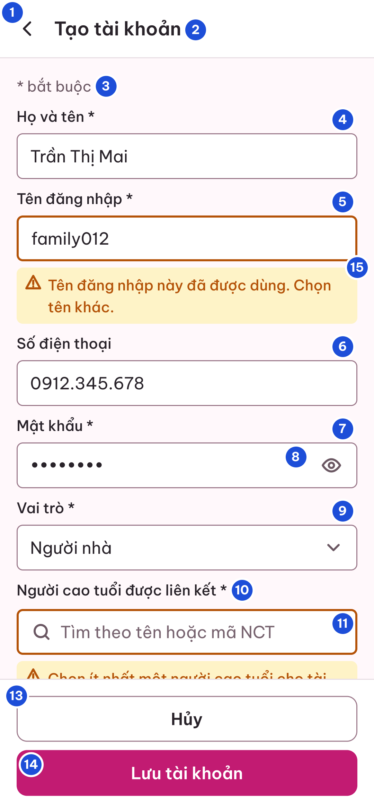
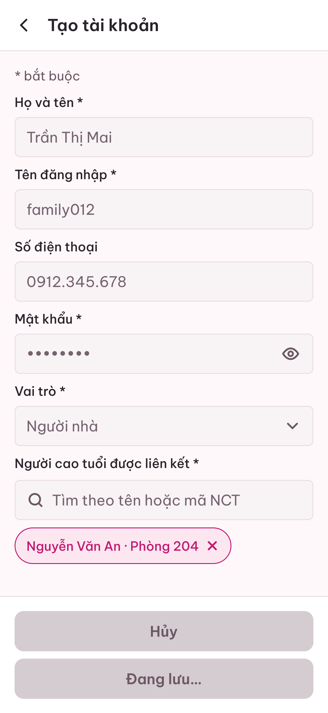
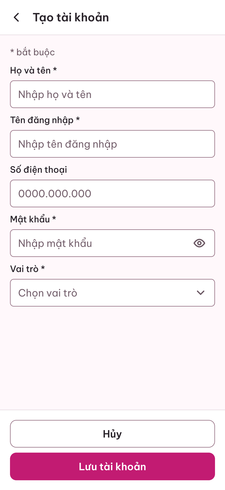
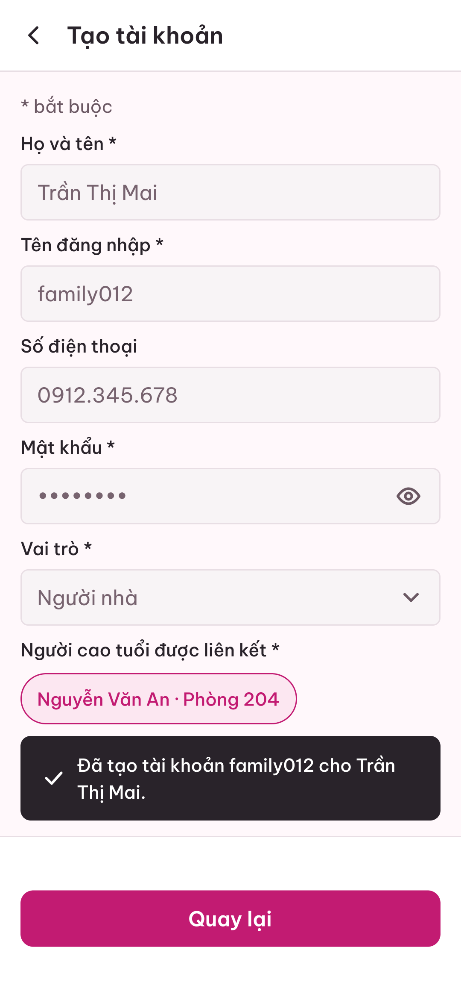

# Screen Spec: S-F06-02 Create or edit account (mobile)

| Field             | Value                                                                                           |
| ----------------- | ----------------------------------------------------------------------------------------------- |
| Screen ID         | S-F06-02                                                                                        |
| Screen name       | Create or edit account (interface label: "Tạo tài khoản" / "Sửa tài khoản")                     |
| Actor             | Admin                                                                                           |
| Priority          | Must                                                                                            |
| Feature           | F-06 Administration                                                                             |
| Activity diagrams | AD-UC-11 (set up account)                                                                       |
| Mockup images     | `img/S-F06-02-mobile.png` (default, create), two numbered images, four state images (section 2) |
| Frame width       | 360px (exported at 3x, 1080 pixels)                                                                                          |
| Figma frame       | page "BOD & Admin · Mobile 360", frame `S-F06-02-mobile` ([Figma file]())                       |
| Status            | Done                                                                                            |

## 1. Purpose

**Shown when:** the Admin taps "Tạo tài khoản" (Create account) or "Sửa" (Edit) on an Active account in S-F06-01. The Admin enters a new account, with the residents to link for a family account, or changes the name, phone number or password of an Active account.

**The user leaves this screen when:** the account is saved and they tap "Quay lại" (Back) or the Back arrow ("[account saved] taps Back"), or they tap "Hủy" (Cancel) ("taps Cancel"); both return to S-F06-01.

## 2. Mockup

**Numbered:** each number is the # of the element inventory in section 3.  Element 12 (Selected resident) appears only when a resident is selected, so it is numbered on the default image. Element 15 (Inline field error) appears only in the error state, so it is numbered on the error image.

| Default, numbered | Error, numbered |
|---|---|
|  |  |

| Loading | Empty |
|---|---|
|  |  |

| Success |
|---|
|  |

| State   | Image                             |
| ------- | --------------------------------- |
| Default | `img/S-F06-02-mobile.png`         |
| Empty   | `img/S-F06-02-mobile-empty.png`   |
| Loading | `img/S-F06-02-mobile-loading.png` |
| Error   | `img/S-F06-02-mobile-error.png`   |
| Success | `img/S-F06-02-mobile-success.png` |

All colours, fonts and corners come from the design tokens in [ui-conventions.md](../ui-conventions.md#7-design-tokens), whose values live in [design-tokens.css](../design-tokens.css).

## 3. Element inventory

Labels are shown as they appear in the interface (Vietnamese), with the repository label in brackets. The tab bar is hidden on this full-screen form; the fixed buttons take its place (ui-conventions §4, Tab bar). Messages marked (new) are not in ui-conventions §5 yet (open question 3).

| # | Element | Type | Content / data source | Required | Validation |
|---|---|---|---|---|---|
| 1 | Back | Icon button, app bar | static: back arrow; accessible name "Quay lại" (Back); same behaviour as Hủy | Yes | none |
| 2 | Title | Header, app bar | create: "Tạo tài khoản" (Create account); edit: "Sửa tài khoản: " + `account.full_name` (Edit account: …) | Yes | none |
| 3 | Required note | Text | static: "* bắt buộc" (* required) | Yes | none |
| 4 | Full name | Text field | label "Họ và tên *" (Full name); `account.full_name` | Yes | not empty after trimming spaces: "Nhập họ và tên." (Enter the full name.) |
| 5 | Username | Text field | label "Tên đăng nhập *" (Username); `account.identifier`; read-only when editing, with the hint "Không đổi được tên đăng nhập." (The username cannot be changed.) | Yes (create) | not empty: "Nhập tên đăng nhập." (new); not used by any other account, Active or Inactive, checked by the server on save (FR-06-04): "Tên đăng nhập này đã được dùng. Chọn tên khác." (This identifier is already in use. Choose another one.); no format rule |
| 6 | Phone number | Text field | label "Số điện thoại" (Phone number); `account.phone`, placeholder and display 0000.000.000 (ui-conventions §2); dots and spaces typed by the Admin are accepted | No | when entered, exactly 10 digits: "Nhập số điện thoại gồm 10 chữ số." (new) |
| 7 | Password | Password field | create: label "Mật khẩu *" (Password); edit: label "Mật khẩu mới" (New password), empty means unchanged; masked with dots; the server never returns it | Create: Yes; edit: No | create: not empty: "Nhập mật khẩu." (new); when entered while editing, same rule; length rules: open question 1 |
| 8 | Show password | Toggle button, inside field 7 | static: eye icon; accessible name "Hiện mật khẩu" / "Ẩn mật khẩu" (Show / Hide password); shows only what the Admin typed in this session | No | none |
| 9 | Role | Dropdown | label "Vai trò *" (Role); placeholder "Chọn vai trò" (Choose a role); `account.role`: only the roles this Admin may assign (BR-14); read-only when editing, with the hint "Đổi vai trò ở màn hình Gán vai trò." (Change the role on the Assign role screen.) | Yes (create) | one value: "Chọn vai trò." (new) |
| 10 | Linked residents | Section label | static: "Người cao tuổi được liên kết *" (Linked residents); shown only when creating and field 9 is "Người nhà" (Residents' Family) | Create, family | see element 11 |
| 11 | Resident search | Search field with result list | placeholder "Tìm theo tên hoặc mã NCT" (Search by name or resident ID); matches `resident.full_name` and `resident.resident_id` (Resident Profile); the list shows matching residents not yet selected as "full name · Phòng room"; no match: "Không có người cao tuổi nào khớp với “…”. Kiểm tra tên hoặc mã NCT." (ui-conventions §5, No search match, wording adapted) | Create, family | at least one resident selected (chip 12): "Chọn ít nhất một người cao tuổi cho tài khoản người nhà." (Select at least one resident for a family account.) (FR-06-04, FR-06-05) |
| 12 | Selected resident | Chip with remove | `resident.full_name` + " · Phòng " + `resident.room` (ui-conventions §2); one chip per selected resident; × removes it, accessible name "Bỏ <full name>" (Remove) | No | none |
| 13 | Cancel | Secondary button, fixed at the bottom | label "Hủy" (Cancel) | Yes | none |
| 14 | Save account | Primary button, fixed at the bottom | label "Lưu tài khoản" (Save account), full width; while saving "Đang lưu…" (Saving…) (ui-conventions 3.3, §4) | Yes | always enabled; checks every field when tapped |
| 15 | Inline field error | Inline error, under the field that failed | one message per field, text and icon on colour/warning-bg, field edge 2px colour/warning (ui-conventions §4, §7.3) | No | shown only in the error state |

## 4. States

| State           | What the user sees                                                                                                                                                                                                                                                                                                                                                                                                                                                          | Trigger                                                                                                                 |
| --------------- | --------------------------------------------------------------------------------------------------------------------------------------------------------------------------------------------------------------------------------------------------------------------------------------------------------------------------------------------------------------------------------------------------------------------------------------------------------------------------- | ----------------------------------------------------------------------------------------------------------------------- |
| Default         | The create form filled in for a family account: Trần Thị Mai, family012, 0912.345.678, password as dots, role "Người nhà", resident Nguyễn Văn An · Phòng 204 selected.                                                                                                                                                                                                                                                                                                     | The Admin is entering a new account                                                                                     |
| Empty (no data) | The create form with every field empty and placeholders shown ("Nhập họ và tên", "Nhập tên đăng nhập", "0000.000.000", "Nhập mật khẩu"); field 9 reads "Chọn vai trò"; elements 10–12 hidden until the role is "Người nhà"; "Lưu tài khoản" enabled                                                                                                                                                                                                                         | "Tạo tài khoản" tapped on S-F06-01                                                                                      |
| Loading         | Every field disabled and greyed (colour/surface-secondary); both buttons disabled, the primary one reading "Đang lưu…" (Saving…); the entered values stay visible                                                                                                                                                                                                                                                                                                           | "Lưu tài khoản" tapped with valid information, request in progress                                                      |
| Error           | Nothing saved (AD-UC-11 `S2`). Each field that failed gets a 2px colour/warning edge and its inline error (15): under field 5 "Tên đăng nhập này đã được dùng. Chọn tên khác." and under field 11 "Chọn ít nhất một người cao tuổi cho tài khoản người nhà." Other fields use the messages of section 3. The entered values are kept so the Admin can correct and save again (`A3`) or cancel (`D3`).                                                                       | Save with incomplete or invalid information, a username already used, or a family account without a resident (FR-06-04) |
| Success         | Fields read-only (password as dots), the selected resident without ×, the resident search gone, "Hủy" and "Lưu tài khoản" replaced by one primary button "Quay lại" (Back), and the toast "Đã tạo tài khoản family012 cho Trần Thị Mai." (Account family012 created for Trần Thị Mai.) (new) for 4 seconds (AD-UC-11 `S4`). The toast sits in the form above the fixed button. After an edit the toast reads "Đã lưu tài khoản family012." (Account family012 saved.) (new) | The account was created (FR-06-01, FR-06-05) or the changes saved (FR-06-06)                                            |

**Edit** (not drawn, same layout as the create form): title "Sửa tài khoản: Trần Thị Mai"; the form is filled with the saved values; fields 5 and 9 are read-only with their hints; field 7 is "Mật khẩu mới" and optional; elements 10–12 are not shown, because an edit keeps the role and the linked residents unchanged (FR-06-06). Loading, Error and Success behave as for create.

**Situations described in words, not drawn**:

- Access denied: a user who is not an Admin is sent back to their home screen with the message "Bạn không có quyền dùng chức năng đó. Bạn đã được đưa về màn hình chính." (You do not have access to that function. You are back on your home screen.) (FR-06-03, ui-conventions §5).
- Saving fails because of the network: a message on colour/warning-bg (not the information banner), "Chưa lưu được. Kiểm tra kết nối và thử lại." (new; Not saved yet. Check your connection and try again.). The form keeps what was entered and the buttons are enabled again.
- Close with unsaved changes: a confirm modal (ui-conventions §4) "Đóng mà không lưu? Thông tin tài khoản bạn đã nhập sẽ mất." (new; Close without saving? The account you entered will be lost.). "Unsaved changes" means any field differs from its initial value; with none, the screen closes without asking.

## 5. Interactions and navigation

| # | Element | User action | System response | Goes to screen |
|---|---|---|---|---|
| 1 | Save account (14) | tap [information valid] | Loading state; creates the account Active with its role and, for a family account, the resident links, and records the action (FR-06-01, FR-06-05, FR-06-08); or saves the changes (FR-06-06); then Success state | stays |
| 2 | Save account (14) | tap [information invalid] | Nothing saved; every error reported at once (FR-06-04); Error state | stays |
| 3 | Cancel (13) | tap | Asks first when there are unsaved changes; nothing is saved (AD-UC-11 `D3` [No]); "taps Cancel" | S-F06-01 |
| 4 | Back (1) | tap | Same as Cancel: asks first when there are unsaved changes | S-F06-01 |
| 5 | "Quay lại" in the Success state | tap | Returns to the list; after a save the list shows the account ("[account saved] taps Back") | S-F06-01 |
| 6 | Role (9) | choose a value | "Người nhà" shows elements 10–12; another role hides them | stays |
| 7 | Resident search (11) | type, then tap a result | Adds the resident as a chip (12) | stays |
| 8 | × on a chip (12) | tap | Removes the resident from the selection | stays |
| 9 | Show password (8) | tap | Shows or hides the password | stays |

## 6. Screen-level rules

| Rule ID | Rule                                                                                                                                                                       | Source                                                   |
| ------- | -------------------------------------------------------------------------------------------------------------------------------------------------------------------------- | -------------------------------------------------------- |
| SR-001  | The username must not be used by any other account, Active or Inactive; the server checks it when the account is saved.                                                    | FR-06-04, AD-UC-11 `D2`                                  |
| SR-002  | A family account (role "Người nhà") needs at least one linked resident; the link is saved for each selected resident. A family account may be linked to several residents. | FR-06-04, FR-06-05, BR-12, ui-conventions 3.5 (S-F04-02) |
| SR-003  | Every error is reported at once, one message per field; nothing is saved and no log entry is written until all are fixed.                                                  | FR-06-04, SD-UC-11                                       |
| SR-004  | Editing changes only the name, phone number and password; the username, the role and the linked residents stay unchanged (the role changes on S-F06-03).                   | FR-06-06                                                 |
| SR-005  | The role list shows only the roles this Admin may assign; the server rejects any other role.                                                                               | BR-14, FR-06-02, AD-UC-12 `S5`                           |
| SR-006  | Only an Active account can be edited. Only an Admin may use this screen; the API Server checks the role on every request, hiding an element is never the only check.       | AD-UC-11 `A4`, FR-06-03, BR-13, ADR-003                  |
| SR-007  | The password is sent once to the server and never returned or kept on the device; element 8 shows only what the Admin typed in this session.                               | FR-06-01, ui-conventions §6                              |
| SR-008  | Residents are linked only when the saved role is "Người nhà": if the Admin chose residents and then changes the role, the selection is ignored on save.                    | FR-06-05                                                 |
| SR-009  | When saving fails because of the network, nothing is saved and the form keeps what was entered.                                                                            | ui-conventions §5                                        |
| SR-010  | Errors are shown by text and icon as well as colour (colour/warning, never colour/error, which is for resident alerts).                                                    | ui-conventions §4, §6 (WCAG 2.2 1.4.1)                   |

## 7. Linked requirements

| FR ID    | What this screen does for it                                                                             |
| -------- | -------------------------------------------------------------------------------------------------------- |
| FR-06-01 | Creates a new account with its role and enables sign-in                                                  |
| FR-06-03 | Only the Admin reaches this screen; any other user gets the access-denied message                        |
| FR-06-04 | Reports each error of the information, lets the Admin correct and save again or cancel                   |
| FR-06-05 | Links a family account to the selected residents                                                         |
| FR-06-06 | Saves changes to the name, phone number or password of an Active account                                 |
| FR-06-08 | The created or edited account is recorded in the action log (no user interface here; listed on S-F06-05) |

## 8. Responsive and accessibility notes

- Smallest supported width: 360px; one column of fields; screen padding 16px. At 360px nothing scrolls sideways: a long name or a long chip wraps to a second line.
- The two buttons are fixed at the bottom, primary full width (ui-conventions §4, Primary button); the form has bottom padding equal to the button area so nothing is hidden behind it (ui-conventions §6). On submit with errors the screen scrolls to the first field with an error and focuses it; every error message must be fully visible above the buttons.
- Every target is at least 44 × 44px; zoom stays allowed.
- Every field has a visible label above it (44px tall); "*" in colour/text-primary (ui-conventions §4, Field); an error is linked to its field and the focus moves to the first field with an error.
- Element 8 and element 12 have accessible names; text contrast at least 4.5:1 on every background used here (ui-conventions 7.6).

## 9. Open questions

| #   | Question                                                                                                                                        | Blocking? | Status                                                                                                                                                                                                |
| --- | ----------------------------------------------------------------------------------------------------------------------------------------------- | --------- | ----------------------------------------------------------------------------------------------------------------------------------------------------------------------------------------------------- |
| 1   | Does a password need a minimum length or other rules?                                                                                           | No.       | Open. Default: not empty only; the server stores it hashed. Confirm with the client before release.                                                                                                   |
| 2   | Which roles may an Admin assign when creating an account?                                                                                       | No.       | Open. Default: Lễ tân, Điều dưỡng, Người nhà, Ban giám đốc                                                                                                                                            |
| 3   | Which residents can be linked? May one resident have several family accounts, and can the links of an existing family account be changed later? | No.       | Open. Default: all residents of the Resident Profile; a resident may have several family accounts; changing links after creation is not in Release 1 (FR-06-06 covers name, phone and password only). |

---

## Completion checklist

- [x] The mockup is a separate cropped image file, named with the Screen ID, at the frame width.
- [x] The numbered images exist, and their numbers match the # column of the element inventory. 
- [x] Every visible element in the mockup appears in the element inventory.
- [x] Every colour in the mockup is a design token from ui-conventions.md.
- [x] Every input element has a validation rule or an explicit "none".
- [x] All five states are filled in.
- [x] Every navigation target is a Screen ID that exists in the Screen List.
- [x] Every element that displays data names the field it displays.
- [x] Every linked FR exists in the Function List, and every action of this screen in AD-UC-11 is covered by an interaction row.
