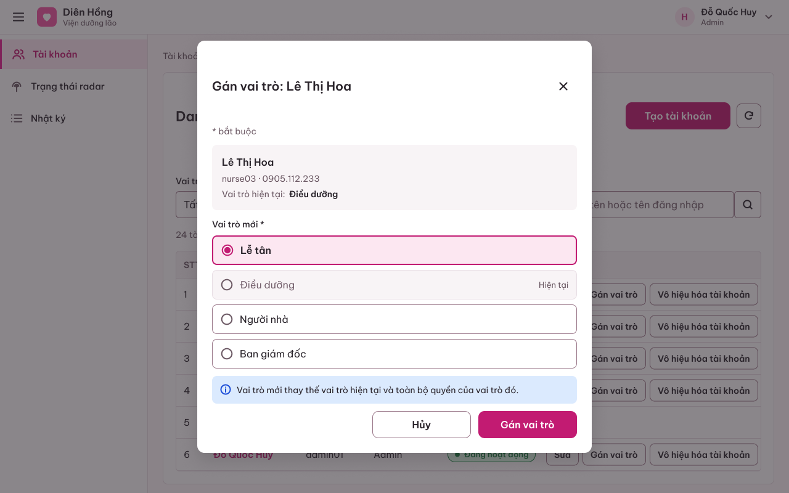
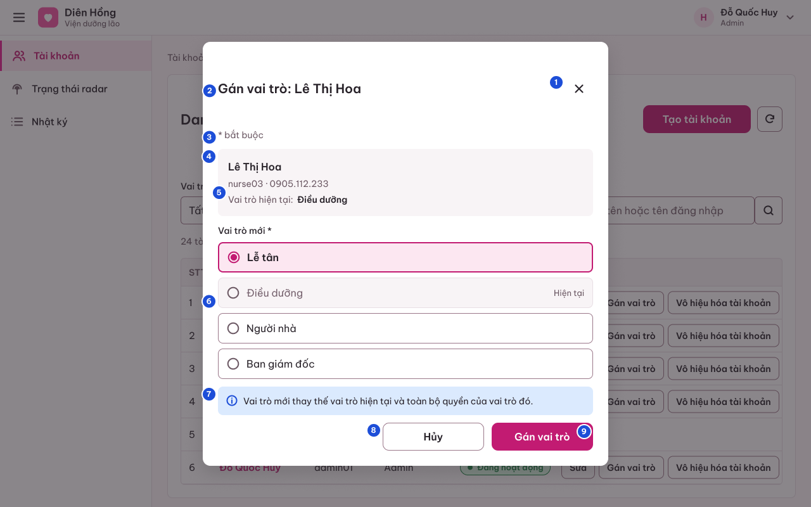
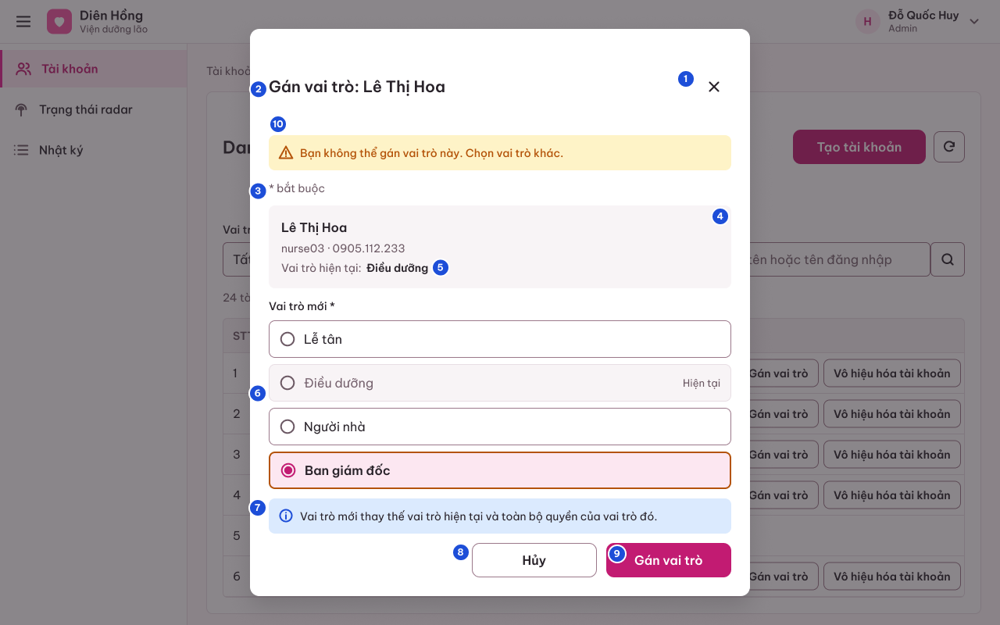
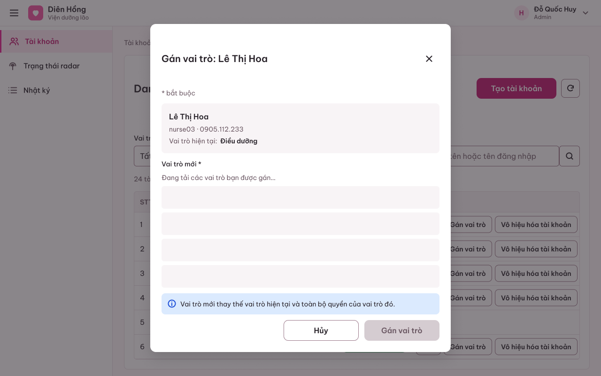
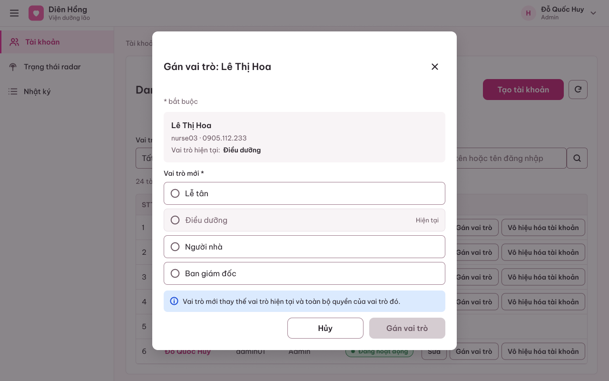
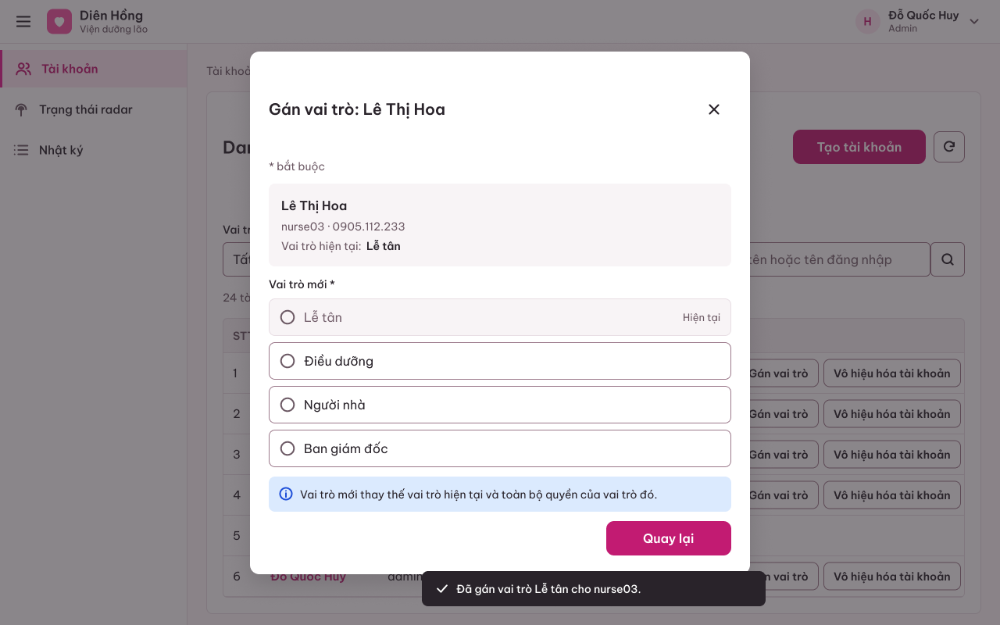

# Screen Spec: S-F06-03 Assign role to account (desktop)

| Field             | Value                                                                                    |
| ----------------- | ---------------------------------------------------------------------------------------- |
| Screen ID         | S-F06-03                                                                                 |
| Screen name       | Assign role to account (interface label: "Gán vai trò")                                  |
| Actor             | Admin                                                                                    |
| Priority          | Must                                                                                     |
| Feature           | F-06 Administration                                                                      |
| Activity diagrams | AD-UC-12 (assign a role to an account)                                                   |
| Mockup images     | `img/S-F06-03-desktop.png` (default), two numbered images, four state images (section 2) |
| Frame width       | 1280px (exported at 1x)                                                                                  |
| Figma frame       | not used (drawn as an HTML wireframe)         |
| Status            | Done                                                                                     |

## 1. Purpose

**Shown when:** the Admin clicks "Gán vai trò" (Assign role) on the row of an Active account in S-F06-01. The dialog opens over the account list, has its own URL, and the browser Back button closes it (ui-conventions 3.3). The Admin sees the account's current role and the roles they may assign, selects one and confirms.

**The user leaves this screen when:** they click "Hủy" (Cancel), the Close [x] button, press Esc or use the browser Back button, or, after the role is assigned, click "Quay lại" (Back). All of them return to S-F06-01.

## 2. Mockup

**Numbered:** each number is the # of the element inventory in section 3. Only the dialog is numbered; the list behind it is S-F06-01. Elements 1 to 9 are numbered on the default image. Element 10 (Message area) appears only in the Error state (and in the network failure, which is not drawn), so it is numbered on the error image.

| Default, numbered                                                        | Error, numbered                                                              |
| ------------------------------------------------------------------------ | ---------------------------------------------------------------------------- |
|  |  |

| Loading                                                       | Empty                                                     |
| ------------------------------------------------------------- | --------------------------------------------------------- |
|  |  |

| Success                                                     |
| ------------------------------------------------------------- |
|  |

| State   | Image                            |
| ------- | -------------------------------- |
| Default | img/S-F06-03-desktop.png         |
| Empty   | img/S-F06-03-desktop-empty.png   |
| Loading | img/S-F06-03-desktop-loading.png |
| Error   | img/S-F06-03-desktop-error.png   |
| Success | img/S-F06-03-desktop-success.png |

All colours, fonts and corners come from the design tokens in [ui-conventions.md](../ui-conventions.md#7-design-tokens), whose values live in [design-tokens.css](../design-tokens.css).

## 3. Element inventory

Labels are shown as they appear in the interface (Vietnamese), with the repository label in brackets. The dialog is 640px wide (size/dialog-form), one column (ui-conventions 3.3). The scrim and the list behind the dialog belong to S-F06-01. The toast of the Success state is the Toast component (ui-conventions §4), not a numbered element.

| # | Element | Type | Content / data source | Required | Validation |
|---|---|---|---|---|---|
| 1 | Close | Icon button, title row | static: [x]; accessible name "Đóng" (Close); closes the dialog | Yes | none |
| 2 | Dialog title | Header | "Gán vai trò: " + `account.full_name` (Assign role: …) | Yes | |
| 3 | Required note | Text | static: "* bắt buộc" (* required) | Yes | |
| 4 | Account summary | Card, on colour/surface-secondary | `account.full_name`; `account.identifier` · `account.phone` written 0905.112.233 (User Account & Role) | Yes | |
| 5 | Current role | Text, inside element 4 | "Vai trò hiện tại: " + role name of `account.role`, in bold (Current role) | Yes | |
| 6 | Role options | Radio list, one choice | label "Vai trò mới *" (New role); one option per role this Admin may assign (BR-14), 48px rows; the current role is shown disabled with the tag "Hiện tại" (Current). While the roles load: the line "Đang tải các vai trò bạn được gán…" (Loading the roles you may assign…) and four placeholder rows | Yes | exactly one role, different from the current role |
| 7 | Information banner | Banner | static: "Vai trò mới thay thế vai trò hiện tại và toàn bộ quyền của vai trò đó." (The new role replaces the current role and all of its permissions.)  | Yes | |
| 8 | Cancel | Secondary button, bottom right | label "Hủy" (Cancel); closes the dialog without changes | Yes | none |
| 9 | Assign role | Primary button, bottom right | label "Gán vai trò" (Assign role) (ui-conventions 3.3) | Yes | disabled until a new role is chosen, and while the roles load or the request runs |
| 10 | Message area | Banner, under the title row, above element 3 | Error state: warning banner (colour/warning-bg, warning icon) with the message of section 4 (AD-UC-12 `S5`); network failure: the same banner with the network message | No | Shown only in the Error state and the network failure |

## 4. States

| State                  | What the user sees                                                                                                                                                                                                                                                                                                                                                                                              | Trigger                                                                                                    |
| ---------------------- | --------------------------------------------------------------------------------------------------------------------------------------------------------------------------------------------------------------------------------------------------------------------------------------------------------------------------------------------------------------------------------------------------------------- | ---------------------------------------------------------------------------------------------------------- |
| Default                | Account Lê Thị Hoa (nurse03 · 0905.112.233), current role "Điều dưỡng"; the options Lễ tân, Điều dưỡng (disabled, tag "Hiện tại"), Người nhà, Ban giám đốc; "Lễ tân" chosen (colour/pink-light, 2px colour/primary edge, bold label, filled radio); the information banner; "Hủy" and "Gán vai trò" enabled; the account list behind the scrim.                                                                 | The Admin chooses a new role                                                                               |
| Empty (no data)        | The same dialog with no option chosen; "Gán vai trò" disabled.                                                                                                                                                                                                                                                                                                                                                  | The roles are loaded and no new role is chosen yet                                                         |
| Loading                | The account summary with the current role, the label "Vai trò mới *", the line "Đang tải các vai trò bạn được gán…" and four placeholder rows on colour/surface-secondary instead of the options; the information banner stays; "Hủy" enabled, "Gán vai trò" disabled.                                                                                                                                          | The dialog is opened from "Gán vai trò" and the roles this Admin may assign are being read (AD-UC-12 `S6`) |
| Error                  | The warning banner (10) "Bạn không thể gán vai trò này. Chọn vai trò khác." (You cannot assign this role. Choose another role.) (ui-conventions §5, Role outside the permitted scope); the chosen option ("Ban giám đốc" in the mockup) on a colour/warning edge; the account keeps its role, nothing is recorded; "Gán vai trò" stays enabled. Choosing another option clears the banner and the warning edge. | The API Server refuses the chosen role as outside the permitted scope (AD-UC-12 `D2` [No], `S5`)           |
| Success / confirmation | "Vai trò hiện tại: Lễ tân"; the tag "Hiện tại" moves to "Lễ tân"; the options are read-only; "Hủy" and "Gán vai trò" are replaced by the one primary button "Quay lại" (Back); the toast "Đã gán vai trò Lễ tân cho nurse03." (Role Receptionist assigned to nurse03.) on colour/toast with a white check mark, gone after 4 seconds.                                                                     | The role was replaced and the action recorded (FR-06-02, FR-06-08, AD-UC-12 `S4`)                          |

**Situations described in words, not drawn:**

- Access denied: when the API Server refuses a request because the role is not Admin, the user is sent to their home screen with the message "Bạn không có quyền dùng chức năng đó. Bạn đã được đưa về màn hình chính." (You do not have access to that function. You are back on your home screen.) (FR-06-03). The message is shown on the home screen, not in element 10.
- Saving fails because of the network: the warning banner (10) "Chưa lưu được. Kiểm tra kết nối và thử lại." (Not saved yet. Check your connection and try again.) (ui-conventions §5, Network error); the chosen role stays chosen and "Gán vai trò" stays enabled to try again.
- Saving in progress: while the request runs, elements 6 and 9 and the buttons "Hủy" and Close are disabled until the answer arrives, so the Admin never leaves without knowing the result.

## 5. Interactions and navigation

| # | Element | User action | System response | Goes to screen |
|---|---|---|---|---|
| 1 | Role options (6) | click an option | Chooses the new role, enables element 9, and clears the error banner and the warning edge if they are shown | stays |
| 2 | Assign role (9), role within the permitted scope | click | Replaces the account's role and permissions with the chosen role and records the action (FR-06-02, FR-06-08, AD-UC-12 `A3`, `S2`, `S7`); shows the Success state | stays |
| 3 | Assign role (9), role outside the permitted scope | click | Changes nothing (AD-UC-12 `D2` [No], `S5`); shows the Error state | stays |
| 4 | Cancel (8) | click | Closes the dialog; nothing is changed | S-F06-01 |
| 5 | Close (1), Esc, browser Back button | click or key | Closes the dialog without asking; nothing is changed. After a success it acts like "Quay lại" | S-F06-01 |
| 6 | "Quay lại" in the Success state | click | Closes the dialog; the list shows the new role of the account | S-F06-01 |

## 6. Screen-level rules

| Rule ID | Rule | Source |
|---|---|---|
| SR-001 | Only the roles within this Admin's permitted scope are offered; the API Server checks the scope again when the role is assigned. A request outside it is refused with the message of the Error state and changes nothing. | BR-14, FR-06-02, AD-UC-12 `D2`, `S5` |
| SR-002 | The new role replaces the old role and all of its permissions. It applies from the person's next request, because the API Server checks the role on every request. | BR-14, FR-06-02, ADR-003, SD-UC-12 |
| SR-003 | Only an Active account can have its role assigned: S-F06-01 offers "Gán vai trò" on Active accounts only. | BR-15, S-F06-01 mockup |
| SR-004 | The current role cannot be chosen again: its option is disabled and tagged "Hiện tại". "Gán vai trò" is enabled only when a different role is chosen. | FR-06-02, mockups |
| SR-005 | A successful assignment is recorded in the action log (shown on S-F06-05) and the account list shows the new role. After a success the options are read-only and the only action is "Quay lại". | FR-06-02, FR-06-08, AD-UC-12 `S4` |
| SR-006 | Closing the dialog with a role chosen but not assigned asks nothing: no text was typed, and the Element List names the "Close without saving?" question for S-F06-02 only. | Element List, ui-conventions 3.3 |
| SR-007 | Only an Admin sees this screen. The API Server checks the role on every request; hiding an element is never the only check. A refused request sends the user to their home screen with the access-denied message. | FR-06-03, BR-13, ADR-003 |
| SR-008 | A chosen option is shown by the filled radio, the bold label and the colour/primary edge; the refused one by the warning edge, the banner icon and the text; the current role by the word "Hiện tại". Nothing is shown by colour alone. The refusal uses colour/warning, never colour/error. | ui-conventions §4, §6, §7.1, WCAG 2.2 1.4.1 |

## 7. Linked requirements

| FR ID | What this screen does for it |
|---|---|
| FR-06-02 Assign role-based permissions | Shows the account and its current role, lets the Admin choose a new role and assigns it; the new role replaces the current one and its permissions |
| FR-06-08 | The role change is recorded in the action log (no user interface here; listed on S-F06-05) |
| FR-06-03 Enforce role-based access (non-functional) | Only an Admin reaches this screen; a refused request sends the user home with the access-denied message |

## 8. Responsive and accessibility notes

- 768px and wider: record dialog up to 640px wide (size/dialog-form), centred over S-F06-01 on colour/scrim; on a narrow window it takes the width of the window minus 24px on each side. Below 768px the mobile layout (full-screen form) applies.
- The dialog keeps the keyboard focus inside while open, takes the focus when it opens and returns it to "Gán vai trò" of the list when it closes; Esc closes it (ui-conventions §6).
- The role options are one single-choice group named "Vai trò mới", 48px rows, reachable with Tab and the arrow keys; the tag "Hiện tại" is part of the option's accessible name.
- The banner (10), the toast and the end of Loading are announced when they appear; after a success the focus moves to "Quay lại".
- Every control shows the 2px focus ring; text contrast is at least 4.5:1 on every background used here (ui-conventions 7.6).

## 9. Open questions

| #   | Question                                                                         | Blocking? | Status                                                                                                                                                                                                                                                                                                                                                                   |
| --- | -------------------------------------------------------------------------------- | --------- | ------------------------------------------------------------------------------------------------------------------------------------------------------------------------------------------------------------------------------------------------------------------------------------------------------------------------------------------------------------------------ |
| 1   | Which roles are offered, and why is Admin not among them?                        | Yes       | The screen shows the roles the API Server returns for this Admin (BR-14). In the mockups they are Lễ tân, Điều dưỡng, Người nhà, Ban giám đốc; the Admin role is not offered.                                                                                                                                                                                            |
| 2   | When is "Bạn không thể gán vai trò này" returned, although the role was offered? | Yes       | When the API Server's check at assignment fails (`D2` [No]): the Admin's scope changed after the roles were read; the role is Người nhà and the account has no linked resident (a family account needs one, FR-06-04); or the account is an Admin account, including the signed-in Admin's own, so the system is never left without an Admin. One message for all three. |
| 3   | Is there a saving state?                                                         | No        | No drawn state. While the request runs, the role options, "Gán vai trò", "Hủy" and Close are disabled (section 4).                                                                                                                                                                                                                                                       |

## Completion checklist

- [x] The mockup is a separate cropped image file, named with the Screen ID, at the frame width.
- [x] The numbered images exist for default and error, and their numbers match the # column of the element inventory.
- [x] Every visible element in the mockup appears in the element inventory (the toast is the Toast component of ui-conventions §4).
- [x] Every colour in the mockup is a design token from ui-conventions.md.
- [x] Every input element has a validation rule or an explicit "none".
- [x] All five states are filled in, and every state links its image.
- [x] Every navigation target is a Screen ID that exists in the Screen List.
- [x] Every element that displays data names the field it displays.
- [x] Every linked FR exists in the Function List, and every action of this screen in AD-UC-12 is covered: `S6` by Loading and Empty, `A3` by interaction rows 1 to 3, `D2` and `S5` by row 3, `S4` by row 6 and the Success state.
