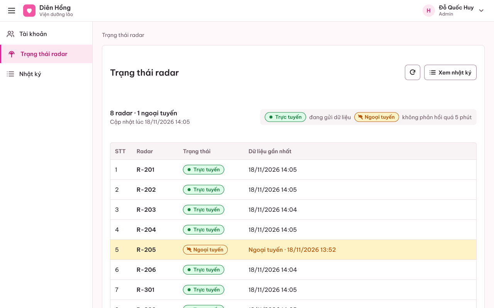
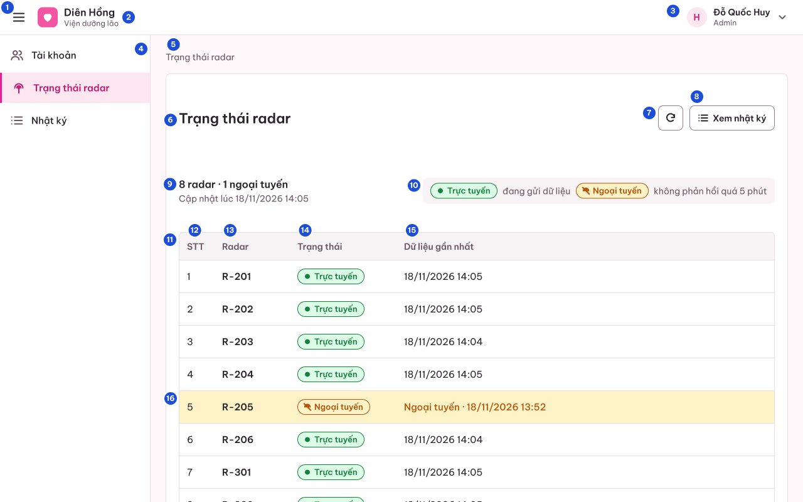
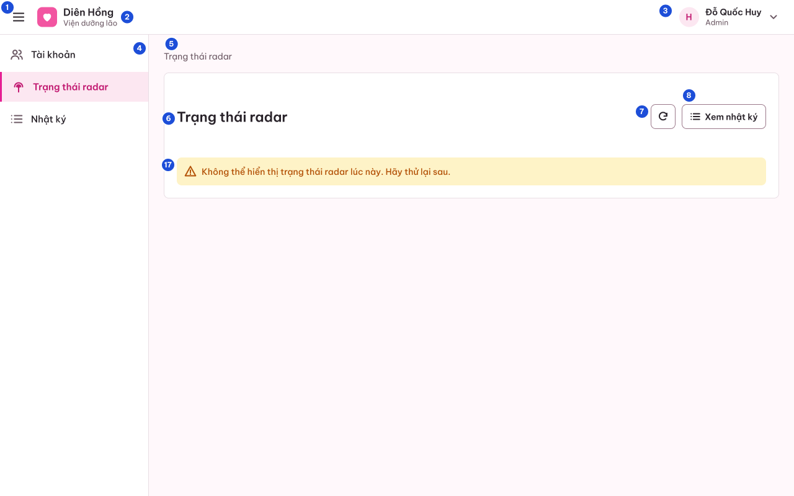
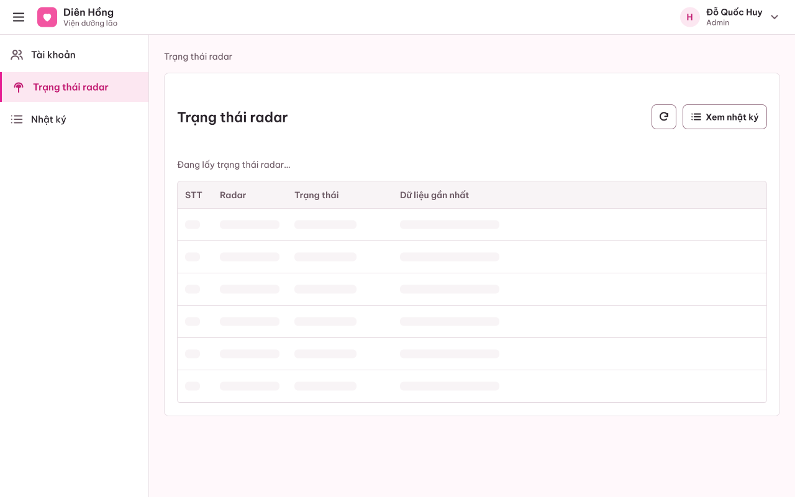
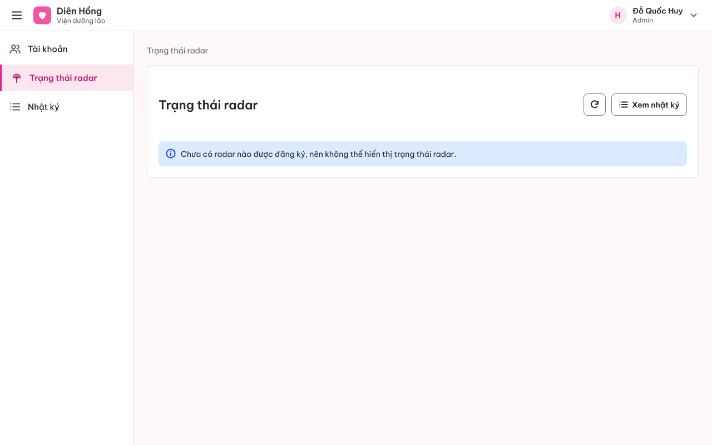

# Screen Spec: S-F06-04 Radar status list (desktop)

| Field             | Value                                                                                                                                                                                                                                                                                                                                                                                         |
| ----------------- | --------------------------------------------------------------------------------------------------------------------------------------------------------------------------------------------------------------------------------------------------------------------------------------------------------------------------------------------------------------------------------------------- |
| Screen ID         | S-F06-04                                                                                                                                                                                                                                                                                                                                                                                      |
| Screen name       | Radar status list (interface label: "Trạng thái radar")                                                                                                                                                                                                                                                                                                                                       |
| Actor             | Admin                                                                                                                                                                                                                                                                                                                                                                                         |
| Priority          | Could                                                                                                                                                                                                                                                                                                                                                                                         |
| Feature           | F-06 Administration                                                                                                                                                                                                                                                                                                                                                                           |
| Activity diagrams | AD-UC-13 (UC-13 Monitor radar status) |
| Mockup images     | `img/S-F06-04-desktop.png` (default), two numbered images, three state images (section 2)                                                                                                                                                                                                                                                                                                     |
| Frame width       | 1280px (exported at 1x)                                                                                                                                                                                                                                                                                                                                                                       |
| Figma frame       | page "BOD & Admin · Desktop 1280", frame `S-F06-04-desktop`                                                                                                                                                                                                                                                                                                                  |
| Status            | Done                                                                                                                                                                                                                                                                                                                                                                                          |

## 1. Purpose

**Shown when:** the Admin clicks "Trạng thái radar" (Radar status) in the sidebar menu. The Admin checks that every registered radar is working, sees at once which ones are Offline, and sees when each radar last sent data.

**The user leaves this screen when:** they open the logs with "Xem nhật ký" (View logs) or "Nhật ký" in the sidebar menu (S-F06-05), open Accounts (S-F06-01) from the sidebar menu, or sign out. Nothing is saved on this screen.

## 2. Mockup

**Numbered:** each number is the # of the element inventory in section 3. Elements 9 to 16 appear only when the radars are shown, so they are numbered on the default image. Element 17 (Message area) appears only in the Empty and Error states, so it is numbered on the error image.

| Default, numbered | Error, numbered |
|---|---|
|  |  |

| Loading                                                       | Empty                                                     |
| ------------------------------------------------------------- | --------------------------------------------------------- |
|  |  |

| State   | Image                                       |
| ------- | ------------------------------------------- |
| Default | img/S-F06-04-desktop.png                    |
| Empty   | img/S-F06-04-desktop-empty.png              |
| Loading | img/S-F06-04-desktop-loading.png            |
| Error   | img/S-F06-04-desktop-error.png              |
| Success | Not applicable: this screen saves nothing. |

All colours, fonts and corners come from the design tokens in [ui-conventions.md](../ui-conventions.md#7-design-tokens), whose values live in [design-tokens.css](../design-tokens.css).

## 3. Element inventory

Labels are shown as they appear in the interface (Vietnamese), with the repository label in brackets.

| # | Element | Type | Content / data source | Required | Validation |
|---|---|---|---|---|---|
| 1 | Menu button | Icon button | static: accessible name "Thu gọn menu" (Collapse menu); "Mở menu" (Open menu) while the sidebar is collapsed | Yes | none |
| 2 | Brand | Image + text | static: logo mark on colour/brand-pink, "Diên Hồng", "Viện dưỡng lão" | Yes | |
| 3 | Account menu | Menu button | initial of the given name (the last word of `user.name`, "H" for "Đỗ Quốc Huy") on colour/pink-light; `user.name` and role name (`user.role`, "Admin") on two lines; item "Đăng xuất" (Sign out) | Yes | none |
| 4 | Sidebar menu | Navigation | "Tài khoản" (Accounts), "Trạng thái radar" (Radar status, current), "Nhật ký" (Logs) (ui-conventions 3.4) | Yes | |
| 5 | Breadcrumb | Text | static: "Trạng thái radar" | Yes | |
| 6 | Title | Header | static: "Trạng thái radar" (Radar status) | Yes | |
| 7 | Reload | Icon button | static: reload icon, accessible name "Tải lại" (Reload); asks the Radar Gateway for the status again | Yes | none |
| 8 | View logs | Secondary button | label "Xem nhật ký" (View logs) with the list icon; opens S-F06-05 | Yes | none |
| 9 | Summary | Text, two lines | "n radar · m ngoại tuyến" (n registered radars, m of them Offline; "0 ngoại tuyến" when none is Offline) and "Cập nhật lúc " + the time the status was read, dd/MM/yyyy HH:mm (Radar Sensor, read through the Radar Gateway). While Loading, this place holds the line "Đang lấy trạng thái radar…" | Yes (Default state) | |
| 10 | Legend | Legend, on colour/surface-secondary | "Trực tuyến" (Online) badge + "đang phản hồi" (responding); "Ngoại tuyến" (Offline) badge + "không phản hồi quá 5 phút" (no response for more than 5 minutes) | Yes (Default state) | |
| 11 | Radar table | Data table | one row per registered radar, in radar ID order; header row on colour/surface-secondary, rows at least 48px; a row is not a link (a radar has no detail screen) | Yes (Default state) | |
| 12 | No. | Column "STT" | row number, 1, 2, 3 in the order shown | Yes | |
| 13 | Radar | Column "Radar" | `radar.radar_id`, e.g. "R-201" | Yes | |
| 14 | Status | Column "Trạng thái", status badge | Online ("Trực tuyến", dot icon, colour/success on colour/success-bg) or Offline ("Ngoại tuyến", crossed-out signal icon, colour/warning on colour/warning-bg); Offline when the radar's last data is more than 5 minutes older than the time of the status (FR-06-09, FR-06-10) | Yes | |
| 15 | Last data | Column "Dữ liệu gần nhất" | `radar.last_data_at`, dd/MM/yyyy HH:mm; for an Offline radar "Ngoại tuyến · " + the same time (ui-conventions §2, Radar status) | Yes | |
| 16 | Offline row | Table row, highlighted | the row of an Offline radar on colour/warning-bg, its time in colour/warning (FR-06-10) | Only when a radar is Offline | |
| 17 | Message area | Banner | Empty state: information banner (colour/info-bg, info icon); Error state: warning banner (colour/warning-bg, warning icon); messages of section 4 (FR-06-11) | No | Shown only in the Empty and Error states |

## 4. States

| State                  | What the user sees                                                                                                                                                                                                                                                                                                                                                                   | Trigger                                                                                                |
| ---------------------- | ------------------------------------------------------------------------------------------------------------------------------------------------------------------------------------------------------------------------------------------------------------------------------------------------------------------------------------------------------------------------------------ | ------------------------------------------------------------------------------------------------------ |
| Default                | Summary (9), legend (10) and the table (11) of all registered radars in radar ID order, each Offline radar's row highlighted (16). The mockup shows 8 radars (R-201 to R-206, R-301, R-302; the last row is cut off by the edge of the image); R-205 is Offline with "Ngoại tuyến · 18/11/2026 13:52"; the summary reads "8 radar · 1 ngoại tuyến", "Cập nhật lúc 18/11/2026 14:05". | Screen opened or Reload, status obtained and at least one radar registered (AD-UC-13 `A1`, `S3`, `S5`) |
| Empty (no data)        | The title row with both buttons stays; no summary, no legend, no table. The information banner (17): "Chưa có radar nào được đăng ký, nên không thể hiển thị trạng thái radar." (No radar is registered, so the radar status cannot be shown.)                                                                                                                                 | The status is obtained and no radar is registered (FR-06-11, SD-UC-13, AD-UC-13 `S4`)                  |
| Loading                | The title row with both buttons stays; the line "Đang lấy trạng thái radar…" (Getting the radar status…) takes the place of the summary; the table header "STT, Radar, Trạng thái, Dữ liệu gần nhất" stays above six placeholder rows on colour/surface-secondary; no legend and no old status.                                                                                      | Screen opened or Reload (AD-UC-13 `S2`)                                                                |
| Error                  | The title row with both buttons stays; the warning banner (17): "Không thể hiển thị trạng thái radar lúc này. Hãy thử lại sau." (The radar status cannot be shown right now. Try again later.) (ui-conventions §5, Radar status unavailable); no summary, no table and no old status; Reload (7) stays available to try again.                                                       | The Radar Gateway cannot be reached or does not answer (FR-06-11, AD-UC-13 `S4`)                       |
| Success / confirmation  | Not applicable: this screen saves nothing; Reload only reads the status again (SD-UC-13 ends with showing the radars)                                                                                                                                                                                                                                                                          | –                                                                                                      |

**Situations described in words, not drawn:**

- Access denied: when the API Server refuses a request because the role is not Admin, the user is sent to their home screen with the message "Bạn không có quyền dùng chức năng đó. Bạn đã được đưa về màn hình chính." (You do not have access to that function. You are back on your home screen.) (FR-06-03, AD-UC-13 `D1`). The message is shown on the home screen, not in element 17.

## 5. Interactions and navigation

| # | Element | User action | System response | Goes to screen |
|---|---|---|---|---|
| 1 | Reload (7) | click | Asks the Radar Gateway for the status again (AD-UC-13 `A1`); Loading, then Default, Empty or Error | stays |
| 2 | View logs (8) | click | Opens the logs, which start with all users and today's date | S-F06-05 |
| 3 | "Tài khoản" in the sidebar menu (4) | click | Opens the account list | S-F06-01 |
| 4 | "Nhật ký" in the sidebar menu (4) | click | Opens the logs, which start with all users and today's date | S-F06-05 |
| 5 | Menu button (1) | click | Collapses the sidebar to icons (64px), or opens it again | stays |
| 6 | "Đăng xuất" in the account menu (3) | click | Ends the session | S-F00-01 |

## 6. Screen-level rules

| Rule ID | Rule | Source |
|---|---|---|
| SR-001 | A radar is Offline when it has not sent data for more than 5 minutes, otherwise Online. The API Server works the status out at each request. | FR-06-09, FR-06-10, SD-UC-13 |
| SR-002 | The table lists the radars in radar ID order. An Offline radar stays in its place and its row is highlighted. | Mockups, FR-06-10 |
| SR-003 | An Offline radar is shown by text, icon and colour together (the badge, "Ngoại tuyến · " before the time, the highlighted row), never by colour alone. | FR-06-10, ui-conventions §4 (Status badge), §6, WCAG 2.2 1.4.1 |
| SR-004 | The summary counts all registered radars and the Offline ones. "Cập nhật lúc" is the time the status was read, not the last data of a radar. | FR-06-09 |
| SR-005 | When no radar is registered, or the Radar Gateway does not answer, no summary, legend or table is shown, and no old status is kept on screen; the message says why. | FR-06-11, SD-UC-13, ui-conventions §5 |
| SR-006 | The status is read when the screen opens and when Reload is clicked, never by itself. | AD-UC-13 `A1` |
| SR-007 | The screen is read-only: Reload only reads the status, and nothing is saved. | SD-UC-13 |
| SR-008 | Dates and times are written dd/MM/yyyy HH:mm. | ui-conventions §2 |
| SR-009 | Only an Admin sees this screen. The API Server checks the role on every request, including each Reload; hiding the menu item is never the only check. A refused request sends the user to their home screen with the access-denied message. | FR-06-03, BR-13, ADR-003, ui-conventions 3.4 |
| SR-010 | The Empty message is an information banner, the Error message a warning banner. Neither uses colour/error, which is reserved for resident alerts. | ui-conventions §4, §7.1 |

## 7. Linked requirements

| FR ID | What this screen does for it |
|---|---|
| FR-06-09 | Shows the number of radars, the status of each radar (Online or Offline) and the time of its last data |
| FR-06-10 | Highlights each Offline radar and explains it in the legend |
| FR-06-11 | Tells the Admin that the status cannot be shown (no radar registered, or the Radar Gateway does not answer), without showing an old status |
| FR-06-03 | Refuses the screen to a role that may not see it |

## 8. Responsive and accessibility notes

- 768px and wider: sidebar 240px with labels, which the menu button (1) collapses to icons (64px); content padding 24px; card padding 20px; table text 15px (ui-conventions 3.1, 7.5). Below 768px the mobile layout applies.
- When the window is narrower than the table, the table keeps its columns and scrolls sideways inside its card; the legend wraps under the summary.
- Table headers are `<th scope="col">`; rows are at least 48px tall.
- The status is written in words ("Trực tuyến", "Ngoại tuyến") with an icon; the highlighted row is an extra sign. Warning text on colour/warning-bg stays at least 14px (ui-conventions 7.6).
- The banner (17) and the end of Loading are announced when they appear; the table is marked busy while loading.
- Every control shows the 2px focus ring; the icon-only buttons (1, 7) have an accessible name.
- Text contrast is at least 4.5:1 on every background used here, including the highlighted row (ui-conventions 7.6).

## 9. Open questions

| #   | Question                                                                                              | Blocking?                                                                                                                                                       | Status                                                                                                                                    |
| --- | ----------------------------------------------------------------------------------------------------- | --------------------------------------------------------------------------------------------------------------------------------------------------------------- | ----------------------------------------------------------------------------------------------------------------------------------------- |
| 1   | Does the status refresh by itself?                                                                    | No.                                                                                                                                                             | No. It is read when the screen opens and on "Tải lại"; "Cập nhật lúc" shows how old it is.                                                |
| 2   | Does "Xem nhật ký" pass a filter to the logs?                                                         | No.                                                                                                                                                             | No. S-F06-05 opens with all users and today's date.                                                                                       |
| 3   | How does the count read when no radar is Offline?                                                     | No.                                                                                                                                                             | "n radar · 0 ngoại tuyến", the same pattern; no extra message.                                                                            |
| 4   | Should the cards show where each radar is installed?                                                  | No.                                                                                                                                                             | No. A card shows the radar ID, the status and the time of the last data.                                                                  |
| 5   | Order of the cards (the mockup lists the Offline card first and the desktop table keeps the ID order) | No.                                                                                                                                                             | Mobile: Offline cards first, then radar ID order. Desktop: radar ID order, the Offline row stays in place. One rule per layout, as drawn. |

## Completion checklist

- [x] The mockup is a separate cropped image file, named with the Screen ID, at the frame width.
- [x] The numbered images exist for default and error, and their numbers match the # column of the element inventory.
- [x] Every visible element in the mockup appears in the element inventory (the Empty banner is element 17).
- [x] Every colour in the mockup is a design token from ui-conventions.md.
- [x] Every input element has a validation rule or an explicit "none".
- [x] All five states are filled in (Success is "None", with the reason in section 4); every drawn state links its image.
- [x] Every navigation target is a Screen ID that exists in the Screen List.
- [x] Every element that displays data names the field it displays.
- [x] Every linked FR exists in the Function List; every action of this screen in AD-UC-13 is covered: `A1` by opening the screen and interaction row 1, `A2` is reading with no control.
