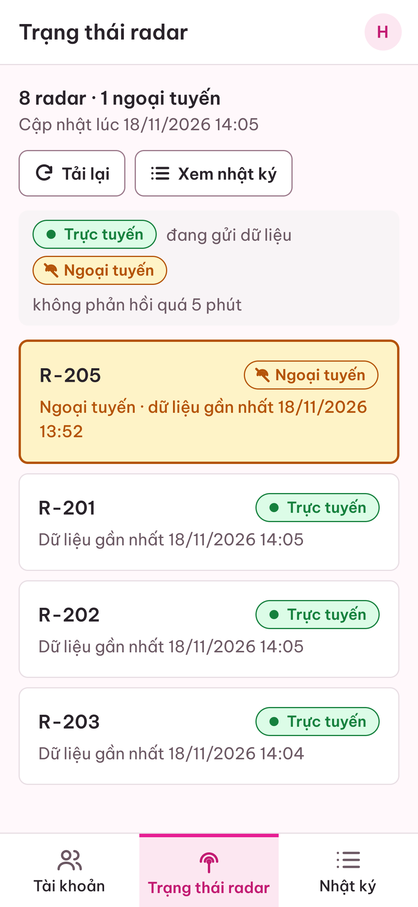
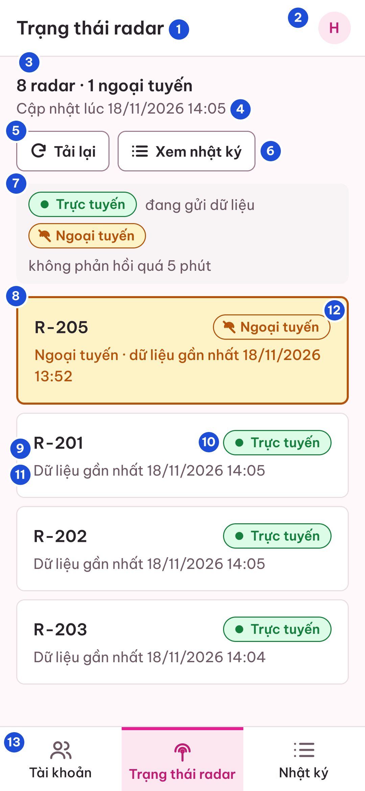
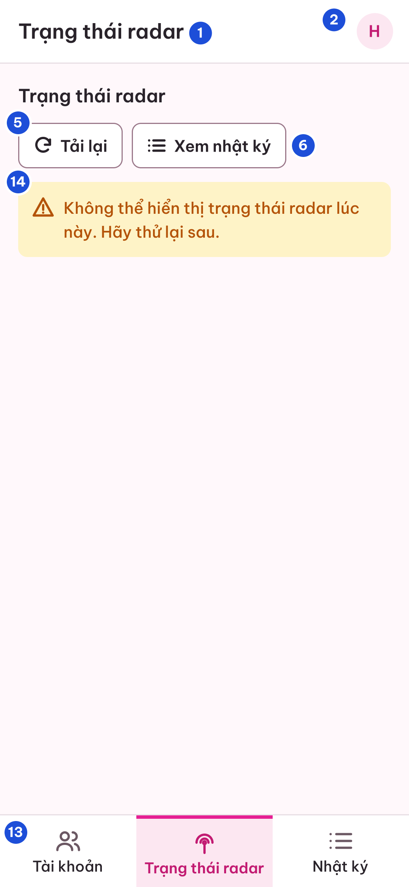
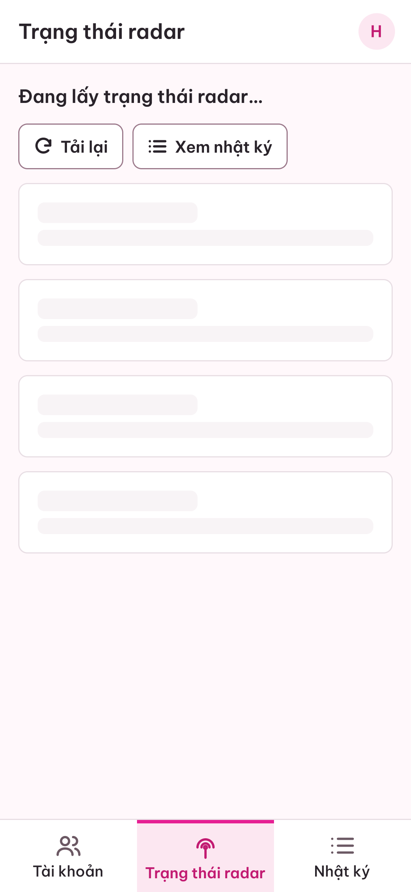
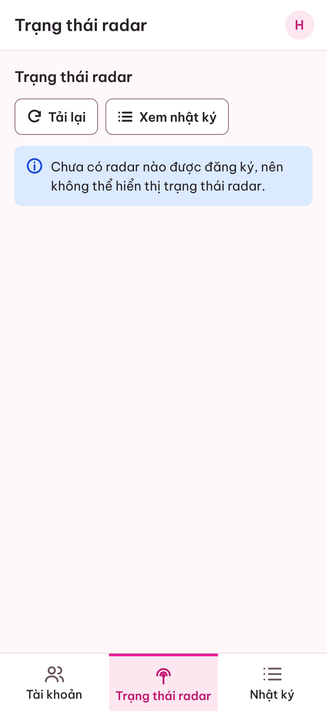

# Screen Spec: S-F06-04 Radar status list (mobile)

| Field             | Value                                                                                                                                                                                                                                                                                                                                                                                         |
| ----------------- | --------------------------------------------------------------------------------------------------------------------------------------------------------------------------------------------------------------------------------------------------------------------------------------------------------------------------------------------------------------------------------------------- |
| Screen ID         | S-F06-04                                                                                                                                                                                                                                                                                                                                                                                      |
| Screen name       | Radar status list (interface label: "Trạng thái radar")                                                                                                                                                                                                                                                                                                                                       |
| Actor             | Admin                                                                                                                                                                                                                                                                                                                                                                                         |
| Priority          | Could                                                                                                                                                                                                                                                                                                                                                                                         |
| Feature           | F-06 Administration                                                                                                                                                                                                                                                                                                                                                                           |
| Activity diagrams | AD-UC-13 (UC-13 Monitor radar status) |
| Mockup images     | `img/S-F06-04-mobile.png` (default), two numbered images, three state images (section 2)                                                                                                                                                                                                                                                                                                      |
| Frame width       | 360px (exported at 3x, 1080 pixels)                                                                                                                                                                                                                                                                                                                                                           |
| Figma frame       | page "BOD & Admin · Mobile 360", frame `S-F06-04-mobile` ([Figma file]())                                                                                                                                                                                                                                                                                                                     |
| Status            | Done                                                                                                                                                                                                                                                                                                                                                                                          |

## 1. Purpose

**Shown when:** the Admin taps "Trạng thái radar" (Radar status) in the tab bar. The Admin checks that every registered radar is working, sees at once which ones are Offline, and sees when each radar last sent data.

**The user leaves this screen when:** they open the logs with "Xem nhật ký" (View logs) or the "Nhật ký" tab (S-F06-05), open Accounts (S-F06-01) with the "Tài khoản" tab, or sign out. Nothing is saved on this screen.

## 2. Mockup

**Numbered:** each number is the # of the element inventory in section 3. Elements 3, 4 and 7 to 12 appear only when the radars are shown, so they are numbered on the default image. Element 14 (Message area) appears only in the Empty and Error states, so it is numbered on the error image.

| Default, numbered                                                      | Error, numbered                                                            |
| ---------------------------------------------------------------------- | -------------------------------------------------------------------------- |
|  |  |

| Loading                                                     | Empty                                                   |
| ----------------------------------------------------------- | ------------------------------------------------------- |
|  |  |

| State   | Image                                       |
| ------- | ------------------------------------------- |
| Default | img/S-F06-04-mobile.png                     |
| Empty   | img/S-F06-04-mobile-empty.png               |
| Loading | img/S-F06-04-mobile-loading.png             |
| Error   | img/S-F06-04-mobile-error.png               |
| Success | None: this screen saves nothing (section 4) |

All colours, fonts and corners come from the design tokens in [ui-conventions.md](../ui-conventions.md#7-design-tokens), whose values live in [design-tokens.css](../design-tokens.css).

## 3. Element inventory

Labels are shown as they appear in the interface (Vietnamese), with the repository label in brackets.

| # | Element | Type | Content / data source | Required | Validation |
|---|---|---|---|---|---|
| 1 | Title | Header, app bar | static: "Trạng thái radar" (Radar status) | Yes | |
| 2 | Account button | Icon button, app bar | initial of the given name (the last word of `user.name`, "H" for "Đỗ Quốc Huy") on colour/pink-light; opens a menu with `user.name`, role name (`user.role`, "Admin") and "Đăng xuất" (Sign out) | Yes | none |
| 3 | Radar count | Text, first line of the body | "n radar · m ngoại tuyến" (n registered radars, m of them Offline; "0 ngoại tuyến" when none is Offline). Where there is nothing to count, this place holds a text line: "Đang lấy trạng thái radar…" while Loading, and "Trạng thái radar" in the Empty and Error states | Yes (Default state) | |
| 4 | Update time | Text, second line of the body | "Cập nhật lúc " + the time the status was read, dd/MM/yyyy HH:mm (Updated at) (Radar Sensor, read through the Radar Gateway) | Yes (Default state) | |
| 5 | Reload | Secondary button | label "Tải lại" (Reload) with the reload icon; asks the Radar Gateway for the status again | Yes | none |
| 6 | View logs | Secondary button | label "Xem nhật ký" (View logs) with the list icon, next to element 5; opens S-F06-05 | Yes | none |
| 7 | Legend | Legend, on colour/surface-secondary | "Trực tuyến" (Online) badge + "đang gửi dữ liệu" (sending data); "Ngoại tuyến" (Offline) badge + "không phản hồi quá 5 phút" (no response for more than 5 minutes); wraps onto three lines at 360px | Yes (Default state) | |
| 8 | Radar cards | Card list | one card per registered radar: Offline cards first, then the others in radar ID order; a card is not a link (a radar has no detail screen) | Yes (Default state) | |
| 9 | Radar ID | Text, first line of the card | `radar.radar_id`, e.g. "R-201" | Yes | |
| 10 | Status badge | Status badge, first line of the card | Online ("Trực tuyến", dot icon, colour/success on colour/success-bg) or Offline ("Ngoại tuyến", crossed-out signal icon, colour/warning on colour/warning-bg); Offline when the radar's last data is more than 5 minutes older than the time of the status (FR-06-09, FR-06-10) | Yes | |
| 11 | Time of last data | Text, second line of the card | "Dữ liệu gần nhất " + `radar.last_data_at`, dd/MM/yyyy HH:mm; for an Offline radar "Ngoại tuyến · dữ liệu gần nhất " + the same time (ui-conventions §2, Radar status) | Yes | |
| 12 | Offline card | Card, highlighted | the card of an Offline radar on colour/warning-bg with a 2px colour/warning edge, its second line in colour/warning (FR-06-10) | Only when a radar is Offline | |
| 13 | Tab bar | Navigation | "Tài khoản" (Accounts), "Trạng thái radar" (Radar status, current), "Nhật ký" (Logs); icon and label on every tab (ui-conventions 3.4) | Yes | none |
| 14 | Message area | Banner | Empty state: information banner (colour/info-bg, info icon); Error state: warning banner (colour/warning-bg, warning icon); messages of section 4 (FR-06-11) | No | Shown only in the Empty and Error states |

## 4. States

| State                  | What the user sees                                                                                                                                                                                                                                                                                                                                                                               | Trigger                                                                                                   |
| ---------------------- | ------------------------------------------------------------------------------------------------------------------------------------------------------------------------------------------------------------------------------------------------------------------------------------------------------------------------------------------------------------------------------------------------ | --------------------------------------------------------------------------------------------------------- |
| Default                | The count (3) and update time (4), the buttons "Tải lại" and "Xem nhật ký", the legend (7) and one card per registered radar (8), Offline cards first and highlighted (12). The mockup shows 8 radars, 1 Offline: "8 radar · 1 ngoại tuyến", "Cập nhật lúc 18/11/2026 14:05", and the first 4 cards, R-205 (Offline since 13:52), R-201, R-202, R-203; the other cards are reached by scrolling. | Screen opened or "Tải lại", status obtained and at least one radar registered (AD-UC-13 `A1`, `S3`, `S5`) |
| Empty (no data)        | The line "Trạng thái radar" and the two buttons stay; no count, no legend, no cards. The information banner (14): "Chưa có radar nào được đăng ký, nên không thể hiển thị trạng thái radar." (No radar is registered, so the radar status cannot be shown.) (new)                                                                                                                                | The status is obtained and no radar is registered (FR-06-11, SD-UC-13, AD-UC-13 `S4`)                     |
| Loading                | The line "Đang lấy trạng thái radar…" (Getting the radar status…) and the two buttons stay; four placeholder cards on colour/surface-secondary; no legend and no old status.                                                                                                                                                                                                                     | Screen opened or "Tải lại" (AD-UC-13 `S2`)                                                                |
| Error                  | The line "Trạng thái radar" and the two buttons stay; the warning banner (14): "Không thể hiển thị trạng thái radar lúc này. Hãy thử lại sau." (The radar status cannot be shown right now. Try again later.) (ui-conventions §5, Radar status unavailable); no count, no cards and no old status; "Tải lại" (5) stays available to try again.                                                   | The Radar Gateway cannot be reached or does not answer (FR-06-11, AD-UC-13 `S4`)                          |
| Success / confirmation | None: this screen saves nothing; "Tải lại" only reads the status again (SD-UC-13 ends with showing the radars)                                                                                                                                                                                                                                                                                   | –                                                                                                         |

**Situations described in words, not drawn:**

- Access denied: when the API Server refuses a request because the role is not Admin, the user is sent to their home screen with the message "Bạn không có quyền dùng chức năng đó. Bạn đã được đưa về màn hình chính." (You do not have access to that function. You are back on your home screen.) (FR-06-03, AD-UC-13 `D1`). The message is shown on the home screen, not in element 14.

## 5. Interactions and navigation

| # | Element | User action | System response | Goes to screen |
|---|---|---|---|---|
| 1 | Reload (5) | tap | Asks the Radar Gateway for the status again (AD-UC-13 `A1`); Loading, then Default, Empty or Error | stays |
| 2 | View logs (6) | tap | Opens the logs, which start with all users and today's date | S-F06-05 |
| 3 | "Tài khoản" tab (13) | tap | Opens the account list | S-F06-01 |
| 4 | "Nhật ký" tab (13) | tap | Opens the logs, which start with all users and today's date | S-F06-05 |
| 5 | "Đăng xuất" in the account menu opened by the account button (2) | tap | Ends the session | S-F00-01 |

## 6. Screen-level rules

| Rule ID | Rule | Source |
|---|---|---|
| SR-001 | A radar is Offline when it has not sent data for more than 5 minutes, otherwise Online. The API Server works the status out at each request. | FR-06-09, FR-06-10, SD-UC-13 |
| SR-002 | The cards list the Offline radars first, so they are seen without scrolling, then the other radars in radar ID order. | Mockup; FR-06-10 (highlight) |
| SR-003 | An Offline radar is shown by text, icon and colour together (the badge, "Ngoại tuyến · " before the time, the highlighted card), never by colour alone. | FR-06-10, ui-conventions §4 (Status badge), §6, WCAG 2.2 1.4.1 |
| SR-004 | The count counts all registered radars and the Offline ones. "Cập nhật lúc" is the time the status was read, not the last data of a radar. | FR-06-09 |
| SR-005 | When no radar is registered, or the Radar Gateway does not answer, no count, legend or cards are shown, and no old status is kept on screen; the message says why. | FR-06-11, SD-UC-13, ui-conventions §5 |
| SR-006 | The status is read when the screen opens and when "Tải lại" is tapped, never by itself. | AD-UC-13 `A1` |
| SR-007 | The screen is read-only: "Tải lại" only reads the status, and nothing is saved. | SD-UC-13 |
| SR-008 | Dates and times are written dd/MM/yyyy HH:mm. | ui-conventions §2 |
| SR-009 | Only an Admin sees this screen. The API Server checks the role on every request, including each reload; hiding the tab is never the only check. A refused request sends the user to their home screen with the access-denied message. | FR-06-03, BR-13, ADR-003, ui-conventions 3.4 |
| SR-010 | The Empty message is an information banner, the Error message a warning banner. Neither uses colour/error, which is reserved for resident alerts. | ui-conventions §4, §7.1 |

## 7. Linked requirements

| FR ID | What this screen does for it |
|---|---|
| FR-06-09 | Shows the number of radars, the status of each radar (Online or Offline) and the time of its last data |
| FR-06-10 | Highlights each Offline radar and explains it in the legend |
| FR-06-11 | Tells the Admin that the status cannot be shown (no radar registered, or the Radar Gateway does not answer), without showing an old status |
| FR-06-03 | Refuses the screen to a role that may not see it |

## 8. Responsive and accessibility notes

- 360–767px: app bar 56px, screen padding 16px, card padding 16px, tab bar 64px (ui-conventions 3.1, 7.5). From 768px the desktop layout applies.
- The desktop table becomes one card per radar: the radar ID and the status badge on the first line, the time of the last data on the second line. The two buttons sit side by side under the update time, and the legend wraps onto three lines.
- At 360px nothing scrolls sideways: a long line of a card wraps to the next line.
- Every target is at least 44 × 44px; the tab bar shows an icon and a label on every tab.
- The status is written in words ("Trực tuyến", "Ngoại tuyến") with an icon; the highlighted card is an extra sign. Warning text on colour/warning-bg stays at least 14px (ui-conventions 7.6).
- The banner (14) and the end of Loading are announced when they appear.
- Text contrast is at least 4.5:1 on every background used here, including the highlighted card (ui-conventions 7.6); zoom stays allowed.

## 9. Decisions and open questions

| #   | Question                                                                                              | Blocking? | Status                                                                                                                                    |
| --- | ----------------------------------------------------------------------------------------------------- | --------- | ----------------------------------------------------------------------------------------------------------------------------------------- |
| 1   | Does the status refresh by itself?                                                                    | No.       | No. It is read when the screen opens and on "Tải lại"; "Cập nhật lúc" shows how old it is.                                                |
| 2   | Does "Xem nhật ký" pass a filter to the logs?                                                         | No.       | No. S-F06-05 opens with all users and today's date.                                                                                       |
| 3   | How does the count read when no radar is Offline?                                                     | No.       | "n radar · 0 ngoại tuyến", the same pattern; no extra message.                                                                            |
| 4   | Should the cards show where each radar is installed?                                                  | No.       | No. A card shows the radar ID, the status and the time of the last data.                                                                  |
| 5   | Order of the cards (the mockup lists the Offline card first and the desktop table keeps the ID order) | No.       | Mobile: Offline cards first, then radar ID order. Desktop: radar ID order, the Offline row stays in place. One rule per layout, as drawn. |

## Completion checklist

- [x] The mockup is a separate cropped image file, named with the Screen ID, at the frame width.
- [x] The numbered images exist for default and error, and their numbers match the # column of the element inventory.
- [x] Every visible element in the mockup appears in the element inventory (the Empty banner is element 14).
- [x] Every colour in the mockup is a design token from ui-conventions.md.
- [x] Every input element has a validation rule or an explicit "none".
- [x] All five states are filled in (Success is "None", with the reason in section 4); every drawn state links its image.
- [x] Every navigation target is a Screen ID that exists in the Screen List.
- [x] Every element that displays data names the field it displays.
- [x] Every linked FR exists in the Function List; every action of this screen in AD-UC-13 is covered: `A1` by opening the screen and interaction row 1, `A2` is reading with no control.
