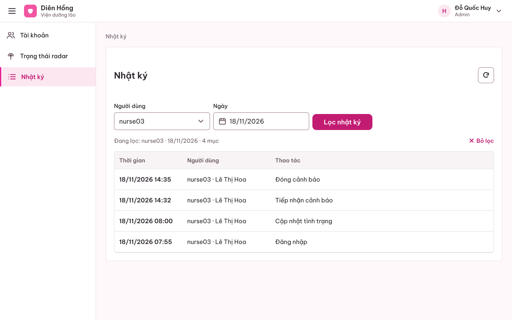
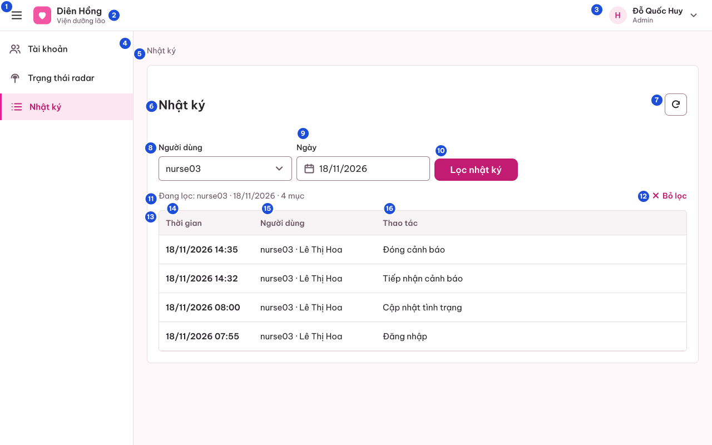
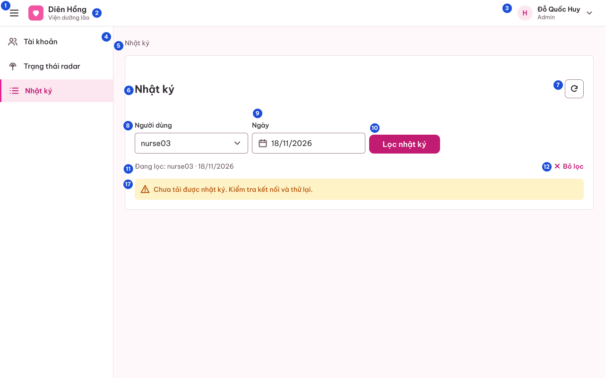
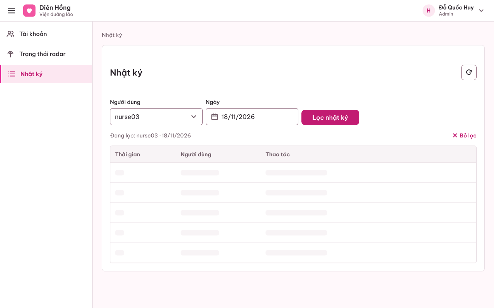
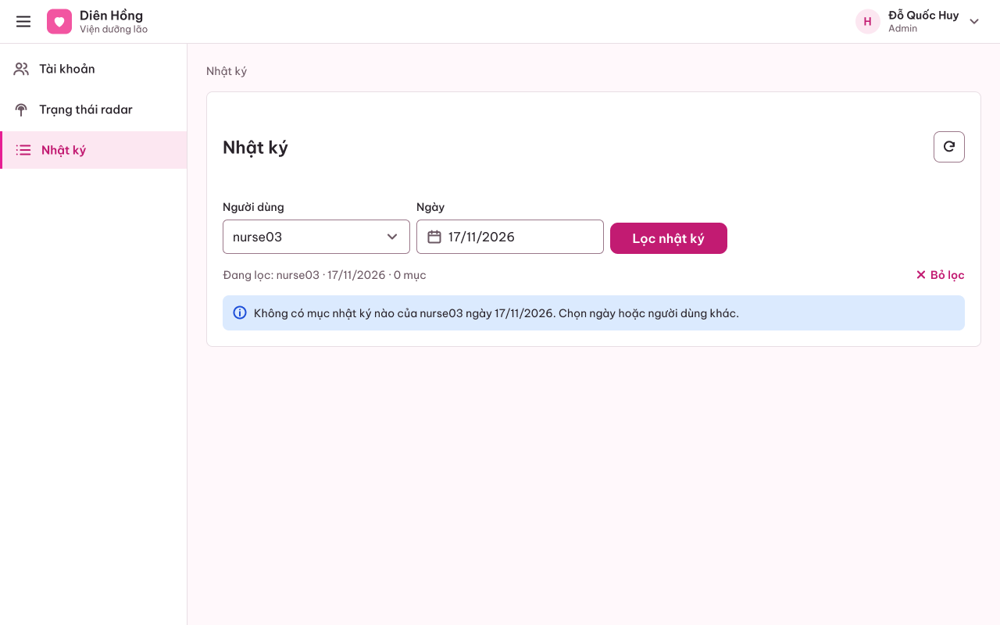

# Screen Spec: S-F06-05 Log list with filters (desktop)

| Field             | Value                                                                                     |
| ----------------- | ----------------------------------------------------------------------------------------- |
| Screen ID         | S-F06-05                                                                                  |
| Screen name       | Log list with filters (interface label: "Nhật ký")                                        |
| Actor             | Admin                                                                                     |
| Priority          | Could                                                                                     |
| Feature           | F-06 Administration                                                                       |
| Activity diagrams | none: UC-14 has no activity diagram (usage flow: "not needed"); the exchange is SD-UC-14  |
| Mockup images     | `img/S-F06-05-desktop.png` (default), two numbered images, three state images (section 2) |
| Frame width       | 1280px (exported at 1x)                                                                   |
| Figma frame       | not used (drawn as an HTML wireframe)                                       |
| Status            | Done                                                                                      |

## 1. Purpose

**Shown when:** the Admin clicks "Nhật ký" (Logs) in the sidebar menu, or "Xem nhật ký" (View logs) on S-F06-04.
The screen always opens with the user "Tất cả" (All) and today's date, whichever way it was reached.
The Admin lists the access and action entries, filtered by user and date, to trace misuse or a radar problem.

**The user leaves this screen when:** they open Accounts (S-F06-01) or Radar status (S-F06-04) from the sidebar menu, or sign out. Nothing is saved on this screen.

## 2. Mockup

**Numbered:** each number is the # of the element inventory in section 3. Elements 13 to 16 appear only when entries are shown, so they are numbered on the default image. Element 17 (Message area) appears only in the Empty and Error states, so it is numbered on the error image.

| Default, numbered | Error, numbered |
|---|---|
|  |  |

| Loading                                                       | Empty                                                     |
| ------------------------------------------------------------- | --------------------------------------------------------- |
|  |  |

| State   | Image                              |
| ------- | ---------------------------------- |
| Default | `img/S-F06-05-desktop.png`         |
| Empty   | `img/S-F06-05-desktop-empty.png`   |
| Loading | `img/S-F06-05-desktop-loading.png` |
| Error   | `img/S-F06-05-desktop-error.png`   |
| Success | Not applicable: this screen saves nothing    |

All colours, fonts and corners come from the design tokens in [ui-conventions.md](../ui-conventions.md#7-design-tokens), whose values live in [design-tokens.css](../design-tokens.css).

## 3. Element inventory

Labels are shown as they appear in the interface (Vietnamese), with the repository label in brackets.

| # | Element | Type | Content / data source | Required | Validation |
|---|---|---|---|---|---|
| 1 | Menu button | Icon button | static: accessible name "Thu gọn menu" (Collapse menu); "Mở menu" (Open menu) while the sidebar is collapsed | Yes | none |
| 2 | Brand | Image + text | static: logo mark on colour/brand-pink, "Diên Hồng", "Viện dưỡng lão" | Yes | |
| 3 | Account menu | Menu button | initial of the given name (the last word of `user.name`, "H" for "Đỗ Quốc Huy") on colour/pink-light; `user.name` and role name (`user.role`, "Admin") on two lines; item "Đăng xuất" (Sign out) | Yes | none |
| 4 | Sidebar menu | Navigation | "Tài khoản" (Accounts), "Trạng thái radar" (Radar status), "Nhật ký" (Logs, current) (ui-conventions 3.4) | Yes | |
| 5 | Breadcrumb | Text | static: "Nhật ký" | Yes | |
| 6 | Title | Header | static: "Nhật ký" (Logs) | Yes | |
| 7 | Reload | Icon button | static: reload icon, accessible name "Tải lại" (Reload); reads the log again with the applied filter | Yes | none |
| 8 | User filter | Dropdown | label "Người dùng" (User): "Tất cả" (All) + each `account.identifier` (User Account & Role), active and inactive accounts, A to Z; default "Tất cả" | Yes | one value |
| 9 | Date filter | Date field | label "Ngày" (Date); calendar icon; dd/MM/yyyy; default today | Yes | a valid date, not after today (later days are disabled in the picker; a typed date that is not valid goes back to the last applied date) |
| 10 | Filter logs | Primary button | label "Lọc nhật ký" (Filter logs); applies the user and the date | Yes | none |
| 11 | Applied filter | Text | "Đang lọc: " + user + " · " + date + " · n mục" (Filtered by … · n entries); user is `account.identifier` or "Tất cả"; the count n is shown only once the log is loaded, so it is missing in the Loading and Error states | Yes | |
| 12 | Clear filter | Link with icon | label "Bỏ lọc" (Clear filter), on the right of element 11 | Yes | none |
| 13 | Log table | Data table | one row per entry of the Access & Action Log that matches the applied filter, newest first; header row on colour/surface-secondary, rows at least 48px; a row is not a link (no entry has a detail screen) | Yes (Default state) | |
| 14 | Time | Column "Thời gian" | `log_entry.time`, dd/MM/yyyy HH:mm | Yes | |
| 15 | User | Column "Người dùng" | `log_entry.user_identifier` + " · " + the user's full name | Yes | |
| 16 | Action | Column "Thao tác" | `log_entry.action`; for an account or role change it names the account ("Vô hiệu hóa tài khoản nurse03", FR-06-08) | Yes | |
| 17 | Message area | Banner | Empty state: information banner (colour/info-bg, info icon); Error state: warning banner (colour/warning-bg, warning icon); messages of section 4 | No | Shown only in the Empty and Error states |

## 4. States

| State | What the user sees | Trigger |
|---|---|---|
| Default | The filters, the applied filter (11) with the count, "Bỏ lọc" and the table of the applied user and date, newest first. The mockup shows nurse03 on 18/11/2026: 14:35 "Đóng cảnh báo", 14:32 "Tiếp nhận cảnh báo", 08:00 "Cập nhật tình trạng", 07:55 "Đăng nhập". | The log is loaded and has at least one entry: after the screen is opened (all users, today), "Lọc nhật ký", "Bỏ lọc" or Reload |
| Empty (no data) | The filters, the line "Đang lọc: nurse03 · 17/11/2026 · 0 mục" with "Bỏ lọc", the information banner (17) and no table. Banner for one user: "Không có mục nhật ký nào của nurse03 ngày 17/11/2026. Chọn ngày hoặc người dùng khác." (No log entries for nurse03 on 17/11/2026. Choose another date or user.) (new). Banner for "Tất cả" (same position and style, not drawn): "Không có mục nhật ký nào ngày 17/11/2026. Chọn ngày khác."  | No entry matches the applied filter (SD-UC-14 "no entry matches the filter") |
| Loading | The filters stay; the line "Đang lọc: nurse03 · 18/11/2026" without the count and with "Bỏ lọc"; the table header "Thời gian, Người dùng, Thao tác" stays above five placeholder rows on colour/surface-secondary. No spinner. | The log is being read: screen opened, "Lọc nhật ký", "Bỏ lọc", Reload |
| Error | The filters and the line "Đang lọc: nurse03 · 18/11/2026" without the count stay; the warning banner (17) "Chưa tải được nhật ký. Kiểm tra kết nối và thử lại." (The logs cannot be loaded. Check your connection and try again.); no table; Reload (7) stays available to try again | The request failed (network or server) |
| Success / confirmation | Not applicable: this screen saves nothing; filtering only reads entries (SD-UC-14 ends with showing the filtered list) | – |

**Situations described in words, not drawn:**

- Access denied: when the API Server refuses a request because the role is not Admin, the user is sent to their home screen with the message "Bạn không có quyền dùng chức năng đó. Bạn đã được đưa về màn hình chính." (You do not have access to that function. You are back on your home screen.) (FR-06-03, SD-UC-14 `break`). The message is shown on the home screen, not in element 17.

## 5. Interactions and navigation

| #   | Element                                    | User action                             | System response                                                                                                                                                                     | Goes to screen |
| --- | ------------------------------------------ | --------------------------------------- | ----------------------------------------------------------------------------------------------------------------------------------------------------------------------------------- | -------------- |
| 1   | User filter (8), Date filter (9)           | choose a value                          | Shows the new value in the field; the table and element 11 change only when the filter is applied (row 2)                                                                           | stays          |
| 2   | Filter logs (10)                           | click, or press Enter in a filter field | Shows the Loading state, then the Default, Empty or Error state for the chosen user and date; element 11 shows the new filter (FR-06-12, SD-UC-14 "filter by user and date, apply") | stays          |
| 3   | Clear filter (12)                          | click                                   | Sets both fields and the applied filter back to "Tất cả" and today, then reads the log (Loading, then Default, Empty or Error)                                                      | stays          |
| 4   | Reload (7)                                 | click                                   | Reads the log again with the applied filter, not with values typed but not applied (Loading, then Default, Empty or Error)                                                          | stays          |
| 5   | "Tài khoản" in the sidebar menu (4)        | click                                   | Opens the account list                                                                                                                                                              | S-F06-01       |
| 6   | "Trạng thái radar" in the sidebar menu (4) | click                                   | Opens the radar status                                                                                                                                                              | S-F06-04       |
| 7   | Menu button (1)                            | click                                   | Collapses the sidebar to icons (64px), or opens it again                                                                                                                            | stays          |
| 8   | "Đăng xuất" in the account menu (3)        | click                                   | Ends the session                                                                                                                                                                    | S-F00-01       |

## 6. Screen-level rules

| Rule ID | Rule                                                                                                                                                                                                                                                        | Source                                       |
| ------- | ----------------------------------------------------------------------------------------------------------------------------------------------------------------------------------------------------------------------------------------------------------- | -------------------------------------------- |
| SR-001  | Only an Admin sees this screen. The API Server checks the role on every request, including each filter and each reload; hiding the menu item is never the only check. A refused request sends the user to their home screen with the access-denied message. | FR-06-03, BR-13, ADR-003, ui-conventions 3.4 |
| SR-002  | The filter applies only when "Lọc nhật ký" is clicked (or Enter is pressed), or when "Bỏ lọc" is clicked. Element 11 always shows the filter of the entries on screen, and Reload uses it.                                                                  | SD-UC-14, ui-conventions §4 (Filter bar)     |
| SR-003  | The table lists the entries of the applied user on the applied date, newest first. One date at a time, not a range. The list is not paged: every entry of the day is listed and the page scrolls.                                                           | FR-06-12, mockups                            |
| SR-004  | Each entry shows when it happened, who did it (user · full name) and what was done; account and role changes also name the account changed.                                                                                                                 | FR-06-12, FR-06-13, FR-06-08, SD-UC-14       |
| SR-005  | The user filter lists every account, active or inactive, so the entries of a deactivated account stay reachable.                                                                                                                                            | FR-06-12, FR-06-13                           |
| SR-006  | The screen is read-only: filtering and reloading change nothing, and the screen offers no edit or delete.                                                                                                                                                   | FR-06-12, FR-06-13                           |
| SR-007  | Dates are written dd/MM/yyyy, times HH:mm, date and time dd/MM/yyyy HH:mm.                                                                                                                                                                                  | ui-conventions §2                            |
| SR-008  | The empty result and the error are written as text with an icon; nothing is shown by colour alone. The error uses colour/warning, never colour/error (reserved for resident alerts).                                                                        | ui-conventions §4, §6, WCAG 2.2 1.4.1        |

## 7. Linked requirements

| FR ID | What this screen does for it |
|---|---|
| FR-06-12 | Lists access and action entries with filters by user and date |
| FR-06-13 | Shows the sign-ins and user actions recorded by the system |
| FR-06-08 | Shows the account and role changes recorded by the system |
| FR-06-03 | Refuses the screen to a role that may not see it |

## 8. Responsive and accessibility notes

- 768px and wider: sidebar 240px with labels, which the menu button (1) collapses to icons (64px); content padding 24px; card padding 20px; table text 15px (ui-conventions 3.1, 7.5). Below 768px the mobile layout applies.
- The filter bar wraps on a narrow window; when the window is narrower than the table, the table keeps its columns and scrolls sideways inside its card.
- Table headers are `<th scope="col">`; rows are at least 48px tall.
- Every filter field has a visible label; Enter in a filter field does the same as "Lọc nhật ký".
- The applied-filter line (11), the banner (17) and the end of Loading are announced when they appear; the table is marked busy while loading.
- Every control shows the 2px focus ring; the icon-only buttons (1, 7) have an accessible name.
- Text contrast is at least 4.5:1 on every background used here (ui-conventions 7.6).

## 9. Open questions

| #   | Question                              | Blocking? | Status                                                                                      |
| --- | ------------------------------------- | --------- | ------------------------------------------------------------------------------------------- |
| 1   | How is loading shown?                 | No        | Placeholder rows (table header kept, five rows) and the line without the count; no spinner. |
| 2   | How is a day with many entries shown? | No        | No paging in Release 1: all entries of the day are listed and the page scrolls.             |
| 3   | Date range instead of one day?        | No        | One day.                                                                                    |

## Completion checklist

- [x] The mockup is a separate cropped image file, named with the Screen ID, at the frame width.
- [x] The numbered images exist for default and error, and their numbers match the # column of the element inventory.
- [x] Every visible element in the mockup appears in the element inventory (the Empty banner is element 17).
- [x] Every colour in the mockup is a design token from ui-conventions.md.
- [x] Every input element has a validation rule or an explicit "none".
- [x] All five states are filled in (Success is "None", with the reason in section 4).
- [x] Every navigation target is a Screen ID that exists in the Screen List.
- [x] Every element that displays data names the field it displays.
- [x] Every linked FR exists in the Function List; UC-14 has no activity diagram, and the SD-UC-14 exchange is covered by interaction rows 2 and 3.
