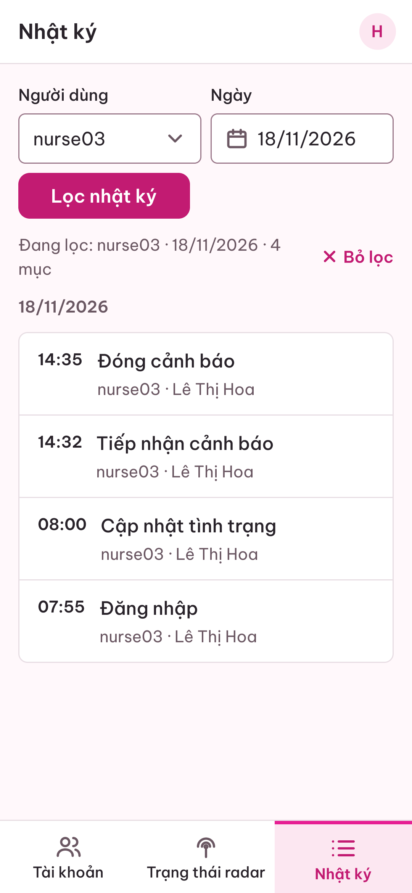
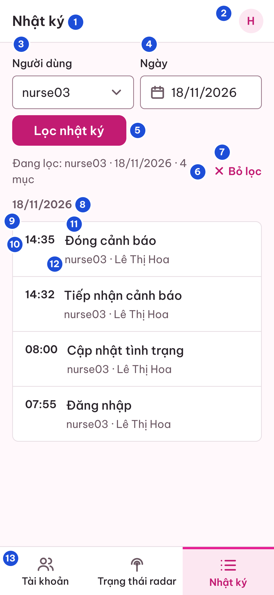
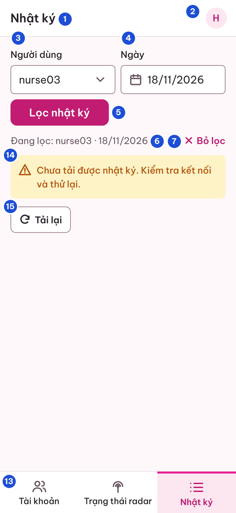
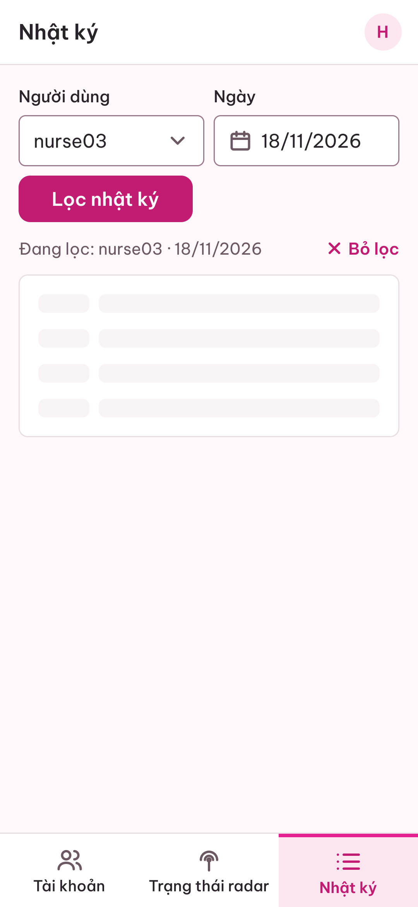
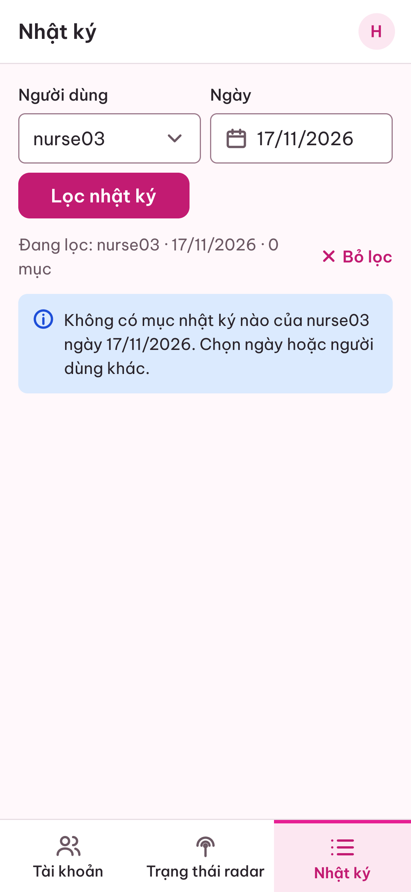

# Screen Spec: S-F06-05 Log list with filters (mobile)

| Field             | Value                                                                                    |
| ----------------- | ---------------------------------------------------------------------------------------- |
| Screen ID         | S-F06-05                                                                                 |
| Screen name       | Log list with filters (interface label: "Nhật ký")                                       |
| Actor             | Admin                                                                                    |
| Priority          | Could                                                                                    |
| Feature           | F-06 Administration                                                                      |
| Activity diagrams | none: UC-14 has no activity diagram (usage flow: "not needed"); the exchange is SD-UC-14 |
| Mockup images     | `img/S-F06-05-mobile.png` (default), two numbered images, three state images (section 2) |
| Frame width       | 360px (exported at 3x, 1080 pixels)                                                      |
| Figma frame       | page "BOD & Admin · Mobile 360", frame `S-F06-05-mobile`                 |
| Status            | Done                                                                                     |

## 1. Purpose

**Shown when:** the Admin taps "Nhật ký" (Logs) in the tab bar, or "Xem nhật ký" (View logs) on S-F06-04.
The screen always opens with the user "Tất cả" (All) and today's date, whichever way it was reached.
The Admin lists the access and action entries, filtered by user and date, to trace misuse or a radar problem.

**The user leaves this screen when:** they open Accounts (S-F06-01) or Radar status (S-F06-04) from the tab bar, or sign out. Nothing is saved on this screen.

## 2. Mockup

**Numbered:** each number is the # of the element inventory in section 3. Elements 8 to 12 appear only when entries are shown, so they are numbered on the default image. Elements 14 (Message area) and 15 (Reload) appear only in the Empty and Error states (15 only in Error), so they are numbered on the error image.

| Default, numbered                                             | Error, numbered                                                           |
| ------------------------------------------------------------- | ------------------------------------------------------------------------- |
|  |  |

| Loading                                                     | Empty                                                   |
| ----------------------------------------------------------- | ------------------------------------------------------- |
|  |  |

| State   | Image                             |
| ------- | --------------------------------- |
| Default | `img/S-F06-05-mobile.png`         |
| Empty   | `img/S-F06-05-mobile-empty.png`   |
| Loading | `img/S-F06-05-mobile-loading.png` |
| Error   | `img/S-F06-05-mobile-error.png`   |
| Success | Not applicable: this screen saves nothing   |

All colours, fonts and corners come from the design tokens in [ui-conventions.md](../ui-conventions.md#7-design-tokens), whose values live in [design-tokens.css](../design-tokens.css).

## 3. Element inventory

Labels are shown as they appear in the interface (Vietnamese), with the repository label in brackets.

| # | Element | Type | Content / data source | Required | Validation |
|---|---|---|---|---|---|
| 1 | Title | Header, app bar | static: "Nhật ký" (Logs) | Yes | |
| 2 | Account button | Icon button, app bar | initial of the given name (the last word of `user.name`, "H" for "Đỗ Quốc Huy") on colour/pink-light; opens a menu with `user.name`, role name (`user.role`, "Admin") and "Đăng xuất" (Sign out) | Yes | none |
| 3 | User filter | Dropdown | label "Người dùng" (User): "Tất cả" (All) + each `account.identifier` (User Account & Role), active and inactive accounts, A to Z; default "Tất cả" | Yes | one value |
| 4 | Date filter | Date field | label "Ngày" (Date); calendar icon; dd/MM/yyyy; default today | Yes | a valid date, not after today (the phone's date picker disables later days; a typed date that is not valid goes back to the last applied date) |
| 5 | Filter logs | Primary button | label "Lọc nhật ký" (Filter logs), under the two filters; applies the user and the date | Yes | none |
| 6 | Applied filter | Text | "Đang lọc: " + user + " · " + date + " · n mục" (Filtered by … · n entries); user is `account.identifier` or "Tất cả"; the count n is shown only once the log is loaded, so it is missing in the Loading and Error states | Yes | |
| 7 | Clear filter | Link with icon | label "Bỏ lọc" (Clear filter), on the right of element 6 | Yes | none |
| 8 | Date heading | Text | the applied date, dd/MM/yyyy | Yes (Default state) | |
| 9 | Log entries | List in a card | one row per entry of the Access & Action Log that matches the applied filter, newest first; a row is not a link (no entry has a detail screen) | Yes (Default state) | |
| 10 | Time | Text, first column of the entry | `log_entry.time`, HH:mm | Yes | |
| 11 | Action | Text, first line of the entry | `log_entry.action`; for an account or role change it names the account ("Vô hiệu hóa tài khoản nurse03", FR-06-08) | Yes | |
| 12 | User | Text, second line of the entry | `log_entry.user_identifier` + " · " + the user's full name | Yes | |
| 13 | Tab bar | Navigation | "Tài khoản" (Accounts), "Trạng thái radar" (Radar status), "Nhật ký" (Logs, current); icon and label on every tab (ui-conventions 3.4) | Yes | none |
| 14 | Message area | Banner | Empty state: information banner (colour/info-bg, info icon); Error state: warning banner (colour/warning-bg, warning icon); messages of section 4 | No | Shown only in the Empty and Error states |
| 15 | Reload | Secondary button | label "Tải lại" (Reload) with the reload icon, under element 14; reads the log again with the applied filter | Error state only | none |

## 4. States

| State | What the user sees | Trigger |
|---|---|---|
| Default | The filters, "Lọc nhật ký", the applied filter (6) with the count and "Bỏ lọc", the heading "18/11/2026" and the entries of the applied user and date, newest first. The mockup shows nurse03: 14:35 "Đóng cảnh báo", 14:32 "Tiếp nhận cảnh báo", 08:00 "Cập nhật tình trạng", 07:55 "Đăng nhập", each with "nurse03 · Lê Thị Hoa". | The log is loaded and has at least one entry: after the screen is opened (all users, today), "Lọc nhật ký", "Bỏ lọc" or "Tải lại" |
| Empty (no data) | The filters, the line "Đang lọc: nurse03 · 17/11/2026 · 0 mục" with "Bỏ lọc", the information banner (14) and no list, no date heading. Banner for one user: "Không có mục nhật ký nào của nurse03 ngày 17/11/2026. Chọn ngày hoặc người dùng khác." (No log entries for nurse03 on 17/11/2026. Choose another date or user.) (new). Banner for "Tất cả" (same position and style, not drawn): "Không có mục nhật ký nào ngày 17/11/2026. Chọn ngày khác."  | No entry matches the applied filter (SD-UC-14 "no entry matches the filter") |
| Loading | The filters stay; the line "Đang lọc: nurse03 · 18/11/2026" without the count and with "Bỏ lọc"; a card with four placeholder rows on colour/surface-secondary; no date heading. No spinner. | The log is being read: screen opened, "Lọc nhật ký", "Bỏ lọc", "Tải lại" |
| Error | The filters and the line "Đang lọc: nurse03 · 18/11/2026" without the count stay; the warning banner (14) "Chưa tải được nhật ký. Kiểm tra kết nối và thử lại." (The logs cannot be loaded. Check your connection and try again.) with the button "Tải lại" (15) under it; no list | The request failed (network or server) |
| Success / confirmation | Not applicable: this screen saves nothing; filtering only reads entries (SD-UC-14 ends with showing the filtered list) | – |

**Situations described in words, not drawn:**

- Access denied: when the API Server refuses a request because the role is not Admin, the user is sent to their home screen with the message "Bạn không có quyền dùng chức năng đó. Bạn đã được đưa về màn hình chính." (You do not have access to that function. You are back on your home screen.) (FR-06-03, SD-UC-14 `break`). The message is shown on the home screen, not in element 14.

## 5. Interactions and navigation

| # | Element | User action | System response | Goes to screen |
|---|---|---|---|---|
| 1 | User filter (3), Date filter (4) | choose a value | Shows the new value in the field; the list and element 6 change only when the filter is applied (row 2) | stays |
| 2 | Filter logs (5) | tap | Shows the Loading state, then the Default, Empty or Error state for the chosen user and date; element 6 shows the new filter (FR-06-12, SD-UC-14 "filter by user and date, apply") | stays |
| 3 | Clear filter (7) | tap | Sets both fields and the applied filter back to "Tất cả" and today, then reads the log (Loading, then Default, Empty or Error) | stays |
| 4 | Reload (15) in the error state | tap | Reads the log again with the applied filter, not with values chosen but not applied (Loading, then Default, Empty or Error) | stays |
| 5 | "Tài khoản" tab (13) | tap | Opens the account list | S-F06-01 |
| 6 | "Trạng thái radar" tab (13) | tap | Opens the radar status | S-F06-04 |
| 7 | "Đăng xuất" in the account menu opened by the account button (2) | tap | Ends the session | S-F00-01 |

## 6. Screen-level rules

| Rule ID | Rule | Source |
|---|---|---|
| SR-001 | Only an Admin sees this screen. The API Server checks the role on every request, including each filter and each reload; hiding the tab is never the only check. A refused request sends the user to their home screen with the access-denied message. | FR-06-03, BR-13, ADR-003, ui-conventions 3.4 |
| SR-002 | The filter applies only when "Lọc nhật ký" is tapped or "Bỏ lọc" is tapped. Element 6 always shows the filter of the entries on screen, and "Tải lại" uses it. | SD-UC-14, ui-conventions §4 (Filter bar) |
| SR-003 | The list shows the entries of the applied user on the applied date, newest first, under the heading of that date. One date at a time, not a range. The list is not paged: every entry of the day is listed and the screen scrolls. | FR-06-12, mockups |
| SR-004 | Each entry shows when it happened, who did it (user · full name) and what was done; account and role changes also name the account changed. | FR-06-12, FR-06-13, FR-06-08, SD-UC-14 |
| SR-005 | The user filter lists every account, active or inactive, so the entries of a deactivated account stay reachable. | FR-06-12, FR-06-13 |
| SR-006 | The screen is read-only: filtering and reloading change nothing, and the screen offers no edit or delete. | FR-06-12, FR-06-13 |
| SR-007 | Dates are written dd/MM/yyyy, times HH:mm. | ui-conventions §2 |
| SR-008 | The empty result and the error are written as text with an icon; nothing is shown by colour alone. The error uses colour/warning, never colour/error (reserved for resident alerts). | ui-conventions §4, §6, WCAG 2.2 1.4.1 |

## 7. Linked requirements

| FR ID | What this screen does for it |
|---|---|
| FR-06-12 | Lists access and action entries with filters by user and date |
| FR-06-13 | Shows the sign-ins and user actions recorded by the system |
| FR-06-08 | Shows the account and role changes recorded by the system |
| FR-06-03 | Refuses the screen to a role that may not see it |

## 8. Responsive and accessibility notes

- 360–767px: app bar 56px, screen padding 16px, card padding 16px, tab bar 64px (ui-conventions 3.1, 7.5). From 768px the desktop layout applies.
- The two filters sit side by side, "Lọc nhật ký" under them. The desktop table becomes a card of entries under the date heading: the time on the left, the action on the first line and the user on the second line.
- At 360px nothing scrolls sideways: a long action or name wraps to the next line.
- The date field opens the phone's own date picker, limited to today and earlier days.
- Every target is at least 44 × 44px; the tab bar shows an icon and a label on every tab.
- Every filter field has a visible label; the applied-filter line (6), the banner (14) and the end of Loading are announced when they appear.
- Text contrast is at least 4.5:1 on every background used here (ui-conventions 7.6); zoom stays allowed.

## 9. Open questions

| #   | Question                                                                    | Blocking?                                                                                                                                                                                 | Status                                                                                                        |
| --- | --------------------------------------------------------------------------- | ----------------------------------------------------------------------------------------------------------------------------------------------------------------------------------------- | ------------------------------------------------------------------------------------------------------------- |
| 1   | How is loading shown?                                                       | No                                                                                                                                                                                        | Placeholder rows (table header kept, five rows) and the line without the count; no spinner.                   |
| 2   | How is a day with many entries shown?                                       | No                                                                                                                                                                                        | No paging in Release 1: all entries of the day are listed and the page scrolls.                               |
| 3   | Date range instead of one day?                                              | No                                                                                                                                                                                        | One day.                                                                                                      |

## Completion checklist

- [x] The mockup is a separate cropped image file, named with the Screen ID, at the frame width.
- [x] The numbered images exist for default and error, and their numbers match the # column of the element inventory.
- [x] Every visible element in the mockup appears in the element inventory (the Empty banner is element 14).
- [x] Every colour in the mockup is a design token from ui-conventions.md.
- [x] Every input element has a validation rule or an explicit "none".
- [x] All five states are filled in (Success is "None", with the reason in section 4).
- [x] Every navigation target is a Screen ID that exists in the Screen List.
- [x] Every element that displays data names the field it displays.
- [x] Every linked FR exists in the Function List; UC-14 has no activity diagram, and the SD-UC-14 exchange is covered by interaction rows 2 and 3.
